<!-- Page head, written by tools/docs_assets.py: edit its PAGES table, then run it. -->

<a href="README.md">Model Router</a> &nbsp;&middot;&nbsp; <a href="docs/README.md">Documentation</a> &nbsp;&middot;&nbsp; Previous: <a href="docs/ROADMAP.md">Roadmap</a> &nbsp;&middot;&nbsp; Next: <a href="CONTRIBUTING.md">Contributing</a>

<!-- End of page head. -->

# Changelog

## 0.1.0 - 2026-11-23

First release. Reviewed against Claude Code 2.1.330 and the platform docs of 2026-11-23; the research is in `docs/research/model-control.md`. Tested live on Claude Code 2.1.330 on macOS, headless and in an interactive terminal in auto mode. Needs Claude Code 2.1.292 or later. Licensed under the Apache License 2.0, and an installed plugin carries the license text in its own folder.

### Routing every agent

- A mod, `hooks/router.ts`, routes every subagent, teammate and workflow stage at `agent.spawn`, using the parent's exact model, and sets each routed agent's effort on every request at `turn.step`. A `PreToolUse` rewrite of the `Agent` call is the fallback where mods don't load, and stands down when the mod runs.
- Built-in, project, user and plugin agents are all routed. An agent that names its own model keeps it and gets the subtask's effort when it sets none. Workflow stages and teammate roles without a definition file are routed too.
- Five levels, profiled from the brief and the agent's name: lookup on Haiku at `low`, standard on Sonnet at `medium`, complex on Sonnet at `high`, hardest on Opus at `high`, and frontier on Fable at `high`. Only research-grade wording (open-ended, no known approach, first principles and the like) reaches frontier.
- Briefs are profiled for risk, scope, ambiguity, reasoning and load: judgment verbs such as design and review, a decision to weigh, named systems, a load limit such as a per-second rate or a millisecond budget, and a negated limit that ends with its clause. A brief in another language starts at standard. A labeled corpus of 246 briefs checks the profiler.
- Redo escalation: a call Claude re-issues within the same request runs one level higher, and never at less effort than the run it replaces. A level whose routed calls keep being redone is raised for good. A clock that moves backwards can't make an old call look like a redo.
- A model named on an `Agent` call is the caller's choice: it is kept, and a re-issue of that call isn't treated as a redo.
- On Bedrock, Google Cloud's Agent Platform, Microsoft Foundry, Claude Platform on AWS and Claude Models on Google Cloud, where an alias runs an older model, routed work starts on that family's newest model and falls back to the alias if the provider refuses it. Setting `ANTHROPIC_DEFAULT_<FAMILY>_MODEL` keeps the alias.
- Under `CLAUDE_CODE_SUBAGENT_MODEL_FORCE` the router sets effort only, and the session-start note says what the force setting costs. `CLAUDE_CODE_SUBAGENT_MODEL`, `CLAUDE_CODE_EFFORT_LEVEL` and `CLAUDE_CODE_SUBAGENT_EFFORT` are respected.
- Availability tracking honors `availableModels` and `deniedModels` the way Claude Code applies them (a managed list, including `managed-settings.d` drop-in files, wins over the others; `deniedModels` is managed-only, and a denied version blocks only that version), and routes around models that fail, are substituted or are rejected on agent calls.
- A model registry with strength, speed and cost ranks and list prices, extendable from `~/.claude/model-router.json` and a project's `.claude/model-router.json`, prices included. A model a project adds can't take over a shipped model's IDs. A project's `.claude/model-router.json` may raise levels and effort as well as lower them, so a cloned repository can cost more, and `max_tier` still caps the model it gets. The registry and override files carry a `schema` version, with a written compatibility policy.

### Role agents and skills

- Seven role agents. The scout and verifier run on Haiku at `low` and the docs-researcher on Haiku at `medium`, also where the router isn't routing. The implementer, architect, reviewer and deep-solver name no model or effort, so the router routes each by its brief: the architect and reviewer start at complex, and `model-router:deep-solver` at hardest. Another plugin's solver starts no lower than complex, like the other heavy roles.
- Each description says when the agent is the right tool. The read-only agents say they write nothing, and the architect says it can't write files, so a task whose result is a file goes to an agent that can write it.
- Five skills: `ship`, `route`, `models`, `usage` and `refresh`. Skills pre-approve only the commands they run. `usage` and `models` take `--json`, with versioned schemas.

### The main conversation

- When a request needs more than the session's model, Claude is told to hand the hard thinking to the architect, or to the deep-solver for a frontier request, by name only. That hand-off starts no lower than the request's level, so a short brief can't put it below the request and a redo of it still escalates. A hand-off made while Claude handles a teammate's or another session's message routes on its brief.
- Two checks before a turn ends, each with its own option. `strong_agent_gate`, on by default, asks once for a stronger agent's check when a hard request was answered by a weaker session model alone. `verify_gate`, off by default, asks once for a test run after code in the project changed and nothing checked it; test runs inside subagents count, and it asks for a reviewer only on a risky or cross-module change.
- `main_effort`, off by default, raises the main conversation's effort for one turn when a request looks complex or harder, a pasted request or a hard skill typed as a slash command included. A skill that takes arguments is judged by them. It never lowers what you set, leaves the model alone, and is skipped wherever an effort change would re-read the context uncached, behind a Claude apps gateway included. Teammates' reports and other sessions' messages never raise it.

### Cost and visibility

- Every turn's tokens are priced at list price, one-hour cache writes and Haiku 5.5's prompts over 100K tokens at their own rates, the Mythos models included, and `/model-router:usage` shows spend by loop and model. Fast-mode requests are logged at standard rates. A version the price table doesn't list is reported as unpriced, never priced as its neighbour.
- The plugin adds 683 tokens to a Sonnet session's context, measured on a headless run ([PERFORMANCE.md](docs/PERFORMANCE.md)). Each hook starts Python once and leaves the network modules unloaded.
- Session start names a session model or alias that runs older than the newest active version of its family. A daily check reads the Claude Code changelog, docs index, model aliases and model deprecations page, plus the account's Models API list when an Anthropic API key is set, with a deadline per request, an overall budget and a backoff after a failure. Models that routed calls ran on and that are deprecated or retiring are reported at session start. A GitHub workflow runs the same check for the repository.
- Options: `routing_mode`, `priority`, `max_tier`, `agent_pins`, `main_effort`, `update_check`, `verify_gate` and `strong_agent_gate`.

### State

- State files carry a version and migrate. A file that fails to parse is set aside, a unique copy each time even within one clock tick, and only the three newest copies are kept. A file from a newer release is read but never written. `models --reset` says what it cleared.

### Measured

- Benchmarked at 10 runs per class and configuration on the routing code at `780ee86`, beside baselines on the same Claude Code version: on an Opus 5.5 session the router costs 21% less per solved task than Claude Code's defaults ($0.119 against $0.152, 80 of 80 solved each), outside the noise in 7 of 8 classes and level in design. On a Sonnet session it is cheaper only in lookup, and 13% dearer over all runs ([BENCHMARKS.md](docs/BENCHMARKS.md)).
- The benchmark harness can run a router variant with its own ladder and options (`router_config`, `plugin_options`) or from another commit (`plugin_ref`), keeps a run's scratch folder and transcripts with `--keep`, and records each task's revision on every row.
- Unit tests on Linux, macOS and Windows with Python 3.9 and 3.13, tests of the mod in Node, strict plugin validation in CI, and routing evals.

### Docs

- A README with diagrams, a FAQ, a glossary, a security assessment, hook latency, state-size and context measurements, and a project site in `site/`, which a workflow deploys to GitHub Pages from `main` once Pages is on for the repository. `tools/docs_assets.py` builds the diagrams, the benchmark chart, the page heads and the site's FAQ and structured data, and `--check` fails when any of them is stale.
