<!-- Page head, written by tools/docs_assets.py: edit PAGES in tools/docs_pages.py, then run it. -->
<p align="center"></p>

<p align="center"><a href="README.md">Model Router</a> &nbsp;&middot;&nbsp; <a href="docs/README.md">Documentation</a> &nbsp;&middot;&nbsp; Previous: <a href="CHANGELOG.md">Changelog</a> &nbsp;&middot;&nbsp; Next: <a href="RELEASING.md">Releasing</a></p>
<!-- End of page head. -->

# Contributing

## Where to work

Branch from `main` and work in a git worktree (`git worktree add ../<name> -b <name> main`), so the main checkout keeps its branch. Other work, and a maintainer's installed copy of the plugin, may read from that checkout. CI runs on pushes to `main` and on pull requests, so a branch is tested once it has an open PR.

## Repository layout

```text
plugins/model-router/
  .claude-plugin/plugin.json   manifest and options
  config/models.json           the model registry, levels, prices and role agents
  hooks/router.ts              the mod: tool.call, session.start, agent.spawn, prompt.submit, skill.prompt,
                               turn.start, turn.step, turn.complete
  hooks/hooks.json             the mod, plus SessionStart, UserPromptSubmit, PreToolUse,
                               PostToolUse, PostToolUseFailure, PostModelSwitch,
                               SubagentStop, Stop
  scripts/modelrouter/         the runtime: config, settings, registry, allowlist, health, profile, ladder, router, intake, request,
                               learn, gates, agents, spawn, calls, fallback, session, upstream, report, ledger, hooks, cli,
                               store (standard library only)
  agents/                      the seven role agents
  skills/                      ship, route, models, usage, refresh
  evals/                       routing evals
tests/                         unit tests, run on Linux, macOS and Windows
compat/baseline.json           the Claude Code version, docs index, model list and model status last reviewed
docs/research/                 the primary-source research the design rests on
docs/README.md                 index of the project's documents: traceability, readiness, roadmap, test results
docs/FAQ.md                    questions and answers
docs/GUIDE.md                  commands, options, precedence, limits and compatibility in full
docs/assets/                   logo, banners, badges and diagrams, and BRAND.md
tools/traceability.py          counts the requirement statuses in docs/TRACEABILITY.md
tools/docs_assets.py           writes the docs' SVGs, page heads, benchmark figures, the site's asset copies and CITATION.cff
tools/docs_pages.py            the index of docs pages and the head each one carries (docs_assets and bench/analyze use it)
docs/BENCHMARKS.md             cost and quality results against Claude Code without the plugin
bench/                         the benchmark: pinned tasks and their pass checks, configurations, runner and analysis (not shipped)
site/                          the project site, sitemap, robots.txt and llms.txt; a workflow deploys it to GitHub Pages from main once Pages is on
CITATION.cff                   how to cite the project
```

[docs/ARCHITECTURE.md](docs/ARCHITECTURE.md) describes the design and the reasons behind it. A daily GitHub workflow compares live Claude Code releases, docs, model aliases and model status with `compat/baseline.json` and opens an issue when something this plugin is built on changes.

## Gates

Every change passes these before it is merged:

```bash
python3 -m unittest discover -s tests
node --experimental-strip-types --test "tests/mod/*.test.ts"
claude plugin validate --strict .
claude plugin validate --strict plugins/model-router
python3 tools/traceability.py
sh tests/mod/typecheck.sh
python3 tools/docs_assets.py --check
python3 bench/analyze.py bench/results/*.jsonl --out docs/BENCHMARKS.md --check
```

`python3 bench/analyze.py ... --check` fails when `docs/BENCHMARKS.md` no longer matches the rows in `bench/results/`, or when a fact the docs' prose states about them (every run solved, a baseline cheaper in every class, no class PASS) is false now; rebuild the page by running it without `--check`, and fix the prose when a fact fails. `sh tests/mod/typecheck.sh` type-checks the mod and its test with `tsc` against Claude Code's published mod API types, pinned to a commit, with the tsconfig in `tests/mod`, outside the plugin folder; CI runs it too. To check against the types your installed Claude Code writes, see [docs/TEST_RESULTS.md](docs/TEST_RESULTS.md). The labeled corpora in `tests/fixtures` (Agent briefs, the user's requests, agent names) fail a change that moves a level, so a row changes only with its reason in the commit. A change to routing reruns `claude plugin eval plugins/model-router --trust-plugin`; it runs live models, so record what it cost. CI's `eval` job runs it on Claude Code 2.1.330 when started by hand from the Actions tab, with the repository's `ANTHROPIC_API_KEY` secret.

The routing evals also run free in CI. Each case under `plugins/model-router/evals` states its route in `expected_outcome` (`level L, model M, effort E`), and `RoutingEvals` in `tests/test_model_router.py` checks it against what `spawn.decide` gives for the brief the case hands a subagent, in a session on the case's own model, as part of the unittest gate above. To run only that check: `python3 -m unittest tests.test_model_router.RoutingEvals`. A change that moves a case's route on purpose updates its `expected_outcome` in the same commit.

## Rules for a change

- The runtime is Python 3.9 or later on the standard library only. Never add a dependency.
- The mod stays thin: it forwards events to the runtime and holds no routing rule of its own.
- Every hook fails open. A bug may cost routing, never a tool call, a spawn or a session.
- A claim about Claude Code or a model comes from the newest official docs (`code.claude.com/docs`, `platform.claude.com/docs`) or the installed binary, with the link. Anything without a primary source is marked UNCONFIRMED in `docs/research/` and nothing is built on it.
- A change updates every document it makes wrong, in the same commit. When it changes a requirement's status, update its row in [docs/TRACEABILITY.md](docs/TRACEABILITY.md), run `python3 tools/traceability.py`, and paste its output over the "Summary:" line. `tests/test_traceability.py` fails until they agree.
- A new module or concept gets a term in [GLOSSARY.md](GLOSSARY.md).
- Docs images, page heads, the site's asset copies and `CITATION.cff` come from `tools/docs_assets.py`. Change the script, run it, and keep `--check` passing. It also fills the benchmark figures marked `<!-- bench:KEY -->value<!-- /bench -->` in README.md, docs/FAQ.md, docs/TRACEABILITY.md and the site from `bench/analyze.py`'s summary, so a figure changes by rerunning analyze, never by hand. [docs/assets/BRAND.md](docs/assets/BRAND.md) has the palette and how to add a banner.
- A change to the shape of `config/models.json`, a `model-router.json` override, a state file, a `--json` output or a plugin option follows the policy in [docs/ARCHITECTURE.md](docs/ARCHITECTURE.md#compatibility): a breaking change bumps that shape's version and keeps the old one readable.
- Code comments explain a reason the code can't show, in a line. No ticket numbers, no history of the change.

## Commits

- One problem per commit, with its tests and docs.
- The subject is a plain sentence naming what changed: "Arm the unverified-edit gate only for files in the project". No type prefix.
- The body says what was wrong and why: the cause, then what the change does about it.
- No AI or tool attribution anywhere: no `Co-Authored-By` trailer for a tool, no "Generated with" footer, in commits, PRs or files.
- Never force-push `main`.

## License of contributions

Contributions are licensed under Apache-2.0, the same as the project (section 5 of the license). No CLA or sign-off is required.

## Releases

[RELEASING.md](RELEASING.md) is the checklist, worked in order. The version is set only in `plugins/model-router/.claude-plugin/plugin.json`; `python3 tools/docs_assets.py` copies it into the version badge, the site and `CITATION.cff`. The maintainer merges, tags and publishes.
