<!-- Page head, written by tools/docs_assets.py: edit PAGES in tools/docs_pages.py, then run it. -->

<a href="README.md">Model Router</a> &nbsp;&middot;&nbsp; <a href="docs/README.md">Documentation</a> &nbsp;&middot;&nbsp; Previous: <a href="docs/ARCHITECTURE.md">Architecture</a> &nbsp;&middot;&nbsp; Next: <a href="docs/research/model-control.md">Research</a>

<!-- End of page head. -->

# Glossary

The words this plugin's code, docs and reviews use for its own domain.

**Call**: one request to start an agent: a subagent, a teammate or a workflow stage. A call is known by its agent type and its prompt, so the same call issued twice is recognized.

**Spawn**: the moment a call starts an agent. The mod sees it as the engine's `agent.spawn` event, the fallback as a `PreToolUse` hook on the `Agent` tool.

**Path**: how a call reaches the router. The **mod path** runs in `hooks/router.ts` on engine events. The **fallback path** (`fallback.py`) rewrites the `Agent` tool call and stands down when the mod runs.

**Level**: how much reasoning a call needs: lookup, standard, complex, hardest or frontier. It comes from the call's brief and the agent's name. In code it is `config.Level`, a `str` that is written to state files and JSON as its bare name but orders by difficulty (a plain `str` sorts alphabetically), so levels compare and `max` works on them. `Level.up()` is the next one.

**Profile**: the step that turns a brief and an agent's name into a level, with the reasons for it (`profile.py`). `profile.read` gives the brief's Reading and `profile.level` scores it, as a call or as a request. A brief that fixes or hunts a defect is at least complex, and so is the person's request, where a hunt verb such as "analyze" counts only beside a defect word such as "bug" or "failing".

**Reading**: what a brief says, read once (`profile.Reading`): its signals, whether it asks for a change or for reasoning, whether it fixes or hunts a defect, frontier and thorough wording, whether it is phrased as a lookup, whether it is English, and its length. A negated limit such as "do not change any files" restricts the work and doesn't ask for it, so a call's reading leaves out what it says, except its risk words. A call and a request read the same way but are scored by their own rules: a call that asks for nothing is a lookup, a request with signals and no verb still scores, a request over 1,500 characters gains scope, and a call over 4,000 only lifts a lookup to standard.

**Role**: what an agent's name stands for (`profile.role`, from the `ROLES` table): a heavy role such as a reviewer or architect is raised to its floor (this plugin's own deep-solver to hardest), a light one such as a scout or verifier is held to standard. A role also says whether the agent is strong (it starts no lower than the request's level), a checker or read-only. A name counts by whole parts (`docs-researcher` is a search agent, `researcher` is not), and `docs` only before another part (`update-docs` is not a search agent).

**Signal**: one kind of difficulty a Reading looks for in a brief: risk (security, data and its consistency, migrations, public APIs), scope (several modules or services), load (performance, latency, throughput, staleness and capacity limits, counted only when the brief also asks for a design or a choice) or ambiguity (design, a decision between approaches, root cause, trade-offs). More signals mean a higher level.

**Registry**: the one value `config.load` builds per hook call or command from the shipped `config/models.json` and the user's and a project's override files, which every step reads (`registry.Registry`). It holds the models (each marked as the plugin's or the user's, or added by the project) with their relative strength, speed and cost, the levels with their `needs` and effort, aliases, list prices, the main-loop effort table, agent rules, and the keys it dropped or held back. Its methods say which models are usable and pick between them (`available`, `select`, `clamp`, `family`, `price`, `cost`). A level's `needs` is finite and never lower than the level below it.

**Override file**: `~/.claude/model-router.json` or a project's `.claude/model-router.json`, merged over the registry. The user's file is trusted in full. A project's only raises: it can turn routing down but never on, it can raise a level's `needs` or `effort` but never lower it below the shipped or the user's value, its rule for an agent is a floor (its `level`) or applies only when it isn't weaker than the router's pick (its `model`), and it can't switch routing off for an agent or change the rank of a shipped model or one the user defined. A key of the wrong type, such as a `needs` that isn't a finite number, is dropped from every file. What is dropped, and what a project asked for and was held back, is listed by `/model-router:models`. An override file is only read, never set aside.

**Agent rule**: what an override file says about one agent: a `model`, a `level` or `route: false` (`registry.Rule`). From the user's file it decides in full. From a project's file the `level` becomes a floor and the `model` a suggestion that applies only when it isn't weaker than the pick.

**Ladder**: the rule that turns a level, the priority and learned feedback into a model and an effort. When the model it lands on is weaker than the level needs, because a cap, the allowlist or model health left nothing at or above it, the pick gets one more effort step, at most `xhigh`, which makes up part of the loss. A pin, a caller's model or a rule that the cap lowers keeps the level's own effort.

**Pick**: the model and effort the ladder gives a call before anyone else's choice is applied.

**Decision**: the model and effort a call finally gets, with the reason (`router.py`). It applies an order of authority (force settings, a model named on the call, agent rules, the agent's pin, the subagent default, then the pick) and lowers the winner to the cap and to what is available.

**Session model**: the model the conversation itself runs on, which subagents inherit when nothing else decides (`session.py`). The mod reads it from the engine. The fallback reads it from the transcript, or from what SessionStart and PostModelSwitch recorded.

**Pin**: a model an agent's own definition names. A pinned agent keeps its model, and gets effort from its level when it names none.

**Cap**: the strongest model the user allows (`max_tier`). Every result is lowered to fit it, never raised.

**Priority**: what the ladder favors (`priority`). `balanced` takes the cheapest model strong enough for the level, `quality` goes one step stronger, and `fast` goes one step lighter and takes the quickest model that qualifies.

**Routing mode**: `auto` sets each call's model and effort, `advise` only tells Claude the estimate, and `off` does nothing (`routing_mode`). When the option and the override files disagree, the most cautious one wins.

**Allowlist** (`allowlist.py`): the `availableModels` and `deniedModels` settings, read the way Claude Code reads them, from the layers the mod sends or from the settings files. Models they block are not picked. When they leave no registry model open, the call is left as it is. The same layers carry `maxEffortLevel`, the cap every effort the router sets is held to.

**Model health** (`health.py`): what the router has seen of each model here. Two calls that fail with a model error, run as a different model or are rejected route the model around for a day, then three days, then a week, after which it is tried again. A call that runs as asked clears the record. Reading the table writes nothing; an outage a read finds too long for the clock is shortened in memory and written by the next spawn.

**Snapshot** (`settings.Snapshot`): the registry, options, usable models, health, allowlist and learned raises a hook call reads once and passes to every step, and the ladder's `pick(level)` bound to them, so no step re-reads a file another step already read. The last three load on first use. A read writes nothing, so a dry run leaves the state as it was; a spawn writes what reads only noticed (`Snapshot.settle`).

**Main-loop effort**: the effort of the conversation's own turn. The mod raises it for one turn when the request profiles as complex or harder, never lowers it, and leaves it alone wherever an effort change would re-read the context uncached. A `maxEffortLevel` cap holds it too.

**Fork**: an agent that starts from its parent's conversation. It runs on its parent's model and reads its parent's cache, so the router leaves it alone. A skill with `context: fork` is not a fork, despite the name ([skills](https://code.claude.com/docs/en/skills.md#run-skills-in-a-subagent)). It starts a new subagent of its `agent` type without an `agent.spawn` event, so it isn't routed either, and its model comes from the skill's `model` field, else from its agent type and the session.

**Redo**: the same call issued again in the same request after its result came back. A redo runs one level higher and counts as a vote that its first level was too low. When `maxEffortLevel` holds it at the model and effort of the run it repeats, it takes the next stronger usable model instead. A run that swapped models never finishes a call, so issuing it again is no redo.

**Model swap**: a run whose model changed mid-run, reported as `modelsUsed` on the `Agent` result ([hooks](https://code.claude.com/docs/en/hooks.md)). A content-classifier fallback causes it: Sonnet 5.5 to Sonnet 5, Opus 5.5 and Fable to Opus 4.8 or Opus 5 ([model config](https://code.claude.com/docs/en/model-config.md), "Automatic model fallback"). Sonnet 5 scored 10.3% against 70.6% on Terminal-Bench 4.0 ([announcement](https://www.anthropic.com/news/claude-sonnet-5-5)). A swapped run is no health evidence, no redo and no count for its level.

**Vote**: evidence that a level was routed too low: a redo, or Claude naming a stronger model than the pick. Enough votes raise the level one step, and a raise that keeps being overruled with a weaker model is undone the same way.

**Intake**: the step that decides whether a prompt or a turn is the person's request and at what level (`intake.py`). A teammate's report, another session's message and a background notification are not. A typed skill is read from its arguments and its body, which the settings hook reads from the skill's file: under `.claude` for a project or user skill, in the plugin's install folder for a plugin's (this plugin's own, or one named in Claude Code's install record). A plugin's skill whose file isn't found is read from its arguments alone.

**Request**: one prompt from the user and the turns it starts. Redos count only within one request. Its record is kept by `request.py`. Its level is set by the settings hook's `UserPromptSubmit` reading, which starts it, and the mod's `turn.start` reading of a typed command's rendered body, which can only raise it: never lower it, start one or raise from a turn that isn't the person's, and only when the turn is a typed command, since plain turn text may carry other hooks' context. The level drives the strong-agent floor, the hand-off note and the Stop check, whatever the `main_effort` option says. `Request.below` says whether the session's model is weaker than the request needs.

**Ledger** (`ledger.py`): the append-only log of every spawn, result, turn effort and turn's spend, with the reason for each decision. A result row names the models of a swapped run in `models_used`.

**Spend** (`ledger.py`): a request's tokens priced at list price from the registry, summed per turn. A model with no price is counted as unpriced, never priced as its neighbour.

**Gate**: a check before a turn ends (`gates.py`). One asks for a test run when code in the project changed and nothing checked it. The other asks for a stronger agent's review when a weak session model answered a hard request alone. Each asks once and then lets go. Both are on by default; `verify_gate` and `strong_agent_gate` set to `false` turn them off.

**Schema**: the version number written into every state file and allowed in override files. An older file is upgraded as it is read and saved at the current version on its next write. A file from a newer release is read but never overwritten.

**Set aside**: what happens to a state file that can't be read. It is renamed with a `.corrupt-` suffix and a timestamp, routing carries on with that state empty, and `/model-router:models` lists it. Only the three newest copies of each file are kept.

**Skipped write**: a state write a hook drops because another process held the file's lock past one second. Writing without the lock could drop that process's update, so the hook loses its own one update instead. Skipped writes, lock waits and stale locks broken are counted per file in `locks.json` and shown by `/model-router:models`.

**Upstream**: the public feeds the plugin compares against what was last reviewed: Claude Code releases, the docs index, model aliases and model status.

**Baseline**: a way of running Claude Code without the router that the benchmark compares it against, such as Claude Code's defaults or every subagent forced onto one model. The docs' figures name each by the part it plays, not by its id: the router is `router`, and the baselines are `defaults` (no plugin, no forced model), `best` (the lowest cost per solved task over all runs) and `strongest` (the strongest forced one), besides each baseline's own id.

**Pass check**: a benchmark task's script that decides, from the files and the answer a run left, whether the task was solved. It has three outcomes: solved (exit 0), not solved (exit 1) and broken (exit 2, the check itself failed). `run.grade` gives the verdict with a reason, the last line the check printed, and a hash of the check's code, and each row keeps all three under `grade`, so a row says which version of the check judged it.

**Cost per solved task**: a configuration's total spend on a set of runs divided by the runs whose pass check passed. It is the benchmark's measure of cost. A failed run counts against it. A broken run and a run on an earlier task revision are left out of the spend and the count.

**Pilot**: a benchmark run with too few runs per cell (under 10) to tell a difference from noise, or whose cells cover different tasks or counts. Every row it produces is PARTIAL, and it supports no claim beyond its raw data. The quality-tier pilot, 3 runs per cell, is kept under `bench/results/pilot/` and the page's tables leave it out.

**Saturated**: a task class where the weakest forced baseline (every subagent on the lowest model) can't be told from the strongest by an exact one-sided test at 5%. Its tasks can't tell models apart, so the benchmark makes no quality claim for or against the router there, and a PASS or FAIL on that class is a cost result only.

**Quality verdict**: what a class's pass rates say about the router's quality, apart from its cost verdict. The router's rate is tested against every baseline that has 10 runs, with an exact one-sided test at 5% adjusted across the baselines (Holm): `BEHIND` when a baseline solved more beyond noise, `NOT SHOWN BEHIND` when none did. The second is not parity, since 10 runs per cell can't show a tie. The verdict is withheld ("no claim") for a saturated class, one with too few runs or cells that differ, and one whose forced baselines cover fewer than two models.

**Known answers**: the right and wrong answers kept beside a task's pass check, as `wrong/<name>/` and `right/<name>/` overlays on `repo/` and `solution/`, or a `wrong_answer` for a reply. One test asserts that the check fails on `repo/` as shipped, passes every right answer and fails every wrong one, each as a verdict of the check and never as a broken one.

**Task revision**: the number in a task's `task.json`, raised with a line under `revisions` saying why when a change to the task could change a run's outcome. Every row records the revision it ran on. Rows on an earlier one are left out of every table, and the page counts them in a note.

**Broken run**: a benchmark run whose pass check exited 2, so it was neither solved nor failed. It stays in its results file with the check's error in `grade`, is left out of every table, and the page counts it in a note.

**Prose fact**: a yes/no claim the docs' prose makes about the benchmark rows, such as every run solved or a baseline cheaper in every class. `bench/analyze.py` computes each from the rows (`PROSE`, `FACT_TEXT`), and `--check` fails when one is false.
