# Claude Code Model Router: the right Claude model for every subagent

<p align="center">
  <picture>
    <source media="(max-width: 600px)" srcset="docs/assets/hero-phone.svg">
    
  </picture>
</p>

<p align="center">
  <a href="CHANGELOG.md"></a>
  <a href="#install-the-claude-code-plugin"></a>
  <a href="#install-the-claude-code-plugin"></a>
  <a href="CONTRIBUTING.md#rules-for-a-change"></a>
  <a href="LICENSE"></a>
</p>

<p align="center">
  <a href="#install-the-claude-code-plugin"><b>Install</b></a> &nbsp;&middot;&nbsp;
  <a href="#quick-start"><b>Quick start</b></a> &nbsp;&middot;&nbsp;
  <a href="#how-it-works-picking-a-subagent-model"><b>How it works</b></a> &nbsp;&middot;&nbsp;
  <a href="#configuration"><b>Options</b></a> &nbsp;&middot;&nbsp;
  <a href="#does-it-reduce-claude-code-cost-the-measured-result"><b>Results</b></a> &nbsp;&middot;&nbsp;
  <a href="docs/FAQ.md"><b>Questions</b></a> &nbsp;&middot;&nbsp;
  <a href="docs/README.md"><b>Docs</b></a>
</p>

**Model Router (`model-router`) is a Claude Code plugin that sets the model and reasoning effort of every agent Claude Code starts, choosing the cheapest Claude model that should do the job and moving a call one level up when its work comes back for a redo.** It covers subagents from any plugin, skill or agent, agent-team teammates and workflow stages, and you never pick a model by hand ([how it works](docs/ARCHITECTURE.md)).

It is autonomous multi-model orchestration for Claude Code. Whenever something in your session starts a subagent, a teammate or a workflow agent, the plugin sets the Claude model and reasoning effort that fit the work: Haiku for lookups, Sonnet at medium effort for everyday implementation, Sonnet at high for design, review and risky changes, Opus for the hardest work, Fable for research-grade problems. With the `main_effort` option on, it also raises the main conversation's effort for a hard request.

The goal is the lowest cost per finished task at a high quality bar. Each subtask starts on the cheapest model and effort that should do it, and moves up only when the work comes back for a redo.

## What it does

- Sets the model and effort of every subagent, teammate and workflow agent as it starts, whichever agent, skill or plugin starts it. The agent the caller chose stays the same.
- With the `main_effort` option on (it's off by default), raises the main conversation's effort for one turn when the request looks complex or harder. It never lowers what you set, and it leaves the model alone, so the prompt cache is kept.
- Escalates on a redo. When Claude re-issues a call that already came back, that call runs one level higher on the ladder: a stronger model, or more effort when it stays on the same model.
- Treats models as data. A registry ranks each model by strength, speed and cost, and the router works out which of them your setup can use from your settings, from the model each agent ran on, and from failures.
- Logs what each turn cost at list price, main conversation and subagents apart, in `/model-router:usage`.
- Leans toward quality, speed or cost with one `priority` option, and caps the strongest model allowed with another.
- Asks for a stronger model's check when a hard request was answered by a weak session model alone, and, with the `verify_gate` option on (it's off by default), for a test run after code changes.
- Checks the official changelog, docs index, model aliases and model deprecations once a day, plus your account's model list when an Anthropic API key is set, and reports releases, docs changes, new models and models it routes to that are retiring.

## Install the Claude Code plugin

In Claude Code:

```text
/plugin install model-router --marketplace crisnahine/claude-code-model-router
```

On versions without the one-step form, add the marketplace first:

```text
/plugin marketplace add crisnahine/claude-code-model-router
/plugin install model-router@claude-code-model-router
```

The plugin's own name is `model-router`, so its commands start with `/model-router:`.

Requirements: Claude Code 2.1.292 or later, `sh`, and Python 3.9 or later as `python3` or `python` on your `PATH`. Without Python the plugin stays out of the way: its hooks do nothing and its skills say why. The daily update check needs network access to `code.claude.com` and `platform.claude.com`, and with an Anthropic API key set, `api.anthropic.com` for your account's model list.

To try it from a clone without installing, run `claude --plugin-dir ./plugins/model-router`.

There is nothing to configure. Claude model routing is on from the first session.

## Quick start

1. Install the plugin as above and start a new session.
2. Work as you always do. Every agent call is routed as it starts. To see what a task would get before you run it, ask `/model-router:route <task>`: it names the level, model and effort, and why.
3. After some work, `/model-router:usage` shows what ran where and what it cost at list price, and `/model-router:models` shows the models in use and anything capped, unavailable or learned.

To change how it routes, open `/config` and find the plugin's options ([Configuration](#configuration)).

## How it works: picking a subagent model


The plugin has two parts. A mod (a hooks module, `hooks/router.ts`) hooks Claude Code's own events: `agent.spawn` for every subagent, teammate and workflow agent, `turn.step` for effort on each model request, and `turn.start` and `turn.complete` for the main conversation and the spend log. Settings hooks (`hooks/hooks.json`) do the rest: the checks before a turn ends, availability tracking, and routing through the `Agent` tool call when mods aren't available. Both call the same Python runtime, so one router decides everything.

### 1. Profile the subtask

Each subtask is scored from its own brief. The profile looks for risk (security, data and its consistency, migrations, public APIs), scope (several modules or services), load (performance, latency, throughput, staleness and capacity limits, counted only when the brief also asks for a design or a choice) and ambiguity (design, a decision between approaches, root cause, trade-offs). It also checks whether the subtask changes or reasons about something or only reads, and what the agent's name says the agent is for: a reviewer or an architect needs more than a search agent. The result is one of five levels.

| Level | Typical subtask | Model (balanced) | Effort |
| :- | :- | :- | :- |
| lookup | Find, list, summarize, run a command | Haiku | low |
| standard | Implement to a clear spec, write tests | Sonnet | medium |
| complex | Design, review, risky or cross-module change | Sonnet | high |
| hardest | Ambiguous, multi-system and risky at once | Opus | high |
| frontier | All of that, with no known approach: research, open-ended investigation | Fable | high |


The ladder starts cheap and relies on redo escalation to catch what falls short, the policy Anthropic measured as cheapest for a high pass rate. In this repository's benchmark the earlier, stronger ladder (standard at `high`, complex on Opus) cost 1.2 to 2.2 times as much per solved task as Claude Code's defaults on 7 of 8 task classes, at the same pass rate, on a Sonnet session (raw data in [bench/results/archive/early-builds](bench/results/archive/early-builds/)). So standard work runs Sonnet at `medium`, Claude Code's own default for it, and complex work Sonnet at `high`. Opus 5.5 at `high` came within a point of Fable 5.2 at `high` on coding (95.5% against 96.3%) for under a quarter of the cost, so the hardest work runs on Opus and Fable is kept for research-grade work.

### 2. Select a model

The registry in `config/models.json` gives each model a relative strength, speed and cost. With `balanced` priority the router picks the cheapest model strong enough for the level. `quality` goes one step stronger. `fast` goes one step lighter and takes the quickest model that qualifies. The choice is limited to models inside your cap, permitted by your `availableModels` and `deniedModels` settings, and known to work.

### 3. Write it on the spawn

The mod sets the model on the agent as it starts and sets its effort on each of its model requests. On setups without mods, the `PreToolUse` hook returns the `Agent` call with `model` and `effort` set instead. If the agent would run on that model and effort anyway, nothing is changed.

The plugin never approves a tool call. Your permission rules and auto mode review every spawn exactly as they would without it.

### 4. Escalate and learn


A call Claude re-issues after its result came back runs one level higher. That is the cheapest policy Anthropic measured for a high pass rate: start low and re-run what fails at a higher setting. That beat starting every task high on both cost and pass rate. Each redo also counts as a vote that the level was routed too low. At least 6 votes that are also at least 30% of the level's calls raise it one step, and a raise that keeps being overruled with a weaker model is undone the same way. Copies of one brief started together are not redos, and a background agent's call counts as finished when the agent stops.

The model each agent ran on is recorded. A model is routed around for a day, and then retried, after two calls on it fail with a model error, run as a different model, or are rejected by the `Agent` tool. If the trouble comes back, the wait grows to three days and then a week. `/model-router:models` shows all of this and can reset it.

### Who decides the model


In order, strongest first:

1. `CLAUDE_CODE_SUBAGENT_MODEL_FORCE` in your environment. Every subagent's model is pinned, so the router sets only effort. The session-start note says so once, because a pinned strong model costs far more on lookups: in a live test, listing a directory on a forced Opus subagent cost about 30 times what the same subagent cost on Haiku ($0.39 against $0.012).
2. A model named on the call itself, by Claude, a skill's instructions or a workflow script. If you ask for a model in your prompt ("use opus for this"), Claude is reminded to pass it on the calls for that request.
3. A per-agent rule in your `~/.claude/model-router.json` or the project's `.claude/model-router.json`.
4. The agent's own `model` field, unless you set `agent_pins` to `override`. Its effort still follows the subtask when the agent sets none.
5. `CLAUDE_CODE_SUBAGENT_MODEL`, your default for agents without a model.
6. The router's pick.

Under steps 1 and 5 your environment has decided, so the model is left as it is: with `CLAUDE_CODE_SUBAGENT_MODEL_FORCE` the router sets only effort, and with `CLAUDE_CODE_SUBAGENT_MODEL` it leaves the call alone, unless `agent_pins` is `override`. Under steps 2, 3, 4 and 6, whatever wins then has to be usable: inside your cap, allowed by your settings and known to work. If it isn't, the strongest usable model below it runs, or the weakest usable one when none is below it. Effort is left alone when the call, the agent, `CLAUDE_CODE_EFFORT_LEVEL` or `CLAUDE_CODE_SUBAGENT_EFFORT` already sets it.

### The checks before a turn ends


Before Claude ends a turn, the `Stop` hook runs two checks. Each asks once, then lets the turn end.

With `strong_agent_gate` on, its default, a complex or harder request that a weaker session model answered alone, with no agent of the needed strength started, gets one blocked stop and a request for a stronger agent's check: the architect, or the deep-solver for a frontier request. That agent starts no lower than the request's level, so a short hand-off brief can't route it lower, and a redo of it still climbs.

With `verify_gate` on (off by default), Claude is asked once for a test run when code in the project changed and no test, lint, type-check or build ran after the last edit, and no verifier or reviewer was started. A test run inside a subagent counts.

## Does it reduce Claude Code cost? The measured result

<p align="center">
  <picture>
    <source media="(max-width: 600px)" srcset="docs/assets/benchmark-phone.svg">
    
  </picture>
</p>

On an Opus 5.5 session, the default model for every account type but Microsoft Foundry (https://code.claude.com/docs/en/model-config.md), the router cost less per solved task than Claude Code's defaults in 7 of 8 task classes, with all 80 runs solved for both. All 7 differences are outside the noise, so PASS: lookup 36% less, implementation 32%, research 27%, bugfix 23%, cross-module 22%, root cause 19% and security review 18%. Design is level, $0.189 against $0.188, so PARTIAL. Over all 80 runs it cost $0.119 per solved task against $0.152.

On a Sonnet session the router is behind. It is cheapest only in lookup (24% less than the defaults, PASS), and in the other 7 classes it costs more per solved task than the best baseline at the same pass rate, from 7% more in implementation and root cause to 63% more in design (FAIL). It runs the same model there, but writes more cache tokens per run, runs security review and half the cross-module tasks at `high` effort, and sent 4 of 10 design tasks to the read-only architect, which then needed an implementer on Opus to write the file. Complex subtasks stay on Sonnet at `high` effort as a quality margin; the next step is a harder task set and the `fast` priority ([roadmap](docs/ROADMAP.md)).

Both sessions ran the routing code at commit `780ee86`, which differs from this release in its license, a state-file fix and the architect's description, 10 runs per class and configuration, beside baselines run with commit `27b94e6` on the same Claude Code version and tasks. Against the router at `27b94e6` it cost 2% less per solved task on Opus and 8% less on Sonnet, both inside the noise; research fell most, since only research-grade wording now reaches Fable. [BENCHMARKS.md](docs/BENCHMARKS.md) has every table, the raw data and the commands to rerun it.

## Role agents and `/model-router:ship`

The plugin ships seven agents for work that no better-fitting agent covers: `model-router:scout`, `verifier`, `docs-researcher`, `implementer`, `architect`, `reviewer` and `deep-solver`. The scout and verifier run on Haiku at low effort and the docs-researcher on Haiku at medium, from their own definitions, so they stay cheap even when the router isn't routing: with `routing_mode` at `advise` or `off`, without Python, or with hooks turned off. The other four name no model or effort, so the router routes each by its brief like any other agent; the architect and reviewer start no lower than complex because of their names, and the deep-solver's name floors it at hardest, so a frontier brief can still take it to the strongest model. When the router isn't routing, those four run on `CLAUDE_CODE_SUBAGENT_MODEL` if it's set, else on the conversation's own model, as any agent without a model does (https://code.claude.com/docs/en/sub-agents.md#choose-a-model). Their descriptions say when each is the right tool, such as the reviewer for a risky or cross-module diff, rather than a step to run on every change, since Claude decides when to delegate from those descriptions (https://code.claude.com/docs/en/sub-agents.md). The architect, reviewer, scout, verifier and docs-researcher have no tool that writes files, and their descriptions say so, so Claude doesn't give one of them a task whose result is a file.

`/model-router:ship <task or issue>` runs a full loop with them: understand, plan, build, verify, review, fix, and commit on a branch. It stops before pushing, merging or deploying.

## Commands

| Command | What it does |
| :- | :- |
| `/model-router:ship <task>` | Plans, builds, verifies and reviews a change end to end |
| `/model-router:route <task>` | Explains which model a task would get and why, and how to split it |
| `/model-router:models [reset] [--json]` | Lists the models in use, what each runs as, what is capped or unavailable, and what was learned. `reset` clears it |
| `/model-router:usage [days] [--json]` | Shows what ran where, and what it cost at list price: agents, levels, models, tokens and dollars |
| `/model-router:refresh` | Reviews new Claude Code releases, docs changes, model changes and retirements |

With `--json`, `models` and `usage` print one JSON object instead of the tables. Its `schema` key names the shape and its version, `model-router.models/1` and `model-router.usage/1`. A new key keeps the version; a key removed, renamed or changed in meaning bumps it. Scripts can run the same commands without Claude: `sh <plugin>/scripts/model-router.sh --data-dir <plugin data dir> usage 30 --json`. The shapes are in [docs/ARCHITECTURE.md](docs/ARCHITECTURE.md#machine-readable-output).

## Configuration

Options, in `/config` under the plugin:

| Option | Default | Meaning |
| :- | :- | :- |
| `routing_mode` | `auto` | `auto` sets model and effort on every agent. `advise` only tells Claude the estimate. `off` does nothing but keep the ledger |
| `priority` | `balanced` | `balanced`, `quality` or `fast` |
| `max_tier` | none | The strongest model subagents may run on. Anything stronger is lowered to it |
| `agent_pins` | `respect` | `respect` keeps the model an agent names for itself. `override` routes those agents by task too |
| `main_effort` | off | When on, raises the main conversation's effort for a complex or harder request, for that turn. Off where an effort change would re-read the context uncached: Bedrock, Vertex, Foundry, `ANTHROPIC_BASE_URL`, a Claude apps gateway or another third-party provider, `CLAUDE_CODE_DISABLE_EXPERIMENTAL_BETAS`, and models other than Fable 5.1+, Opus 5.5, Sonnet 5.5 and Haiku 5.5. Leave it off in a HIPAA organization, which the router doesn't detect, or if Claude Desktop reaches Claude through a Claude apps gateway, which it can't tell from a subscription there |
| `update_check` | on | The daily check of the changelog, docs index, model list and deprecations |
| `verify_gate` | off | Asks for a test run before a turn ends when code changed and nothing checked it. It adds turns and often an agent, so it's off unless you want a check before every finish |
| `strong_agent_gate` | on | Asks for a stronger agent's check before a turn ends when a weak session model answered a hard request alone. It rarely fires on a strong session model |

Rules and extra models go in a JSON file. `~/.claude/model-router.json` is yours and applies everywhere. `.claude/model-router.json` belongs to a project. Both have the same shape:

```json
{
  "routing_mode": "advise",
  "agents": {
    "general-purpose": { "level": "standard" },
    "my-agent": { "model": "opus" },
    "legacy-agent": { "route": false }
  },
  "levels": { "complex": { "effort": "xhigh" } },
  "models": { "newmodel": { "strength": 3.5, "speed": 2, "cost": 3.5 } }
}
```

Your own file is trusted in full. A project's file can turn routing down to `advise` or `off`, set rules for agents and add models. It can't turn routing on for someone who switched it off, re-rank a model that ships with the plugin or that you defined, or get any model past your cap.

A file may carry `"schema": 1`, the version of this shape; without it, it is read as version 1. A file written for a newer release still loads: the settings this release understands apply, and `/model-router:models` names the file. Older shapes keep working after an update ([docs/ARCHITECTURE.md](docs/ARCHITECTURE.md#compatibility)).

## What it can't do

These limits come from what Claude Code lets a plugin do, or from choices made to protect quality and cost.

- It doesn't switch the main conversation's model. A mod could, but each model keeps its own prompt cache, so a switch re-reads the whole conversation uncached. It changes the main conversation's effort instead, which keeps the cache on current models, and when a request looks harder than the session's model, Claude is told to hand the hard thinking to a strong subagent, and is asked once before finishing if it didn't, unless `strong_agent_gate` is off.
- It leaves forks alone. A fork reads its parent's cache and always runs on its parent's model.
- It leaves alone an agent whose definition it can't read, such as an agent defined on the command line, unless `agent_pins` is `override`. That agent may have a model its author chose. Workflow stages and teammate roles, which the engine makes, are routed.
- It doesn't judge answers. The profile reads the wording of the brief and the agent's name, never the code, so it is an estimate. Claude can overrule it on any call, and redo escalation and the feedback loop correct levels that prove too low.
- The profile reads English wording. A brief written mostly in another script, such as Japanese or Cyrillic, or with enough common French, Spanish, Portuguese, Italian, German or Dutch words, starts at standard (Sonnet at medium effort) instead of lookup. A very short brief, or one in another language, may still score lookup, and a redo moves it up.
- It doesn't route to a new model family on its own. A new alias in the docs is reported within a day, and it is routed to once it has an entry under `models`. New versions inside a family need nothing: the router uses aliases, and Claude Code moves each alias to the newest version. When your session's model or an alias still runs an older version than the newest of its family, session start says so: usually a `model` setting naming a full version, or Claude Code waiting for an update.
- It does nothing when hooks are switched off, by `disableAllHooks` or by `allowManagedHooksOnly` in a managed setup. Where an organization blocks user mods, routing falls back to the `Agent` call.
- Spend figures are list prices from the registry's `prices` table. Each model request is priced on its own and a turn's figure is the sum, so Haiku 5.5's higher rate for a prompt over 100K tokens applies to exactly the requests that cross it. Fast mode requests are counted at standard rates, because the usage Claude Code reports doesn't say which requests ran fast. A model with no price is listed as such. Add a missing price under `prices` in your own `~/.claude/model-router.json`; a project's file can't set prices. Your bill is in `/usage` and `/cost`.

## Compatibility

Other plugins: the router never changes which agent runs and never refuses a call to steer it, so it has nothing to conflict over. Another plugin's hook that denies or asks about a call still applies. Another plugin's mod that sets a spawn's model runs in its own order with this one, and the model that ran is what the ledger records.

Permission modes: the mod sets the model after the call was reviewed, so auto mode's review of a changed call doesn't come into it. The `Agent` call fallback was tested in default and auto mode. Claude Code's documentation says auto mode can refuse a rewritten call once so that it can review the change. Claude then repeats the call as rewritten and it runs.

Refused rewrites: on the `Agent` call fallback, if a rewritten call comes back without having run, the same call is passed through untouched the next time, so a refused rewrite can't loop. The plugin issues one refusal of its own, to protect your cap. When a call asks for a model above the cap and lowering it didn't take, the repeated call is refused with the model to use instead.

Organization allowlists: `availableModels` and `deniedModels` are read the way Claude Code reads them. A managed `availableModels` list applies alone; otherwise the lists in user, project and local settings are combined. `deniedModels` counts only in managed settings. Only the file-based managed policy is read: `managed-settings.json` and the `*.json` files in `managed-settings.d/` beside it, merged with their lists combined. MDM and server-managed policies are not read. An allow entry stands for its family, so `claude-opus-4-6` permits `opus`. A deny entry blocks a family only when it names it, since Claude Code moves an alias off a denied version to the newest permitted one. Blocked models are not picked, unless the settings leave no registry model open, in which case they are ignored. If a model is substituted anyway, two substitutions take it out of rotation.

Third-party providers: routing uses the aliases `haiku`, `sonnet`, `opus` and `fable`, which Claude Code resolves for your provider. An alias your provider lacks fails or is substituted, and is then routed around. Some providers resolve aliases to older models ([alias table](https://code.claude.com/docs/en/model-config.md#model-aliases)). On Bedrock and Google Cloud's Agent Platform, `sonnet` runs Sonnet 4.5 and `haiku` runs Haiku 4.5; on Microsoft Foundry, `opus` runs Opus 4.6, `sonnet` Sonnet 4.5 and `haiku` Haiku 4.5; on Claude Platform on AWS, `sonnet` runs Sonnet 4.6 and `haiku` Haiku 4.5; on Claude Models on Google Cloud, `haiku` runs Haiku 4.5. Sonnet 4.5 retires on the Claude API and Foundry on November 30, 2026, and Bedrock and Agent Platform set their own dates ([model deprecations](https://platform.claude.com/docs/en/about-claude/model-deprecations.md)). So on those providers the mod starts routed work for those families on the newest model instead: it sends `claude-opus-5-5`, `claude-sonnet-5-5` or `claude-haiku-5-5`, which Bedrock and Agent Platform map to their own IDs and Foundry sends as the deployment name. If the provider refuses it, the call runs on the alias from then on, and the newest model is tried again after a day (then three days, then a week, if it keeps failing). To keep the alias for a family, set its `ANTHROPIC_DEFAULT_<FAMILY>_MODEL` variable to the version you want; `modelOverrides`, or an `availableModels` or `deniedModels` setting that rules the newest version out, keeps the alias too. Where mods don't load, the `Agent` call fallback can only pass an alias. The main conversation's effort is left alone wherever an effort change re-reads the context uncached: on Bedrock, Vertex and Foundry, behind `ANTHROPIC_BASE_URL`, with `CLAUDE_CODE_DISABLE_EXPERIMENTAL_BETAS` set, and on a session model it knows is older than Fable 5.1, Opus 5.5, Sonnet 5.5 and Haiku 5.5. When the model isn't known, as after `/clear`, effort is raised as usual.

Versions: needs Claude Code 2.1.292 for per-call effort. Mods need 2.1.287 and were tested live on 2.1.330: subagents, workflow agents, agent-team teammates (in-process, in an interactive session), plan mode, effort per request, effort only under `CLAUDE_CODE_SUBAGENT_MODEL_FORCE`, the spend log, a hard skill typed as a slash command, and a background agent's `SubagentHandback` in auto mode. The slash-skill raise reads the mod's `skill.prompt` event, which the Claude Code changelog first names in 2.1.299; on an older build that raise may not happen.

Operating systems: installed and run live on macOS. The unit tests also run on Linux and Windows in CI.

Failure handling: every hook and every mod hook fails open. A bug in this plugin can cost routing but can't block a tool call, a spawn or a session. State files are written atomically, and under a lock when it can be had within two seconds, so agents started together don't overwrite each other's records. A write that would wait longer goes ahead without the lock, so a hook never hangs, and can then lose one update.

## Security

Model Router fetches four fixed docs pages and, with an API key, the Models API. It sends no prompt or code anywhere and keeps its state in its own data directory. A repository's `.claude/model-router.json` can't set prices or get past your cap. [docs/SECURITY.md](docs/SECURITY.md) has the threat model, what reaches the network, the API key path and the open items. To report a problem, read its "Reporting a problem" section first: there is no private channel yet, so never put details in a public issue.

## Questions

[docs/FAQ.md](docs/FAQ.md) answers the questions people ask first, each in its first sentence: what Model Router is, how it picks a model, what it costs, whether quality drops, how to turn parts of it off, Bedrock, Vertex and Foundry, what it stores on your machine, and how it differs from setting one model for every agent.

## Documentation

| Start here | How it works | Evidence | The project |
| :- | :- | :- | :- |
| [Questions](docs/FAQ.md) | [Architecture](docs/ARCHITECTURE.md) | [Benchmarks](docs/BENCHMARKS.md) | [Roadmap](docs/ROADMAP.md) |
| [Documentation index](docs/README.md) | [Glossary](GLOSSARY.md) | [Test results](docs/TEST_RESULTS.md) | [Changelog](CHANGELOG.md) |
| | [Research](docs/research/model-control.md) | [Traceability](docs/TRACEABILITY.md) | [Contributing](CONTRIBUTING.md) |
| | [Performance](docs/PERFORMANCE.md) | [Release readiness](docs/RELEASE_READINESS.md) | [Releasing](RELEASING.md) |
| | [Security](docs/SECURITY.md) | | [Brand](docs/assets/BRAND.md) |

## Repository layout

```text
plugins/model-router/
  .claude-plugin/plugin.json   manifest and options
  config/models.json           the model registry, levels, prices and role agents
  hooks/router.ts              the mod: agent.spawn, turn.start, turn.step, turn.complete
  hooks/hooks.json             the mod, plus SessionStart, UserPromptSubmit, PreToolUse,
                               PostToolUse, PostToolUseFailure, PostModelSwitch,
                               SubagentStop, Stop
  scripts/modelrouter/         the runtime: registry, profile, router, learn, gates, agents,
                               session, upstream, report, hooks, cli, store (standard library only)
  agents/                      the seven role agents
  skills/                      ship, route, models, usage, refresh
  evals/                       routing evals
tests/                         unit tests, run on Linux, macOS and Windows
compat/baseline.json           the Claude Code version, docs index, model list and model status last reviewed
docs/research/                 the primary-source research the design rests on
docs/README.md                 index of the project's documents: traceability, readiness, roadmap, test results
docs/FAQ.md                    questions and answers
docs/assets/                   logo, banners, badges and diagrams, and BRAND.md
tools/traceability.py          counts the requirement statuses in docs/TRACEABILITY.md
tools/docs_assets.py           writes the docs' SVGs, page heads, the site's asset copies and CITATION.cff
docs/BENCHMARKS.md             cost and quality results against Claude Code without the plugin
bench/                         the benchmark: pinned tasks, configurations, runner and analysis (not shipped)
site/                          a static landing page with its sitemap, robots.txt and llms.txt (not published)
CITATION.cff                   how to cite the project
```

[docs/ARCHITECTURE.md](docs/ARCHITECTURE.md) describes the design and the reasons behind it.

## Development

```bash
python3 -m unittest discover -s tests
node --experimental-strip-types --test "tests/mod/*.test.ts"
sh tests/mod/typecheck.sh
claude plugin validate --strict .
claude plugin validate --strict plugins/model-router
claude plugin eval plugins/model-router --trust-plugin
python3 tools/docs_assets.py --check
```

A daily GitHub workflow compares live Claude Code releases, docs, model aliases and model status with `compat/baseline.json` and opens an issue when something this plugin is built on changes.

## License

Apache-2.0. See [LICENSE](LICENSE).

Copyright 2026 Cris Nahine.

Model Router is an independent project, not made or endorsed by Anthropic.
