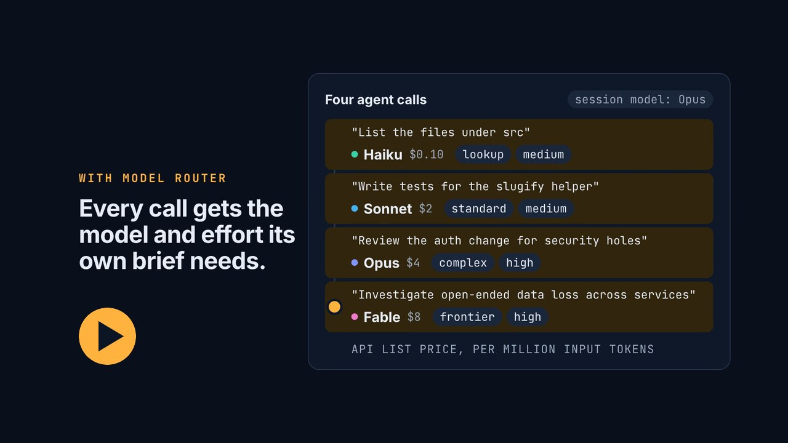

# Claude Code Model Router: the right Claude model for every subagent

<p align="center">
  <picture>
    <source media="(max-width: 600px)" srcset="docs/assets/headline-phone.svg">
    
  </picture>
</p>

<p align="center">
  <a href="CHANGELOG.md"></a>
  <a href="#install-the-claude-code-plugin"></a>
  <a href="#install-the-claude-code-plugin"></a>
  <a href="CONTRIBUTING.md#rules-for-a-change"></a>
  <a href="LICENSE"></a>
</p>

<p align="center">
  <a href="#install-the-claude-code-plugin"><b>Install</b></a> &nbsp;&middot;&nbsp;
  <a href="#quick-start"><b>Quick start</b></a> &nbsp;&middot;&nbsp;
  <a href="#how-it-works-picking-a-subagent-model"><b>How it works</b></a> &nbsp;&middot;&nbsp;
  <a href="#built-on-the-claude-code-docs"><b>By the docs</b></a> &nbsp;&middot;&nbsp;
  <a href="#configuration"><b>Options</b></a> &nbsp;&middot;&nbsp;
  <a href="#benchmarks"><b>Benchmarks</b></a> &nbsp;&middot;&nbsp;
  <a href="docs/FAQ.md"><b>Questions</b></a> &nbsp;&middot;&nbsp;
  <a href="docs/README.md"><b>Docs</b></a>
</p>


**Model Router (`model-router`) is a Claude Code plugin that keeps the model and reasoning effort Claude names for every agent Claude Code starts inside your limits, sets the effort nobody named, and moves a call one level up when its work comes back for a redo.** It covers subagents from any plugin, skill or agent, agent-team teammates and workflow stages, and you never pick a model by hand ([how it works](docs/ARCHITECTURE.md)).

Without it, a subagent that names no model runs on its conversation's model ([Claude Code docs](https://code.claude.com/docs/en/sub-agents.md#choose-a-model)), so on an Opus session a file listing runs on Opus too. One model for every agent, set with `CLAUDE_CODE_SUBAGENT_MODEL`, puts lookups on an expensive model or hard design work on a weak one. Model Router does autonomous multi-model orchestration instead: Claude, which has read the work, names the model and effort each call needs, and the plugin holds that to your cap and the models that work here.

<p align="center">
  <a href="https://crisnahine.github.io/claude-code-model-router/assets/video.mp4"></a><br>
  <sub><a href="https://crisnahine.github.io/claude-code-model-router/assets/video.mp4"><b>Watch it in 22 seconds</b></a>, with sound. Music: Sascha Ende, ende.app (CC BY 4.0).</sub>
</p>

## What it does

- Keeps the model of every subagent, teammate and workflow agent inside your cap as it starts, and sets the effort when nobody named one. The agent the caller chose stays the same.
- Runs a call one level higher when Claude redoes a weak result, and `/model-router:usage` counts the redos per level.
- Asks once, before a turn ends, for a test run when code changed unchecked.
- Logs what each turn cost at list price in `/model-router:usage`, and checks the Claude Code changelog, docs and model retirements once a day.

## Built on the Claude Code docs

Model Router uses only the extension points Claude Code documents (the plugin manifest, hooks, the mods API, skills and subagents), and follows its rules on subagent models, the prompt cache and failing hooks:

- It keeps the docs' subagent model order: a model on the call, the agent's own model, `CLAUDE_CODE_SUBAGENT_MODEL`, then the parent's model ([sub-agents](https://code.claude.com/docs/en/sub-agents.md#choose-a-model)). It only lowers a model to your cap, raises one to a rule's level, and fills in the effort.
- It never switches the main conversation's model, because a switch re-reads the history with no cache hits ([prompt caching](https://code.claude.com/docs/en/prompt-caching.md#switching-models)).
- It re-runs failures one level higher, modeled on Anthropic's finding that low effort with failures re-run at high costs less than running every task at high ([cost and intelligence](https://platform.claude.com/docs/en/about-claude/models/optimizing-for-cost-and-intelligence#re-run-failures-at-higher-effort)).
- Its hooks fail open: a bug never blocks a tool call, a spawn or a session ([exit codes](https://code.claude.com/docs/en/hooks.md#exit-code-output)).

The saving comes from Claude Code's own advice to put simple subagents on Haiku ([best practices](https://code.claude.com/docs/en/best-practices.md#know-what-subagents-cost)): the plugin's search and check agents carry Haiku in their definitions, and Claude names a cheaper model where the work allows it. The banner above shows each model's price per million input tokens. [Built on the docs](docs/CLAUDE_CODE_DOCS.md) lists every rule, its doc page and its test, and where the plugin goes past the docs.

## Install the Claude Code plugin

In Claude Code:

```text
/plugin install model-router --marketplace crisnahine/claude-code-model-router
```

In a session this opens the plugin in the `/plugin` panel, where you pick a scope (you in every project, everyone in this repository, or you in this repository only). In your shell, `claude plugin install model-router --marketplace crisnahine/claude-code-model-router` installs at user scope unless you pass `--scope project` or `--scope local` ([install docs](https://code.claude.com/docs/en/plugins/install.md#add-a-marketplace-and-install-in-one-command)).

Requirements: Claude Code 2.1.329 or later, `sh`, and Python 3.9 or later as `python3` or `python` on your `PATH`. Without Python its hooks do nothing and its skills say why.

Nothing has to be set: the four options in `/config` under the plugin start at their defaults ([options](docs/GUIDE.md#configuration)), and Claude model routing is on from the first session. To try it from a clone, run `claude --plugin-dir ./plugins/model-router`.

## Quick start

1. Start a new session. The plugin's commands start with `/model-router:`.
2. Check what a call would run on: `/model-router:route` shows the policy, the level each model stands for and the effort a call gets when it names none.
3. Work as you always do. Every agent call is checked as it starts.
4. Later, `/model-router:usage` shows what ran where and what it cost, and `/model-router:models` shows the models in use and anything capped, unavailable or routed around. To change how it routes, see [Configuration](#configuration).

## How it works: picking a subagent model

<p align="center">
  <picture>
    <source media="(max-width: 600px)" srcset="docs/assets/hero-phone.svg">
    
  </picture>
</p>

Claude names the model on each agent call, and its effort when the work needs a set one. The router never reads the brief. Each model stands for the lowest of five levels it runs, and a call that names no effort runs at that level's effort:

| Level | Typical subtask | Model | Effort |
| :- | :- | :- | :- |
| lookup | Find, list, summarize, run a command | Haiku | medium |
| standard | Implement to a clear spec, write tests | Sonnet | medium |
| complex | Fix a bug, design, review, risky change | Opus | high |
| hardest | Ambiguous, multi-system and risky at once | Opus | xhigh |
| frontier | All of that, with no known approach: research, open-ended investigation | Fable | high |

A model named with `xhigh` or `max` stands for hardest. A call that names no model runs on its parent's model, as Claude Code decides, unless that model is over your cap. A redo of a weak result that names no model runs one level higher: a stronger model, or more effort on the same one. Claude marks the redo in the call's `description`, so a rewritten brief still climbs. Anthropic measured low effort with failures re-run at high at about 97% solved for $0.17 a task on a coding benchmark, against 95.3% for $0.29 with every task at high ([research](docs/research/model-control.md), Q7).

<a id="who-decides-the-model"></a><a id="the-checks-before-a-turn-ends"></a>Your choices come first. Inside your `max_tier` cap, a model named on the call, a per-agent rule or the agent's own `model` field decides the model, and `CLAUDE_CODE_SUBAGENT_MODEL_FORCE` and `CLAUDE_CODE_SUBAGENT_MODEL` leave the model as you set it ([who decides the model](docs/GUIDE.md#who-decides-the-model)). The [checks before a turn ends](docs/GUIDE.md#the-checks-before-a-turn-ends) are in the guide, and the full design in [ARCHITECTURE.md](docs/ARCHITECTURE.md).

## Benchmarks

On an Opus 5.5 session the router solved <!-- bench:opus.solved.router -->70 of 70<!-- /bench --> benchmark runs, as many as Claude Code's defaults, for <!-- bench:opus.pooled.router -->$0.121<!-- /bench --> per solved task against the defaults' <!-- bench:opus.pooled.defaults -->$0.151<!-- /bench -->. It isn't the cheapest setup on these tasks. They are easy enough that every subagent on Haiku at `high` effort also solved <!-- bench:opus.solved.haiku-high -->70 of 70<!-- /bench -->, for <!-- bench:opus.pooled.haiku-high -->$0.075<!-- /bench -->. On a Sonnet session the router cost more per solved task than the cheapest other setup in <!-- bench:sonnet.status.FAIL -->6<!-- /bench --> of <!-- bench:sonnet.classes -->8<!-- /bench --> task classes.

The run measured the routing code at <!-- bench:opus.commit_code -->`780ee86`<!-- /bench -->, before complex moved to Opus and the verify gate was turned on, so it doesn't price today's defaults. A harder task set is next ([roadmap](docs/ROADMAP.md)). [BENCHMARKS.md](docs/BENCHMARKS.md) has every table, the raw data and the commands to rerun it.

## Commands

| Command | What it does |
| :- | :- |
| `/model-router:ship <task or issue>` | Plans, builds, verifies, reviews and commits a change on a branch, and stops before pushing, merging or deploying |
| `/model-router:route <task>` | Explains which model a task would get and why, and how to split it |
| `/model-router:models [reset] [--json]` | Lists the models in use, what each runs as, and what is capped, unavailable or routed around. `reset` clears learned availability |
| `/model-router:usage [days] [--json]` | Shows what ran where and what it cost at list price, over `days` (default 7) |
| `/model-router:refresh` | Reviews new Claude Code releases, docs changes and model retirements |

Type `/model-router:ship` in full. Where Claude Code has its own `/ship`, the bare `/ship` runs that command instead, and it can commit, push and open a pull request with no confirmation prompt ([Claude Code docs](https://code.claude.com/docs/en/ship-command.md)).

The plugin also ships five role agents for work no better-fitting agent covers: `model-router:scout` and `verifier` on Haiku, `architect` and `reviewer` on Opus at `high`, and `implementer`, which takes the model named on its call ([what each is for](docs/GUIDE.md#role-agents)). `--json` output shapes are in the [guide](docs/GUIDE.md#commands).

## Configuration

Four options in `/config` under the plugin, each with a working default: `routing_mode` (`auto`; `off` only keeps the ledger), `max_tier` (none), `update_check` (on) and `verify_gate` (on). What each option does is in the [guide](docs/GUIDE.md#configuration).

Rules and extra models go in `~/.claude/model-router.json` (yours, applies everywhere) or `.claude/model-router.json` (a project's). A project's file only raises: a cloned repository can make its subagents cost more, never run weaker, and it can't get a model past your `max_tier`. The file's shape, every key and the trust rules are in the [guide](docs/GUIDE.md#configuration).

## What it can't do

- It doesn't change the main conversation's model or effort, because a model switch re-reads the conversation uncached. For a hard request, type `ultrathink` or use `/effort`.
- It never picks a model from the work itself: Claude names one, or the agent's definition does. A call that names none stays on its parent's model.
- It leaves forks alone, and agents whose definition it can't read, such as one defined on the command line.
- It doesn't retry a call that fails on a model error. Set `fallbackModel` (or `--fallback-model`) for that. After a model error the router suggests a usable model to re-issue the call on, and after two it routes around that model for a day.
- It routes a new model family only once the registry has an entry for it, and does nothing when hooks are switched off.
- Spend figures are list prices; your bill is in `/usage` and `/cost`.

[Every limit, and why](docs/GUIDE.md#what-it-cant-do).

## Compatibility

- Other plugins, skills and agents: their agents are routed too. The router never changes which agent runs, and another plugin's hook that denies or asks about a call still applies ([details](docs/GUIDE.md#refused-rewrites)).
- Workflows and ultracode: a model the script names is held to your cap like any call's, and on the session's own model a stage never runs below the session's effort, such as `xhigh` under ultracode ([details](docs/GUIDE.md#workflows-and-ultracode)).
- Permissions: the plugin never approves a tool call. Your permission rules and auto mode still review every spawn.
- Amazon Bedrock, Google Cloud's Agent Platform (Vertex AI) and Microsoft Foundry: routing uses the aliases `haiku`, `sonnet`, `opus` and `fable`, and where one resolves to an older model the mod sends the family's newest ID ([details](docs/GUIDE.md#third-party-providers)). These providers aren't tested live yet.
- Versions: Claude Code 2.1.329 or later. Tested live on 2.1.330 and 2.1.331 on macOS, ultracode included; the unit tests also run on Linux and Windows in CI. This is version 0.1.2, and [release readiness](docs/RELEASE_READINESS.md) lists what is still open.
- Failure: every hook fails open. A bug can cost routing, never block a tool call, a spawn or a session.

<a id="security"></a>
## Privacy and security

Model Router runs on your machine with your user permissions, as every plugin's hooks and mods do ([plugin security](https://code.claude.com/docs/en/plugins/security.md)). It reads the model and effort on each agent call, never its brief, keeps its state in its own data directory, and sends no prompt or code anywhere. Its only network traffic is the daily update check to `code.claude.com` and `platform.claude.com`, plus `api.anthropic.com` for your account's model list when `ANTHROPIC_API_KEY` is set, `ANTHROPIC_BASE_URL` is unset and none of `CLAUDE_CODE_USE_BEDROCK`, `CLAUDE_CODE_USE_VERTEX` or `CLAUDE_CODE_USE_FOUNDRY` is on. Turn `update_check` off to stop it; `/model-router:refresh` still fetches when you run it. To see every hook, agent and skill it installs before you install it, run `claude --plugin-dir ./plugins/model-router plugin details model-router` from a clone. [SECURITY.md](docs/SECURITY.md) has the threat model, what is stored and how to report a problem (there is no private channel yet, so never put details in a public issue).

## Update and uninstall

- Update: run `claude plugin update model-router@claude-code-model-router`, or choose **Update now** on the **Installed** tab of `/plugin`. Auto-update is off by default for third-party marketplaces like this one ([Claude Code docs](https://code.claude.com/docs/en/plugins/install.md)).
- Pause it: set `routing_mode` to `off` in `/config`.
- Remove it: `claude plugin uninstall model-router@claude-code-model-router`, or `/plugin uninstall model-router` in a session. Removing the last install also deletes the plugin's data directory, with its ledger and what it learned, unless you pass `--keep-data`. Your own `model-router.json` files stay.

## Documentation

[docs/FAQ.md](docs/FAQ.md) answers the questions people ask first, each in its first sentence.

| Page | Answers |
| :- | :- |
| [Guide](docs/GUIDE.md) | How do I configure it for my setup? |
| [Architecture](docs/ARCHITECTURE.md) | How do two paths share one router? |
| [Built on the docs](docs/CLAUDE_CODE_DOCS.md) | Which Claude Code docs does it follow, and where? |
| [Benchmarks](docs/BENCHMARKS.md) | What does a solved task cost, with and without it? |
| [Security](docs/SECURITY.md) | What reaches the network, and who can steer it? |
| [Changelog](CHANGELOG.md) | What changed in each release? |

The [documentation index](docs/README.md) lists every other page, including performance, the roadmap, the glossary and release readiness. Bugs and questions go to [GitHub issues](https://github.com/crisnahine/claude-code-model-router/issues). For a quick question, or a call it routed wrong, join the [Discord server](https://discord.gg/AHZZ7bABJy). To work on the plugin, see [CONTRIBUTING.md](CONTRIBUTING.md).

## License

Apache-2.0. See [LICENSE](LICENSE).

Copyright 2026 Cris Nahine.

The music in the [video](docs/assets/BRAND.md) is by Sascha Ende ([ende.app](https://ende.app/en)) under CC BY 4.0, so the Apache-2.0 license doesn't cover it.

Model Router is an independent project, not made or endorsed by Anthropic.
