<!-- Page head, written by tools/docs_assets.py: edit its PAGES table, then run it. -->

<a href="README.md">Model Router</a> &nbsp;&middot;&nbsp; <a href="docs/README.md">Documentation</a> &nbsp;&middot;&nbsp; Previous: <a href="CONTRIBUTING.md">Contributing</a> &nbsp;&middot;&nbsp; Next: <a href="docs/assets/BRAND.md">Brand</a>

<!-- End of page head. -->

# Releasing

Work the list in order, and tick each item only once it is checked.

1. The version is set in one place: `plugins/model-router/.claude-plugin/plugin.json`. The marketplace file has no version. After the changelog section below exists, run `python3 tools/docs_assets.py`, which copies the version into the version badge, `site/index.html` and `CITATION.cff` (with the changelog date as `date-released`), and check that `python3 tools/docs_assets.py --check` passes. `LICENSE` and `plugins/model-router/LICENSE` are the same file (a test checks it).
2. `CHANGELOG.md` has a section headed `## <version> - <date>` for this exact version, dated the release day, describing what ships.
3. Prose that goes stale is current: README options table, requirements and minimum Claude Code version, `docs/ARCHITECTURE.md`, skill files, and the numbers they quote. So are the state documents: `docs/TRACEABILITY.md` (recounted with `python3 tools/traceability.py`), `docs/RELEASE_READINESS.md`, `docs/ROADMAP.md` and `docs/TEST_RESULTS.md`.
4. Locally: `python3 tools/docs_assets.py --check`, `python3 -m unittest discover -s tests`, `node --experimental-strip-types --test "tests/mod/*.test.ts"`, `sh tests/mod/typecheck.sh`, `claude plugin validate --strict .` and `claude plugin validate --strict plugins/model-router` all pass. These are the commands of the `test`, `mod`, `typecheck` and `validate` jobs in `.github/workflows/ci.yml`. Run `claude plugin eval` from a `git archive` export of the commit, since the CLI refuses a plugin folder whose git directory registers more linked worktrees than it can screen.
5. The release PR's CI is green, then the PR is merged into `main`. Installs read the marketplace from `main`.
6. CI is green on the merge commit in `main` (CI runs on every push to `main`).
7. Tag that commit `v<version>` and push the tag.
8. Create the GitHub release for the tag, not a draft, with the changelog section as its notes: `gh release create v<version> --notes-file <file> --title "Model Router <version>"`.
9. Confirm the release exists (`gh release view v<version>`) and close what it fixed, one closing keyword per issue.
