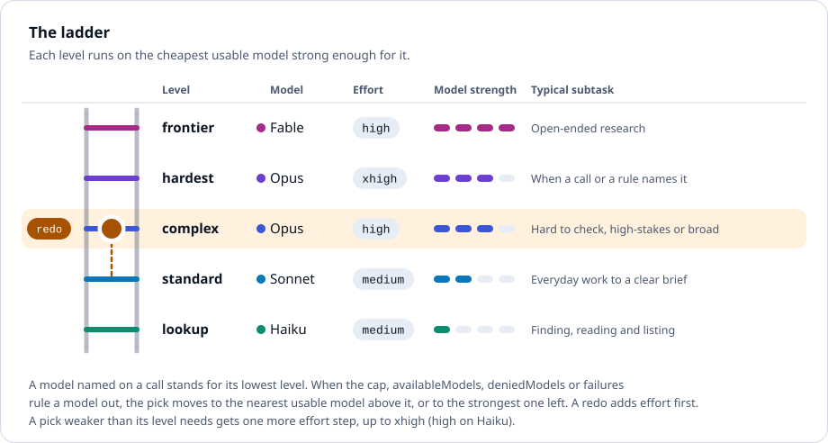

<!-- Page head, written by tools/docs_assets.py: edit PAGES in tools/docs_pages.py, then run it. -->

<a href="../README.md">Model Router</a> &nbsp;&middot;&nbsp; <a href="README.md">Documentation</a> &nbsp;&middot;&nbsp; Previous: <a href="FAQ.md">Questions</a> &nbsp;&middot;&nbsp; Next: <a href="GLOSSARY.md">Glossary</a>

<!-- End of page head. -->

# Architecture

Model Router changes two fields of an agent call, `model` and `effort`. Claude names both from a table the plugin gives it; the plugin holds them to the user's cap, the allowlist and model health, fills in an effort nobody chose, gives a call that names no model a level from its agent's tools, raises a call to a rule's level, and runs a call marked "Redo:" one step higher. A Stop check asks for a check after unchecked edits. With a person at the prompt, the mod also shows a status line, answers `/model-router`, and offers a stronger main-session setup once.

## Two paths, one router

Both paths run one launcher, `scripts/model-router.sh`, and one procedure, `spawn.decide` then `spawn.record`. The mod, `hooks/router.ts` (under `modules` in `hooks/hooks.json`), is the main path, and calls the runtime's `mod-*` commands:

| Event | What the mod does |
| :- | :- |
| `tool.call` (`Agent`) | Keeps the call's `effort` (`agent.spawn` has none) and writes the mark; adds the spawn's `note` to the result's `context` |
| `tool.describe` | Appends `rules` to the Agent tool's description and `workflow_rules` to the Workflow tool's, from the latest `mod-start` answer |
| `session.start` | Sends the settings layers (`mod-start`), which the runtime stores; it clears day-old marks and answers the session-start note. If `isInteractive`, registers `/model-router`, refreshes the status line and runs the session check |
| `session.end` | At `/clear`, forgets the session id the layers went to. If interactive, drops the session's switch and check (`mod-end`) |
| `command.run` (`model-router`) | Answers `/model-router`, display only: the state or a switch (`mod-status`), or `check on` and `check off` (`$.config.set`) |
| `config.set` (`model-router.*`) | Refuses an option change while a main-loop turn runs or an agent whose effort the mod set is running: the change reloads the module, which forgets those efforts |
| `agent.spawn` | Sends the call, the layers, `parent_model`, `kind` and the session's effort (`mod-spawn`); passes the answer's `model` on. Marks a spawn a later mod moved to another family. Passes forks and resumed runs untouched |
| `turn.start` | On the main loop, notes that a turn started, and sends the layers again when the session id changed, as at `/clear`. Gives an agent whose first request beats its spawn's return that spawn's effort, if its prompt's waiting spawns agree |
| `turn.step` | Sets a routed agent's effort on each request that carries one (a workflow agent's only when higher); records the main loop's |
| `turn.complete` | Sends a subagent's tokens, cost estimate, and the model and effort its last request carried (`mod-usage`). On an interactive main loop, refreshes the status line |

The settings hooks:

| Hook | Command | What it does |
| :- | :- | :- |
| `SessionStart` | `session-start` | Records the session's model; writes the session-start note. As a session opens (not at `/clear` or compaction), a `systemMessage` names a subagent model variable that is set |
| `PostModelSwitch` | `model-switch` | Records the new model |
| `UserPromptSubmit` | `user-prompt` | Says where a call runs with the `model` the person's own prompt names, as in "use opus" (`intake.is_user_prompt`, `request.named_model`) |
| `PreToolUse` (`Agent`) | `pre-agent` | The fallback (`fallback.route`): rewrites the call through `updatedInput`, with a line saying what it set |
| `PostToolUse` (`Agent`) | `post-agent` | Records the result (done record, health, ledger); asks for a check of a run that switched models mid-run |
| `PostToolUseFailure` (`Agent`) | `agent-failed` | Strikes a model error; says what a re-issued call runs on |
| `SubagentStop` | `agent-stopped` | Finishes a background run that stopped with an answer; counts a check the subagent ran |
| `PostToolUse` (`Edit`, `Write`, `NotebookEdit`) | `post-edit` | Notes an edit under the project |
| `Stop` | `stop` | The Stop check |

### Which path routes a call

While the runtime answers (the latest `mod-start`, `mod-spawn` or `mod-usage` got a reply, if only `{"ok": true}`), the mod's `tool.call` hook writes an empty file, `mod-calls/<tool_use_id>`. Plugin `PreToolUse` hooks run after the mod; `mod.routes` takes the mark and stands the fallback down.

| Case | Routed by |
| :- | :- |
| `Agent` call, mark written | The mod, at spawn |
| `Agent` call, no mark (no reply yet, a failed one, a failed write, no mod) | The fallback; the mod passes its spawn untouched |
| `Agent` call, no mark, after an empty reply (no Python) | Neither. With routing on, the mod lowers a named model to `max_tier` by family (`capped`) |
| A marked call whose `mod-spawn` fails twice | Neither; the mod holds the cap as above |
| A spawn with no `Agent` call, such as a workflow stage | The mod |
| A fork or a resumed run | Neither |

A mod round trip times out after 8 seconds, a settings hook after 10 (`UserPromptSubmit` after 5). `cli.main` catches what a handler raises, writes its type and place to stderr, and exits 1: Claude Code shows a hook error notice, and the mod counts a failed round trip. Hook input that doesn't parse reads as empty; with no readable `tool_input`, `pre-agent` leaves the call alone and `mod-spawn` answers nothing, as with no Python. The launcher runs Python with `-I`, exits 0 with no Python 3.9 or later, and 1, never 2, on other hook failures. Each mod hook's `.catch` passes the event on.

## In an interactive session

None of this runs unless `session.start` reports `isInteractive`. The loader takes `$` only as calls, so each mods API call sits in a `try`, and a surface without one loses only that feature.

- **Status line.** `report.status` builds it from the options, the switch and the session's spawn rows: `auto · mod · cap opus · 14 calls · 5 changed · 2 redos`, or `off`. The second field is `fallback` when the latest spawn went that way, `(this session)` marks a switched mode, and zero counts are left out. The mod pins it with `$.ui.status`, one refresh at a time, folding any asked for meanwhile into one more.
- **Switch.** `/model-router on` or `off` sends `routing` to `mod-status`. `settings.switch` keeps it in the session's `switches.json` entry (none when it matches `routing_mode`), and `settings.resolve` reads it for every snapshot with a session id, so both paths decide alike. The mod keeps the answer for a call whose round trip fails.
- **Session check.** Runs after `session.start` returns, when `session_check` and routing are on and `$.session.turns()` is 0. `mod-check` sends `$.session.model()`, whether managed settings own `session_check` (`$.config.list()`), and a `--effort` flag read from the session's command line with `ps`. `session.check` marks the session checked first, so the reload a `$.config.set` causes asks nothing. It asks only when the session's model at its estimated effort matches no `session` setup in `config/models.json`, or is older than its family's `newest`, and offers each setup the allowlist and `maxEffortLevel` leave, then a way to stay. Each choice carries its label, its next question (`then`), what it does (`model`, `effort`, `check`) and the line to show after (`done`). The mod asks with `$.ui.ask` only before the first main-loop turn and acts only on a label it sent: `$.command.run` for `model`, `$.session.model()` to confirm the family, then `effort`; `$.config.set` for `check`.
- **Effort estimate.** `session.effort_on`: `CLAUDE_CODE_EFFORT_LEVEL`, the `--effort` flag (`ultracode` reads as `xhigh`), `Allowlist.saved_effort` over the layers in `allowlist.PRECEDENCE` order (a model's `modelSettings` level before its file's top-level `effortLevel`, the user file's top-level one skipped), then `config.DEFAULT_EFFORT`, held to `maxEffortLevel`. After each main-loop turn, `session.observe` records the model and effort its latest request carried.

## Modules

In `scripts/modelrouter/`, standard library only:

| Module | Owns |
| :- | :- |
| `cli`, `hooks` | The command line; one handler per hook command; the session-start note (`hooks._rules`) |
| `mod`, `fallback` | The mod's commands and mark; the fallback's rewrite, repeat guard and deny |
| `spawn`, `router` | The shared procedure and the run a redo redoes; `decide`, from facts alone |
| `ladder`, `registry`, `config` | Levels and rungs; the `Registry` (`select`, `clamp`, `family`); building it from the config files |
| `settings` | Options, environment facts, the session's routing switch, and each hook's `Snapshot` |
| `allowlist`, `health` | `availableModels`, `deniedModels`, `maxEffortLevel`; model errors and substitutions |
| `calls` | Routes, outcomes, the redo mark, tasks, done records |
| `agents`, `session` | Agent definitions and whether one can only read (`agents.read_only`); the conversation's model and transcripts, and the session check |
| `intake`, `request`, `gates` | Whether a prompt is the person's; the model it names; the Stop check |
| `ledger`, `report`, `store` | Ledger rows; skill tables, `--json` and the status line; state files and locks |

The agents `scout` and `verifier` pin Haiku at `medium`, `implementer` Haiku at `high`, and `architect` and `reviewer` Sonnet at `high`. Models are entries in `config/models.json`; the mod repeats the family names in `TIERS`. A model's `twins` are other names it is offered under (Fable's is Mythos). `Registry.family` and the mod's `NAMES` (twins and `aliases`) place a twin's ID in its family for the cap and the ladder; the allowlist and the health table match it by its own name (`family(twins=False)`).

## The ladder

| Level | `needs` | Model | Effort |
| :- | -: | :- | :- |
| lookup | 1 | Haiku | medium |
| standard | 1 | Haiku | high |
| complex | 2 | Sonnet | high |
| hardest | 3 | Opus | high |
| frontier | 4 | Fable | high |

A level runs on the cheapest usable model whose strength meets its `needs`, else the strongest usable one (`Registry.select`). A model stands for the lowest level it is the model of (`ladder.rung`), or, if it is no level's model, the highest level it is strong enough for. A named effort lifts it on the same model: Haiku at `high` or above is standard.

The router's effort is the level's own, one step more (at most `xhigh`) on a model weaker than the level needs (`ladder.effort_on`).

## The decision

`spawn.decide` gathers the facts (the agent's definition, the parent's model, the usable models, the session's effort, and for a redo the run it redoes) and calls `router.decide`, which reads no state. Neither writes. `spawn.record` then writes the ledger row and, unless the call is denied or a workflow stage, the route.

A decision is `keep`, `rewrite` or `deny` (the guard's), with a model, effort, level, source, `was` (the untouched model) and reason. A fork, routing `off`, an allowlist that leaves no registry model open, a user rule's `route: false`, or a call's `model` outside the registry such as `inherit` is a keep. Otherwise the first source below that names a model wins.

### Order of authority

| # | Source | The router |
| -: | :- | :- |
| 1 | `CLAUDE_CODE_SUBAGENT_MODEL_FORCE` | Sets effort only, none when the call names a model |
| 2 | `CLAUDE_CODE_WORKFLOW_SUBAGENT_MODEL`, for a workflow agent whose call names no model | Sets effort only |
| 3 | The call's `model` | Keeps it |
| 4 | The user's rule `model` | Applies it |
| 5 | A project's rule `model` | Applies it only when not weaker than what the call runs on without it, and not a model the project added; else `held` says why |
| 6 | The agent's own `model` | Keeps it; for `inherit`, the parent's model, which outranks row 7. With no definition found, or a `model` outside the registry, leaves the call alone |
| 7 | `CLAUDE_CODE_SUBAGENT_MODEL` | Leaves the call alone. Unforced, it doesn't move the built-in Explore and Plan, which go to row 8 |
| 8 | Nothing | The level the agent's tools put it at: `lookup` when its `tools` hold none of Edit, Write, NotebookEdit and Bash, or its `disallowedTools` remove them all, as for the built-in Explore and Plan; `standard` otherwise. A list `agents._list` can't read with confidence counts as every tool, or as removing none |

Then, for rows 3 to 6 and 8 (steps 4 to 6 on rows 1 and 2 too):

1. **Floor.** A rule's `level` raises a call that stands below it to that level and its model. On row 8 either file's floor raises the tools' level. On an inherited parent's model the user's floor applies wherever the call stands below it, and a project's only when its model is stronger than the parent's, or, with the parent's unknown, when no registry model is stronger (`router._floor_lifts`).
2. **Teammate.** A teammate naming nothing starts no lower than standard: its row 8 level is at least standard, and an inherited parent's model weaker than standard needs moves to standard's model.
3. **Cap.** `Registry.clamp` keeps a usable model (inside `max_tier`, permitted, healthy), else takes the next stronger usable one, else the strongest. An exact ID the call or the agent names inside `max_tier`, which the lists let run though they don't open its family (a Mythos ID, say), makes that family usable for the call (`spawn._usable`). A parent's model it moves runs at the new model's level.
4. **Effort.** If nobody chose it (the call, the agent, `CLAUDE_CODE_EFFORT_LEVEL`, or `CLAUDE_CODE_SUBAGENT_EFFORT`, which skips teammates), the level's effort.
5. **Session floor.** On a main-conversation call on the session's own model, an effort the router sets is at least the session's (`router._session_floor`): `session_effort` from the mod, `effort.level` from the hook.
6. **`maxEffortLevel`.** The lowest cap any settings source sets for that model, a `modelSettings` entry replacing its source's top-level cap (`router.capped`). None without the mod's layers.

The same model with no effort to set is a keep. Where the untouched model is unknown (a nested call on the fallback, the built-in Explore and Plan), row 8 still names a model, and an agent that inherits is left alone unless a floor lifts it.

A full ID or `[1m]` variant the call or the agent names is kept while its family is, if the lists permit it and it is healthy (`mod.exact`). On a provider whose alias runs an older model (`older_aliases`), the mod sends the family's `newest` ID unless `ANTHROPIC_DEFAULT_<FAMILY>_MODEL`, `modelOverrides`, the allowlist or health rules it out (`Registry.newest_id`). Where no newest ID goes (always on the fallback, which sends aliases only), the router's own picks (a level, a floor, a redo's next model) move one family up (`Registry.past_lag`), unless `ANTHROPIC_DEFAULT_<FAMILY>_MODEL` pins that family.

`explain`, behind `/model-router:route`, runs `spawn.decide` with no session and writes nothing.

## Redo escalation

| Step | How |
| :- | :- |
| Mark | A `description` starting "Redo:", any case (`calls.marked_redo`). The same call sent unmarked is a new call. A workflow stage is never a redo |
| Task | A hash of the agent type and the description without the mark (`calls.task`) |
| Record | Each route in `routes.json` holds the effort the run gets, in Claude Code's order (`CLAUDE_CODE_EFFORT_LEVEL`, the call's as sent, the agent's, `CLAUDE_CODE_SUBAGENT_EFFORT`, the session's on its own model), else `medium` (`router.ran_at`); on the mod, what the run's last request carried replaces it (`calls.observed`). A foreground result with no model swap makes the run its task's latest in `done.json`; a background one waits in `launched.json` for `SubagentStop` with an answer |
| Find | The task's latest run this session, at most 30 minutes old, from any request (`calls.last_run`) |
| Run as named | If the call's unmarked decision asks for more than that run (a stronger model, or more effort on a model that took one), it runs as decided (`spawn._asks_more`) |
| Climb | Otherwise it climbs from that run, or with none on record from its unmarked run (`on_record: false`) |

The climb (`router._redo`):

1. Below `high` effort: the same model, one step up.
2. Else the next stronger usable model, never a project's, at its level's effort.
3. Else the same model one more step, at most `max`.

A step `maxEffortLevel` holds counts as none. Under an effort variable the router takes no effort step, so the redo takes the next model; under `CLAUDE_CODE_SUBAGENT_EFFORT`, a redo left on its model keeps the effort it redoes. A nested run with no effort on record skips step 1, and a run whose requests carried no effort gets no effort step. The call's model, the agent's, a rule's model and `CLAUDE_CODE_SUBAGENT_MODEL` don't hold a redo back. Under the force pin a redo gets one effort step, none past `max`. The session floor and `maxEffortLevel` apply after, and `escalated_from` names the redone run's level.

With no stronger usable model and no effort to gain, the redo runs as the run it redoes did, and `no_step` is set. Claude then reads one sentence, such as "This redo ran on opus at max, the strongest model and the most effort usable here, the same as the run it redoes." (`spawn.redo_note`): `additionalContext` on the fallback, the `tool.call` result's `context` on the mod.

A redo is left alone wherever a plain call is. It misses its record after a skipped write, 30 minutes, 100 newer tasks, or a day idle, and never changes later calls. A run that swapped models mid-run (`modelsUsed`) finishes nothing and isn't health evidence.

## The session-start note

`hooks._rules` writes it while routing is `auto`, as facts, since the Agent tool sets `effort` only when instructions ask. It says the plugin keeps the `model` and `effort` a call names within the cap and fills in `effort` when a call names only a model, then "Here every Agent call names both, by the work": haiku at medium for finding, reading and listing; haiku at high for writing and fixing code, figures and documents to a brief; sonnet at high for a judgment call with no check to run (a design or a review). Opus and Fable have no row. It ends with where a call naming neither runs, and how to mark a redo.

Each pairing is a level's model and effort from the registry (`ladder.model_for`, `ladder.effort`), so a rules file that moves a level moves the note. The force pin, either effort variable, `max_tier` and `CLAUDE_CODE_SUBAGENT_MODEL` each trim or reword it to what still applies.

`mod-start` answers the same text as `rules`, and `workflow_rules` (`hooks._workflow_rules`), the table worded for a workflow script's `agent()` calls; under the force pin, where a script can't set a model, there is none. Each tool's description keeps the latest text it got.

## Model health and the allowlist

Model health lives in `state.json` (`health.py`):

- A model error is a failed `Agent` call whose error text has `not_found_error`, `model_not_found` or `claude_code_version_too_old`, and isn't an interrupt or an unknown agent type. A substitution is a `resolvedModel` in another family than asked, outside the force pin, a swapped run, or the untouched model.
- Neither counts for a spawn a later mod moved to another family (the mod compares the model it sent with the one the engine's entry in `next.trace` was asked for, and writes `mod-calls/<tool_use_id>.moved` for `post-agent` and `agent-failed` to take), or for a fallback call left on the parent's model, which the router only guessed.
- Two of either route the model around for a day. A run as asked clears the count; until then, one more after the day routes it around again. The cause kept is the error's type identifier, never its display text, which can quote a model ID a repository's settings chose. A full ID the router sent (a newest ID, or an exact ID kept on a rewrite) is routed around after one model error or provider refusal (`health.REFUSED`), and its alias runs instead. An exact ID on a call left as it is strikes nothing. `/model-router:models reset` clears the table.
- `Registry.available` drops the health filter when it would leave nothing usable; it never drops the allowlist's.

The allowlist (`allowlist.py`):

- The mod reads each settings source at session start, at the first main-loop turn after `/clear`, and at each spawn it routes, and sends only the keys routing reads, kept per session in `allowlist.json`; a source whose read fails keeps what it last sent. A read waits at most 2 seconds; a source that missed that is read without waiting from then on, and its answer goes with a later command. Without the layers no list applies, and Claude Code enforces its own.
- A policy `availableModels` applies alone, else the sources' lists join; `deniedModels` and `availableModelsMatch` count only from policy. A policy `availableModels` or `deniedModels` that isn't a list, or a policy deny list over 200 entries, leaves no model open. A deny entry blocks a family only when it names it with no version.

## The Stop check

`gates.before_stop` asks once per batch of edits when `post-edit` noted an Edit, Write or NotebookEdit on a file under `cwd` or `CLAUDE_PROJECT_DIR`, and no later tool call in the transcript ran a check (`gates.is_check`); a subagent's transcript counts at `SubagentStop`. `is_check` splits a command as a shell does and looks past wrappers such as `npx` for a test, lint or type-check tool, task or script; a check whose result shows it never ran doesn't count.

The ask is `additionalContext` on `Stop` naming the work's own check (tests, `model-router:verifier`, a recompute, a reread), plus a `gate` ledger row. It is silent when routing isn't `auto`, `verify_gate` is off, `stop_hook_active` is set, background tasks run, or the transcript can't be read.

## State

The data folder is `${CLAUDE_PLUGIN_DATA}`, else `plugins/data/model-router-local` under `CLAUDE_CONFIG_DIR` or `~/.claude`: mode 0700, and 0600 for the runtime's files.

| File | Holds |
| :- | :- |
| `state.json` | Model health |
| `allowlist.json` | Per session: settings layers |
| `sessions`, `routes`, `pending`, `launched`, `done`, `edits` (`.json`) | Per session: its model, routes, waiting fallback rewrites, waiting background runs, finished runs, edit and check times |
| `switches.json` | Per session: the `/model-router` switch, whether the session check ran, its estimate and the setup the latest main-loop request carried. Dropped at session end |
| `locks.json` | Per file: lock waits, waits on another session, skipped writes |
| `<file>.flock`, `mod-calls/` | OS lock files; the mod's marks |
| `ledger.jsonl` | One row per spawn, result, model error, Stop ask and subagent turn |

Per-session files keep 200 sessions and 100 records each, and `routes`, `launched`, `done` and `switches` drop a session after a day unwritten. The ledger drops rows past 30 days once its oldest is a day past that, so an age trim runs about once a day. Past 4 MiB it drops each running usage row a later one for the same agent replaces, then its older half if the rest still fills 2 MiB.

Writes are atomic. Each read-modify-write and ledger append holds an OS lock (`flock`, or `msvcrt.locking` on Windows) on the file's `.flock` (`store.locked`), since agents started together run their hooks at once; only the counts in `locks.json` are written without one. The OS frees a dead holder's lock. A held lock is `BlockingIOError` from `flock` and `PermissionError` (`EACCES`) from `msvcrt.locking`; any other lock error means the filesystem can't lock, and the write goes ahead unlocked.

| Case | What happens |
| :- | :- |
| Lock busy | Retried for up to one second; then the write is skipped and counted, and the hook goes on with what it read |
| `state.json` corrupt | Moved aside as `state.json.corrupt-<stamp>` (three kept); routing goes on with it empty; `/model-router:models` lists it |
| Newer `schema` in `state.json` or `locks.json` | Read, never written |
| `locks.json` corrupt | Left as it is |
| Per-session file corrupt | Read as empty, replaced on the next write |
| Ledger line that doesn't parse (bad bytes, nesting past the parser's limit) | Skipped |

## Trust

The user's `~/.claude/model-router.json` is trusted in full. A project's `.claude/model-router.json` only raises (`config.build`):

- A level `needs` or `effort` below the shipped or user value is dropped, and a named model keeps the level it has without the file.
- Its rule `level` is a floor, its rule `model` follows row 5, and `route: false` is ignored. A user rule setting an agent's level or model voids both of the project's.
- A model it adds is never a pick, a clamp stand-in or a redo's next model, is ignored under a cap, and may not overlap a trusted name or a shipped twin.

An override file's `routing_mode` is dropped: only `/config` sets it. Bad types and non-finite numbers are dropped, and `/model-router:models` lists what was dropped or held back. An override file that doesn't parse, nests past the parser's limit, is over 4 MiB or isn't a regular file says nothing (`store.load_dict`).

## Compatibility

`state.json`, `locks.json` (`store.SCHEMA`), `config/models.json` and override files (`config.CONFIG_SCHEMA`) carry a top-level `schema` of 1, which a file without one also is. An override with a newer `schema` is read as far as understood. `models --json` prints `model-router.models/3` and `usage --json` prints `model-router.usage/2`, the data the tables use (`report.models_data`, `report.usage_data`); a new key keeps the version, and removing, renaming or redefining one bumps it. Options follow the plugin's version. Removing or renaming a key or option, changing its type or meaning, or accepting fewer values bumps the version.

## What the plugin never does

- **Network calls.** The runtime imports no network module; the mod uses only the engine's own APIs.
- **Reading a brief to pick a model.** A call's prompt is only hashed into its key (`calls.identify`) and matched to the agent's first turn. The person's prompt is read only for a model it names.
- **Changing more than `model` and `effort`** of an agent call. The main conversation's model and effort change only through Claude Code's own `/model` and `/effort`, run for a setup the person picks in the session check.
- **Writing settings**, but for `session_check`, through `$.config.set`, from `/model-router check on` or `off` or the session check's "Don't ask again". A plugin's own `$.config.set` skips its `config.set` hook, so `check on` and `off` run the same refusal themselves.
- **Approving a call.** No hook returns `permissionDecision: "allow"`.
- **Blocking a spawn**, but for one case. A fallback rewrite waits in `pending.json`. If the same call comes back 5 seconds to 30 minutes later with no result, the rewrite didn't run, so it passes through untouched and can't loop; if that would run it above `max_tier`, it is denied, with the model to use (`fallback._guard`).
- **Blocking a session.** Hooks never exit 2.
