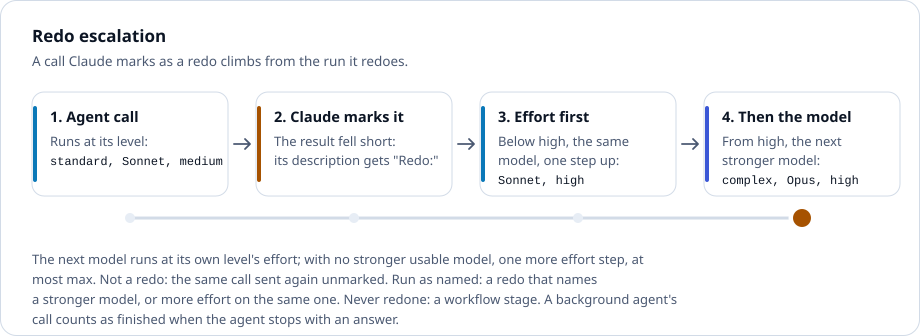

<!-- Page head, written by tools/docs_assets.py: edit its PAGES table, then run it. -->
<p align="center"></p>

<p align="center"><a href="../README.md">Model Router</a> &nbsp;&middot;&nbsp; <a href="README.md">Documentation</a> &nbsp;&middot;&nbsp; Previous: <a href="README.md">Documentation</a> &nbsp;&middot;&nbsp; Next: <a href="../GLOSSARY.md">Glossary</a></p>
<!-- End of page head. -->

# Architecture

## The idea

Model Router decides the model and reasoning effort of every agent Claude Code starts: subagents from any plugin, skill or agent, teammates, and workflow stages. It also raises the main conversation's effort for a hard request. The agent the caller chose, its prompt and its tools stay as they were.

The aim is the lowest cost per finished task at a high quality bar. Every subtask starts on the cheapest model and effort that should do it, and moves up only when its result comes back for a redo. That ordering comes from Anthropic's own measurements: running at low effort and re-running failures at high solved about 97% of a coding benchmark for $0.17 a task, against 95.3% for $0.29 with every task at high ([docs/research/model-control.md](research/model-control.md), Q7).

## Two control paths, one router


```text
              Claude Code engine events                      settings hooks
   agent.spawn  turn.start  turn.step  turn.complete      SessionStart, UserPromptSubmit,
        │           │           │            │            PreToolUse, PostToolUse(Failure),
        └───────────┴─── hooks/router.ts ────┘            PostModelSwitch, SubagentStop, Stop
                            (the mod)                               │
                                │   sh model-router.sh mod-*        │  sh model-router.sh <event>
                                └──────────────┬────────────────────┘
                                               ▼
                                  scripts/modelrouter (Python)
                  spawn · fallback · router.decide · ladder · registry · profile · request · calls · learn · gates
```

**The mod** (`hooks/router.ts`, a hooks module loaded from `hooks/hooks.json` under `modules`) is the primary path. It hooks eight engine events:

| Event | What the mod does |
| :- | :- |
| `tool.call` | Fires for an `Agent` call. The mod keeps the `effort` Claude put on the call, which `agent.spawn` has no field for, and sends it with the spawn. |
| `session.start` | Marks the session for the settings hooks (`mod-start`) and sends the settings layers the mod read. |
| `agent.spawn` | Fires for every subagent, teammate and workflow agent before its model is resolved. The mod asks the router and passes the pick on as `model`. The event names the parent's effective model exactly (`parentModel`), so nothing is guessed from a transcript. Forks and resumed runs are left alone. |
| `turn.step` | Fires for each model request, the main loop's and each agent's. `agent.spawn` has no effort field, so a routed agent's effort is set here, on each of its requests. The main loop's turn effort is applied here too. Each request's usage is kept for its turn. |
| `prompt.submit` | Where a prompt came from: a teammate's report or a notification is not the person's request. For a typed `/skill` it keeps the command's name and arguments. Nothing is sent from here. |
| `skill.prompt` | The body a typed `/skill` renders for its turn, kept so `turn.start` can send it with the command. |
| `turn.start` | The main loop's request text, after the settings hooks for the prompt ran. The router picks that turn's effort from it. For a typed `/skill`, whose turn text is a `<command-message>` line, the mod sends the command's arguments from `prompt.submit` and the body `skill.prompt` rendered for it instead. |
| `turn.complete` | Each turn's token usage and model, main loop and agents alike, written to the ledger with its cost: the sum of its requests, each priced on its own, because Haiku 5.5 bills a prompt over 100,000 tokens at a higher rate per request (https://platform.claude.com/docs/en/about-claude/pricing.md, Long context pricing). A turn sent without its requests is priced at the base rate. |

The mod calls the same Python runtime the settings hooks use, through `$.process.run` with the plugin's hook environment, so there is one decision procedure and one state store. A spawn decision settled in about 110 ms in live runs, the time to start Python included.

**The settings hooks** keep every job the mod doesn't do: the session-start note, the request profile for the conversation's own model, availability tracking from each `Agent` result, redo bookkeeping, and the two checks before a turn ends. `PreToolUse` on the `Agent` tool is the fallback path. It rewrites the call's `model` and `effort` with `updatedInput`, and stands down once the mod has announced itself for the session (`mod-start`), so a call is never routed twice. The fallback covers Claude Code versions without mods and organizations that don't load user mods.

Why the mod comes first: it reaches teammates and workflow stages, which the `Agent` call doesn't carry. It sets the model after auto mode reviewed the call, so auto mode's "input changed after review" denial doesn't apply. And it can set effort on each request, which a forced subagent model leaves as the only lever.

## Components

| Module | Job |
| :- | :- |
| `health` | What the router has seen of each model: a model error, a substitution or a refused rewrite in; healthy, last ran as and why it is routed around out |
| `registry` | Which models exist, which are usable right now, the `select` and `clamp` rules, and list prices |
| `profile` | Turns a brief and an agent's name into a level and the reasons for it |
| `ladder` | Turns a level, the priority and learned raises into the pick: a model and an effort |
| `spawn` | The one procedure both paths call, in two steps: decide (facts and `router.decide`), then record (the ledger row, the call, its votes) |
| `fallback` | The `Agent` call path's own pieces: the rewrite to `updatedInput`, the rewrite waiting for its result, the refused-rewrite guard and the one deny |
| `router` | Applies the order of authority and produces one decision per agent, from the facts it is given alone |
| `intake` | Whether a prompt or a turn is the person's request, and at what level, for both paths; profile scores it |
| `request` | The current request's record: its level and floor, the model the user named, the routed spawns and the strongest one, the escalation ask, and whether code changed |
| `calls` | Per-call records both paths use: background runs waiting for their agent, finished runs for redos, and the models a run swapped between |
| `learn` | Decides from each spawn's facts which votes it casts, counts votes that a level was routed too low, and raises it |
| `agents` | Finds an agent's definition in the project, the user folder, this plugin or another installed plugin |
| `session` | Tracks the model the conversation itself runs on |
| `gates` | The two checks before a turn ends |
| `upstream` | Compares releases, the docs index, model aliases and model status with what was last reviewed |
| `settings` | The plugin's options and the environment facts routing depends on, resolved once per hook call or command, and the snapshot of config, options, usable models, health and allowlist each hook call builds once (the last three on first use) |
| `allowlist` | Which registry models `availableModels` and `deniedModels` leave open, from the settings layers the mod reads from the engine, with the settings files for any source the mod didn't send; the managed files always apply as a floor |
| `ledger` | One append per row kind, the turn Spend rule, and reading rows from the data folder or a given path |
| `hooks`, `cli`, `report`, `store`, `config` | Handlers for settings hooks and mod calls, commands, tables, state files and the ledger file, and the registry and override files |

All of it is standard-library Python, plus the one TypeScript file the engine runs. No module names a model: the shipped models, and aliases such as `best`, are entries in `config/models.json`.

## The ladder

| Level | Needs | Model (balanced) | Effort |
| :- | -: | :- | :- |
| lookup | 1 | Haiku | medium |
| standard | 2 | Sonnet | medium |
| complex | 3 | Opus | high |
| hardest | 3 | Opus | xhigh |
| frontier | 4 | Fable | high |


The profile scores each subtask from its own brief. It looks for risk (security, data and its consistency, migrations, public APIs), scope (several modules or services), load (performance, latency, throughput, staleness and capacity limits, counted only when the brief also asks for a design or a choice) and ambiguity (design, a decision between approaches, root cause, trade-offs). It also checks whether the subtask changes or reasons about something or only reads, and what the agent's name says the agent is for: a reviewer or an architect needs more than a search agent. A name counts by its whole parts, split on `-`, `_` and `:`, so `docs-researcher` and `lint-runner` are search or check agents, and `researcher`, `relocation-migrator`, `information-extractor` and `allocator-tuner` are not. A brief whose work is to fix or hunt a defect is at least complex, however small: Claude Code's effort guide puts fixing a bug in an existing codebase at `high` (https://code.claude.com/docs/en/model-config.md, choose an effort level), and complex is now Opus, the model the research notes pick for risky and judgment-heavy work (`docs/research/quality-first-routing.md`). `fix` and `debug` count only as verbs, so "the fix", "fixed", "fixture", "debug logging", "debug mode" and "debug output" don't, a fix the brief rules out ("do not fix", "avoid fixing", "must not fix", "not to fix", "out of scope") doesn't, and a search or check agent's name still caps the brief at standard. The request profile (`profile_prompt`) applies the same rule to the person's request, with the same exceptions, so a request to fix or hunt a defect is at least complex too.

Each step is set from the measurements in the research notes:

- Complex runs on Opus at `high`. Claude Code's effort guide puts "work where verification matters or edge cases are likely, such as fixing a bug in an existing codebase" at `high` (https://code.claude.com/docs/en/model-config.md, choose an effort level). On a SWE-bench Pro subset Opus 5.5 at `high` solved 95.3% of the tasks at $0.29 per solved task, against 92.8% at $0.21 for `medium`, and Sonnet 5.5 at `high` solved 87.6% at $0.11. "The bill is decided by the tasks the cheaper model fails" (https://platform.claude.com/docs/en/about-claude/models/optimizing-for-cost-and-intelligence; `docs/research/quality-first-routing.md`). A migration or a performance optimization "can have clear specs and still be difficult enough to warrant Opus 5.5" (https://claude.dev/blog/which-claude-model-should-you-build-with/, a blog, not reference docs), and those are the risk and load briefs that reach complex. Saving the difference on them trades quality for cost, so the shipped ladder pays it. An earlier ladder (standard at `high`, complex on Opus, hardest at `xhigh`) cost 1.2 to 2.2 times as much per solved task as Claude Code's defaults on 7 of 8 task classes at the same pass rate ([BENCHMARKS.md](BENCHMARKS.md)), but that bench was one nearly every configuration saturated, so it could not show what a stronger model buys on hard work.
- Sonnet 5.5 stays the standard rung at `medium`, Claude Code's own default for it, for work with a clear spec. No rung runs Sonnet above `medium`: a defect fix or a risky change goes to complex, and a pick that falls back to the weaker model because Opus is capped or unavailable gets the extra effort step below.
- Hardest differs from complex in effort, on the same model: Opus at `xhigh`. On 463 of the subset's problems Opus 5.5 solved 95.5% at `high` for $0.30 per solved task and 96.5% at `xhigh` for $0.75, against 96.3% for Fable 5.2 at `high` for $1.39 (https://platform.claude.com/docs/en/about-claude/models/optimizing-for-cost-and-intelligence). The last point costs two and a half times as much, so only the hardest work pays it. The headline figures in [BENCHMARKS.md](BENCHMARKS.md) predate this ladder: that run had complex on Sonnet.
- Fable is kept for frontier work, where the brief is hardest and also open-ended or research-grade, and for redos of hardest work.

A level's `needs` is a strength. `ladder.pick` adds any learned raise, and `registry.select` takes the cheapest usable model at or above it, so a cap or an unavailable model moves the pick without any level naming a model. When the model it lands on is weaker than the level's own `needs` (a cap, the allowlist or model health left nothing at or above it), the pick gets one more effort step than the level's effort, at most `xhigh`: with Opus out of reach, the `high` of the complex level becomes `xhigh` on the model left, which makes up part of the loss (Opus at `high` solved 95.3% of the SWE-bench Pro subset against 87.6% for Sonnet at `high`; the docs give no Sonnet figure at `xhigh`, so the step narrows the gap at most, and Sonnet 5.5 at `xhigh` can start its own rounds of review, which costs more time and tokens: https://platform.claude.com/docs/en/about-claude/models/optimizing-for-cost-and-intelligence). Only the ladder's pick gets the step; a pin, a model named on the call or a rule that `registry.clamp` lowers keeps the level's own effort, and `fast` priority steps down on purpose and gets none. With `balanced` priority that is the cheapest model strong enough for the level; `quality` goes one step stronger, and `fast` one step lighter, taking the quickest model that qualifies.

## The decision

Both paths call one procedure in two steps. `spawn.decide` gathers the facts about the call (the agent's definition, the model it would inherit, the usable models, and an earlier finished run of the same call) and passes them to `router.decide`; it writes nothing. `spawn.record` writes one ledger row (`via` says which path) and records the call in `request` and its votes in `learn`. The fallback adjusts the decision between the two steps, so the ledger row shows the guarded result. Each path is a thin adapter around them: the fallback turns the decision into `updatedInput` and a note, the mod into `{model, effort, reason}`.

`router.decide` reads no state of its own: the parent's model, the agent's definition, the call's earlier run and the learned raises all arrive as facts. It returns one record: keep or rewrite, plus the model, the effort, the level and the reason. The reason is written to the ledger, so every choice can be explained afterwards.

Order of authority, strongest first:

1. `CLAUDE_CODE_SUBAGENT_MODEL_FORCE`: the user pinned every subagent's model. The router sets effort only.
2. A model named on the call: by Claude, by the user through Claude, by a skill, or by a workflow script.
3. A per-agent rule in a `model-router.json` file.
4. The agent's own `model`, unless `agent_pins` is `override`.
5. `CLAUDE_CODE_SUBAGENT_MODEL`, the user's default for agents without a model.
6. The router's pick: `ladder.pick(level, priority, usable models)`, which runs `registry.select` on the level's needs plus any learned raise.

The scout, verifier and docs-researcher pin Haiku at medium effort in their own definitions, so step 4 keeps them. Medium is Anthropic's starting point, since at `low` the model is more likely to skip a search, stop early or skip a check in a long agent prompt (https://platform.claude.com/docs/en/build-with-claude/effort). That matters most for the verifier, the check the cheap-first ladder rests on. All three stay on Haiku where the router doesn't route (`advise`, `off`, or no hooks). The implementer, architect, reviewer and deep-solver name no model or effort, so step 6 decides them like any agent without a pin, and where the router doesn't route they run on `CLAUDE_CODE_SUBAGENT_MODEL` if it's set, else on the conversation's model (https://code.claude.com/docs/en/sub-agents.md#choose-a-model). Their names set a floor in the profile: complex for the architect and reviewer, hardest for this plugin's own `model-router:deep-solver` only (`profile.profile_call`); another agent named for a role, such as `sudoku-solver`, gets complex, and a `resolver` none. A brief that profiles higher keeps its level. When the session note or the `Stop` check asks for a strong agent, it names the architect, or the deep-solver for a frontier request, by name only (`gates.strong_agent`), and a call to either starts no lower than the request's level from `UserPromptSubmit` (`spawn.facts`), since a hand-off brief often reads simpler than the request (not while Claude handles a teammate's or another session's message, which isn't the user's request); a redo still climbs from there, which a model named on the call would stop at step 2.

Then `registry.clamp` moves the result to the closest usable model at or below it, or to the weakest usable model when none is below it, so it raises only when everything usable is stronger than the pick.

Effort is set when the router, a rule or the agent's own model decided the model and nobody chose an effort: not the call, not the agent's definition, not `CLAUDE_CODE_EFFORT_LEVEL` or `CLAUDE_CODE_SUBAGENT_EFFORT`. A pin is about the model, and an agent that pins Opus with no effort would otherwise run at `medium`. `CLAUDE_CODE_SUBAGENT_EFFORT` "doesn't apply to forks, forked skills, or teammates" (https://code.claude.com/docs/en/env-vars.md), so it doesn't count for a teammate: the router sets that effort. The mod names a teammate by the spawn's `kind`. On the fallback path the `Agent` call carries no such field; a call with a `name` from the main conversation, with no `isolation`, launches as a teammate when agent teams are on (https://code.claude.com/docs/en/sub-agents.md#subagent-names), and the router treats it as one (`spawn.facts`, `router.Facts.teammate`). The hook can't see whether agent teams are on, so a named call without them is treated as a teammate too.

Some details of how the rules apply:

- If the result is the model and effort the agent would run on anyway, nothing is changed.
- An agent whose definition can't be found is left alone, since it may have a model its author chose. Workflow stages and teammate roles are the exception: the engine makes them, and they name no model unless the script or the call does.
- On the fallback path, inside a subagent and for the built-in Explore and Plan agents, the model a call would inherit isn't known for certain, so the pick is always written onto the call. The mod path knows the parent's model and needs no such guess.
- A call that names a model outside the registry, such as `inherit` or a gateway's own ID, is left as it is.
- A model the user names in a prompt is passed to Claude as a reminder to put it on the calls for that request. Words like "opus" appear in ordinary sentences too, so the hook leaves that judgment to Claude and forces nothing. A call on that model casts no feedback votes, since the user chose it, not Claude.
- On a provider whose alias for the decided family resolves to an older model (`settings.provider`, from the `CLAUDE_CODE_USE_*` switches), the mod sends that family's newest ID in place of the alias (`registry.newest_id`, which asks `allowlist.Allowlist.permits_id`). It doesn't when the user pinned the family with `ANTHROPIC_DEFAULT_<FAMILY>_MODEL`, set `modelOverrides`, or has `availableModels`, `availableModelsMatch` or `deniedModels` ruling the version out, when the caller or the agent named an exact version, or on Mantle, whose aliases aren't documented. A model error on that ID routes around the ID alone, after one failure, so the alias runs until the ID is retried. Only `agent.spawn` takes a full ID: the `Agent` tool's `model` takes an alias (https://code.claude.com/docs/en/sub-agents.md), so the fallback path sends aliases.

### Redo escalation



When an agent's result comes back, the call is remembered with the level it ran at (`done`, per session). For an agent that runs in the background the `Agent` call returns as soon as the agent has launched, so its call waits under the agent's id (`launched`) and counts as finished when the agent stops with an answer: a closing message, or a report it handed back through `SubagentHandback` (https://code.claude.com/docs/en/hooks.md#subagentstop). Copies of one brief started together therefore all run at the brief's own level. The `post-agent` hook runs before Claude's next step, so a redo always finds the record. If the same call is issued again, the first answer wasn't good enough, so it runs one level higher, and the redo is a vote that its first level was too low. On the shipped ladder (`levels` in `config/models.json`), lookup to standard, standard to complex and hardest to frontier move to a stronger model, and complex to hardest stays on Opus and raises effort to xhigh. Any redo that stays on the model of the run it replaces, as complex to hardest does, or under a cap that holds it there, or for a frontier run with no level above it, runs at least one step more effort than that run (`router._above_earlier`). A call that names its own model is never escalated: the caller has decided.

A run whose model changed mid-run is its own result. Claude Code reports it as `modelsUsed` on a finished foreground `Agent` result (https://code.claude.com/docs/en/hooks.md), and a content-classifier fallback can cause it, such as Sonnet 5.5 re-run on Sonnet 5 (https://code.claude.com/docs/en/model-config.md, "Automatic model fallback"). Sonnet 5 scored 10.3% against 70.6% on Terminal-Bench 4.0 (https://www.anthropic.com/news/claude-sonnet-5-5), so such a run says nothing about the level or the model that was asked for. It isn't health evidence, isn't recorded as finished (a re-issue is a fresh call, not a redo), and comes back out of its level's count when the router routed it. The result row in the ledger carries `models_used`, and when the brief had a risk signal Claude is told in one line to check the result.

### Rewrites that don't take

On the fallback path, the `Agent` tool validates a rewritten call, and Claude Code reports no event when it rejects one. That includes auto mode denying a call because a hook changed its input after the mode reviewed it (https://code.claude.com/docs/en/hooks.md#pretooluse-decision-control). A hook that rewrote the retry the same way would loop. So every rewrite is remembered until its result or failure arrives. If the same call shows up again first, and more than a few seconds later, the earlier rewrite didn't run, and a call the router would give a model is passed through untouched. Copies of one call issued in one message arrive together, so they are each routed as usual. This guard belongs to the fallback adapter alone (`fallback.py`); `router.decide` doesn't know about it. When the target was a model that has never run in this setup, that counts as a strike against it, and two strikes route around it.

One case can't be passed through. If the model the call would run on untouched is above the user's cap, letting it go would break the cap. That repeated call is denied, with the model to use in the reason. This is the only denial the plugin ever returns, and the mod path never needs it.

### Permissions

Neither path approves anything. The hook returns `updatedInput` and a one-line note, never `permissionDecision: "allow"`, and the mod's spawn hook only passes a model on. The user's ask rules and auto mode's review of the spawn apply as they would without the plugin.

## The conversation's own model

A mod could send the main loop's requests to another model, and the first probe of this design did. The router doesn't, by choice. Each model keeps its own prompt cache, so a switch re-reads the whole conversation uncached, and switching back does it again. Effort keeps the cache on current models with an API key or a subscription, so the main loop gets effort instead:

- `turn.start` profiles the request. A complex, hardest or frontier request raises that turn's effort (`main.effort` in the registry). It only raises: a level below what the session already asks for is left alone, so `/effort`, `ultrathink` and the user's own settings win. It is skipped when `CLAUDE_CODE_EFFORT_LEVEL` is set, when the `main_effort` option is off, and wherever an effort change breaks the cache (https://code.claude.com/docs/en/prompt-caching.md#changing-effort-level): on Bedrock (Mantle endpoint included) and Vertex, when the mod's `$.session.authorize()` finds no first-party credential (a Claude apps gateway or a third-party provider; a null in the desktop app, which never lends its sign-in to plugins, counts as unknown), with `CLAUDE_CODE_DISABLE_EXPERIMENTAL_BETAS` set, with prompt caching turned off (`DISABLE_PROMPT_CACHING`, or the variant for the session model's family, https://code.claude.com/docs/en/env-vars.md), and when the session's model is known and isn't one the registry lists under `main.effort_keeps_cache` (Fable 5.1 or later, Opus 5.5, Sonnet 5.5, Haiku 5.5). It is also skipped on Foundry and behind `ANTHROPIC_BASE_URL` (a gateway): the docs don't list Foundry among the places an effort change drops the cache, and through a gateway what stays cached depends on the gateway, so the router can't confirm the cache survives there. An unknown model, as after `/clear` when SessionStart sends none, is raised as before. A turn that starts from a teammate's report, another session's message or a background notification is not the person's request, and is skipped when its framing or origin shows it. Both `turn.start` and `UserPromptSubmit` skip text framed as "Another Claude session sent a message:" with a `<teammate-message>` or `<cross-session-message>` below it, so such a turn doesn't raise effort, replace the request's profile or add a note. The mod also reads the origin `prompt.submit` gives a prompt that starts a turn from idle, and skips five kinds: `task-notification`, `peer`, `peer-send-message`, `observer` and `observer-activity`. Every other kind is the person's and is routed, a kind a later build adds included: `composer`, `bridge`, `sdk`, `scheduled-trigger`, `projects-relay`, `channel`, `coordinator`, `auto-continuation`, `unclassified`, `slack-ping` and `plugin`. A same-user socket's typed prompt arrives as `unclassified`, and a coordinator's hand-off is a worker session's real task. `intake.py` holds these rules for both paths. The model is the mod's `$.session.model()` when that is a model ID, else what SessionStart or PostModelSwitch recorded. A skill typed as `/name` is profiled by what it asks for. When its content takes the arguments through a placeholder (`$ARGUMENTS`, `$1` or a declared `arguments` name, https://code.claude.com/docs/en/skills.md#available-string-substitutions), and the arguments say what to do (once paths, numbers, flags and URLs are set aside, a change, reasoning or lookup verb with at least one other word; `profile.asks_for_work`; length or a signal word alone isn't an instruction), they are the task and set the level alone, so `/model-router:ship fix a typo` routes as that fix (complex, since a fix is at least complex) and not as the pipeline its instructions describe. Arguments that only name targets (`482`, `src/a.py src/b.py`, a URL, `the payments service`, `the login page`, a lone `audit`) leave the task to the body, at most complex, since a template body serves any target: `/security-review 482` routes complex on the review its instructions describe, and `/model-router:ship 1234` complex rather than frontier from ship's gate wording. When nothing takes them, the engine appends them as `ARGUMENTS: ...` and the body is the task: the higher of the arguments' level and that of the body's first 1,500 characters counts, as it does for a skill typed with no arguments. The mod reads that from the rendered body (any `ARGUMENTS:` trailer means no placeholder took them). The settings hook reads it from the raw file: an unescaped `$ARGUMENTS`, a `$N` or `$ARGUMENTS[N]` whose 0-based index has an argument, or a declared name the body uses. A `$` before an amount such as `$500` is prose. The two paths can still disagree where the engine's own substitution differs from that reading, such as quoted arguments. A body is standing instructions, so its length never reads as scope. Command output a skill renders near the top of its body (`` !`cmd` ``) still counts when the body does. On the mod path those come from `prompt.submit`'s `command` and the `skill.prompt` text that follows it, before the turn starts. A plugin's skill is named `plugin:skill` in both. The command goes only to a turn that opens with its `<command-message>` line, so a command whose turn never started can't stand in for a later turn's text. `UserPromptSubmit` sees only the typed line (https://code.claude.com/docs/en/hooks.md#userpromptsubmit-input), so it reads the body from the project's or user's `SKILL.md` or command file, a regular file of at most 64 KB. A plugin's skill (`/plugin:skill args`) has no file under `.claude`, so its arguments alone are profiled, which `intake._typed_skill` does without the skill's own name; the mod's reading of the rendered body is the richer one. A `/skill` typed while a turn is running is queued, and the mod doesn't profile it yet.
- `UserPromptSubmit` profiles each request against the session's model. When the request needs more than that model, the note says a strong subagent can take the plan or decision when a few reads of the code can't settle the design, root cause or risky choice, and that the conversation works directly otherwise, since delegating costs a round trip and a task the code settles gains nothing from it. For the architect, the note says it writes nothing, so Claude makes the change itself and never hands it a task whose deliverable is a file. Otherwise the hook says nothing, so a normal prompt carries no extra tokens.
- With the `strong_agent_gate` option on, its default, `Stop` checks whether that happened. A complex or harder request on a weaker session, with no agent of the needed strength started, blocks the stop once and asks for a strong agent to check the result. When code in the project changed during the request, that agent is the reviewer, given the path of a saved diff, since the reviewer stops without one; with no change, the plan is still open, so it is the architect (the deep-solver for a frontier request). Neither writes anything, and Claude applies what they find. The reviewer starts no lower than the request's level, as the architect and the deep-solver do.

A second check at `Stop`, under the `verify_gate` option, which is on by default (`false` turns it off), asks for verification once, when code in the project (under the hook's `cwd` or `CLAUDE_PROJECT_DIR`) changed and no test, lint, type-check or build command ran after the last edit and no verifier or reviewer was started. A command counts whether the conversation ran it or a subagent did: a subagent's commands are in its own transcript, which `SubagentStop` names (`agent_transcript_path`), so a subagent that fixes code and runs the tests doesn't trigger a second agent to run them again.

## Discovery and adaptation

| What | How it is discovered | What happens |
| :- | :- | :- |
| The models that exist | `config/models.json`, plus the user's and a project's additions | They are the candidates |
| New versions of a model | Nothing to discover: routing uses the aliases, and Claude Code moves each alias to the newest version. Where a provider's alias lags (`older_aliases` in `config/models.json`, from the alias table in https://code.claude.com/docs/en/model-config.md), the mod sends the family's newest ID from `newest` instead | Picked up the day Claude Code ships them; on a lagging provider, when a release updates `newest` |
| A setup running behind the newest version | The session's model and what each alias resolved to, against the newest active version of each family in the model status data | Named at session start: a `model` setting that pins a full version, or a Claude Code that hasn't moved its alias yet |
| The models you allow | The `max_tier` option | Stronger ones are never picked, and pins and explicit choices are lowered |
| The models your organization allows | `availableModels` from the policy source alone, else the user, project, local and flag sources combined; `deniedModels` from the policy source only. The mod reads the sources from the engine; a source it couldn't read, or without the mod, comes from the settings files. The managed files also apply as a floor: their deny entries add to the engine's, their allow list must permit too, and one `exact` makes matching exact. An allow entry stands for its family; a deny entry counts when it names a family | Blocked ones are not picked. When they leave no registry model open, the call is left as it is and the ledger says why |
| The model a name resolves to | `resolvedModel` in the `Agent` tool's result, and the model on each turn's usage | Shown in `/model-router:models` and `/model-router:usage` |
| A model that isn't served here | A model error from the `Agent` tool, twice | Routed around for a day, then retried. Repeat trouble extends the wait to three days, then seven. A clock moved back can't stretch a wait past its own days from now |
| A model that is silently replaced | The model a call was routed to, or the one it named, against `resolvedModel`, twice. Not counted while `CLAUDE_CODE_SUBAGENT_MODEL_FORCE` is set | Same |
| A model name the `Agent` tool rejects | A rewrite to it comes back without having run, twice | Same |
| A level routed too low | A redo of a routed call, or Claude naming a stronger model than the pick | Redos run one level up at once. After 6 votes that amount to 30% of that level's calls, the level is raised for good |
| A new or removed model alias | The alias table on the docs' model configuration page, fetched daily | Reported at session start and by `/model-router:refresh`. The repo's daily workflow opens an issue |
| A model being deprecated or retired | The "Model status" table on the platform's model deprecations page, and the account's Models API list when an API key is set, fetched daily | A model routed calls ran on is reported at session start with its retirement date and replacement. Any newly deprecated model is reported by `/model-router:refresh` and the daily workflow |
| A Claude Code release, or a change to a docs page this plugin relies on | Changelog RSS and `llms.txt`, fetched daily | Reported the same way |
| A model with no price | A turn's usage names a model the `prices` table lacks | Listed by `/model-router:usage` |

A new model family is reported but not routed to until it has a strength rating. Placing an unknown model on the ladder by guesswork would send it work it may be too weak or too costly for. Feedback never takes a level below what ships, and a raise is undone when the raised level keeps being given a weaker model.

With `ANTHROPIC_API_KEY` in the environment and no `ANTHROPIC_BASE_URL` or cloud provider in between, the daily check also reads the Models API (`GET /v1/models`). Its `line`, `lifecycle` and `retires_at` for each model the account can call take precedence over the public page, and a new `line` is reported as a new model family. The key is sent to `api.anthropic.com` alone, and that request follows no redirect. A subscription login gives hooks no key, so those setups rely on the public page.

A changelog or docs index that comes back empty, such as an outage page, counts as a failed fetch. The last cache stays as it was, and the repo's daily workflow fails instead of opening an issue. So does a body cut short of its `Content-Length`, and a fetch that runs too long. A request's body gets 10 seconds as a whole, not per socket read, and the whole fetch, connecting and headers included, gets 25 seconds or fails as one. Claude Code doesn't time out an async hook ([hooks docs](https://code.claude.com/docs/en/hooks.md#run-hooks-in-the-background)), so these limits are what end a refresh stuck on a slow server. After a failed fetch, session starts don't try again for an hour, then two, doubling with each failure in a row up to a day; a success resets the wait, and `/model-router:refresh` always tries.

## Hook flow

```text
mod  session.start ─ mod-start      marks the session, so PreToolUse stands down, and keeps the settings layers the mod read
mod  tool.call                      keeps the effort Claude put on an Agent call
mod  agent.spawn   ─ mod-spawn      spawn.decide and spawn.record for a subagent, teammate or workflow stage
mod  prompt.submit                  keeps where the next turn's prompt came from, and a typed command's arguments
mod  skill.prompt                   keeps the body a typed command renders
mod  turn.start    ─ mod-turn       the main loop's effort for this turn; keeps the settings layers too
mod  turn.step                      applies the agent's or the turn's effort to each request; keeps its usage
mod  turn.complete ─ mod-usage      prices the turn's requests into the ledger
SessionStart ─┬─ session-start   records options and the session model; explains routing
              └─ refresh-cache   (async) refreshes the upstream cache if older than 24 h,
                                 waiting 1 h to a day after a failed fetch
UserPromptSubmit ─ user-prompt   profiles the request; notes a model the user may be asking for
PostModelSwitch ─ model-switch   records the session's new model
PreToolUse (Agent|Task) ─ pre-agent      fallback: fallback.route, returns updatedInput
PostToolUse (Agent|Task) ─ post-agent    the model that ran; a returned result finishes the call for redos, unless the run swapped models
SubagentStop ─ agent-stopped    a background agent's result, or its handback, is back; finishes its call for redos;
                                counts the checks the agent ran
PostToolUseFailure (Agent|Task) ─ agent-failed   counts model errors
PostToolUse (Edit|Write|NotebookEdit) ─ post-edit   notes that code changed
Stop ─ stop                      the two checks
```

Every handler catches its own errors and exits 0, and every mod hook has a `.catch` that passes the event on unchanged. The launcher exits 0 when Python is missing. A bug in this plugin can cost routing, but it can't block a tool call, a spawn or a session.

## State

In `${CLAUDE_PLUGIN_DATA}`:

| File | Contents |
| :- | :- |
| `state.json` | Every plugin option as SessionStart recorded it, for skill commands, which run without them; and model health |
| `upstream.json` | The upstream cache and what was last reviewed |
| `allowlist.json` | Per session: the four allowlist keys of each settings source, as the mod last read them. A source whose read failed is left out: the last set kept for it stands, else its file is read |
| `learned.json` | Calls and votes per level, and which levels are raised |
| `sessions.json`, `prompts.json`, `edits.json`, `pending.json`, `launched.json`, `done.json`, `mod.json` | Per session: its model, the current request's profile and routed calls, edit and check times, rewrites waiting for a result, background agents still running, finished calls for redo escalation, and whether the mod is running. The 200 most recently written sessions are kept |
| `ledger.jsonl` | One line per agent start, result, turn effort and turn usage, with the decision, its reason and the list-price cost. A result row has `models_used` only when Claude Code reported a mid-run swap. Trimmed at 4 MB |

Writes are atomic, and the state files are written as compact JSON. Each read-modify-write cycle takes a lock file, because agents started in one message run their hooks at the same moment. A lock that can't be had within two seconds is skipped, so a hook never hangs a session.

Each JSON state file carries a top-level `schema` version, which reads strip. `store.MIGRATIONS` is the one place an older version is brought up to date, one version per step; a file with no version is read as version 0. A file from a newer release is read but never written or removed, `/model-router:models` names it, and `models --reset` leaves it and says so. A file that fails to parse, isn't a JSON object, or has a `schema` that isn't a whole number of 0 or more is moved aside as `<name>.corrupt-<UTC timestamp>` before the next write replaces it, routing carries on with that state empty, and `/model-router:models` lists the files set aside. Only the three newest copies of each file are kept. A file that can't be read, or can't be moved aside, is left as it is and not written. Your own settings and `model-router.json` files are only ever read, never moved. The ledger is a log of independent lines, so it has no version: a line that doesn't parse is skipped.

Nothing about your work leaves the machine. The only network access is the daily fetch from `code.claude.com` and `platform.claude.com`, and from `api.anthropic.com` when an Anthropic API key is set.

## Trust

The user's own `~/.claude/model-router.json` is trusted in full. A repository's `.claude/model-router.json` is read like any project file. It can turn routing down to `advise` or `off`, set rules for agents, add models, and raise any level's `needs` and `effort`, so a cloned repository can make its subagents cost more. It can't lower one: a `needs` or an `effort` below the value in the shipped registry (or in the user's file, which comes first) is dropped without an error (`config._raises_only`), so a repository can't hold a level the user relies on below its shipped quality. A `needs` that isn't a finite number (`NaN`, `Infinity`, which `json` accepts) is dropped from every file. The user's `max_tier` still caps the model: `registry.available` leaves out every model above the cap, so the router picks a raised level from that capped list (`ladder.pick`, `registry.select`), and `registry.clamp` lowers a model named on the call, by a rule or by the agent's own pin. The effort the project set stays. It can't switch routing on for a user who turned it off, and it can't change the strength of a model that ships or that the user defined. A name it adds that sits inside one of those names, or contains one, is dropped, and the names it adds are matched against a model ID last, so a name like `claude` can't claim the shipped models' IDs. Models it adds are ignored while the user has a cap set, since their rank is only the repository's claim.

## Machine-readable output

`models --json` and `usage --json` (and the two skills with `--json`) print one JSON object, built from the same data as the tables, so the two can't disagree. `status --json` prints the upstream changes the daily check found and carries no schema key.

The top-level `schema` key is `<shape>/<version>`. A new key keeps the version, so readers ignore keys they don't know. Removing or renaming a key, or changing what one means, bumps the version. The constants are `USAGE_SCHEMA` and `MODELS_SCHEMA` in `report.py`.

`model-router.usage/1`:

| Key | Contents |
| :- | :- |
| `days` | The window read from the ledger |
| `agents` | One entry per agent type, most calls first: `agent` (`?` when the call named none), `calls`, `routed` (calls whose model the router set), `levels` (level to count), `ran_on` (reported model to count) |
| `models` | One entry per reported model, by name: `model`, `runs`, `tokens`. A background agent whose model wasn't reported counts under `background (not reported)`, here and in `ran_on` |
| `model_errors` | Agent calls that failed with a model error |
| `spend` | `total_usd`, `rows` (most spend first: `loop` as `main` or `subagent`, `model`, `turns`, `output_tokens`, `usd` at list price) and `unpriced` (models with no price, counted as 0) |

`model-router.models/1`:

| Key | Contents |
| :- | :- |
| `cap`, `strongest_in_use`, `priority` | The cap (`null` for none), the strongest usable model (`null` if none) and the priority |
| `models` | One entry per registry model, weakest first: `model`, `last_ran_as` (`null` if never reported), `status` and `detail` (the table's text). `status` is `working`, `not_used`, `above_cap`, `project_model_under_cap`, `not_permitted` or `routed_around` |
| `levels` | Levels the feedback loop has data for: `level`, `routed_calls`, `votes_too_low`, `raised` |
| `doc_aliases`, `not_in_registry` | Model aliases in the current docs, and the families among them the registry lacks |
| `set_aside`, `newer_files` | Paths of state files set aside because they could not be read, and of state files a newer release wrote, which are only read (see State) |
| `newer_config` | Paths of `model-router.json` overrides written for a newer release, of which only the settings this release understands apply (see Compatibility) |

## Compatibility

Every shape a setup or a script depends on carries a version, so a release can change one without breaking what is already written:

| Shape | Version | Where |
| :- | :- | :- |
| State files | Top-level `schema`, a whole number | `store.SCHEMA` and `store.MIGRATIONS` (see State) |
| `config/models.json` and `model-router.json` overrides | Top-level `schema`, a whole number, now 1. A file without it is version 1 | `config.CONFIG_SCHEMA` |
| `--json` output | `schema` as `<shape>/<version>` | `report.py` (see Machine-readable output) |
| Plugin options | The plugin's own version | `userConfig` in `.claude-plugin/plugin.json` |

A breaking change is one that makes an existing file, option or reader behave differently: removing or renaming a key or an option, changing a key's type or meaning, or accepting fewer values. Adding an optional key, option or value is not. A breaking change to the override shape bumps `CONFIG_SCHEMA`, and `config.py` reads every older version into the new one, so old overrides keep working. Dropping an old version is itself a breaking change of the plugin: it needs a new major version and a CHANGELOG entry, and until then every older shape is read.

An override written for a newer release is read, not refused: the settings this release understands apply, the rest are ignored, and `/model-router:models` names the file. Refusing it would be worse, because a newer file that sets `routing_mode: off` would turn routing back on. A state file from a newer release is handled the other way round, read but never written, because writing it would drop what this release can't see.

Plugin options have no version key of their own, since `userConfig` has Claude Code's shape (https://code.claude.com/docs/en/plugins/manifest-reference.md#user-configuration). They follow the plugin's version: within a major version an option is never removed or renamed, and the values it accepts only grow.

## What is out of reach, or left alone on purpose

- The main conversation's model, by choice (see above).
- Forks. A fork reads its parent's cache and always runs on its parent's model.
- Skills with `context: fork`. Their subagent starts without an `agent.spawn` event, so it isn't routed. Its model comes from the skill's `model` field, else from its agent type and the session.
- Agents with no definition on disk that the engine didn't make (command-line agents), unless `agent_pins` is `override`.
- Answer quality. The profile is an estimate from the brief's wording and the agent's name. Redo escalation and the feedback loop react to what Claude redoes. Neither measures whether an answer was right.
- Sessions where hooks are disabled by `disableAllHooks` or `allowManagedHooksOnly`. Where an organization doesn't load user mods, routing falls back to the `Agent` call and workflow stages and teammates aren't routed.
- Another installed mod that also sets a spawn's model. Mods run in their own order. The model that ran is in the ledger either way.
- A HIPAA organization. An effort change there re-reads the context uncached (https://code.claude.com/docs/en/prompt-caching.md#changing-effort-level), but the router finds no reliable sign that the configuration applies, so with `main_effort` on the main conversation's effort is still raised. Leave `main_effort` off, its default, in such an organization.
- A Claude apps gateway reached through the Claude Desktop app. Desktop never lends its sign-in to plugins, so `$.session.authorize()` is null there whether the session signed in to a subscription or a gateway, and the router treats it as unknown and keeps the raise when `main_effort` is on. Desktop reads the gateway URL from its own managed configuration (https://code.claude.com/docs/en/claude-apps-gateway.md#deliver-policy-to-claude-desktop-sessions), which a hook can't read either. Leave `main_effort` off, its default, if Desktop reaches Claude through a gateway.
- Fast mode's price. Fast mode runs the same model ID at higher per-token rates (https://code.claude.com/docs/en/fast-mode.md#understand-the-cost-tradeoff), and the usage the mod gets from `turn.step` and `turn.complete` holds only the token counts and the model, so nothing tells a fast request from a standard one. Those requests are logged at standard rates. Claude Code's own estimate in `/cost` includes them.

## Verified live

These are records of what ran, and the ladder has since changed (see [The ladder](#the-ladder)): the lookup agents ran at low effort and now run at medium, and a bullet that names Sonnet at `high` or Opus at `xhigh` describes the ladder of that day.

On Claude Code 2.1.330, with the plugin loaded from disk, in headless sessions and in an interactive terminal session in auto mode:

- A Sonnet session started a lookup and a security review in one message. The mod sent the lookup to Haiku at low effort and the review to Opus at xhigh, and raised the main turn's effort for the hard request. Every turn's spend was logged.
- A workflow script's one stage, started from a Sonnet session, ran on Haiku at low effort.
- A hard inline skill typed as `/hard-inline please check src too` in a headless Haiku session (`--setting-sources project`, the skill in the project's `.claude/skills/`) raised that turn to xhigh: the ledger's turn row says `hardest`, `xhigh`, `command: hard-inline`, and every main-loop request carried xhigh. An event probe showed the engine's order: `prompt.submit` with `command`, then `skill.prompt` with the body, then `turn.start` with the `<command-message>` line. For a plugin's skill both events named it `plugin:skill`. $0.09 at list price, most of it the Opus architect the request's note asked for.
- Per-request effort: a complex request raised the main loop from medium to high on each of its requests, and a Haiku lookup subagent ran at low on each of its own.
- With `CLAUDE_CODE_SUBAGENT_MODEL_FORCE` pinning Opus, a lookup subagent stayed on Opus at low effort, and the session-start note said why.
- An agent that pins its model kept it and took its own frontmatter effort.
- In the interactive auto-mode session, no spawn was denied, and each subagent's first request already carried its routed effort.
- Three copies of one lookup brief, started in one message and run in the background, all ran on Haiku at low effort. The same call re-issued after its background run had finished ran on Sonnet at high.
- In an interactive auto-mode session on Haiku (`--permission-mode auto`, a plugins root of its own), a background `general-purpose` agent delivered its report through `SubagentHandback`, which auto mode gives local subagents other than forks (https://code.claude.com/docs/en/tools-reference.md). Its `SubagentStop` input had `last_assistant_message: null`, the closing text and not the report (https://code.claude.com/docs/en/hooks.md#subagentstop-input). The router counted the run as finished, and the same call re-issued afterwards ran as standard on Sonnet at high, up from lookup on Haiku at low. $0.08 at list price.
- Agent-team teammates: an interactive auto-mode session in tmux, with `CLAUDE_CODE_EXPERIMENTAL_AGENT_TEAMS=1` (https://code.claude.com/docs/en/agent-teams.md) and a Haiku lead started as `claude --model haiku --teammate-mode in-process --setting-sources project --plugin-dir <plugin>`, with `CLAUDE_CODE_SUBAGENT_MODEL` and `CLAUDE_CODE_SUBAGENT_MODEL_FORCE` unset, so an installed copy of the plugin and a forced subagent model stay out. Two teammates with no agent type, one given a file-listing brief and one a race-condition review, reached `agent.spawn` as teammates and ran on Haiku at low effort and on Opus at high. Every request in each teammate's transcript carried that model and effort. Two teammates on this plugin's pinned scout and architect kept their models. The run cost $0.61 at list price, $0.57 of it the two Opus reviews.
- Skills, plan mode and `disableAllHooks` (2026-11-22, headless `claude -p --model haiku --setting-sources project --plugin-dir <plugin>`, a scratch project with its own skills, `CLAUDE_CODE_DISABLE_AUTO_MEMORY=1`, the parent session's `CLAUDE_CODE_*` variables left out; $0.07 at list price in all). `CLAUDE_CODE_DISABLE_CLAUDE_MDS=1` was added after the inline run, so the user's `CLAUDE.md` loaded in that one. The runs shared the plugin data dir that other `--plugin-dir` sessions on the machine use, and their ledger rows were picked out by session id:
  - Before the slash-skill change above: an inline skill invoked as `/hard-inline`, whose body asks for a risky concurrency fix, ran every request at the session's default medium effort, per its transcript. The turn's prompt is the command: its transcript row is the `<command-message>` line, which `is_user_prompt` rejects because it starts with `<`, and the bare `/hard-inline` profiles as a lookup, which raises nothing. The skill's body arrives as a separate meta message the router doesn't profile, so a hard inline skill typed as a command gets no main-loop raise.
  - A skill with `context: fork` and `agent: general-purpose` ran its subagent on the session's model, Haiku, and wrote no spawn row: the engine starts it as a forked slash command without an `agent.spawn` event, so it isn't routed. Its usage is still logged. The skill's own `model` and `effort` fields are what set it (https://code.claude.com/docs/en/skills.md#run-skills-in-a-subagent).
  - In `--permission-mode plan`, a general-purpose subagent given a file-listing brief was routed as before, to Haiku at low effort, and its transcript shows Haiku. The only permission decisions were the engine's; the router answers none. The main loop ran on Sonnet, the plan-mode upgrade of a Haiku session (https://code.claude.com/docs/en/model-config.md#opusplan-model-setting).
  - With `"disableAllHooks": true` in the project's `.claude/settings.json`, the debug log says the plugin's hooks module was not loaded ("only managed plugins and built-in plugins run"), no ledger row was written, and the session and its subagent worked on the session's model (https://code.claude.com/docs/en/settings-reference.md#disableallhooks).

Rerun of the set, 2026-11-22, Claude Code 2.1.330, macOS, the plugin from disk with a plugins root of its own (`CLAUDE_CODE_PLUGIN_CACHE_DIR`), Haiku sessions unless noted, `--setting-sources project`, the parent session's `CLAUDECODE` and `CLAUDE_CODE_*` variables left out, `CLAUDE_CODE_DISABLE_CLAUDE_MDS=1`, learned stats reset with `models --reset` before the interactive part, and every ledger row read back by session id. $0.93 at list price in all, on a claude.ai subscription: the `stream-json` init event reports `apiKeySource: "none"`, which means no API key, the session authenticating another way such as a claude.ai login (https://code.claude.com/docs/en/agent-sdk/typescript.md, `ApiKeySource`), and no cloud provider or token was set.

- Headless, `--permission-mode acceptEdits` and `--permission-mode bypassPermissions`: a lookup subagent was routed to Haiku at low effort (`source: router`) and ran at low on every request; the result's `permission_denials` was empty and the router answered no permission question.
- Headless, three copies of one lookup brief started in one message in the background ran on Haiku at low. The ledger's usage rows hold per-turn totals, so these figures are each subagent's first request, read from its transcript: the first copy wrote 3,359 cache tokens over 8,405 it read, and the second and third each read 11,764 and wrote none. The same call re-issued after they finished escalated to Sonnet at high; its first request read nothing from that cache and wrote 11,744, since each model keeps its own cache (https://code.claude.com/docs/en/prompt-caching.md).
- Headless, a lookup and a security review started in one message: Haiku at low and Opus at high. That prompt profiled as `standard`, so the main turn stayed at medium; a two-signal question on its own raised the turn to high (turn row `complex`, `high`) on each of its requests.
- Headless, `CLAUDE_CODE_SUBAGENT_MODEL_FORCE` with Opus: the lookup stayed on Opus at low, and the session-start note named the pin. The plugin's pinned `scout`, called from a Sonnet session with a risky brief, kept Haiku at its frontmatter's low (`action: keep`, `source: pin`). A one-stage workflow ran its stage on Haiku at low (`kind: workflow`). The docs predict otherwise for those two runs if the force variable was still set: "While `CLAUDE_CODE_SUBAGENT_MODEL_FORCE` is on, Claude Code ignores the `model` field in subagent definitions, and Claude can't pass a model when it starts a subagent", and the forced model applies to workflow agents too (https://code.claude.com/docs/en/sub-agents.md#run-every-subagent-on-one-model). The record doesn't say whether it was set, so the scout and workflow results are unconfirmed until that run is repeated.
- Headless, `/hard-inline please check src too` raised its turn to `complex`, `high` with `command: hard-inline`, and 12 of the 14 main-loop requests ran at high. The record above, `hardest`, `xhigh`, used another scratch project's `hard-inline` skill, whose text isn't in the repository. This skill's body carries two signals, risk and scope, so it profiles as `complex` at every commit since the skill profiling landed (`hooks._profile_skill`, now `intake.profile_skill`); the difference is the skill's wording, not a code change. It takes no placeholder, so the cap that holds a template's body at complex doesn't apply. A `context: fork` skill, plan mode and `disableAllHooks` behaved as recorded below.
- Interactive auto mode in tmux, with `CLAUDE_CODE_EXPERIMENTAL_AGENT_TEAMS=1` and `--teammate-mode in-process`: a background lookup and review ran on Haiku at low and Opus at high, the lookup re-issued after its run ran on Sonnet at high, and each subagent's first request already carried its effort. No spawn or call was denied. Two teammates with no agent type ran on Haiku at low (a listing) and Opus at high (a review). No lead turn was raised by their reports: all 25 of the lead's requests stayed at medium.
- Not rerun: the `Agent` call fallback path, which runs only where mods don't load.

On the `Agent` call path: a Sonnet session in default and interactive auto mode routed a lookup to Haiku and a security review to Opus; another installed plugin's agents were routed the same way; a cap of Sonnet lowered a Fable agent; a rejected rewrite ran untouched on the retry; and on 2.1.270 the rewrite applied and the agent ran on Haiku.
