<!-- Page head, written by tools/docs_assets.py: edit PAGES in tools/docs_pages.py, then run it. -->

<a href="../README.md">Model Router</a> &nbsp;&middot;&nbsp; <a href="README.md">Documentation</a> &nbsp;&middot;&nbsp; Previous: <a href="FAQ.md">Questions</a> &nbsp;&middot;&nbsp; Next: <a href="GLOSSARY.md">Glossary</a>

<!-- End of page head. -->

# Architecture

Model Router changes two fields of an agent call, `model` and `effort`; the agent, prompt and tools stay as written. Claude names both on each Agent call, from a table in the session-start note, which the mod also puts in the Agent tool's description. The plugin holds them to the user's cap, the allowlist and model health, fills in the effort when only a model is named, gives a call that names no model a level from its agent's tools, raises a call to a rule's level, and runs a call marked "Redo:" higher. A Stop check asks for a check after unchecked edits.

## Two paths, one router

Both paths run one launcher, `scripts/model-router.sh`, and one procedure, `spawn.decide` then `spawn.record`. The mod, `hooks/router.ts` (under `modules` in `hooks/hooks.json`), is the main path, asking the runtime through `mod-start`, `mod-spawn` and `mod-usage`:

| Event | What the mod does |
| :- | :- |
| `tool.call` (`Agent`) | Keeps the call's `effort`, which `agent.spawn` lacks, and writes the mark. After the result, adds the spawn answer's `note` to its `context` |
| `tool.describe` | Appends to the Agent tool's description the session-start note the latest `mod-start` answer carried (`rules`), and to the Workflow tool's the same table for a script's stages (`workflow_rules`). Every other tool is passed on |
| `session.start` | Sends the settings layers; the runtime stores them, clears day-old marks and answers the session-start note |
| `session.end` | At `/clear`, forgets the session id the layers went to |
| `agent.spawn` | Sends the call, `parent_model`, `kind` and the session's effort; passes the answer's `model` on. Marks a spawn a later mod moved to another family. Forks and resumed runs pass untouched |
| `turn.start` | On the main loop, sends the layers again when the session id changed, as it does at `/clear`. Gives an agent whose first request beats its spawn's return that spawn's effort, if its prompt's waiting spawns agree |
| `turn.step` | Sets the agent's effort on each request (a workflow agent's only when higher); records the main loop's |
| `turn.complete` | Sends a subagent's tokens and cost estimate to the ledger, and the model and effort its last request carried (`lastRequest`), with the Agent call it came from |

The fallback is `PreToolUse` on `Agent` (`fallback.route`), which rewrites `model` and `effort` through `updatedInput`.

### Which path routes a call

While the runtime answers (its last command replied, if only `{"ok": true}`), the mod's `tool.call` hook writes an empty file, `mod-calls/<tool_use_id>`. Plugin `PreToolUse` hooks run after the mod; `mod.routes` takes the mark and stands the fallback down.

| Case | Routed by |
| :- | :- |
| `Agent` call, mark written | The mod, at spawn |
| `Agent` call, no mark (no reply yet, a failed one, a failed write, no mod) | The fallback; the mod passes its spawn untouched |
| A spawn with no `Agent` call, such as a workflow stage | The mod |
| A fork or a resumed run | Neither |
| A marked call whose `mod-spawn` fails | The mod asks once more. If that fails too, neither path routes it, and the mod only lowers a named model to `max_tier` by family (`capped`) |

The other settings hooks do the bookkeeping: the session note and model, a model the request names, `Agent` results and failures, background stops, and the Stop check.

`cli.main` catches what a handler raises and exits 0. The launcher runs Python with `-I`, exits 0 with no Python 3.9 or later, and 1, never 2, on other hook failures. Each mod hook's `.catch` passes the event on.

## Modules

In `scripts/modelrouter/`, standard library only:

| Module | Owns |
| :- | :- |
| `cli`, `hooks` | The command line; one handler per hook command; the session-start note (`hooks._rules`) |
| `mod`, `fallback` | The mod's commands and mark; the fallback's rewrite, repeat guard and deny |
| `spawn`, `router` | The shared procedure and the run a redo redoes; `decide`, from facts alone |
| `ladder`, `registry`, `config` | Levels and rungs; the `Registry` (`select`, `clamp`, `family`); building it from the config files |
| `settings` | Options, environment facts, and each hook's `Snapshot` |
| `allowlist`, `health` | `availableModels`, `deniedModels`, `maxEffortLevel`; model errors and substitutions |
| `calls` | Routes, outcomes, the redo mark, tasks, done records |
| `agents`, `session` | Agent definitions and whether one can only read (`agents.read_only`); the conversation's model and transcripts |
| `intake`, `request`, `gates` | Whether a prompt is the person's; the model it names; the Stop check |
| `ledger`, `report`, `store` | Ledger rows; skill tables and `--json`; state files and locks |

The agents `scout` and `verifier` pin Haiku at `medium`, `implementer` Haiku at `high`, and `architect` and `reviewer` Sonnet at `high`. Models are entries in `config/models.json`; the four family names are also text in `hooks._rules` and the mod's `TIERS`.

## The ladder

| Level | `needs` | Model | Effort |
| :- | -: | :- | :- |
| lookup | 1 | Haiku | medium |
| standard | 1 | Haiku | high |
| complex | 2 | Sonnet | high |
| hardest | 3 | Opus | high |
| frontier | 4 | Fable | high |

A level runs on the cheapest usable model whose strength meets its `needs` (`Registry.select`). A model stands for the lowest level it is the model of (`ladder.rung`), and a named effort lifts it on the same model: Haiku at `high` or above is standard.

The router's effort is the level's own, one step more (at most `xhigh`) on a model weaker than the level needs (`ladder.effort_on`).

## The decision

`spawn.decide` gathers the facts (the agent's definition, the parent's model, the usable models, the session's effort, and for a redo the run it redoes) and calls `router.decide`, which reads no state. Neither writes. `spawn.record` then writes the ledger row and the route.

A decision is `keep`, `rewrite` or `deny` (the guard's), with model, effort, level, source, `was` (the untouched model), `held`, `no_step` (a redo with no step left) and a reason. The first source below that names a model wins. A fork, routing `off`, an allowlist that leaves no registry model open, a user rule's `route: false`, or a model outside the registry such as `inherit` is a keep.

### Order of authority

| # | Source | The router |
| -: | :- | :- |
| 1 | `CLAUDE_CODE_SUBAGENT_MODEL_FORCE` | Sets effort only, none when the call names a model |
| 2 | `CLAUDE_CODE_WORKFLOW_SUBAGENT_MODEL`, for a workflow agent whose call names no model | Sets effort only |
| 3 | The call's `model` | Keeps it |
| 4 | The user's rule `model` | Applies it |
| 5 | A project's rule `model` | Applies it only when not weaker than what the call runs on without it, and not a model the project added; else `held` says why |
| 6 | The agent's own `model` | Keeps it, and for `inherit` the parent's model, which outranks row 7; with no definition found, or a `model` outside the registry, leaves the call alone |
| 7 | `CLAUDE_CODE_SUBAGENT_MODEL` | Leaves the call alone. Unforced, the variable doesn't move the built-in Explore and Plan, which go to row 8 |
| 8 | Nothing | The level the agent's tools put it at: `lookup` when its `tools` hold none of Edit, Write, NotebookEdit and Bash, or its `disallowedTools` remove them all, as for the built-in Explore and Plan; `standard` otherwise |

Then, for rows 3 to 6 and 8 (steps 5 and 6 on rows 1 and 2 too):

1. **Floor.** A rule's `level` raises a weaker model to that level's model. On row 8 either file's floor raises the tools' level. On an inherited parent's model the user's floor applies wherever the call stands below it, and a project's only when its model is stronger than the parent's, or no registry model is stronger when the parent's is unknown (`router._floor_lifts`).
2. **Teammate.** A teammate naming nothing starts no lower than standard: its row 8 level is at least standard, and an inherited parent's model weaker than standard needs moves to standard's model.
3. **Cap.** `Registry.clamp` keeps a usable model (inside `max_tier`, permitted, healthy), else takes the next stronger usable one, else the strongest. A parent's model it moves runs at the new model's level.
4. **Effort.** If nobody chose it (the call, the agent, `CLAUDE_CODE_EFFORT_LEVEL`, or `CLAUDE_CODE_SUBAGENT_EFFORT`, which skips teammates), the level's effort.
5. **Session floor.** On a main-conversation call on the session's own model, an effort the router sets is at least the session's (`router._session_floor`): `session_effort` from the mod, `effort.level` from the hook.
6. **`maxEffortLevel`.** The lowest cap any settings source sets for that model, a `modelSettings` entry replacing its source's top-level cap (`router.capped`). None without the mod's layers.

The same model with no effort to set is a keep. Where the parent's model is unknown (inside a subagent on the fallback, the built-in Explore and Plan), row 8 still names a model, and an agent that inherits is left alone unless a floor lifts it.

A full ID or `[1m]` variant the call or agent names is kept while its family is, if permitted and healthy (`mod.exact`). On a provider whose alias runs an older model (`older_aliases`), the mod sends the family's `newest` ID unless `ANTHROPIC_DEFAULT_<FAMILY>_MODEL`, `modelOverrides`, the allowlist or health rules it out (`Registry.newest_id`); without one, the router's own picks move one family up (`Registry.past_lag`). The fallback sends aliases only.

`explain`, behind `/model-router:route`, runs `spawn.decide` with no session and writes nothing.

## Redo escalation

| Step | How |
| :- | :- |
| Mark | A `description` starting "Redo:", any case (`calls.marked_redo`). The same call sent unmarked is a new call. A workflow stage is never a redo |
| Task | A hash of the agent type and the description without the mark (`calls.task`) |
| Record | Each spawn's route goes in `routes.json`, with the effort the run gets in Claude Code's order (`CLAUDE_CODE_EFFORT_LEVEL`, the call's as it ran, the agent's, `CLAUDE_CODE_SUBAGENT_EFFORT`, the session's on its own model), else Claude Code's default, `medium` (`router._ran_at`). On the mod, the model and effort the run's last request carried replace it, whenever they arrive (`calls.observed`). A foreground result with no model swap keeps the run in `done.json` as its task's latest; a background one waits in `launched.json` for `SubagentStop` with an answer |
| Find | The task's latest run this session, at most 30 minutes old, from any request (`calls.last_run`) |
| Run as named | If the call's unmarked decision asks for more than that run (a stronger model, or more effort on a model that took one), it runs as decided (`spawn._asks_more`) |
| Climb | Otherwise it climbs from that run, or with none on record from its unmarked run (`on_record: false`) |

The climb (`router._redo`):

1. Below `high` effort: the same model, one step up.
2. Else the next stronger usable model, never a project's, at its level's effort.
3. Else the same model one more step, at most `max`.

A step `maxEffortLevel` holds counts as none, and under an effort variable the router sets no effort, so the redo takes the next model. A nested run with no effort on record skips step 1, and a run whose requests carried none (a model that takes no effort) gets no effort step. The call's model, the pin, a rule's model and `CLAUDE_CODE_SUBAGENT_MODEL` don't hold a redo back; under the force pin it gets one effort step, and none past `max` (`no_step`). The session floor and `maxEffortLevel` apply after. `escalated_from` names the redone run's level.

With no stronger usable model and no effort to gain, the redo runs as the run it redoes did, and the decision's `no_step` is set. Claude then reads one sentence after the result, such as "This redo ran on opus at max, the strongest model and the most effort usable here, the same as the run it redoes." (`spawn.redo_note`): `additionalContext` beside `updatedInput` on the fallback, the `tool.call` result's `context` on the mod.

A redo is left alone wherever a plain call is. It misses its record after a skipped write, 30 minutes, 100 newer tasks, or a day idle. It never changes later calls. A run that swapped models mid-run (`modelsUsed`) finishes nothing and isn't health evidence.

## The session-start note

`hooks._rules` writes it while routing is `auto`. It says the plugin keeps the `model` and `effort` a call names within the cap and fills in `effort` when a call names only a model, then "Here every Agent call names both, by the work": haiku at medium for finding, reading and listing; haiku at high for writing and fixing code, figures and documents to a brief; sonnet at high for a judgment call with no check to run (a design or a review). Opus and Fable have no row, so a subagent runs on one only when a redo climbs there, a rule sets its level or the call names it. It ends with where a call naming neither runs, and how to mark a redo.

The `mod-start` answer carries the same text as `rules`, and the mod's `tool.describe` hook appends it to the Agent tool's description, so Claude reads the table where it fills in the call. It also carries `workflow_rules` (`hooks._workflow_rules`), the same table worded for the `agent()` calls of a workflow script, which goes into the Workflow tool's description: a stage that names no model runs at the level its agent's tools put it, so the table is what gets a stage a model for its work. Under the force pin there is none, since a script can't set a model then. The description keeps the text of the latest answer that had one, and is left as it is before any.

It is written as facts because, as `hooks._rules` records, the Agent tool sets `effort` only when instructions ask. Each pairing is the level's model and effort from the registry (`ladder.model_for`, `ladder.effort`), so a rules file that moves a level moves the note. The force pin, either effort variable, `max_tier` and `CLAUDE_CODE_SUBAGENT_MODEL` each trim or reword it to what still applies: under an effort variable, for one, a redo goes to a stronger model.

When the person's own prompt (`intake.is_user_prompt`) names a model, as in "use opus" (`request.named_model`), `UserPromptSubmit` says where a call with that `model` runs.

## Model health and the allowlist

Model health lives in `state.json` (`health.py`):

- A model error is a failed `Agent` call whose error text has `not_found_error`, `model_not_found` or `claude_code_version_too_old`. A substitution is a `resolvedModel` in another family than asked, outside the force pin, a swapped run, or the untouched model.
- A spawn a later mod moved to another family strikes nothing. The mod compares the model it sent with the one the engine's entry in `next.trace` was asked for, and writes `mod-calls/<tool_use_id>.moved`; `post-agent` and `agent-failed` take it (`mod.moved`).
- Two of either route the model around for a day; a run as asked clears it. A full ID the router sent (a newest ID, or an exact ID kept on a rewrite) is routed around after one model error or provider refusal (`health.REFUSED`). An exact ID on a call left as it is strikes nothing.
- `Registry.available` drops the health filter rather than leave nothing usable, never the allowlist's.

The allowlist (`allowlist.py`):

- The mod reads each settings source at session start, at the first main-loop turn after `/clear`, and at each spawn, and sends only the keys routing reads, kept per session in `allowlist.json`. Without them no list applies, and Claude Code enforces its own.
- A policy `availableModels` applies alone, else the sources' lists join; `deniedModels` and `availableModelsMatch` count only from policy. A deny entry blocks a family only when it names it with no version. With no registry model open, the call is left as it is.

## The Stop check

`gates.before_stop` asks once per batch of edits when `post-edit` noted an Edit, Write or NotebookEdit on a file under `cwd` or `CLAUDE_PROJECT_DIR`, and no later tool call in the transcript ran a check (`gates.is_check`); a subagent's transcript counts at `SubagentStop`. `is_check` splits a command as a shell does and looks past wrappers such as `npx` for a test, lint or type-check tool, task or script; a check whose result shows it never ran doesn't count.

The ask is `additionalContext` on `Stop` naming the work's own check (tests, `model-router:verifier`, a recompute, a reread), plus a `gate` ledger row. It is silent when routing isn't `auto`, `verify_gate` is off, `stop_hook_active` is set, background tasks run, or the transcript can't be read.

## State

The data folder is `${CLAUDE_PLUGIN_DATA}`, else `plugins/data/model-router-local` under `CLAUDE_CONFIG_DIR` or `~/.claude`: mode 0700, and 0600 for the runtime's files.

| File | Holds |
| :- | :- |
| `state.json` | Model health |
| `allowlist.json` | Per session: settings layers |
| `sessions`, `routes`, `pending`, `launched`, `done`, `edits` (`.json`) | Per session: its model, routes, waiting fallback rewrites, waiting background runs, finished runs, edit and check times |
| `locks.json` | Per file: lock waits, waits on another session, skipped writes |
| `<file>.flock`, `mod-calls/` | OS lock files; the mod's marks |
| `ledger.jsonl` | One row per spawn, result, model error, Stop ask and subagent turn |

Per-session files keep 200 sessions and 100 records each. The ledger drops rows past 30 days, and its older half past 4 MB.

Writes are atomic. Each read-modify-write and ledger append holds an OS lock (`flock`, or `msvcrt.locking` on Windows) on the file's `.flock` (`store.locked`), since agents started together run their hooks at once. The OS frees a dead holder's lock, and a filesystem that can't lock writes unlocked.

| Case | What happens |
| :- | :- |
| Lock busy | Retried for up to one second; then the write is skipped and counted, and the hook goes on with what it read |
| `state.json` corrupt | Moved aside as `state.json.corrupt-<stamp>` (three kept); routing goes on with it empty; `/model-router:models` lists it |
| Newer `schema` in `state.json` or `locks.json` | Read, never written |
| `locks.json` corrupt | Left as it is |
| Per-session file corrupt | Read as empty, replaced on the next write |
| Bad ledger line | Skipped |

## Trust

The user's `~/.claude/model-router.json` is trusted in full. A project's `.claude/model-router.json` only raises (`config.build`):

- A level `needs` or `effort` below the shipped or user value is dropped, and a named model keeps the level it has without the file.
- Its rule `level` is a floor, its rule `model` follows row 5, and `route: false` is ignored. A user rule setting an agent's level or model voids both of the project's.
- A model it adds is never a pick, a clamp stand-in or a redo's next model, is ignored under a cap, and may not overlap a trusted name.

Only `/config` sets `routing_mode`. Bad types and non-finite numbers are dropped, and `/model-router:models` lists what was dropped or held back.

## Machine-readable output

`models --json` prints `model-router.models/3` and `usage --json` prints `model-router.usage/2`, the data the tables use (`report.models_data`, `report.usage_data`). A new key keeps the version; removing, renaming or redefining one bumps it.

## Compatibility

`state.json`, `locks.json` (`store.SCHEMA`), `config/models.json` and override files (`config.CONFIG_SCHEMA`) carry a top-level `schema` of 1, which a file without one also is. `--json` output carries `<shape>/<version>`. Options follow the plugin's version. Removing or renaming a key or option, changing its type or meaning, or accepting fewer values bumps the version. An override with a newer `schema` is read as far as understood; a shared state file with one is read, never written.

## What the plugin never does

- **Network calls.** The runtime imports no network module; the mod uses only the engine's own APIs.
- **Reading a brief to pick a model.** A call's prompt is only hashed into its key (`calls.identify`) and matched to the agent's first turn. A call that names no model gets its level from the agent definition's `tools` and `disallowedTools`. The person's prompt is read only for a model it names.
- **Changing more than `model` and `effort`**, or the main conversation's model or effort.
- **Approving a call.** No hook returns `permissionDecision: "allow"`.
- **Blocking a spawn**, but for one case. A fallback rewrite waits in `pending.json`. If the same call comes back 5 seconds or more later with no result, the rewrite didn't run, so it passes through untouched rather than loop; if that would run it above `max_tier`, it is denied, with the model to use (`fallback._guard`).
- **Blocking a session.** Hooks never exit 2.
