<!-- Page head, written by tools/docs_assets.py: edit its PAGES table, then run it. -->
<p align="center"></p>

<p align="center"><a href="../README.md">Model Router</a> &nbsp;&middot;&nbsp; <a href="README.md">Documentation</a> &nbsp;&middot;&nbsp; Previous: <a href="SECURITY.md">Security</a> &nbsp;&middot;&nbsp; Next: <a href="TEST_RESULTS.md">Test results</a></p>
<!-- End of page head. -->

# Benchmarks

Cost and quality of Model Router against Claude Code without it. 1200 runs, $148.44 at list price, on 2026-11-22 to 2026-11-23.

Claim "cheapest" only for a PASS row, and link its raw data.

6 of 16 class rows below are saturated: the weakest forced baseline solved as many runs as the strongest, within noise, so these tasks can't tell models apart. No claim about quality, for or against the router, rests on a saturated row, and its PASS or FAIL is a cost result only. See each table's Quality list.

## Results: session model `claude-opus-5-5`

Every run here had `claude-opus-5-5` as its session model, except `opusplan`, which sets its own; router: `plugin-next`.

| Task class | plugin-next | advisor | defaults | fable | fable-high | haiku | haiku-high | opus | opus-high | opusplan | plugin | Rank | Status |
| :- | :- | :- | :- | :- | :- | :- | :- | :- | :- | :- | :- | -: | :- |
| lookup | 5 of 5 solved (100%; 48% to 100%); $0.0628 per solved ($0.0612 to $0.0647) | 5 of 5 solved (100%; 48% to 100%); $0.1227 per solved ($0.1155 to $0.1290) | 5 of 5 solved (100%; 48% to 100%); $0.0982 per solved ($0.0920 to $0.1043) | 5 of 5 solved (100%; 48% to 100%); $0.1384 per solved ($0.1310 to $0.1477) | 5 of 5 solved (100%; 48% to 100%); $0.1876 per solved ($0.1440 to $0.2524) | 5 of 5 solved (100%; 48% to 100%); $0.0580 per solved ($0.0565 to $0.0594) | 5 of 5 solved (100%; 48% to 100%); $0.0585 per solved ($0.0568 to $0.0601) | 5 of 5 solved (100%; 48% to 100%); $0.1027 per solved ($0.0941 to $0.1117) | 5 of 5 solved (100%; 48% to 100%); $0.1363 per solved ($0.1033 to $0.1995) | 5 of 5 solved (100%; 48% to 100%); $0.0474 per solved ($0.0450 to $0.0498) | 5 of 5 solved (100%; 48% to 100%); $0.0639 per solved ($0.0624 to $0.0656) | 4 | PARTIAL |
| implementation | 10 of 10 solved (100%; 69% to 100%); $0.1209 per solved ($0.1154 to $0.1258) | 10 of 10 solved (100%; 69% to 100%); $0.1856 per solved ($0.1742 to $0.1993) | 10 of 10 solved (100%; 69% to 100%); $0.1771 per solved ($0.1656 to $0.1895) | 10 of 10 solved (100%; 69% to 100%); $0.2538 per solved ($0.2396 to $0.2712) | 10 of 10 solved (100%; 69% to 100%); $0.3508 per solved ($0.3214 to $0.3901) | 10 of 10 solved (100%; 69% to 100%); $0.0823 per solved ($0.0791 to $0.0862) | 10 of 10 solved (100%; 69% to 100%); $0.0833 per solved ($0.0806 to $0.0862) | 10 of 10 solved (100%; 69% to 100%); $0.1860 per solved ($0.1682 to $0.2071) | 10 of 10 solved (100%; 69% to 100%); $0.1808 per solved ($0.1695 to $0.1922) | 10 of 10 solved (100%; 69% to 100%); $0.0690 per solved ($0.0669 to $0.0708) | 10 of 10 solved (100%; 69% to 100%); $0.1221 per solved ($0.1163 to $0.1281) | 4 | FAIL |
| bugfix | 10 of 10 solved (100%; 69% to 100%); $0.0989 per solved ($0.0969 to $0.1005) | 10 of 10 solved (100%; 69% to 100%); $0.1527 per solved ($0.1437 to $0.1637) | 10 of 10 solved (100%; 69% to 100%); $0.1277 per solved ($0.1247 to $0.1312) | 10 of 10 solved (100%; 69% to 100%); $0.1912 per solved ($0.1703 to $0.2185) | 10 of 10 solved (100%; 69% to 100%); $0.1872 per solved ($0.1751 to $0.2033) | 10 of 10 solved (100%; 69% to 100%); $0.0693 per solved ($0.0669 to $0.0717) | 10 of 10 solved (100%; 69% to 100%); $0.0708 per solved ($0.0691 to $0.0727) | 10 of 10 solved (100%; 69% to 100%); $0.1308 per solved ($0.1275 to $0.1346) | 10 of 10 solved (100%; 69% to 100%); $0.1365 per solved ($0.1320 to $0.1412) | 10 of 10 solved (100%; 69% to 100%); $0.0600 per solved ($0.0567 to $0.0639) | 10 of 10 solved (100%; 69% to 100%); $0.0991 per solved ($0.0960 to $0.1019) | 4 | FAIL |
| cross-module | 10 of 10 solved (100%; 69% to 100%); $0.1480 per solved ($0.1400 to $0.1562) | 10 of 10 solved (100%; 69% to 100%); $0.2569 per solved ($0.2162 to $0.3033) | 10 of 10 solved (100%; 69% to 100%); $0.1895 per solved ($0.1800 to $0.1992) | 10 of 10 solved (100%; 69% to 100%); $0.2836 per solved ($0.2653 to $0.3004) | 10 of 10 solved (100%; 69% to 100%); $0.3429 per solved ($0.3025 to $0.3948) | 10 of 10 solved (100%; 69% to 100%); $0.0827 per solved ($0.0778 to $0.0880) | 10 of 10 solved (100%; 69% to 100%); $0.0840 per solved ($0.0807 to $0.0872) | 10 of 10 solved (100%; 69% to 100%); $0.1915 per solved ($0.1796 to $0.2033) | 9 of 10 solved (90%; 55% to 100%); $0.2209 per solved ($0.1879 to $0.2945) | 10 of 10 solved (100%; 69% to 100%); $0.0825 per solved ($0.0789 to $0.0863) | 10 of 10 solved (100%; 69% to 100%); $0.1566 per solved ($0.1433 to $0.1721) | 4 | FAIL |
| security-review | 10 of 10 solved (100%; 69% to 100%); $0.1085 per solved ($0.1063 to $0.1106) | 10 of 10 solved (100%; 69% to 100%); $0.1546 per solved ($0.1493 to $0.1593) | 10 of 10 solved (100%; 69% to 100%); $0.1322 per solved ($0.1283 to $0.1359) | 10 of 10 solved (100%; 69% to 100%); $0.1757 per solved ($0.1694 to $0.1821) | 10 of 10 solved (100%; 69% to 100%); $0.2009 per solved ($0.1927 to $0.2109) | 6 of 10 solved (60%; 26% to 88%); $0.1152 per solved ($0.0765 to $0.2328) | 10 of 10 solved (100%; 69% to 100%); $0.0669 per solved ($0.0657 to $0.0680) | 10 of 10 solved (100%; 69% to 100%); $0.1303 per solved ($0.1262 to $0.1349) | 10 of 10 solved (100%; 69% to 100%); $0.1331 per solved ($0.1291 to $0.1371) | 10 of 10 solved (100%; 69% to 100%); $0.0645 per solved ($0.0631 to $0.0659) | 10 of 10 solved (100%; 69% to 100%); $0.1071 per solved ($0.1051 to $0.1091) | 3 | FAIL |
| root-cause | 10 of 10 solved (100%; 69% to 100%); $0.1043 per solved ($0.0999 to $0.1101) | 10 of 10 solved (100%; 69% to 100%); $0.1583 per solved ($0.1518 to $0.1663) | 10 of 10 solved (100%; 69% to 100%); $0.1292 per solved ($0.1247 to $0.1341) | 10 of 10 solved (100%; 69% to 100%); $0.2061 per solved ($0.1868 to $0.2289) | 10 of 10 solved (100%; 69% to 100%); $0.2034 per solved ($0.1967 to $0.2103) | 10 of 10 solved (100%; 69% to 100%); $0.0654 per solved ($0.0641 to $0.0666) | 10 of 10 solved (100%; 69% to 100%); $0.0659 per solved ($0.0645 to $0.0674) | 10 of 10 solved (100%; 69% to 100%); $0.1336 per solved ($0.1276 to $0.1389) | 10 of 10 solved (100%; 69% to 100%); $0.1410 per solved ($0.1365 to $0.1451) | 10 of 10 solved (100%; 69% to 100%); $0.0681 per solved ($0.0640 to $0.0741) | 10 of 10 solved (100%; 69% to 100%); $0.1065 per solved ($0.1027 to $0.1099) | 4 | FAIL |
| design | 10 of 10 solved (100%; 69% to 100%); $0.1885 per solved ($0.1620 to $0.2182) | 10 of 10 solved (100%; 69% to 100%); $0.2035 per solved ($0.1949 to $0.2113) | 10 of 10 solved (100%; 69% to 100%); $0.1878 per solved ($0.1739 to $0.2012) | 10 of 10 solved (100%; 69% to 100%); $0.2789 per solved ($0.2554 to $0.3043) | 10 of 10 solved (100%; 69% to 100%); $0.3225 per solved ($0.2967 to $0.3482) | 10 of 10 solved (100%; 69% to 100%); $0.0945 per solved ($0.0905 to $0.0996) | 10 of 10 solved (100%; 69% to 100%); $0.0955 per solved ($0.0914 to $0.1000) | 10 of 10 solved (100%; 69% to 100%); $0.1814 per solved ($0.1688 to $0.1916) | 10 of 10 solved (100%; 69% to 100%); $0.1849 per solved ($0.1733 to $0.1970) | 9 of 10 solved (90%; 55% to 100%); $0.0771 per solved ($0.0654 to $0.1018) | 10 of 10 solved (100%; 69% to 100%); $0.1707 per solved ($0.1474 to $0.1929) | 7 | FAIL |
| research | 10 of 10 solved (100%; 69% to 100%); $0.1233 per solved ($0.1194 to $0.1272) | 10 of 10 solved (100%; 69% to 100%); $0.1919 per solved ($0.1821 to $0.2033) | 10 of 10 solved (100%; 69% to 100%); $0.1697 per solved ($0.1596 to $0.1826) | 10 of 10 solved (100%; 69% to 100%); $0.2455 per solved ($0.2308 to $0.2611) | 10 of 10 solved (100%; 69% to 100%); $0.2485 per solved ($0.2343 to $0.2627) | 10 of 10 solved (100%; 69% to 100%); $0.0775 per solved ($0.0750 to $0.0804) | 10 of 10 solved (100%; 69% to 100%); $0.0761 per solved ($0.0735 to $0.0785) | 10 of 10 solved (100%; 69% to 100%); $0.1691 per solved ($0.1616 to $0.1783) | 10 of 10 solved (100%; 69% to 100%); $0.1648 per solved ($0.1599 to $0.1699) | 10 of 10 solved (100%; 69% to 100%); $0.0801 per solved ($0.0770 to $0.0842) | 10 of 10 solved (100%; 69% to 100%); $0.1498 per solved ($0.1203 to $0.2004) | 4 | FAIL |

- lookup: PARTIAL, too few runs (plugin-next 5, opusplan 5; 10 needed).
- implementation: FAIL, cost per solved task above opusplan's; 95% interval of the difference $0.0461 to $0.0571.
- bugfix: FAIL, cost per solved task above opusplan's; 95% interval of the difference $0.0346 to $0.0427.
- cross-module: FAIL, cost per solved task above opusplan's; 95% interval of the difference $0.0566 to $0.0747.
- security-review: FAIL, cost per solved task above opusplan's; 95% interval of the difference $0.0414 to $0.0466.
- root-cause: FAIL, cost per solved task above haiku's; 95% interval of the difference $0.0344 to $0.0449.
- design: FAIL, cost per solved task above opusplan's; 95% interval of the difference $0.0769 to $0.1438.
- research: FAIL, cost per solved task above haiku-high's; 95% interval of the difference $0.0425 to $0.0520.

### Quality

- lookup: no claim, too few runs (10 needed); no quality claim.
- implementation: saturated, haiku solved 10 of 10, fable-high 10 of 10 (exact p = 1.000), a gap that could be chance, so these tasks can't tell models apart; no quality claim.
- bugfix: saturated, haiku solved 10 of 10, fable-high 10 of 10 (exact p = 1.000), a gap that could be chance, so these tasks can't tell models apart; no quality claim.
- cross-module: saturated, haiku solved 10 of 10, fable-high 10 of 10 (exact p = 1.000), a gap that could be chance, so these tasks can't tell models apart; no quality claim.
- security-review: LEVEL, haiku solved 6 of 10, fable-high 10 of 10 (exact p = 0.043); no baseline solved more than the router beyond noise.
- root-cause: saturated, haiku solved 10 of 10, fable-high 10 of 10 (exact p = 1.000), a gap that could be chance, so these tasks can't tell models apart; no quality claim.
- design: saturated, haiku solved 10 of 10, fable-high 10 of 10 (exact p = 1.000), a gap that could be chance, so these tasks can't tell models apart; no quality claim.
- research: saturated, haiku solved 10 of 10, fable-high 10 of 10 (exact p = 1.000), a gap that could be chance, so these tasks can't tell models apart; no quality claim.

### Run metrics

| Task class | plugin-next | advisor | defaults | fable | fable-high | haiku | haiku-high | opus | opus-high | opusplan | plugin |
| :- | :- | :- | :- | :- | :- | :- | :- | :- | :- | :- | :- |
| lookup | p50 13 s, p90 14 s, cache 83%, accuracy by level: lookup 5/5, escalated 0 of 5 spawns | p50 21 s, p90 25 s, cache 84%, not routed | p50 19 s, p90 23 s, cache 86%, not routed | p50 21 s, p90 25 s, cache 86%, not routed | p50 24 s, p90 32 s, cache 83%, not routed | p50 14 s, p90 18 s, cache 86%, not routed | p50 18 s, p90 22 s, cache 87%, not routed | p50 21 s, p90 29 s, cache 87%, not routed | p50 23 s, p90 28 s, cache 81%, not routed | p50 7 s, p90 10 s, cache 88%, not routed | p50 12 s, p90 16 s, cache 82%, accuracy by level: lookup 5/5, escalated 0 of 5 spawns |
| implementation | p50 27 s, p90 31 s, cache 86%, accuracy by level: standard 10/10, escalated 0 of 10 spawns | p50 35 s, p90 52 s, cache 85%, not routed | p50 42 s, p90 47 s, cache 87%, not routed | p50 42 s, p90 46 s, cache 86%, not routed | p50 59 s, p90 70 s, cache 87%, not routed | p50 33 s, p90 41 s, cache 86%, not routed | p50 41 s, p90 58 s, cache 86%, not routed | p50 44 s, p90 66 s, cache 87%, not routed | p50 44 s, p90 55 s, cache 87%, not routed | p50 18 s, p90 20 s, cache 88%, not routed | p50 27 s, p90 34 s, cache 86%, accuracy by level: standard 10/10, escalated 0 of 10 spawns |
| bugfix | p50 18 s, p90 19 s, cache 87%, accuracy by level: standard 10/10, escalated 0 of 10 spawns | p50 24 s, p90 35 s, cache 85%, not routed | p50 26 s, p90 29 s, cache 88%, not routed | p50 26 s, p90 33 s, cache 86%, not routed | p50 27 s, p90 32 s, cache 88%, not routed | p50 22 s, p90 24 s, cache 88%, not routed | p50 24 s, p90 27 s, cache 88%, not routed | p50 27 s, p90 32 s, cache 88%, not routed | p50 28 s, p90 36 s, cache 88%, not routed | p50 11 s, p90 13 s, cache 87%, not routed | p50 18 s, p90 19 s, cache 87%, accuracy by level: standard 10/10, escalated 0 of 10 spawns |
| cross-module | p50 38 s, p90 43 s, cache 87%, accuracy by level: standard 5/5, complex 5/5, escalated 0 of 10 spawns | p50 49 s, p90 71 s, cache 84%, not routed | p50 49 s, p90 61 s, cache 89%, not routed | p50 48 s, p90 53 s, cache 88%, not routed | p50 53 s, p90 68 s, cache 88%, not routed | p50 33 s, p90 39 s, cache 88%, not routed | p50 39 s, p90 49 s, cache 88%, not routed | p50 44 s, p90 59 s, cache 89%, not routed | p50 47 s, p90 60 s, cache 88%, not routed | p50 21 s, p90 25 s, cache 89%, not routed | p50 39 s, p90 49 s, cache 87%, accuracy by level: standard 5/5, complex 5/5, escalated 0 of 10 spawns |
| security-review | p50 23 s, p90 26 s, cache 89%, accuracy by level: complex 10/10, escalated 0 of 10 spawns | p50 32 s, p90 41 s, cache 88%, not routed | p50 32 s, p90 36 s, cache 89%, not routed | p50 29 s, p90 33 s, cache 89%, not routed | p50 34 s, p90 37 s, cache 88%, not routed | p50 22 s, p90 23 s, cache 89%, not routed | p50 20 s, p90 21 s, cache 88%, not routed | p50 29 s, p90 37 s, cache 89%, not routed | p50 32 s, p90 35 s, cache 89%, not routed | p50 15 s, p90 18 s, cache 90%, not routed | p50 23 s, p90 25 s, cache 89%, accuracy by level: complex 10/10, escalated 0 of 10 spawns |
| root-cause | p50 18 s, p90 22 s, cache 88%, accuracy by level: standard 10/10, escalated 0 of 10 spawns | p50 29 s, p90 30 s, cache 86%, not routed | p50 26 s, p90 29 s, cache 88%, not routed | p50 32 s, p90 35 s, cache 88%, not routed | p50 32 s, p90 34 s, cache 89%, not routed | p50 19 s, p90 23 s, cache 88%, not routed | p50 21 s, p90 25 s, cache 89%, not routed | p50 28 s, p90 36 s, cache 89%, not routed | p50 32 s, p90 38 s, cache 89%, not routed | p50 16 s, p90 17 s, cache 90%, not routed | p50 21 s, p90 22 s, cache 89%, accuracy by level: standard 10/10, escalated 0 of 10 spawns |
| design | p50 42 s, p90 56 s, cache 85%, accuracy by level: complex 3/3, hardest 7/7, escalated 0 of 10 spawns | p50 45 s, p90 56 s, cache 86%, not routed | p50 44 s, p90 54 s, cache 87%, not routed | p50 48 s, p90 55 s, cache 86%, not routed | p50 59 s, p90 65 s, cache 85%, not routed | p50 34 s, p90 58 s, cache 84%, not routed | p50 41 s, p90 64 s, cache 84%, not routed | p50 44 s, p90 54 s, cache 87%, not routed | p50 47 s, p90 55 s, cache 87%, not routed | p50 15 s, p90 19 s, cache 87%, not routed | p50 34 s, p90 49 s, cache 85%, accuracy by level: complex 5/5, hardest 5/5, escalated 0 of 10 spawns |
| research | p50 27 s, p90 30 s, cache 89%, accuracy by level: standard 9/9, complex 1/1, escalated 0 of 10 spawns | p50 37 s, p90 41 s, cache 87%, not routed | p50 44 s, p90 47 s, cache 88%, not routed | p50 40 s, p90 43 s, cache 88%, not routed | p50 41 s, p90 49 s, cache 88%, not routed | p50 25 s, p90 28 s, cache 87%, not routed | p50 26 s, p90 32 s, cache 88%, not routed | p50 39 s, p90 44 s, cache 88%, not routed | p50 37 s, p90 46 s, cache 88%, not routed | p50 19 s, p90 20 s, cache 89%, not routed | p50 28 s, p90 31 s, cache 86%, accuracy by level: standard 7/7, complex 2/2, frontier 1/1, escalated 0 of 10 spawns |

## Results: session model `sonnet`

Every run here had `sonnet` as its session model, except `opusplan`, which sets its own; router: `plugin-next`.

| Task class | plugin-next | defaults | opusplan | plugin | sonnet-high | sonnet-medium | Rank | Status |
| :- | :- | :- | :- | :- | :- | :- | -: | :- |
| lookup | 5 of 5 solved (100%; 48% to 100%); $0.0358 per solved ($0.0349 to $0.0367) | 5 of 5 solved (100%; 48% to 100%); $0.0441 per solved ($0.0408 to $0.0471) | 5 of 5 solved (100%; 48% to 100%); $0.0474 per solved ($0.0450 to $0.0498) | 5 of 5 solved (100%; 48% to 100%); $0.0362 per solved ($0.0352 to $0.0373) | 5 of 5 solved (100%; 48% to 100%); $0.0501 per solved ($0.0445 to $0.0565) | 5 of 5 solved (100%; 48% to 100%); $0.0471 per solved ($0.0444 to $0.0491) | 1 | PARTIAL |
| implementation | 10 of 10 solved (100%; 69% to 100%); $0.0745 per solved ($0.0714 to $0.0777) | 10 of 10 solved (100%; 69% to 100%); $0.0697 per solved ($0.0660 to $0.0734) | 10 of 10 solved (100%; 69% to 100%); $0.0690 per solved ($0.0669 to $0.0709) | 10 of 10 solved (100%; 69% to 100%); $0.0783 per solved ($0.0725 to $0.0850) | 10 of 10 solved (100%; 69% to 100%); $0.0744 per solved ($0.0714 to $0.0777) | 10 of 10 solved (100%; 69% to 100%); $0.0726 per solved ($0.0670 to $0.0799) | 5 | FAIL |
| bugfix | 10 of 10 solved (100%; 69% to 100%); $0.0648 per solved ($0.0626 to $0.0675) | 10 of 10 solved (100%; 69% to 100%); $0.0547 per solved ($0.0520 to $0.0576) | 10 of 10 solved (100%; 69% to 100%); $0.0600 per solved ($0.0564 to $0.0640) | 10 of 10 solved (100%; 69% to 100%); $0.0638 per solved ($0.0609 to $0.0676) | 10 of 10 solved (100%; 69% to 100%); $0.0575 per solved ($0.0547 to $0.0608) | 10 of 10 solved (100%; 69% to 100%); $0.0580 per solved ($0.0555 to $0.0605) | 5 | FAIL |
| cross-module | 10 of 10 solved (100%; 69% to 100%); $0.0922 per solved ($0.0874 to $0.0965) | 10 of 10 solved (100%; 69% to 100%); $0.0823 per solved ($0.0793 to $0.0856) | 10 of 10 solved (100%; 69% to 100%); $0.0825 per solved ($0.0788 to $0.0863) | 10 of 10 solved (100%; 69% to 100%); $0.0940 per solved ($0.0889 to $0.0994) | 10 of 10 solved (100%; 69% to 100%); $0.0888 per solved ($0.0831 to $0.0951) | 10 of 10 solved (100%; 69% to 100%); $0.0853 per solved ($0.0812 to $0.0909) | 5 | FAIL |
| security-review | 10 of 10 solved (100%; 69% to 100%); $0.0761 per solved ($0.0712 to $0.0825) | 10 of 10 solved (100%; 69% to 100%); $0.0635 per solved ($0.0616 to $0.0653) | 10 of 10 solved (100%; 69% to 100%); $0.0645 per solved ($0.0631 to $0.0659) | 10 of 10 solved (100%; 69% to 100%); $0.0753 per solved ($0.0741 to $0.0765) | 10 of 10 solved (100%; 69% to 100%); $0.0656 per solved ($0.0638 to $0.0674) | 10 of 10 solved (100%; 69% to 100%); $0.0653 per solved ($0.0639 to $0.0668) | 5 | FAIL |
| root-cause | 10 of 10 solved (100%; 69% to 100%); $0.0685 per solved ($0.0653 to $0.0717) | 10 of 10 solved (100%; 69% to 100%); $0.0661 per solved ($0.0631 to $0.0688) | 10 of 10 solved (100%; 69% to 100%); $0.0681 per solved ($0.0639 to $0.0738) | 10 of 10 solved (100%; 69% to 100%); $0.0694 per solved ($0.0659 to $0.0725) | 10 of 10 solved (100%; 69% to 100%); $0.0642 per solved ($0.0616 to $0.0669) | 10 of 10 solved (100%; 69% to 100%); $0.0638 per solved ($0.0611 to $0.0665) | 5 | FAIL |
| design | 9 of 10 solved (90%; 55% to 100%); $0.1147 per solved ($0.0830 to $0.1550) | 8 of 10 solved (80%; 44% to 97%); $0.0835 per solved ($0.0628 to $0.1364) | 9 of 10 solved (90%; 55% to 100%); $0.0771 per solved ($0.0653 to $0.1021) | 9 of 10 solved (90%; 55% to 100%); $0.1195 per solved ($0.0846 to $0.1723) | 9 of 10 solved (90%; 55% to 100%); $0.0802 per solved ($0.0673 to $0.1078) | 10 of 10 solved (100%; 69% to 100%); $0.0703 per solved ($0.0660 to $0.0747) | 5 | FAIL |
| research | 10 of 10 solved (100%; 69% to 100%); $0.0851 per solved ($0.0796 to $0.0915) | 10 of 10 solved (100%; 69% to 100%); $0.0733 per solved ($0.0701 to $0.0762) | 10 of 10 solved (100%; 69% to 100%); $0.0801 per solved ($0.0771 to $0.0841) | 10 of 10 solved (100%; 69% to 100%); $0.1262 per solved ($0.0829 to $0.1886) | 10 of 10 solved (100%; 69% to 100%); $0.0767 per solved ($0.0739 to $0.0791) | 10 of 10 solved (100%; 69% to 100%); $0.0779 per solved ($0.0737 to $0.0832) | 5 | FAIL |

- lookup: PARTIAL, too few runs (plugin-next 5, defaults 5; 10 needed).
- implementation: FAIL, cost per solved task above opusplan's; 95% interval of the difference $0.0015 to $0.0094.
- bugfix: FAIL, cost per solved task above defaults's; 95% interval of the difference $0.0064 to $0.0142.
- cross-module: FAIL, cost per solved task above defaults's; 95% interval of the difference $0.0040 to $0.0153.
- security-review: FAIL, cost per solved task above defaults's; 95% interval of the difference $0.0073 to $0.0194.
- root-cause: FAIL, cost per solved task above sonnet-medium's; 95% interval of the difference $0.0005 to $0.0090.
- design: FAIL, cost per solved task above sonnet-medium's; 95% interval of the difference $0.0129 to $0.0843.
- research: FAIL, cost per solved task above defaults's; 95% interval of the difference $0.0054 to $0.0189.

### Quality

- lookup: no claim, forced baselines on fewer than 2 models, so the class can't show whether the tasks tell models apart; no quality claim.
- implementation: no claim, forced baselines on fewer than 2 models, so the class can't show whether the tasks tell models apart; no quality claim.
- bugfix: no claim, forced baselines on fewer than 2 models, so the class can't show whether the tasks tell models apart; no quality claim.
- cross-module: no claim, forced baselines on fewer than 2 models, so the class can't show whether the tasks tell models apart; no quality claim.
- security-review: no claim, forced baselines on fewer than 2 models, so the class can't show whether the tasks tell models apart; no quality claim.
- root-cause: no claim, forced baselines on fewer than 2 models, so the class can't show whether the tasks tell models apart; no quality claim.
- design: no claim, forced baselines on fewer than 2 models, so the class can't show whether the tasks tell models apart; no quality claim.
- research: no claim, forced baselines on fewer than 2 models, so the class can't show whether the tasks tell models apart; no quality claim.

### Run metrics

| Task class | plugin-next | defaults | opusplan | plugin | sonnet-high | sonnet-medium |
| :- | :- | :- | :- | :- | :- | :- |
| lookup | p50 8 s, p90 9 s, cache 89%, accuracy by level: lookup 5/5, escalated 0 of 5 spawns | p50 7 s, p90 7 s, cache 87%, not routed | p50 7 s, p90 10 s, cache 88%, not routed | p50 9 s, p90 10 s, cache 86%, accuracy by level: lookup 5/5, escalated 0 of 5 spawns | p50 9 s, p90 10 s, cache 86%, not routed | p50 8 s, p90 8 s, cache 87%, not routed |
| implementation | p50 18 s, p90 21 s, cache 87%, accuracy by level: standard 10/10, escalated 0 of 10 spawns | p50 19 s, p90 21 s, cache 88%, not routed | p50 18 s, p90 20 s, cache 88%, not routed | p50 18 s, p90 21 s, cache 86%, accuracy by level: standard 10/10, escalated 0 of 10 spawns | p50 19 s, p90 22 s, cache 89%, not routed | p50 18 s, p90 21 s, cache 87%, not routed |
| bugfix | p50 13 s, p90 15 s, cache 88%, accuracy by level: standard 10/10, escalated 0 of 10 spawns | p50 11 s, p90 13 s, cache 88%, not routed | p50 11 s, p90 13 s, cache 87%, not routed | p50 13 s, p90 15 s, cache 88%, accuracy by level: standard 9/9, complex 1/1, escalated 0 of 10 spawns | p50 12 s, p90 14 s, cache 88%, not routed | p50 12 s, p90 14 s, cache 88%, not routed |
| cross-module | p50 25 s, p90 27 s, cache 88%, accuracy by level: standard 5/5, complex 5/5, escalated 0 of 10 spawns | p50 22 s, p90 24 s, cache 89%, not routed | p50 21 s, p90 25 s, cache 89%, not routed | p50 24 s, p90 26 s, cache 88%, accuracy by level: standard 5/5, complex 5/5, escalated 0 of 10 spawns | p50 22 s, p90 29 s, cache 90%, not routed | p50 22 s, p90 24 s, cache 88%, not routed |
| security-review | p50 18 s, p90 21 s, cache 88%, accuracy by level: complex 10/10, escalated 0 of 10 spawns | p50 16 s, p90 17 s, cache 90%, not routed | p50 15 s, p90 18 s, cache 90%, not routed | p50 19 s, p90 20 s, cache 89%, accuracy by level: complex 10/10, escalated 0 of 10 spawns | p50 17 s, p90 18 s, cache 90%, not routed | p50 16 s, p90 17 s, cache 90%, not routed |
| root-cause | p50 15 s, p90 16 s, cache 90%, accuracy by level: standard 10/10, escalated 0 of 10 spawns | p50 16 s, p90 18 s, cache 90%, not routed | p50 16 s, p90 17 s, cache 90%, not routed | p50 16 s, p90 17 s, cache 89%, accuracy by level: standard 10/10, escalated 0 of 10 spawns | p50 15 s, p90 17 s, cache 90%, not routed | p50 16 s, p90 17 s, cache 90%, not routed |
| design | p50 19 s, p90 40 s, cache 86%, accuracy by level: complex 9/10, escalated 0 of 13 spawns | p50 14 s, p90 20 s, cache 87%, not routed | p50 15 s, p90 19 s, cache 87%, not routed | p50 19 s, p90 39 s, cache 85%, accuracy by level: complex 7/8, hardest 2/2, escalated 0 of 11 spawns | p50 15 s, p90 23 s, cache 87%, not routed | p50 15 s, p90 22 s, cache 88%, not routed |
| research | p50 18 s, p90 22 s, cache 88%, accuracy by level: standard 10/10, escalated 0 of 10 spawns | p50 18 s, p90 19 s, cache 90%, not routed | p50 19 s, p90 20 s, cache 89%, not routed | p50 19 s, p90 28 s, cache 88%, accuracy by level: standard 3/3, complex 5/5, frontier 2/2, escalated 0 of 10 spawns | p50 19 s, p90 21 s, cache 89%, not routed | p50 18 s, p90 20 s, cache 89%, not routed |

## How to read it

- A task counts as solved only when its pass check passes. A wrong answer is a failure, the router's too.
- Cost per solved task is a configuration's total spend on a task class divided by the tasks it solved, so failed runs count against it.
- Pass-rate intervals are exact 95% binomial (Clopper-Pearson) intervals. Cost intervals are 95% percentile bootstrap intervals over runs (2,000 resamples), and each cell resamples from a generator seeded by its session model, class and configuration, so a cell's interval doesn't change when another configuration is added.
- Quality: the router's pass rate is tested against every baseline with an exact one-sided test (5%). A class is saturated when the weakest forced baseline (every subagent on the weakest model) can't be told from the strongest by the same test; then the tasks can't show a quality difference and no quality claim is made. Without forced baselines on two models the class has no quality claim either. A class is PARTIAL when its configurations didn't run the same tasks the same number of times, and runs on an earlier revision of a task are left out of every table.
- PASS means the router's cost per solved task is below the best baseline's with the whole 95% interval of the difference below zero, and its pass rate is not behind beyond noise. FAIL means it is behind on either. PARTIAL means a tie, a difference inside the noise, or fewer than 10 runs per configuration. The best baseline is the one with the lowest cost per solved task.
- Rank is the router's place among the baselines by cost per solved task, 1 being cheapest. A router variant (another configuration that loads the plugin) has its own column but is never a baseline.
- Run metrics, per class and configuration: p50 and p90 are nearest-rank percentiles of each run's wall time (`wall_ms`, the runner's clock around the `claude` process). Cache is cache-read tokens over all input tokens, which are input plus cache reads plus cache writes (https://platform.claude.com/docs/en/build-with-claude/prompt-caching.md), summed over every model that ran. For a router configuration, accuracy by level is the pass rate of its runs grouped by the level the router gave the run's first subagent. Escalated counts the spawns the router moved one level up because the same call came back for a redo, over the spawns whose ledger row says either way. Both come from the run's `routed` line, and n/a means no run in the cell has it.

## Setup

- Claude Code: 2.1.330 (Claude Code). Session models: claude-opus-5-5, opusplan, sonnet (`--model`), one results table each. Inside a table every configuration ran on that session model, except one that sets its own (`opusplan`).
- Configurations run: `advisor` (No plugin: a sonnet session with an opus advisor (--advisor opus); needs the Anthropic API, Claude Platform on AWS or Claude Models on Google Cloud, on a subscription or API billing); `defaults` (No plugin: subagents inherit the session model at its default effort); `fable` (No plugin: every subagent on fable (CLAUDE_CODE_SUBAGENT_MODEL=fable, CLAUDE_CODE_SUBAGENT_MODEL_FORCE=1); needs Fable access); `fable-high` (No plugin: every subagent on fable at high effort (CLAUDE_CODE_SUBAGENT_EFFORT=high); needs Fable access); `haiku` (No plugin: every subagent on haiku (CLAUDE_CODE_SUBAGENT_MODEL=haiku, CLAUDE_CODE_SUBAGENT_MODEL_FORCE=1)); `haiku-high` (No plugin: every subagent on haiku at high effort (CLAUDE_CODE_SUBAGENT_EFFORT=high)); `opus` (No plugin: every subagent on opus (CLAUDE_CODE_SUBAGENT_MODEL=opus, CLAUDE_CODE_SUBAGENT_MODEL_FORCE=1)); `opus-high` (No plugin: every subagent on opus at high effort (CLAUDE_CODE_SUBAGENT_EFFORT=high)); `opusplan` (No plugin: session model opusplan (--model opusplan). Opus plans only in plan mode, which a headless dontAsk run never enters, so this runs Sonnet throughout); `plugin` (Model Router loaded with --plugin-dir); `plugin-next` (Model Router at 780ee86, the fixes after 27b94e6 (research-grade frontier wording, read-only role agents that say so, a smaller session note), with its own defaults); `sonnet-high` (No plugin: every subagent on sonnet at high effort (CLAUDE_CODE_SUBAGENT_EFFORT=high)); `sonnet-medium` (No plugin: every subagent on sonnet at medium effort (CLAUDE_CODE_SUBAGENT_EFFORT=medium)).
- Models that ran, with Claude Code's list-price cost across all runs: `claude-fable-5-2` $26.3656 over 153 runs; `claude-haiku-5-5` $0.5147 over 170 runs; `claude-opus-5-5` $84.4527 over 756 runs; `claude-sonnet-5-5` $37.1086 over 577 runs. Each run's raw line also carries the registry's prices for those models.
- Agents started, by configuration: `advisor` Explore x5, general-purpose x70; `defaults` Explore x6, general-purpose x144; `fable` Explore x5, general-purpose x70; `fable-high` Explore x2, general-purpose x73; `haiku` Explore x3, general-purpose x72; `haiku-high` Explore x5, general-purpose x70; `opus` Explore x5, general-purpose x70; `opus-high` Explore x5, general-purpose x70; `opusplan` Explore x1, general-purpose x74; `plugin` claude x25, general-purpose x83, model-router:architect x3, model-router:implementer x31, model-router:reviewer x1, model-router:scout x8; `plugin-next` Explore x1, claude x22, general-purpose x81, model-router:architect x6, model-router:implementer x34, model-router:scout x9; `sonnet-high` Explore x4, general-purpose x71; `sonnet-medium` general-purpose x75.
- Router spend by agent type, from the router's ledger (`agent_costs`), over the runs that record it: `plugin` on `claude-opus-5-5` (75 runs): main loop $5.7978 (61%), `claude` $1.2373 (13%), `model-router:implementer` $1.2313 (13%), `general-purpose` $1.1695 (12%), `model-router:scout` $0.0022 (0%); `plugin` on `sonnet` (75 runs): main loop $3.0514 (48%), `general-purpose` $2.6354 (42%), `model-router:implementer` $0.4067 (6%), `model-router:architect` $0.1746 (3%), `model-router:reviewer` $0.0284 (0%), `claude` $0.0277 (0%), `model-router:scout` $0.0019 (0%); `plugin-next` on `claude-opus-5-5` (75 runs): main loop $5.7515 (62%), `general-purpose` $1.4259 (15%), `model-router:implementer` $1.1232 (12%), `claude` $0.9331 (10%), `model-router:scout` $0.0023 (0%), `Explore` $0.0019 (0%); `plugin-next` on `sonnet` (75 runs): main loop $2.9949 (51%), `general-purpose` $2.0919 (36%), `model-router:implementer` $0.6043 (10%), `model-router:architect` $0.1303 (2%), `model-router:scout` $0.0024 (0%).
- `lookup-retry-limit` is at revision 2; 80 of its runs ($6.50) ran on an earlier revision (revision 2: the check rules read_timeout out where it is named, and no longer fails an answer that says what read_timeout reads), so they are left out of every table.
- Each configuration's runs pool every batch it ran in, on the same machine, so a configuration run in a later batch is compared with the baseline runs of earlier ones. Batches, by configuration: `advisor` base-opus (75); `defaults` v011-opus (75), v011-sonnet (75); `fable` base-opus (75); `fable-high` base-opus (75); `haiku` base-opus (75); `haiku-high` base-opus (75); `opus` base-opus (75); `opus-high` base-opus (75); `opusplan` base-opus (75); `plugin` v011-opus (75), v011-sonnet (75); `plugin-next` next-opus (75), next-sonnet (75); `sonnet-high` v011-sonnet (75); `sonnet-medium` v011-sonnet (75).
- Shape: a single agent. The session hands each task to one subagent with the Agent tool and relays its answer, so the subagent is what each configuration changes.
- Each run starts in a fresh copy of the task's files, outside any repository, with `--setting-sources project`, `--strict-mcp-config`, `--permission-mode dontAsk`, `--allowedTools` `Read`, `Edit`, `Write`, `Glob`, `Grep`, `Bash(python3 *)`, `Bash(python *)`, `Bash(tail *)`, `Bash(head *)`, `Bash(echo *)` (every part of a compound command must match, so `tail`, `head` and `echo` let a subagent pipe its test output), `CLAUDE_CODE_DISABLE_CLAUDE_MDS=1` and `CLAUDE_CODE_DISABLE_AUTO_MEMORY=1`. Every inherited `CLAUDE_CODE_*`, `CLAUDECODE` and `CLAUDE_PLUGIN_*` variable is dropped except the provider switches (`CLAUDE_CODE_USE_*`) and `CLAUDE_CODE_OAUTH_TOKEN`, so `CLAUDE_CODE_SUBAGENT_MODEL`, `CLAUDE_CODE_SUBAGENT_MODEL_FORCE` and the effort variables are set only by a configuration. Only the router configuration passes `--plugin-dir`.
- The router keeps learned state across sessions (model health, level raises and its ledger) in its plugin data folder, by default `~/.claude/plugins/data/model-router-inline/`, which every `--plugin-dir` session on the machine shares. The runner gives each run a plugins root of its own inside its scratch copy with `CLAUDE_CODE_PLUGIN_CACHE_DIR` (https://code.claude.com/docs/en/env-vars.md), so every router run starts from an empty data folder, never reads or writes the shared one, and its data goes when the scratch copy does. Each raw line records `plugin_data_own` and, for router runs, hashes of the `state.json` and `learned.json` the run started from in `plugin_state`.
- Sessions are saved, as Claude Code saves them by default, so the router's Stop check can read the transcripts and see a test run, the subagents' included. After each run the runner deletes that run's folder under `~/.claude/projects/` (the one named after its scratch copy) and nothing else, and each raw line records `sessions_saved` and `session_dir_removed`.
- Cost is Claude Code's `total_cost_usd`, which includes subagents and is a client-side estimate at list price, not a bill (https://code.claude.com/docs/en/agent-sdk/cost-tracking.md). Every run is capped with `--max-budget-usd`, which a run can pass by up to the cost of one response plus anything that subagents still running at that moment spend before they stop (https://code.claude.com/docs/en/agent-sdk/agent-loop.md#budget-headroom). The runner starts a run only with room for twice its cap under the total, which is a margin, not a bound.
- The prompt cache is shared across runs, so later runs of a configuration may read what earlier ones wrote. The runner rotates the configuration order on each run, and every raw line records its cache tokens.

## Task set

- `bugfix-median` (bugfix): median in stats.py is wrong for an even number of values. The cause: it returns the upper of the two middle values instead of their mean. Fix it so that odd-length input still returns the middle value.
- `bugfix-pagination` (bugfix): page_slice in pages.py returns the wrong page. The cause: pages are numbered from 1, but the code computes the start as if they were numbered from 0. Fix it, and keep the ValueError for a page or size below 1. test_pages.py shows the expected behaviour.
- `bugfix-split-amount` (bugfix): allocate in money.py doesn't always add up to the total. The cause: it rounds each share on its own. Fix it so it does what its docstring says.
- `bugfix-statement-queries` (bugfix): balances in billing/statement.py makes the month-end run on 40,000 accounts take hours. The cause: it runs one query per account and one per invoice. Make it run at most 3 SQL statements however many rows there are, with work that grows in proportion to the data, and return exactly what it returns now. Don't change the schema or billing/rules.py, and leave no temp tables behind.
- `cross-amount-cents` (cross-module): Make the change CHANGE.md describes across shop/ and reports/.
- `cross-currency` (cross-module): Add a `currency` argument (an ISO code, default "USD") to format_price in pricing/money.py. It must use the symbol from SYMBOLS in pricing/symbols.py and the number of decimals from DECIMALS there (2 for a currency DECIMALS doesn't list), so format_price(1234, "EUR") is "€12.34" and format_price(1234, "JPY") is "¥1234". Then make Invoice.total_line in billing/invoice.py and summary_line in reports/summary.py format in their own currency. Output in USD must not change.
- `cross-retry-setting` (cross-module): fetcher.fetch and uploader.upload each hard-code 3 attempts. Make both use the `retries` setting from config.load(), read each time they are called so a changed $APP_CONFIG file takes effect, and keep 3 as the default. A `retries` of 5 means 5 attempts in both.
- `cross-tenant-cache` (cross-module): Prices are now kept per tenant. Every function in catalog/, admin/ and jobs/ that takes a product id or a list of product ids must take a tenant_id as its first argument, and so must the functions in catalog/db.py; cached_products in reports/cached.py takes the tenant_id whose products it lists. Each tenant has its own prices. Tenant ids and product ids are arbitrary strings. The cache must never serve, evict, sweep or report one tenant's price for another tenant. Keep cache/keys.py the one place cache keys are built.
- `design-cache-invalidation` (design): Read SPEC.md and design how the catalog servers cache prices. Write DESIGN.json in the repository root with exactly these keys: "strategy" (one of "no_cache", "ttl_only", "event_invalidation", "write_through_from_admin"), "ttl_seconds" (a number, or null for none), "max_staleness_seconds" (the longest a changed price can still be served, a number) and "reasons" (a list of short strings).
- `design-checkout-retries` (design): Read SPEC.md and design the retries for the checkout's call to the payment provider. Write DESIGN.json in the repository root with exactly these keys: "retry_at" (one of "gateway", "checkout", "payments_client", "none"), "attempts" (an integer, the total number of tries), "per_try_timeout_ms" (an integer), "backoff_ms" (an integer), "idempotency_key" (one of "none", "per_attempt", "per_checkout"), "gateway_retries" ("on" or "off") and "reasons" (a list of short strings).
- `design-event-partitions` (design): Read SPEC.md and design the order-events topic it describes. Write DESIGN.json in the repository root with exactly these keys: "partitions" (an integer), "key" (one of "order_id", "customer_id", "event_id", "none"), "retention_hours" (a number), "replication_factor" (an integer) and "reasons" (a list of short strings).
- `design-rate-limiter` (design): Read SPEC.md and design the rate limiter it asks for. Write DESIGN.json in the repository root with exactly these keys: "algorithm" (one of "token_bucket", "fixed_window", "sliding_log", "sliding_window_counter"), "store" (one of "process_memory", "redis", "postgres"), "key" (one of "ip", "api_key", "user_id"), "rate_per_second" (a number), "burst" (a number) and "reasons" (a list of short strings).
- `impl-merge-customers` (implementation): Write the database migration in store/migrations/m0002_merge_customers.py exactly as its docstring specifies. Use the standard library only, and don't change the other files in store/.
- `impl-parse-duration` (implementation): Implement parse_duration in durations.py exactly as its docstring specifies, using the standard library only.
- `impl-semver-compare` (implementation): Implement compare and max_satisfying in semver.py exactly as their docstrings specify, using the standard library only.
- `impl-slugify` (implementation): Implement slugify in text_utils.py exactly as its docstring specifies, using the standard library only.
- `lookup-effective-timeout` (lookup): This app runs with REQUEST_TIMEOUT_MS=45000 and HTTP_TIMEOUT=10 in its environment and the repository's settings.ini. How many seconds does a Client created with Client() use as its timeout, and in which file is that final value decided? Don't change any files. End your reply with one line of the form `<seconds> <file path>`, for example `12 app/example.py`.
- `lookup-retry-limit` (lookup): In this repository, which function reads the retry limit from the environment, and in which file is it defined? Answer with the file path and the function name.
- `lookup-todo-count` (lookup): How many `# TODO` comments are there in the .py files under src/, subfolders included? Reply with the number.
- `research-changelog` (research): Using only the files under docs/ in this repository, answer: in which fetchkit version did the default of Client.retry change from 3 to 5, in which version could it first be set through an environment variable, and what is that variable? Write RESEARCH.json in the repository root with the keys "default_changed_in" and "configurable_in" (version numbers such as "1.0"), "variable", and "sources" (the paths of the files that state these facts).
- `research-latency` (research): Which deploy first pushed the p95 latency of /search above 300 ms, and which commit did it ship? Use deploys.csv and metrics/, and compute p95 as the nearest-rank 95th percentile of that deploy's /search samples. Write RESEARCH.json in the repository root with the keys "deploy", "commit" and "p95_ms".
- `research-yanked-release` (research): Using only the files under docs/ in this repository, answer: what is the first version of streamio that users could install and call Client.stream() in; the first version in which Client.stream() accepts a timeout argument; and the first version that has that timeout and is affected by no security advisory in docs/security/? Write RESEARCH.json in the repository root with the keys "stream_since", "timeout_since" and "safe_since" (version numbers such as "1.0.0") and "sources" (the paths of the files that settle each answer).
- `rootcause-cached-rates` (root-cause): test_pricing.py fails. Find out why and fix the code so every test in it passes. Don't change test_pricing.py.
- `rootcause-cart` (root-cause): test_cart.py fails. Find out why and fix the code so every test in it passes. Don't change test_cart.py.
- `rootcause-ranking` (root-cause): test_ranking.py fails. Find out why and fix the code so every test in it passes. Don't change test_ranking.py.
- `rootcause-wallet-race` (root-cause): Payout workers lose money and sometimes hang; INCIDENT.md has the logs. The workers are separate processes that share nothing but the store in ledger/store.py. Find the cause and fix ledger/wallet.py so that credits and transfers running at the same time never lose or create money and never hang, a transfer never takes a wallet below zero, a transfer to the same wallet changes nothing, and work on different wallets never waits for other wallets. Keep the functions' signatures and the store's interface.
- `security-admin-route` (security-review): Review this repository for the vulnerability that lets a caller do something their role doesn't allow. Write FINDING.json in the repository root with exactly the keys "file" (the vulnerable file's path from the repository root), "line" (the number of the one vulnerable line, an integer) and, if you like, "why" (one sentence).
- `security-path-traversal` (security-review): Review this repository for a security vulnerability that lets a caller read files they shouldn't. Write FINDING.json in the repository root with exactly the keys "file" (the vulnerable file's path from the repository root), "line" (the number of the one vulnerable line, an integer) and, if you like, "why" (one sentence).
- `security-prefix-check` (security-review): Review this repository for a security vulnerability that lets a caller read or write files outside the folders they're given. Write FINDING.json in the repository root with exactly the keys "file" (the vulnerable file's path from the repository root), "line" (the number of the one vulnerable line, an integer) and, if you like, "why" (one sentence).
- `security-sql-injection` (security-review): Review this repository for a security vulnerability that lets a caller read or change data they shouldn't. Write FINDING.json in the repository root with exactly the keys "file" (the vulnerable file's path from the repository root), "line" (the number of the one vulnerable line, an integer) and, if you like, "why" (one sentence).

Each task's files and pass check are under `bench/tasks/<id>/`. Each check fails on the files as shipped and passes on a reference answer (`tests/test_bench.py`).

## Raw data and commands

- [`bench/results/base-opus-bugfix.jsonl`](../bench/results/base-opus-bugfix.jsonl)
- [`bench/results/base-opus-cross-module.jsonl`](../bench/results/base-opus-cross-module.jsonl)
- [`bench/results/base-opus-design.jsonl`](../bench/results/base-opus-design.jsonl)
- [`bench/results/base-opus-implementation.jsonl`](../bench/results/base-opus-implementation.jsonl)
- [`bench/results/base-opus-lookup.jsonl`](../bench/results/base-opus-lookup.jsonl)
- [`bench/results/base-opus-research.jsonl`](../bench/results/base-opus-research.jsonl)
- [`bench/results/base-opus-root-cause.jsonl`](../bench/results/base-opus-root-cause.jsonl)
- [`bench/results/base-opus-security-review.jsonl`](../bench/results/base-opus-security-review.jsonl)
- [`bench/results/next-opus-bugfix.jsonl`](../bench/results/next-opus-bugfix.jsonl)
- [`bench/results/next-opus-cross-module.jsonl`](../bench/results/next-opus-cross-module.jsonl)
- [`bench/results/next-opus-design.jsonl`](../bench/results/next-opus-design.jsonl)
- [`bench/results/next-opus-implementation.jsonl`](../bench/results/next-opus-implementation.jsonl)
- [`bench/results/next-opus-lookup.jsonl`](../bench/results/next-opus-lookup.jsonl)
- [`bench/results/next-opus-research.jsonl`](../bench/results/next-opus-research.jsonl)
- [`bench/results/next-opus-root-cause.jsonl`](../bench/results/next-opus-root-cause.jsonl)
- [`bench/results/next-opus-security-review.jsonl`](../bench/results/next-opus-security-review.jsonl)
- [`bench/results/next-sonnet-bugfix.jsonl`](../bench/results/next-sonnet-bugfix.jsonl)
- [`bench/results/next-sonnet-cross-module.jsonl`](../bench/results/next-sonnet-cross-module.jsonl)
- [`bench/results/next-sonnet-design.jsonl`](../bench/results/next-sonnet-design.jsonl)
- [`bench/results/next-sonnet-implementation.jsonl`](../bench/results/next-sonnet-implementation.jsonl)
- [`bench/results/next-sonnet-lookup.jsonl`](../bench/results/next-sonnet-lookup.jsonl)
- [`bench/results/next-sonnet-research.jsonl`](../bench/results/next-sonnet-research.jsonl)
- [`bench/results/next-sonnet-root-cause.jsonl`](../bench/results/next-sonnet-root-cause.jsonl)
- [`bench/results/next-sonnet-security-review.jsonl`](../bench/results/next-sonnet-security-review.jsonl)
- [`bench/results/v011-opus-bugfix.jsonl`](../bench/results/v011-opus-bugfix.jsonl)
- [`bench/results/v011-opus-cross-module.jsonl`](../bench/results/v011-opus-cross-module.jsonl)
- [`bench/results/v011-opus-design.jsonl`](../bench/results/v011-opus-design.jsonl)
- [`bench/results/v011-opus-implementation.jsonl`](../bench/results/v011-opus-implementation.jsonl)
- [`bench/results/v011-opus-lookup.jsonl`](../bench/results/v011-opus-lookup.jsonl)
- [`bench/results/v011-opus-research.jsonl`](../bench/results/v011-opus-research.jsonl)
- [`bench/results/v011-opus-root-cause.jsonl`](../bench/results/v011-opus-root-cause.jsonl)
- [`bench/results/v011-opus-security-review.jsonl`](../bench/results/v011-opus-security-review.jsonl)
- [`bench/results/v011-sonnet-bugfix.jsonl`](../bench/results/v011-sonnet-bugfix.jsonl)
- [`bench/results/v011-sonnet-cross-module.jsonl`](../bench/results/v011-sonnet-cross-module.jsonl)
- [`bench/results/v011-sonnet-design.jsonl`](../bench/results/v011-sonnet-design.jsonl)
- [`bench/results/v011-sonnet-implementation.jsonl`](../bench/results/v011-sonnet-implementation.jsonl)
- [`bench/results/v011-sonnet-lookup.jsonl`](../bench/results/v011-sonnet-lookup.jsonl)
- [`bench/results/v011-sonnet-research.jsonl`](../bench/results/v011-sonnet-research.jsonl)
- [`bench/results/v011-sonnet-root-cause.jsonl`](../bench/results/v011-sonnet-root-cause.jsonl)
- [`bench/results/v011-sonnet-security-review.jsonl`](../bench/results/v011-sonnet-security-review.jsonl)

- `bench/results/archive/` holds 12 rows left out of every table: 12 ran on 2 other commits (older builds of the router and the bench), 3 on an earlier revision of `lookup-retry-limit`, and 12 were recorded while the run's folder name held its task id.
- `bench/results/archive/early-builds/` holds 798 rows left out of every table, plus 7 set-aside lines under its `infra/` and `limited/`: 798 ran on 5 other commits (older builds of the router and the bench), 81 on an earlier revision of `design-cache-invalidation`, `lookup-retry-limit`, and 798 were recorded while the run's folder name held its task id.

```bash
python3 bench/run.py --tasks <ids> --configs <ids> --runs <n> --budget 0.5 --max-total <usd> --out bench/results/<name>.jsonl
python3 bench/analyze.py bench/results/*.jsonl --out docs/BENCHMARKS.md
```

## The full suite

A run of the whole current task set under every configuration in `bench/configs.json`, 10 times each, is 30 tasks x 20 configurations x 10 runs = 6000 runs, about $1097.46 at list price. Each class is priced at its own mean per run here (bugfix $0.1014, cross-module $0.1537, design $0.1499, implementation $0.1363, lookup $0.0806, research $0.1335, root-cause $0.1071, security-review $0.1055), and a class with no runs yet at the mean of all runs ($0.1237). A configuration whose subagents run a dearer model than Sonnet is priced up by that model's output price over Sonnet's, on the whole run: `plugin` x2, `opus` x2, `opus-high` x2, `fable` x4, `fable-high` x4, `advisor` x2. That scales the price per token only: a dearer model may use more or fewer tokens, the class means pool every configuration's runs, so treat the figure as a guide, not a bound. At the per-run cap the pilot used, 6000 runs x $1 come to $6,000.00 before overshoot, which has no fixed limit; only `--max-total` stops spend. The full suite needs the maintainer's go-ahead before it runs.

Defined in `bench/configs.json` but not run here: `plugin-cheap`, `plugin-cheap-nomain`, `plugin-cheap-nomain-nogate`, `plugin-m6-08-b`, `plugin-m6-08-b-nogate`, `plugin-m6-10`, `sonnet`.

Not covered yet: the fan-out, workflow, team and redo shapes; a cold and a warm prompt cache measured apart; router overhead per spawn and per turn; and each `priority` setting. `opusplan` in a headless `dontAsk` run never enters plan mode, so it runs Sonnet throughout (https://code.claude.com/docs/en/model-config.md#opusplan-model-setting, https://code.claude.com/docs/en/permission-modes.md). The advisor needs the Anthropic API, Claude Platform on AWS or Claude Models on Google Cloud (https://code.claude.com/docs/en/advisor.md), and the `fable` and `fable-high` configurations need Fable access.
