<!-- Page head, written by tools/docs_assets.py: edit PAGES in tools/docs_pages.py, then run it. -->

<a href="../README.md">Model Router</a> &nbsp;&middot;&nbsp; <a href="README.md">Documentation</a> &nbsp;&middot;&nbsp; Previous: <a href="SECURITY.md">Security</a> &nbsp;&middot;&nbsp; Next: <a href="BENCHMARKS.md">Benchmarks</a>

<!-- End of page head. -->

# Built on the Claude Code docs

Model Router uses only the extension points Claude Code documents: the plugin manifest, hooks, the mods API, skills and subagents. This page lists each rule the Claude Code docs, the Claude platform docs and Anthropic's best practices set on subagent models, effort, the prompt cache, hooks, mods and packaging: what the docs say, what the plugin does, and the test or live run that checks it. What the docs don't state, or the plugin does differently, is at the end, in [Where it goes past the docs](#where-it-goes-past-the-docs).

Last checked against the live docs on 2026-11-24, on Claude Code 2.1.330 and 2.1.331. Row numbers such as S3.12 point to [TRACEABILITY.md](TRACEABILITY.md); tests are in `tests/`.

## Choosing a subagent's model

| The docs say | Model Router | Checked by |
| :- | :- | :- |
| A subagent's model comes from the first of: the call's `model`, the agent's `model`, `CLAUDE_CODE_SUBAGENT_MODEL`, then the conversation's model ([sub-agents](https://code.claude.com/docs/en/sub-agents.md#choose-a-model)) | Fills in a model only when none of the first three set one, and changes no model under `CLAUDE_CODE_SUBAGENT_MODEL_FORCE` | `test_the_users_environment_settings_win`, live (S3.12) |
| An agent's `model` field takes an alias such as `haiku` or a full model ID ([frontmatter](https://code.claude.com/docs/en/sub-agents.md#supported-frontmatter-fields)) | Keeps an agent's own model by default (`agent_pins` is `respect`). Its scout, verifier and docs-researcher pin `haiku` | `test_the_role_agents_are_routed_by_their_brief`, `test_pins_can_be_overridden` (S2.16) |
| A teammate's model comes from the spawn prompt, its definition, `CLAUDE_CODE_SUBAGENT_MODEL`, then the lead, and a mod's `agent.spawn` model takes the first place ([agent teams](https://code.claude.com/docs/en/agent-teams.md#specify-teammates-and-models)) | Routes teammates through `agent.spawn` | `test_workflow_stages_and_teammate_roles_without_a_file_are_routed`, live (S3.2) |
| Workflow agents get their model in the same order as subagents ([workflows](https://code.claude.com/docs/en/workflows.md#cost)) | Routes each workflow stage like a subagent, and keeps a model the script names | Live (S3.3), and under ultracode on 2.1.331 |
| Ultracode runs substantive tasks as workflows at the session's effort level, `--effort ultracode` sets it to `xhigh`, and on the main conversation's model a subagent or teammate with no other level runs at that level ([model configuration](https://code.claude.com/docs/en/model-config.md#effort-level-of-subagents-and-teammates)) | Never sets an effort below the session's level for a subagent, teammate or workflow agent the main conversation starts on its model, on either path | `test_an_agent_on_the_sessions_own_model_runs_at_least_at_the_sessions_effort`, Node test "the main loop's effort reaches mod-spawn, and the agent steps at the effort the CLI decided", live under ultracode on 2.1.331 |
| `CLAUDE_CODE_WORKFLOW_SUBAGENT_MODEL` runs every workflow agent on one model ([changelog](https://code.claude.com/docs/en/changelog.md), 2.1.296) | Sets only a workflow agent's effort while it is set | `test_a_workflow_model_pin_keeps_its_model_and_the_router_sets_only_effort`, live on 2.1.331 |
| A fork sees the same model and history as its parent ([forks](https://code.claude.com/docs/en/sub-agents.md#fork-the-current-conversation)) | Passes forks and resumed runs through untouched | `test_fork_is_never_touched`, live (S2.2) |

## Effort

| The docs say | Model Router | Checked by |
| :- | :- | :- |
| An agent's `effort` field overrides the session's effort, and a call can pass its own `effort` from Claude Code 2.1.292 ([effort level](https://code.claude.com/docs/en/sub-agents.md#choose-an-effort-level)) | Sets a call's effort only when nobody else chose it: the caller, the agent, `CLAUDE_CODE_EFFORT_LEVEL` or `CLAUDE_CODE_SUBAGENT_EFFORT` | `test_an_agents_own_effort_and_a_callers_effort_are_kept` (S2.3) |
| `CLAUDE_CODE_SUBAGENT_EFFORT` doesn't apply to forks, forked skills or teammates ([environment variables](https://code.claude.com/docs/en/env-vars.md#variables)) | Sets a teammate's effort itself | `test_the_subagent_effort_variable_does_not_reach_a_teammate` (S3.12) |
| A `maxEffortLevel` cap still applies under `CLAUDE_CODE_EFFORT_LEVEL` ([environment variables](https://code.claude.com/docs/en/env-vars.md#variables)) | Holds every effort it sets to `maxEffortLevel`, managed settings included | `test_a_max_effort_level_holds_every_effort_the_router_sets` |
| For agentic coding, start at `medium` for well-specified tasks and move to `high` for harder ones ([effort](https://platform.claude.com/docs/en/build-with-claude/effort)) | Lookup and standard run at `medium`, complex at `high` | `test_the_shipped_ladder_picks_at_balanced_priority` (S4.2) |
| Run every task low and re-run only the failures higher: about 97% solved for about $0.17 a task, against 95.3% for $0.29 with every task at high ([cost and intelligence](https://platform.claude.com/docs/en/about-claude/models/optimizing-for-cost-and-intelligence#re-run-failures-at-higher-effort)) | Its redo is modeled on this: a call re-issued after its result came back runs one level higher | `test_a_call_redone_after_its_result_runs_one_level_up` (S4.3) |

## The prompt cache

| The docs say | Model Router | Checked by |
| :- | :- | :- |
| Switching the conversation's model means the next request reads the whole history with no cache hits ([prompt caching](https://code.claude.com/docs/en/prompt-caching.md#switching-models)) | Never switches the main conversation's model, and leaves its effort alone | Node test "a main-loop turn sends only the settings and leaves the main loop's effort alone" (S4.4) |
| Workflow agents with the same model, effort, agent type, tools and folder share a cache prefix ([fan-out](https://code.claude.com/docs/en/workflows.md#prompt-caching-in-a-fan-out)) | Copies of one brief get the same model and effort | `test_copies_of_one_brief_launched_in_the_background_all_run_at_its_level` (S4.5) |

## Hooks

| The docs say | Model Router | Checked by |
| :- | :- | :- |
| `updatedInput` replaces the whole tool input, so include the fields you don't change ([PreToolUse](https://code.claude.com/docs/en/hooks.md#pretooluse-decision-control)) | The fallback rewrite keeps every field and changes only `model` and `effort` | `test_a_rewrite_changes_two_fields_and_approves_nothing` (S2.25) |
| Exit code 2 blocks, any other failure lets the action go ahead, and a timed-out PreToolUse hook doesn't block ([exit codes](https://code.claude.com/docs/en/hooks.md#exit-code-output)) | Every hook exits 0 or 1, never 2, and exits 0 when Python is missing | `test_hooks_never_break_on_garbage` (S6.2), `test_every_hook_exits_0_and_a_command_explains` (S12.23) |
| A matcher made of letters, digits and pipes is an exact list, and SessionStart fires on startup, resume, clear, compact and fork ([matchers](https://code.claude.com/docs/en/hooks.md#matcher-patterns)) | Its session hook matches all five sources | Inspection of `hooks/hooks.json`; `test_a_compaction_keeps_the_request_and_routed_calls_and_the_model` covers the `compact` source (S12.7) |
| The Stop input's `background_tasks` lists the tasks still in flight, such as a `shell`, `subagent`, `workflow` or `teammate` ([Stop input](https://code.claude.com/docs/en/hooks.md#stop-input)) | The check before a turn ends waits while a workflow, subagent, shell or teammate is in flight | `test_background_work_still_running_holds_the_check_and_keeps_the_ask` |
| Use `additionalContext` when a Stop hook is working as designed and giving Claude guidance, such as "run the test suite before finishing"; it keeps the same loop protections as `decision: "block"` and shows no hook error ([Stop decision control](https://code.claude.com/docs/en/hooks.md#stop-decision-control)) | The check before a turn ends returns its ask as `additionalContext` | `test_the_ask_is_guidance_for_any_kind_of_work_and_names_no_reviewer` |
| A hook's input carries `effort.level`, the level when the hook runs ([common input fields](https://code.claude.com/docs/en/hooks.md#common-input-fields)) | The fallback reads it as the main conversation's level, which a subagent on the session's own model runs at | `test_the_sessions_effort_counts_only_for_a_call_from_the_main_conversation` |
| Claude Code's internal agents fire `SubagentStop` with an empty `agent_type` in a session run without `--agent`, and a matcher that can't match an empty string skips them ([SubagentStop](https://code.claude.com/docs/en/hooks.md#subagentstop)) | Its `SubagentStop` hook matches `.` | `Shipped.test_agent_hooks_match_the_agent_tool_and_skip_internal_agents` |
| An Agent result reports `resolvedModel`, `modelsUsed` when the model was swapped, and `totalTokens` from the final request only ([hooks](https://code.claude.com/docs/en/hooks.md)) | Records the model that really ran, and labels `totalTokens` as the final request's | `test_results_teach_the_registry_which_models_really_run` |

## The mods API

| The docs say | Model Router | Checked by |
| :- | :- | :- |
| A plugin's mod is listed under `modules` in `hooks/hooks.json` and exports `register(on, options)` ([mods reference](https://code.claude.com/docs/en/plugins/mods/reference.md#files)) | `hooks/router.ts` exports `register` | Node suite (S9.2) |
| The type files Claude Code writes for your build are the ones to trust over any page ([types](https://code.claude.com/docs/en/plugins/mods/create.md#get-the-types-for-your-build)) | The mod and its test are type-checked against those types | `sh tests/mod/typecheck.sh` and CI (S9.5) |
| `agent.spawn` takes a model through `next`, and `turn.step` takes an effort ([events](https://code.claude.com/docs/en/plugins/mods/events.md)) | Sets a spawn's model there and its effort at `turn.step`, and leaves the main loop's model and effort alone | Node suite, live (S2.1) |
| Plugins' `PreToolUse` hooks run after the last mod calls `next` ([order](https://code.claude.com/docs/en/plugins/mods/events.md#where-settings-hooks-run-in-the-order)), and `$.fs.write(path, text)` writes a file ([files](https://code.claude.com/docs/en/plugins/mods/api.md#reach-files-processes-and-the-network)) | The mod's `tool.call` hook marks each `Agent` call under `mod-calls/` in the data folder before passing it on, and the fallback stands down only for a marked call | `Mod.test_the_settings_hook_stands_down_only_for_a_call_the_mod_marked`; Node "an Agent call is marked for the fallback only while the runtime answers" (S2.7) |

## Plugin packaging

| The docs say | Model Router | Checked by |
| :- | :- | :- |
| `engines`, `network` and `userConfig` are manifest fields ([manifest](https://code.claude.com/docs/en/plugins/manifest-reference.md#fields)) | Requires Claude Code 2.1.329 or later, names the hosts it reads, and offers its options in `/config` | `claude plugin validate --strict` (S9.3) |
| Options reach hooks as `CLAUDE_PLUGIN_OPTION_<KEY>`, and `${CLAUDE_PLUGIN_DATA}` is kept across updates ([user configuration](https://code.claude.com/docs/en/plugins/manifest-reference.md#user-configuration)) | Reads its options there and keeps its state in its data folder | Node test "plugin options reach the CLI env" (S2.8) |
| `plugin validate --strict` treats warnings as errors, and `plugin eval` runs live cases ([CLI reference](https://code.claude.com/docs/en/plugins/cli-reference.md#plugin-validate)) | CI runs `validate` on every change and `eval` as a manual job | S9.3, S9.4 |

## Skills and agents

| The docs say | Model Router | Checked by |
| :- | :- | :- |
| Put a skill's key use first in its `description`, and `allowed-tools` grants tools without asking, it doesn't restrict them ([skills](https://code.claude.com/docs/en/skills.md#frontmatter-reference)) | Each skill's description opens with its use, and its Bash grants cover only the plugin's own commands, plus `date +%F` for refresh | `test_each_skill_may_run_its_own_commands_and_nothing_that_writes_files` |
| An agent needs only `name` and `description`, and `tools` limits what it can use ([frontmatter](https://code.claude.com/docs/en/sub-agents.md#supported-frontmatter-fields)) | Seven role agents. The architect, reviewer, scout, verifier and docs-researcher list their `tools`; the implementer and deep-solver keep all of them | `test_read_only_role_agents_say_they_write_nothing` |
| A plugin skill loads as `/plugin-name:skill-name` beside any other skill of that name, and a skill of yours named `ship`, `ship-local` or `steward` doesn't load where Claude Code's own `/ship` is available ([skills](https://code.claude.com/docs/en/skills.md#resolve-skills-that-share-a-name)) | The pipeline is `/model-router:ship`, and the README and the guide say to type it in full, since the bare `/ship` runs Claude Code's command | Not checked live |

## Permissions

| The docs say | Model Router | Checked by |
| :- | :- | :- |
| A hook that returns `updatedInput` with no `permissionDecision` can be denied in auto mode ([auto mode](https://code.claude.com/docs/en/hooks.md#pretooluse-updatedinput-in-auto-mode)) | Never approves a call. The mod sets the model after the call was reviewed, and a fallback rewrite that was refused passes through untouched the next time | Live in five permission modes (S3.8, S12.15) |

## Model limits, providers and prices

| The docs say | Model Router | Checked by |
| :- | :- | :- |
| A managed `availableModels` applies alone, otherwise the user, project and local lists are joined, and `deniedModels` counts only in managed settings ([restrict model selection](https://code.claude.com/docs/en/model-config.md#restrict-model-selection)) | Routes only to models those lists leave open | `test_a_managed_list_applies_alone_else_the_other_sources_are_concatenated` (S3.11) |
| Aliases resolve per provider, and on Bedrock `sonnet` and `haiku` can be older versions ([model aliases](https://code.claude.com/docs/en/model-config.md#model-aliases)) | Routes by alias, and on the mod path sends the family's newest ID where an alias lags, falling back to the alias | `NewestOnProviders` tests, no live provider run (S3.10) |
| A Haiku 5.5 request costs more per token when its prompt is over 100K tokens ([model configuration](https://code.claude.com/docs/en/model-config.md)) | Prices each request on its own | `LongPromptPricing` tests (S4.7) |

## Anthropic's best practices

| The docs say | Model Router | Checked by |
| :- | :- | :- |
| Set `model: haiku` on a subagent whose work is simple ([best practices](https://code.claude.com/docs/en/best-practices.md#know-what-subagents-cost)) | Gives simple briefs Haiku without a pin you have to write | `test_the_shipped_ladder_picks_at_balanced_priority` |
| Give Claude a check to run, and enforce it with a Stop hook ([best practices](https://code.claude.com/docs/en/best-practices.md#give-claude-a-check-to-run)) | The verify gate, on by default, asks once before a turn ends for the work's own check when project files changed and nothing checked them | `Gates` tests (S2.23) |

## Staying current

The plugin rereads the docs every day: at session start, at most once in 24 hours, it fetches the Claude Code changelog, the docs index (`llms.txt`), the model configuration page and the model deprecations page, plus the Models API when `ANTHROPIC_API_KEY` is set, `ANTHROPIC_BASE_URL` is unset and none of the Bedrock, Vertex or Foundry switches is on (`scripts/modelrouter/upstream.py`), and it flags changes to the pages it is built on. `/model-router:refresh` shows what changed that affects routing, and CI runs the same check every day (`.github/workflows/upstream-watch.yml`). Its `docs-researcher` agent checks a feature against the current docs and changelog, not memory.

## Where it goes past the docs

Each is recorded in [TRACEABILITY.md](TRACEABILITY.md) or [RELEASE_READINESS.md](RELEASE_READINESS.md).

- The platform docs call effort often a better lever than switching models ([effort](https://platform.claude.com/docs/en/build-with-claude/effort)). The router picks both for every level, and standard is Sonnet at `medium`, which the docs put about 7 points below `high` at coding.
- Anthropic's re-run figures come from Opus 5.5 at `low`, re-run at `high` when a reliable check failed. The router starts at `medium`, its climb usually moves to a stronger model, and its trigger is the same call issued again, not a check.
- It refuses one kind of call: on the `Agent` call fallback, a repeated call that would break your `max_tier` cap is denied with the model to use instead (S2.25).
- The mod reads `agent.spawn` fields such as `fork`, `parentModel` and `workflow` that the reference page doesn't list. They are in the type files Claude Code writes for each build, which the docs say to trust (S5.6).
- An `availableModels` list passed with `--settings` is joined with the others. The docs' merge rule names user, project and local settings only.
- Fast mode requests are priced at standard rates (S4.8).
- The docs don't say whether `CLAUDE_CODE_WORKFLOW_SUBAGENT_MODEL` wins over the model a mod sets, or give an effort order for workflow agents. A live run on 2.1.331 showed the pin wins, and the router treats workflow agents as subagents: the mods reference names only subagents and teammates for `agent.spawn`, but the type files and the run show it fires for workflow agents too.
- A script's `effort` on `agent()` isn't on the spawn event, so on a stage that names no model the router can't see it. It raises a stage's effort to its own pick and never lowers it.
