<!-- Page head, written by tools/docs_assets.py: edit PAGES in tools/docs_pages.py, then run it. -->

<a href="../README.md">Model Router</a> &nbsp;&middot;&nbsp; <a href="README.md">Documentation</a> &nbsp;&middot;&nbsp; Next: <a href="GUIDE.md">Guide</a>

<!-- End of page head. -->

# Model Router FAQ: questions about the Claude Code model router

Short answers about Model Router, the Claude Code plugin with the id `model-router`, each with a link to the page it comes from.

## What is Model Router?

Model Router is an open-source Claude Code plugin that sets the Claude model and reasoning effort of every agent Claude Code starts, and moves a call one level up when its work comes back for a redo. It is an independent project by Cris Nahine, not made or endorsed by Anthropic. It covers subagents from any plugin, skill or agent, agent-team teammates and workflow stages, and leaves the agent, its prompt and its tools as they were. It is Apache-2.0 licensed and needs Claude Code 2.1.329 or later and Python 3.9 or later ([README](../README.md#install-the-claude-code-plugin)).

## Does Model Router follow the Claude Code docs?

Yes. It uses only extension points Claude Code documents (the plugin manifest, hooks, the mods API, skills and subagents), and follows the docs' rules on subagent models, effort, the prompt cache and failing hooks. [Built on the docs](CLAUDE_CODE_DOCS.md) lists each rule with its doc page and test, and where the plugin goes past the docs.

## How does Model Router pick a model for a subagent?

Model Router reads the subagent's brief and the agent's name, gives the call one of five levels, and runs it on the cheapest usable model and effort for that level. The levels are lookup (Haiku at medium effort), standard (Sonnet at medium), complex (Opus at high), hardest (Opus at xhigh) and frontier (Fable at high). A model you or the caller named still wins: the order is `CLAUDE_CODE_SUBAGENT_MODEL_FORCE`, a model named on the call, a per-agent rule, the agent's own `model` field, `CLAUDE_CODE_SUBAGENT_MODEL`, and only then the router's pick ([ARCHITECTURE.md](ARCHITECTURE.md#the-decision)).

## What happens when the cheap model gets it wrong?

When Claude redoes a weak result, the call runs one level higher. Claude marks the redo by starting the call's `description` with "Redo:", so a rewritten brief climbs too, and the same call issued again unchanged in the same request also counts. Lookup, standard and hardest move to a stronger model, complex moves to hardest (Opus at more effort), and a frontier redo runs at one more step of effort. A run that ended on an API error, such as an overload, counts as a retry, not a redo. A redo never changes later calls. `/model-router:usage` counts redos by level, and a level that keeps coming back can be raised in your own `~/.claude/model-router.json` ([ARCHITECTURE.md](ARCHITECTURE.md#redo-escalation)).

## What does Model Router cost?

The plugin is free, and it adds 683 tokens to the main conversation's context (subagents get none), measured on a headless Sonnet run. Each hook takes about 54 to 60 ms warm, and a `mod-spawn` round trip takes about 58 ms warm and 187 ms cold (p50), almost all of it starting Python ([PERFORMANCE.md](PERFORMANCE.md)). The models it routes to are billed to your Claude plan or API account as usual, and `/model-router:usage` shows Claude Code's own cost estimate for each subagent, which isn't the bill.

## Does Model Router reduce Claude Code cost?

Not measured yet for today's defaults: the last benchmark ran the routing code at commit <!-- bench:opus.commit_code -->`780ee86`<!-- /bench -->, before complex moved to Opus and the verify gate was turned on. On that run's Opus 5.5 session the router cost <!-- bench:opus.pooled.router -->$0.121<!-- /bench --> per solved task against <!-- bench:opus.pooled.defaults -->$0.151<!-- /bench --> for Claude Code's defaults over <!-- bench:opus.runs.defaults -->70<!-- /bench --> runs each (<!-- bench:opus.pooled_less.defaults -->20<!-- /bench -->% less), with every run solved for both. By class, it cost less than the defaults beyond noise in <!-- bench:opus.below.defaults -->5<!-- /bench --> of <!-- bench:opus.classes -->8<!-- /bench --> task classes, was level in <!-- bench:opus.level.defaults -->design<!-- /bench -->, and the other <!-- bench:opus.status.PARTIAL -->2<!-- /bench --> had too few runs to call. It isn't the cheapest setup there: every subagent on Haiku at `high` effort (<!-- bench:opus.pooled.haiku-high -->$0.075<!-- /bench -->, <!-- bench:opus.solved.haiku-high -->70 of 70<!-- /bench --> solved) and `opusplan` (<!-- bench:opus.pooled.opusplan -->$0.069<!-- /bench -->, <!-- bench:opus.solved.opusplan -->69 of 70<!-- /bench -->) cost less in every class, so <!-- bench:opus.status.FAIL -->6<!-- /bench --> of <!-- bench:opus.classes -->8<!-- /bench --> classes are FAIL against the best baseline. On a Sonnet session it did not: the router is PASS in <!-- bench:sonnet.status.PASS -->0<!-- /bench --> of <!-- bench:sonnet.classes -->8<!-- /bench --> classes and costs <!-- bench:sonnet.behind.min -->7<!-- /bench --> to <!-- bench:sonnet.behind.max -->63<!-- /bench -->% more per solved task than the best baseline in the <!-- bench:sonnet.status.FAIL -->6<!-- /bench --> that are FAIL, at a pass rate no lower beyond noise. Each class and configuration ran <!-- bench:per_cell -->5 or 10<!-- /bench --> times ([BENCHMARKS.md](BENCHMARKS.md), [TRACEABILITY.md](TRACEABILITY.md) row S4.15).

## Does quality drop when subagents run on cheaper models?

The benchmark can't tell yet. In the run of the routing code at commit <!-- bench:opus.commit_code -->`780ee86`<!-- /bench -->, the router solved as many tasks as Claude Code's defaults, <!-- bench:opus.solved.router -->70 of 70<!-- /bench --> for each on an Opus 5.5 session, and <!-- bench:sonnet.solved.router -->69 of 70<!-- /bench --> against <!-- bench:sonnet.solved.defaults -->68 of 70<!-- /bench --> on a Sonnet session, <!-- bench:per_cell -->5 or 10<!-- /bench --> runs per class and configuration. That says little about quality. <!-- bench:opus.saturated -->5<!-- /bench --> of <!-- bench:opus.classes -->8<!-- /bench --> Opus classes are saturated: every subagent on Haiku solved as many runs there as every subagent on Fable at `high`, within noise, so those tasks can't tell models apart. On a Sonnet session no baseline forces a second model, so no class gets a quality verdict. The router's one Sonnet miss was a design task, where every subagent on Sonnet at medium solved <!-- bench:sonnet.cell_solved.design.sonnet-medium -->10 of 10<!-- /bench -->. Two things guard quality: a redo runs one level higher, and the `verify_gate` check asks for the work's own check when project files changed and nothing checked them ([BENCHMARKS.md](BENCHMARKS.md), [guide](GUIDE.md#the-check-before-a-turn-ends)).

## How do I turn Model Router off, or turn parts of it off?

Set the plugin's `routing_mode` option to `off` in `/config`, and the router changes nothing and only keeps its ledger; `advise` logs the level each call reads as without changing any call. `verify_gate` (on) switches the check before a turn ends. To leave one agent alone, set `"route": false` for it under `agents` in `~/.claude/model-router.json`; a project's file can't ([README](../README.md#configuration)).

## Can I cap the strongest model, or force one model?

Yes: `max_tier` caps the strongest model subagents may run on, and `CLAUDE_CODE_SUBAGENT_MODEL_FORCE` pins every subagent to one model. With the cap at `sonnet`, anything the router or a caller picks above Sonnet is lowered to it, including a level a project's file raised. A pick the cap leaves weaker than its level needs gets one more effort step, up to `xhigh`. With the force variable set, the router only sets effort, and a pinned strong model costs far more on small jobs: Opus 5.5's list price is 40 times Haiku 5.5's per token ([guide](GUIDE.md#who-decides-the-model)).

## How is this different from setting one model for every agent?

`CLAUDE_CODE_SUBAGENT_MODEL` gives every agent without its own model the same model, while Model Router gives each call the model and effort its brief needs. One model for everything puts lookups on an expensive model or hard design work on a weak one. The variable also outranks the router's pick: while it is set, agents that name no model run on it and the router leaves them alone, unless `agent_pins` is `override` ([ARCHITECTURE.md](ARCHITECTURE.md#the-decision)).

## Does it change the main conversation's model?

No. Each model keeps its own prompt cache, so a switch would re-read the whole conversation uncached. It leaves the main conversation's effort alone too: for a hard request, type `ultrathink` or use `/effort` ([README](../README.md#what-it-cant-do)).

## Does Model Router work on Amazon Bedrock, Google Vertex AI and Microsoft Foundry?

Yes, through the aliases `haiku`, `sonnet`, `opus` and `fable`, which Claude Code resolves for your provider, though these providers aren't tested live yet. Where an alias resolves to an older model, the mod starts routed work on the family's newest model (`claude-opus-5-5`, `claude-sonnet-5-5` or `claude-haiku-5-5`) and falls back to the alias if the provider refuses it. `ANTHROPIC_DEFAULT_<FAMILY>_MODEL` keeps the alias ([guide](GUIDE.md#third-party-providers)).

## What does Model Router store on my machine, and what leaves it?

It keeps its state in its own plugin data directory and sends no prompt, brief, path or code anywhere. The ledger keeps the first 120 characters of each agent call's description, plus levels, reasons, model names, token counts and Claude Code's cost estimate per subagent, for 30 days; a repeated call is recognized by a hash. Its folder is readable by your user alone. It makes no network call: new Claude Code releases, docs changes and model retirements are checked in this repository's CI, and fixes reach you as plugin updates ([SECURITY.md](SECURITY.md#network)).

## Does it work with other plugins, skills and agents?

Yes. It routes agents from any plugin, skill or agent, and never changes which agent runs. Another plugin's hook that denies or asks about a call still applies. An agent whose definition names its own model keeps it unless you set `agent_pins` to `override` ([README](../README.md#compatibility)).

## Does Model Router work with workflows and ultracode?

Yes. Every workflow agent is routed by its brief like a subagent, a model the script names is kept, and on the session's own model a stage never runs below the session's effort, such as `xhigh` under ultracode. Under `claude --effort ultracode` on Claude Code 2.1.331, four stages ran on Haiku, Sonnet, Opus and Fable as routed, an `Agent` call sent again climbed one level, and the verify gate asked once ([guide](GUIDE.md#workflows-and-ultracode)).

## Does it approve tool calls or get around my permissions?

No. The plugin never approves a tool call, and your permission rules and auto mode review every spawn as they would without it. Its one refusal is on the fallback path: a call it already rewrote that came back without running, when the call's own model is above your cap. The refusal names the model to use instead ([SECURITY.md](SECURITY.md#what-the-plugin-does)).

## How do I see what it routed and what it spent?

Run `/model-router:usage` for what ran where and Claude Code's cost estimate per subagent, and `/model-router:models` for the models in use, what each runs as, and what is capped, unavailable or routed around. `/model-router:route <task>` explains which model a task would get and why before you run it ([README](../README.md#commands)).
