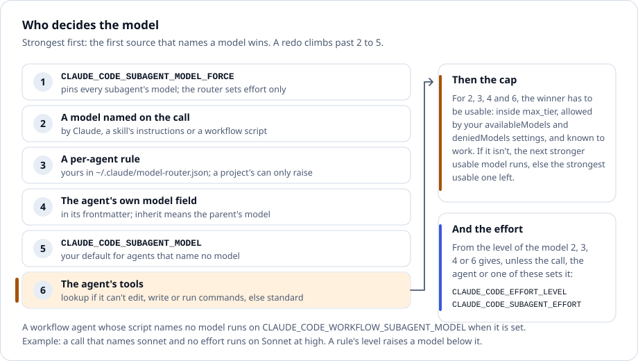

<!-- Page head, written by tools/docs_assets.py: edit PAGES in tools/docs_pages.py, then run it. -->
<p align="center"><a href="../README.md">Model Router</a> &nbsp;&middot;&nbsp; <a href="README.md">Documentation</a> &nbsp;&middot;&nbsp; Previous: <a href="README.md">Documentation</a> &nbsp;&middot;&nbsp; Next: <a href="FAQ.md">Questions</a></p>
<!-- End of page head. -->

# Guide

How to install, use and configure Model Router 0.2.0.

## Install, update and uninstall

It needs Claude Code 2.1.329 or later, `sh`, and Python 3.9 or later as `python3` or `python` on your `PATH`.

- Install: `/plugin install model-router --marketplace crisnahine/claude-code-model-router`, then pick a scope. From a shell, `claude plugin install` takes the same arguments and `--scope`.
- Update: `claude plugin update model-router@claude-code-model-router`, or **Update now** in `/plugin`. Auto-update is off by default; turn it on in the **Marketplaces** tab.
- Disable or uninstall: `claude plugin disable` or `uninstall`, with `model-router@claude-code-model-router`. Uninstalling the last install deletes the plugin's data folder unless you pass `--keep-data`.

## Commands

- `/model-router` prints the [status line](#the-status-line), the session's setup once a request shows it, and how to switch. `/model-router off` and `on` [switch routing for this session](#switch-routing-for-this-session), and `/model-router check off` and `on` set `session_check`. It runs with no model turn, and its reply is for you only. It exists only where the mod runs, in a session with a person at the prompt.
- `/model-router:route [task]` shows the mode, cap, ladder and role agents, which Claude uses to say what model and effort fit the task, or to delegate it.
- `/model-router:models [reset]` shows, per model, what it last ran as and whether it is working, unused, above your cap, not permitted or routed around, and what your rules files had wrong. `reset` clears the model health record first.
- `/model-router:usage [days]` shows, over `days` (default 7), calls per agent with levels and models, redos, tokens per model, model errors and, where the mod runs, Claude Code's cost estimate, which isn't your bill.

`models` and `usage` take `--json`.

## Configuration

### Options

Set in `/config`:

- `routing_mode`: `auto` (default) or `off`. `off` changes no call and adds no notes or checks, but still keeps records and tells Claude of a model error or a mid-run model swap.
- `max_tier`: `none` (default), `haiku`, `sonnet`, `opus` or `fable`, the strongest model a subagent may run on. A stronger one is lowered, except an environment pin or a fork.
- `verify_gate`: `true` (default) or `false`, the [check before a turn ends](#the-check-before-a-turn-ends).
- `session_check`: `ask` (default) or `off`, the [session check](#the-session-check). `/model-router check off` and `check on` write it too, unless managed settings own it.

### Rules files

Your `~/.claude/model-router.json` (in `$CLAUDE_CONFIG_DIR` when set) applies everywhere and is trusted in full. A project's `.claude/model-router.json`, the nearest one up to the repository root, only raises, so a cloned repository can't make its subagents run weaker. Both are JSON, as in `{"agents": {"my-agent": {"model": "opus"}}}`.

Agents are keyed by the name a call uses. Levels are in [the ladder](#the-ladder); efforts are `low`, `medium`, `high`, `xhigh` and `max`.

- `agents.<name>.model`: yours sets it. A project's applies only when not weaker than the call's model without it.
- `agents.<name>.level`: a floor in either file; a call below it runs on the level's model, unless the environment pins it. It also raises the level a call naming no model gets from its agent's tools. To keep an agent on its parent's model instead, set `route: false` for it in yours, or `model: inherit` in the agent's own file.
- `agents.<name>.route`: `false` in yours leaves the agent alone, with no level from its tools either. A project's is ignored.
- `levels.<level>.needs` (the weakest model's strength) and `.effort`: yours sets them; a project's only raises them.
- `models.<name>.strength` and `.cost`: yours adds or re-ranks a model, named by an alias the Agent tool accepts. A project's adds only new names, used only when named, never under `max_tier`.

Where your rule sets an agent's `level` or `model`, a project's rule for it is ignored. `routing_mode`, wrong types and other keys are ignored; `/model-router:models` lists what was dropped or held back. `max_tier` caps only the model; `maxEffortLevel` in your settings bounds effort.

## In a session

Where the mod runs and a person is at the prompt, three things appear. None of them exists in `claude -p`, the Agent SDK, a subagent, a teammate or a workflow agent, and each platform call they make is wrapped, so on a Claude Code or a surface that lacks one, that feature is absent and routing goes on.

### The status line

One line under the prompt, after the plugin's name:

| Part | Shows |
| :- | :- |
| `auto` or `off` | `routing_mode`, or this session's switch, marked `(this session)` while it overrides the saved option. With routing off the line is that word alone |
| `mod` or `fallback` | The path that routed this session's latest call |
| `cap opus` | `max_tier`, when set |
| `14 routed` | This session's calls the router changed, counted from the ledger |
| `2 redos` | This session's calls marked "Redo:" |

It refreshes when the session starts, after each spawn, after each main-loop turn and after a switch, from one runtime answer (`report.status`), after the hook that asks for it has returned. A spawn during a refresh waits for one more.

### Switch routing for this session

`/model-router off` leaves every call as it is from the next spawn, on the mod and the fallback alike, and the ledger records "routing is off" as it does for `routing_mode`. `/model-router on` turns routing back on, over a saved `off` too. The reply says whether it lasts: "Routing is off for this session. To keep it off, set Routing mode in /config." The switch ends with the session, at `/clear` included, and `/model-router` never writes `routing_mode`. The table already in the session note and the Agent tool's description stays in Claude's context after a switch.

### The session check

The session that plans and delegates works best on a strong setup. The recommended ones are in `config/models.json` under `session`, as each model's lowest effort: Opus at `medium`, Fable at `medium` and Sonnet at `xhigh`, each up to `max`. A model left out, such as Haiku, is never recommended.

When a new interactive session starts below these, with `routing_mode` on and `session_check` at `ask`, Model Router asks once, after the session has started:

1. "Model Router works best with a strong session to plan and delegate. This session is on Sonnet at medium. Which model should it run on?" The options are each recommended model usable here, in the order Opus, Fable, Sonnet, then `Stay on Sonnet at medium`. The first carries `(Recommended)`, the strongest one left carries `(the strongest model)`, and Sonnet says `(at xhigh effort or higher)`. A model `availableModels` or `deniedModels` blocks is left out, and so is one `maxEffortLevel` holds below its lowest recommended effort. `max_tier` caps subagents, not the session, so it leaves none out.
2. After a model: "Which effort for Opus? Claude Code keeps this model and effort as your default for new sessions." The efforts run from the lowest recommended one, marked `(Recommended)` and `Claude Code's default` where it is, up to `max (this session only)`, held to `maxEffortLevel`. Under `CLAUDE_CODE_EFFORT_LEVEL`, which `/effort` can't override, a model whose level it already reaches is offered at that level with no second step.
3. After Stay: "Ask about this again?", with `Ask again next session` first and `Don't ask again (/model-router check on brings this back)`, which sets `session_check` to `off`. With the option owned by managed settings, there is no second step.

Picking a setup runs Claude Code's own `/model` when the model differs, then `/effort` when the effort differs, and one line says where the session is now, as "This session is now on Opus at medium." If Claude Code refuses the model, say for an allowlist, the line says the session stayed and no effort is set, since Claude Code saves effort per model. A dismissal, text typed under the dialog's own rows, or Stay changes nothing.

It asks at most once per session, a plugin reload included, and never once the conversation has a prompt in it: a first prompt given at launch, or typed before the question shows, keeps it away. Before the first request the session's effort is an estimate: `CLAUDE_CODE_EFFORT_LEVEL`, then the settings files in Claude Code's order (a model's saved level, a top-level `effortLevel`), then the model's default, `medium`, held to `maxEffortLevel`. It can't see a `--effort` flag or an organization's default effort. From the first request on, the main loop's own effort is read, and `/model-router` shows it, as `session: opus at medium` or `session: sonnet at medium (below the recommended setups)`. A wrong estimate never brings the question back mid-work.

## Who decides the model



1. `CLAUDE_CODE_SUBAGENT_MODEL_FORCE` runs every subagent on `CLAUDE_CODE_SUBAGENT_MODEL`, else the conversation's model. The router sets only effort, and none on a call that names a model.
2. A model named on the call, by Claude, a skill or a workflow script. A prompt asking for one ("use opus") gets Claude a note to pass it.
3. A per-agent rule: yours, or a project's when not weaker.
4. The agent's own `model` field. `inherit` there is the agent's choice of the parent's model, and it outranks 5.
5. `CLAUDE_CODE_SUBAGENT_MODEL`. The router leaves the call alone unless it is a redo. Unforced, the variable doesn't move the built-in Explore and Plan, so they go on to step 6.
6. The agent's tools. An agent whose `tools` hold none of Edit, Write, NotebookEdit and Bash, or whose `disallowedTools` remove them all, as the built-in Explore and Plan, runs at `lookup`; any other at `standard`. The router reads only the agent's definition here, never the brief. A [teammate](#agent-teams) starts no lower than `standard`.

For a workflow agent whose script names no model, `CLAUDE_CODE_WORKFLOW_SUBAGENT_MODEL` ranks between 1 and 2, with only effort set. `max_tier` doesn't lower these environment pins; a session-start notice names them. Under 2, 3, 4 and 6, a rule's `level` first raises a weaker model. The model must then be inside `max_tier`, allowed by `availableModels` and `deniedModels`, and not routed around, else the next stronger usable model runs, or the strongest usable one.

Effort set by the call, the agent, `CLAUDE_CODE_EFFORT_LEVEL` or `CLAUDE_CODE_SUBAGENT_EFFORT` stays. Otherwise a model from 2, 3, 4 or 6 gets its level's effort, one step more on a model weaker than the level (at most `xhigh`). A call left on its parent's model through `inherit` gets none unless capped. On the session's own model, a main-conversation call gets at least the session's effort.

## The ladder

Each model stands for its lowest level; Haiku named at `high` or above stands for `standard`.

| Level | Model | Effort |
| :- | :- | :- |
| `lookup` | Haiku | `medium` |
| `standard` | Haiku | `high` |
| `complex` | Sonnet | `high` |
| `hardest` | Opus | `high` |
| `frontier` | Fable | `high` |

To run a level on a stronger model, raise its `needs` to that model's strength (Haiku 1, Sonnet 2, Opus 3, Fable 4) in your `~/.claude/model-router.json`. This puts `complex`, and with it the table's design and review row, on Opus:

```json
{"levels": {"complex": {"needs": 3}}}
```

## Redo

Claude marks a redo by starting the `description` with "Redo:" after a failed check or a gap in a report. It climbs from the latest run of the same agent and description (case and spacing aside) that finished in this session in the last 30 minutes, else from what the call would run at unmarked: one effort step while that run was below `high`, else the next stronger usable model at its level's effort, else one more step. From Haiku at `medium`: Haiku `high`, Sonnet `high`, Opus `high`, Fable `high`, `xhigh`, `max`. With no step left, the redo runs as before, and Claude reads that nothing stronger is usable.

A redo naming more than that run runs as named; naming the same or less climbs anyway. It climbs past a rule's model, the agent's model and effort, and `CLAUDE_CODE_SUBAGENT_MODEL`, inside `max_tier`. When `CLAUDE_CODE_EFFORT_LEVEL`, `CLAUDE_CODE_SUBAGENT_EFFORT` or `maxEffortLevel` holds the effort, it moves to the next model; under `CLAUDE_CODE_SUBAGENT_MODEL_FORCE` it only gets the effort step, up to `max`. Where the mod runs, a redo climbs from the model and effort the run's requests carried, after any cap.

No redo applies to a workflow stage, an agent whose definition isn't found, a model outside the registry, or `route: false`. A redo of a call that named no model climbs from the level its agent's tools gave it. A redo changes only its own call.

## The check before a turn ends


When Claude or a subagent changed a project file with Edit, Write or NotebookEdit and no check ran since, the `Stop` hook asks Claude once for the work's own check: tests, type check or linter for code, a recompute for figures, a reread for a document. Each ask costs a turn.

A check is a test runner, linter or type checker run through Bash (`pytest`, `npm test`, `make check`), in the session or a subagent. A build, a tool only named (`pip install pytest`) and a refused command don't count, and a shell command's file change isn't an edit. It asks once per batch of edits, never while a background task runs or when the transcript can't be read.

## Workflows and ultracode

Workflow agents are routed only where the mod runs. The Workflow tool's description carries the same table as the session note, so a script Claude writes names a model and effort for each stage. A model the script names is capped and gets its level's effort, and a stage naming none, as in a saved script written without them, runs on its agent's own model, else at the level its tools put it. The router only raises a stage's effort, since it can't see the script's, and never redoes a stage. Under ultracode the session's effort is the floor on the session's model.

## Agent teams

A teammate keeps one model for all its tasks, so one that nothing names a model for starts no lower than the `standard` level's model, even when its agent can only read. Its effort is set even under `CLAUDE_CODE_SUBAGENT_EFFORT`, which doesn't reach teammates. Without the mod, a named call counts as a teammate only while `CLAUDE_CODE_EXPERIMENTAL_AGENT_TEAMS` is on.

## Role agents

Five agents carry their own models, which hold with routing off: `model-router:scout` (search) and `verifier` (checks) on Haiku at `medium`, `implementer` (code to a plan) on Haiku at `high`, and `architect` (plans) and `reviewer` (risky diffs) on Sonnet at `high`. Only the implementer has Edit and Write.

## Compatibility

Agents from any plugin, skill or project are routed. The router never changes which agent runs and never approves a tool call, so other plugins' hooks, your permission rules and auto mode still apply.

<a id="refused-rewrites"></a>Without the mod, the router rewrites the Agent call's `model` and `effort` and tells Claude. If a rewritten call comes back unrun, its repeat passes through unchanged, or is refused with the model to use if it exceeds `max_tier`.

### Organization allowlists

The mod reads `availableModels`, `deniedModels` and `maxEffortLevel` from your settings, so a blocked model is never picked and no effort passes the cap. If the lists leave no registry model open, the call runs as it is. Without the mod, only Claude Code enforces them.

### Third-party providers

Where a provider's alias runs an older model, as on Bedrock, Vertex AI and Foundry, the mod sends `claude-opus-5-5`, `claude-sonnet-5-5` or `claude-haiku-5-5`, or the alias for a day after a refusal. `ANTHROPIC_DEFAULT_<FAMILY>_MODEL` keeps the alias. None of these is tested live.

## What it stores

Its state is in `~/.claude/plugins/data/model-router-claude-code-model-router/`, readable only by you on macOS and Linux, and holds no prompt, brief or description. `ledger.jsonl` has a row per spawn, result, model error, check and subagent turn (agent, level, model, effort, reason, tokens, cost estimate) for 30 days, at most 4 MiB. `state.json` holds model health until `reset`. The rest track routes, redos, edits, locks and each session's switch and session check for a day or the newest 200 sessions. Delete the folder to remove it all. On a Python that writes no bytecode under the launcher, as the macOS system Python does, compiled code is cached in `~/.cache/model-router/pycache`, which you can delete at any time and which uninstalling leaves behind.

## What it can't do

- It never changes the main conversation's model or effort by itself, since a switch re-reads the conversation uncached. The [session check](#the-session-check) offers one before the first prompt, and only a setup you pick runs `/model` and `/effort`. Otherwise use `ultrathink` or `/effort`.
- It leaves forks, resumed agents and agents whose definition it can't find alone, unless the call or your rule names a model.
- It doesn't retry a failed call; set `fallbackModel`. After a model error it suggests a usable model (not under the force variable), and after two errors, or two runs on another model, it routes around that model for a day. With the mod, a run that another mod moved to another model doesn't count.
- Where Fable bills to usage credits, a background session or teammate with nobody to answer the consent prompt ends its turn, and `claude -p` bills without asking; `max_tier` at `opus` avoids both.
- Without the mod, as where an organization blocks user mods, it has no dollar figures, workflow routing, settings lists, newest IDs or model table in the Agent and Workflow tools' descriptions, and no status line, `/model-router` or session check: the state is in `/config` and `/model-router:usage`, and nothing asks about the session. With hooks off it does nothing.
- The session check can't see an organization's model restrictions or effort limits, which come with the sign-in. Claude Code still refuses a blocked `/model`, and the check says the session stayed.
