<!-- Page head, written by tools/docs_assets.py: edit PAGES in tools/docs_pages.py, then run it. -->
<p align="center"></p>

<p align="center"><a href="../README.md">Model Router</a> &nbsp;&middot;&nbsp; <a href="README.md">Documentation</a> &nbsp;&middot;&nbsp; Previous: <a href="FAQ.md">Questions</a> &nbsp;&middot;&nbsp; Next: <a href="README.md">Documentation</a></p>
<!-- End of page head. -->

# Guide

How to use, configure and run Model Router, and how it behaves on your setup. The [README](../README.md) is the short version; [ARCHITECTURE.md](ARCHITECTURE.md) has the internals.

## Commands

The five commands and their arguments are in the [README](../README.md#commands). Type `/model-router:ship` in full: where Claude Code has its own `/ship`, the bare `/ship` runs that command, which can commit, push and open a pull request with no confirmation prompt ([ship command](https://code.claude.com/docs/en/ship-command.md)). A plugin skill always loads under its `plugin:skill` name, so both stay available ([skills](https://code.claude.com/docs/en/skills.md#resolve-skills-that-share-a-name)).

With `--json`, `models` and `usage` print one JSON object instead of the tables. Its `schema` key names the shape and version, `model-router.models/1` and `model-router.usage/1`. A new key keeps the version; a key removed, renamed or changed in meaning bumps it. Scripts can run the commands without Claude: `sh <plugin>/scripts/model-router.sh --data-dir <plugin data dir> usage 30 --json`. The shapes are in [ARCHITECTURE.md](ARCHITECTURE.md#machine-readable-output).

## Role agents

The plugin ships seven agents for work that no better-fitting agent covers: `model-router:scout`, `verifier`, `docs-researcher`, `implementer`, `architect`, `reviewer` and `deep-solver`.

The scout, verifier and docs-researcher name Haiku at medium effort in their own definitions, so they stay cheap even when the router isn't routing (`routing_mode` at `advise` or `off`, no Python, hooks off). The other four name no model or effort, so the router routes each by its brief. The architect and reviewer start no lower than complex because of their names, and the deep-solver no lower than hardest, so a frontier brief can still take it to the strongest model. With the router not routing, those four run on `CLAUDE_CODE_SUBAGENT_MODEL` if it's set, else on the conversation's model ([sub-agents](https://code.claude.com/docs/en/sub-agents.md#choose-a-model)).

The architect, reviewer, scout, verifier and docs-researcher have no Write or Edit tool, so none should get a task whose result is a file; their descriptions tell Claude when each is the right tool.

`/model-router:ship <task or issue>` runs a loop with them: understand, plan, build, verify, review, fix, and commit on a branch. A task of a few edits skips the plan and the build agent. It stops before pushing, merging or deploying.

## Configuration

Options, in `/config` under the plugin:

| Option | Default | Meaning |
| :- | :- | :- |
| `routing_mode` | `auto` | `auto` sets model and effort on every agent. `advise` only tells Claude the estimate. `off` does nothing but keep the ledger |
| `priority` | `balanced` | `balanced`: the cheapest model strong enough. `quality`: one step stronger. `fast`: one step lighter, and the quickest that qualifies. Fast sets no effort above `low`, so a lookup runs at Claude Code's own default for Haiku, `medium` ([effort](https://code.claude.com/docs/en/model-config.md#adjust-effort-level)) |
| `max_tier` | none | The strongest model subagents may run on: `haiku`, `sonnet`, `opus` or `fable`. Anything stronger is lowered to it |
| `agent_pins` | `respect` | `respect` keeps the model an agent names for itself. `override` routes those agents by task too |
| `main_effort` | off | Raises the main conversation's effort for a complex or harder request, for that turn, and never lowers it. Where it stays off is below the table |
| `update_check` | on | The daily check of the changelog, docs index, model list and deprecations |
| `verify_gate` | on | Asks for a test run before a turn ends when code changed and nothing checked it. It is the failure signal the router needs to start cheap and rerun what fails ([cost and intelligence](https://platform.claude.com/docs/en/about-claude/models/optimizing-for-cost-and-intelligence)), at the price of a turn and sometimes an agent |
| `strong_agent_gate` | on | Asks for a stronger agent's check before a turn ends when a weak session model answered a hard request alone. It rarely fires on a strong session model |

`main_effort` stays off wherever an effort change would re-read the context uncached: on Bedrock (including its Mantle endpoint), Vertex or a Claude apps gateway, with `CLAUDE_CODE_DISABLE_EXPERIMENTAL_BETAS` set, with prompt caching turned off (`DISABLE_PROMPT_CACHING` or a per-model variant), and on a model other than Fable 5.1 or later, Opus 5.5, Sonnet 5.5 and Haiku 5.5 (`main.effort_keeps_cache` in `config/models.json`). It is also off on Foundry, behind `ANTHROPIC_BASE_URL` and on another third-party provider, where the router can't confirm the cache survives, and while `CLAUDE_CODE_EFFORT_LEVEL` is set. When the model isn't known, as after `/clear`, effort is raised as usual. Leave it off in a HIPAA organization, which the router doesn't detect, or if Claude Desktop reaches Claude through a Claude apps gateway, which it can't tell from a subscription.

On plans where Fable bills to usage credits, a frontier subtask sent to Fable bills there too. A background or teammate session may have nobody to answer the consent prompt, so Claude Code ends the turn when its `dialogExpiry` deadline passes, and `claude -p` or an Agent SDK host with no prompt bills without asking ([Fable and usage credits](https://code.claude.com/docs/en/model-config.md#fable-and-usage-credits)). Set `max_tier` to `opus` where that matters.

Rules and extra models go in a JSON file. `~/.claude/model-router.json` is yours and applies everywhere. `.claude/model-router.json` belongs to a project. Both have the same shape:

```json
{
  "routing_mode": "advise",
  "agents": {
    "general-purpose": { "level": "standard" },
    "my-agent": { "model": "opus" },
    "legacy-agent": { "route": false }
  },
  "levels": { "complex": { "effort": "xhigh" } },
  "models": { "newmodel": { "strength": 3.5, "speed": 2, "cost": 3.5 } }
}
```

Your own file is trusted in full. A project's file only raises. It can turn routing down to `advise` or `off`, add models, and raise any level's model and effort. Its rule for an agent is a floor and a suggestion: the rule's `level` can lift a call above the level its brief earns, and its `model` applies only when it isn't weaker than what the call would run on without it (the router's pick, the agent's own `model`, `CLAUDE_CODE_SUBAGENT_MODEL` or the inherited model), and never when it names a model the project's own file added. So a cloned repository can make its subagents cost more, never run weaker. To bound what it can spend, set `max_tier`: it caps the model, and the effort the project set stays.

A project's file can't do the rest. Its `route: false` is ignored, as is any lowering of a level (below the shipped value, or below yours when your file sets one). It can't turn routing on for someone who switched it off, re-rank a model that ships with the plugin or that you defined, set prices, or get any model past your cap. A level's `needs` never falls below the level under it, so raising one level lifts the ones above.

A `needs` that isn't a finite number, or any other key of the wrong type, is dropped from every file without an error. `/model-router:models` lists what was dropped, what a project's file asked for that wasn't applied, and any file written for a newer release (it still loads, applying what this release understands). A file may carry `"schema": 1`; without it, it is read as version 1. Older shapes keep working after an update ([ARCHITECTURE.md](ARCHITECTURE.md#compatibility)).

## Who decides the model


In order, strongest first:

1. `CLAUDE_CODE_SUBAGENT_MODEL_FORCE` in your environment pins every subagent's model, so the router sets only effort. The session-start note says so once, because a pinned strong model costs far more on lookups: Opus 5.5's list price is 40 times Haiku 5.5's per token, for prompts up to 100,000 tokens ([pricing](https://platform.claude.com/docs/en/about-claude/pricing.md)).
2. A model named on the call itself, by Claude, a skill's instructions or a workflow script. If you ask for a model in your prompt ("use opus for this"), Claude is reminded to pass it on the calls for that request.
3. A per-agent rule in your `~/.claude/model-router.json`, or the project's `.claude/model-router.json` when its model isn't weaker than what the call would run on without it (steps 4 to 6).
4. The agent's own `model` field, unless you set `agent_pins` to `override`. Its effort still follows the subtask when the agent sets none.
5. `CLAUDE_CODE_SUBAGENT_MODEL`, your default for agents without a model.
6. The router's pick.

For a workflow agent whose call names no model, `CLAUDE_CODE_WORKFLOW_SUBAGENT_MODEL` ranks between steps 1 and 2 (see below).

Under steps 1 and 5 your environment has decided, so the model is left as it is: with the force variable the router sets only effort, and with `CLAUDE_CODE_SUBAGENT_MODEL` it leaves the call alone, unless `agent_pins` is `override`. Under steps 2, 3, 4 and 6, the winner has to be usable: inside your cap, allowed by your settings and known to work. If it isn't, the strongest usable model below it runs, or the weakest usable one when none is below it.

Effort is left alone when the call, the agent, `CLAUDE_CODE_EFFORT_LEVEL` or `CLAUDE_CODE_SUBAGENT_EFFORT` already sets it. Claude Code ignores `CLAUDE_CODE_SUBAGENT_EFFORT` for agent-team teammates, so for a teammate the router still sets the effort. Every effort it sets is held to `maxEffortLevel` when a settings source sets one, and the ledger reason and `/model-router:route` say when it was. The lowest cap of any source applies, a source's `modelSettings` entry for a model replaces its own top-level cap for that model, and `max` sets none ([settings](https://code.claude.com/docs/en/settings-reference.md#maxeffortlevel)).

`CLAUDE_CODE_WORKFLOW_SUBAGENT_MODEL` runs every workflow agent on one model while other subagents keep theirs ([changelog](https://code.claude.com/docs/en/changelog), 2.1.296). The docs don't say whether it wins over the model a mod sets on `agent.spawn`. In a live run on Claude Code 2.1.331 it did, so while it is set the router sets only a workflow agent's effort, as under the force variable. The session-start note and `/model-router:models` name the pin, and `/model-router:usage` shows the model each workflow agent ran on.

## Workflows and ultracode

Ultracode is a Claude Code setting that has Claude run substantive tasks as dynamic workflows, at the session's effort level ([workflows](https://code.claude.com/docs/en/workflows.md#let-claude-decide-with-ultracode)). Turning it on with `/effort` or the `ultracode` setting keeps that level, and `claude --effort ultracode` also sets it to `xhigh` ([model configuration](https://code.claude.com/docs/en/model-config.md#adjust-effort-level)).

Every workflow agent goes through the router at `agent.spawn`, like a subagent, so a stage with no agent file is routed by its brief. A model the script names for a stage counts as the model on the call ([workflows](https://code.claude.com/docs/en/workflows.md#cost)), so the router keeps it, inside your `max_tier`. With `CLAUDE_CODE_WORKFLOW_SUBAGENT_MODEL` set, the pin wins ([who decides the model](#who-decides-the-model)).

A routed stage runs at its level's effort, except that on the session's own model it never runs below the session's level, such as `xhigh` under ultracode, since Claude Code would run it at that level there ([model configuration](https://code.claude.com/docs/en/model-config.md#effort-level-of-subagents-and-teammates)). On a lighter model the session's level doesn't apply, so a lookup stage on Haiku runs at `medium`. The same floor holds for any subagent or teammate the main conversation starts, on either path and under a pinned model too. The ledger records the effort that ran, so a redo still asks for more than the run before. An agent file's own `effort`, `CLAUDE_CODE_SUBAGENT_EFFORT` and `CLAUDE_CODE_EFFORT_LEVEL` keep the router out of effort, and `maxEffortLevel` still caps it.

A script can also pass an `effort` to `agent()`, but the spawn event carries none, so on a stage that names no model the router can't see it and sets its own. Name the model too and the router leaves both alone.

Stages whose briefs land on the same level get the same model and effort, which a fan-out needs to share a prompt cache ([fan-out](https://code.claude.com/docs/en/workflows.md#prompt-caching-in-a-fan-out)). A stage never reaches the `Agent` tool's result hook, so it is never redone one level up and doesn't vote to raise a level. While a workflow or a background subagent is running, the checks before a turn ends wait, since the turn is paused, not done. These were run live under `--effort ultracode` on Claude Code 2.1.331 ([verified live](ARCHITECTURE.md#verified-live)).

## The checks before a turn ends


Before Claude ends a turn, the `Stop` hook runs two checks. The stronger-agent check asks once per request and the test-run check once per batch of edits, then each lets the turn end.

`strong_agent_gate`, when on: a complex or harder request that a weaker session model answered alone, with no agent of the needed strength started, gets one blocked stop and a request for a stronger agent's check. That is the reviewer, given a saved diff, once code changed during the request, else the architect, or the deep-solver for a frontier request. The agent starts no lower than the request's level, so a short hand-off brief can't route it lower, and a redo of it still climbs. A complex request needs Opus, so a Sonnet session is below its need and gets the stop check.

`verify_gate`, when on: Claude is asked once for a test run when code in the project changed and no test, lint, type-check or build ran after the last edit, and no verifier or reviewer is still running. A test run inside a subagent counts.

## What it can't do

These limits come from what Claude Code lets a plugin do, or from choices made to protect quality and cost.

- It doesn't switch the main conversation's model. A mod could, but each model keeps its own prompt cache, so a switch re-reads the whole conversation uncached. It changes the main conversation's effort instead, which keeps the cache on current models, and when a request looks harder than the session's model, Claude is told a strong subagent can take the plan or decision.
- It leaves forks alone. A fork reads its parent's cache and always runs on its parent's model.
- It leaves alone an agent whose definition it can't read, such as one defined on the command line, unless `agent_pins` is `override`. Workflow stages and teammate roles are routed.
- It sees a model swap only in a foreground result, since a background agent's launch carries no usage fields. A run that ends on an API error, such as an overload, counts as a retry when sent again, not a redo.
- It doesn't judge answers. The profile reads the brief's wording and the agent's name, never the code, so it is an estimate. Claude can overrule it on any call, and redo escalation and the feedback loop correct levels that prove too low.
- The profile reads English. A brief mostly in another script, such as Japanese or Cyrillic, or with enough common French, Spanish, Portuguese, Italian, German or Dutch words, starts at standard instead of lookup. A very short brief may still score lookup, and a redo moves it up.
- It doesn't route to a new model family on its own. A new alias in the docs is reported within a day, and routed to once it has an entry under `models`. New versions inside a family need nothing, since Claude Code moves each alias to the newest version. When your session's model or an alias runs an older version than its family's newest, session start says so, usually because a `model` setting names a full version or Claude Code hasn't moved its alias yet.
- It does nothing when hooks are switched off, by `disableAllHooks` or by `allowManagedHooksOnly`. Where an organization blocks user mods, routing falls back to the `Agent` call.
- Spend figures are list prices from the registry's `prices` table. Each model request is priced on its own, so Haiku 5.5's higher rate for a prompt over 100K tokens applies only to the requests that cross it. Fast mode requests are counted at standard rates, because the usage Claude Code reports doesn't say which ran fast. A model with no price is listed as such; add it under `prices` in your own `~/.claude/model-router.json`. Your bill is in `/usage` and `/cost`.

## Compatibility

### Other plugins

The router never changes which agent runs and refuses a call only to hold your cap ([refused rewrites](#refused-rewrites)), so it has nothing to conflict over. Another plugin's hook that denies or asks about a call still applies. If another plugin's mod also sets a spawn's model, the ledger records the model that ran.

### Permission modes

The plugin never approves a tool call: your permission rules and auto mode review every spawn as they would without it. On the `Agent` call fallback, auto mode can refuse a rewritten call once so that it can review the change, and Claude then repeats the call as rewritten and it runs.

### Refused rewrites

On the `Agent` call fallback, a rewritten call that comes back without having run is passed through untouched the next time, so a refusal can't loop. The plugin issues one refusal of its own, to protect your cap: when a call asks for a model above the cap and lowering it didn't take, the repeated call is refused with the model to use instead.

### Organization allowlists

`availableModels` and `deniedModels` are read the way Claude Code reads them.

- With the mod, the router asks Claude Code for each settings source (`policy`, `user`, `project`, `local` and `flag`) and takes only `availableModels`, `deniedModels`, `availableModelsMatch` and `modelOverrides` (counted as set or not). `policy` is managed policy as Claude Code reports it to mods, every managed tier merged. A read that fails or takes over two seconds leaves that source out, and the router uses what the mod last sent for it in this session, else its file, so a failed `policy` read never leaves your own lists standing as if no managed policy existed.
- Without the mod the settings files are read: the managed file and `managed-settings.d/` at their fixed paths, the user and project files, and the local file at the repository root. A file that isn't a regular file of at most 1 MiB is ignored. These files can't show server-managed, MDM, registry or `--settings` policy.
- The managed files apply even when the mod reports policy, as a floor under it: their `deniedModels` add to the reported ones, their `availableModels` must permit a model too, and `availableModelsMatch: exact` in either makes matching exact. A `policy` list key that isn't a list, or a managed file with content that can't be parsed as a JSON object, leaves no model open. An empty file, or a folder in `managed-settings.d/`, counts as no policy.
- A `policy` `availableModels` list applies alone; otherwise the lists in the other sources are combined. `deniedModels` counts only in `policy`. An allow list is cut to 200 entries of 200 characters, which only allows less. A `policy` deny list over that size is never cut, since that would let a denied model through: it leaves no model open.
- An allow entry stands for its family, so `claude-opus-4-6` permits `opus`. An entry naming a specific model (a version prefix such as `claude-sonnet-4-5` or a full ID: one with a digit, or a `claude-` or provider prefix, so `opusplan` beside `opus` keeps `opus`) turns off the entry that names the family, as Claude Code does ([merge behavior](https://code.claude.com/docs/en/model-config.md)). With `["sonnet", "claude-sonnet-4-5"]` the family is still routed, but the mod never sends `claude-sonnet-5-5` in place of the alias.
- A deny entry that names a family with no version (`opus`, `claude-opus`) blocks the family. One with a version (`claude-opus-5-5`, `sonnet[1m]`) blocks that version only, since Claude Code moves an alias off a denied version.

Blocked models are not picked. When the settings leave no registry model open, the call runs as it is, even above a `max_tier` cap, and the ledger says why. If a model is substituted anyway, two substitutions take it out of rotation.

### Third-party providers

Routing uses the aliases `haiku`, `sonnet`, `opus` and `fable`, which Claude Code resolves for your provider. An alias your provider lacks fails or is substituted, and is then routed around. Some providers resolve aliases to older models ([alias table](https://code.claude.com/docs/en/model-config.md#model-aliases)):

- Amazon Bedrock and Google Cloud's Agent Platform (Vertex AI): `sonnet` runs Sonnet 4.5 and `haiku` Haiku 4.5.
- Microsoft Foundry: `opus` runs Opus 4.6, `sonnet` Sonnet 4.5 and `haiku` Haiku 4.5.
- Claude Platform on AWS: `sonnet` runs Sonnet 4.6 and `haiku` Haiku 4.5.
- Claude Models on Google Cloud: `haiku` runs Haiku 4.5.

Sonnet 4.5 retires on 2026-11-30, replaced by `claude-sonnet-5-5`, on Anthropic-operated platforms such as the Claude API and Microsoft Foundry. Amazon Bedrock and Claude Models on Google Cloud (Google managed) set their own date ([model deprecations](https://platform.claude.com/docs/en/about-claude/model-deprecations.md)).

So on those providers the mod starts routed work for those families on the newest model: it sends `claude-opus-5-5`, `claude-sonnet-5-5` or `claude-haiku-5-5`, which Bedrock and Agent Platform map to their own IDs and Foundry sends as the deployment name. If the provider refuses it, the call runs on the alias, and the newest model is tried again after a day (then three days, then a week, if it keeps failing). To keep the alias for a family, set its `ANTHROPIC_DEFAULT_<FAMILY>_MODEL` variable to the version you want. `modelOverrides`, or an `availableModels` or `deniedModels` setting that rules the newest version out, keeps the alias too. Where mods don't load, the `Agent` call fallback can only pass an alias.

`main_effort` stays off on these providers, as [Configuration](#configuration) lists. The prompt-caching docs don't list Foundry among the places where an effort change drops the cache, and through a gateway what stays cached "depends on how the gateway handles the `cache_control` markers" ([changing effort](https://code.claude.com/docs/en/prompt-caching.md#changing-effort-level), [where the cache lives](https://code.claude.com/docs/en/prompt-caching.md#where-the-cache-lives)).

### Versions

Needs Claude Code 2.1.329 or later. The manifest's `network` field needs 2.1.328 ([manifest reference](https://code.claude.com/docs/en/plugins/manifest-reference.md)), 2.1.329 fixed the Agent tool's `effort` parameter being ignored for named teammates ([changelog](https://code.claude.com/docs/en/changelog), 2.1.329), and the mod reads its hook environment with `$.process.hookEnv()`, added in 2.1.326 ([mods reference](https://code.claude.com/docs/en/plugins/mods/reference.md)). That one floor covers the older versions the plugin's features name, such as mods (2.1.287) and per-call effort (2.1.292).

Tested live on 2.1.330 (subagents, workflow agents, teammates, effort per request, the spend log) and, for workflows under ultracode and the workflow model pin, on 2.1.331. What each run covered is in [verified live](ARCHITECTURE.md#verified-live).

### Operating systems

Installed and run live on macOS. The unit tests also run on Linux and Windows in CI.

### Failure handling

Every hook and mod hook fails open. A bug in this plugin can cost routing but can't block a tool call, a spawn or a session. State files are written atomically under a lock. A hook waits at most a second for a busy lock, then skips the write, which loses that one update and counts it; `/model-router:models` shows the counts per file.

## Update and uninstall

The steps to update, pause and uninstall are in the [README](../README.md#update-and-uninstall).
