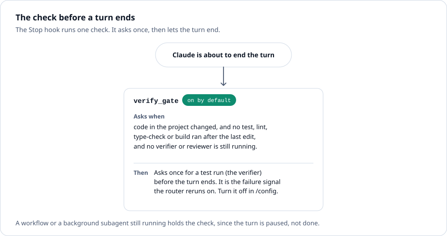

<!-- Page head, written by tools/docs_assets.py: edit PAGES in tools/docs_pages.py, then run it. -->
<p align="center"><a href="../README.md">Model Router</a> &nbsp;&middot;&nbsp; <a href="README.md">Documentation</a> &nbsp;&middot;&nbsp; Previous: <a href="FAQ.md">Questions</a> &nbsp;&middot;&nbsp; Next: <a href="README.md">Documentation</a></p>
<!-- End of page head. -->

# Guide

How to use, configure and run Model Router, and how it behaves on your setup. The [README](../README.md) is the short version; [ARCHITECTURE.md](ARCHITECTURE.md) has the internals.

## Commands

The three commands and their arguments are in the [README](../README.md#commands).

Scripts can run the commands without Claude: `sh <plugin>/scripts/model-router.sh --data-dir <plugin data dir> usage 30 --json`. With `--json`, `models` and `usage` print one JSON object instead of the tables. Its `schema` key names the shape and version, `model-router.models/3` and `model-router.usage/2`. A new key keeps the version; a key removed, renamed or changed in meaning bumps it. `policy`, `models` and `explain` take the options as flags, such as `--max-tier=sonnet`, because only hooks get them from Claude Code; the skills pass them that way. The shapes are in [ARCHITECTURE.md](ARCHITECTURE.md#machine-readable-output).

## Role agents

The plugin ships five agents for work that no better-fitting agent covers: `model-router:scout`, `verifier`, `implementer`, `architect` and `reviewer`.

The scout, verifier, architect and reviewer carry their level in their definitions, the documented way ([sub-agents](https://code.claude.com/docs/en/sub-agents.md#choose-a-model)), so it holds even when the router isn't routing (`routing_mode` at `off`, no Python, hooks off). The scout and verifier name Haiku at medium effort, and the architect and reviewer Opus at high. The implementer names no model, so the caller names one per step; called without one, it runs on `CLAUDE_CODE_SUBAGENT_MODEL` if it's set, else on the conversation's model. A model or effort named on a call wins over the definition's, inside your cap.

The architect, reviewer, scout and verifier have no Write or Edit tool, and only the verifier has Bash, so none should get a task whose result is a file; their descriptions tell Claude when each is the right tool.

## Configuration

Options, in `/config` under the plugin:

| Option | Default | Meaning |
| :- | :- | :- |
| `routing_mode` | `auto` | `auto` keeps the model and effort each call names inside your limits, and fills in the effort from the model's level when only a model is named. `off` changes no call and adds no session-start note, prompt note or check before a turn ends. It still keeps the ledger and model health, and still tells Claude after a model error or a mid-run model swap. `advise`, from older releases, reads as `off` |
| `max_tier` | none | The strongest model subagents may run on: `haiku`, `sonnet`, `opus` or `fable`. Anything stronger is lowered to it, except a model your environment pins: `CLAUDE_CODE_SUBAGENT_MODEL_FORCE`, `CLAUDE_CODE_WORKFLOW_SUBAGENT_MODEL` for a workflow agent whose call names no model, and `CLAUDE_CODE_SUBAGENT_MODEL` where it sets the model and the call isn't a redo. Those calls run on the pinned model |
| `verify_gate` | on | Asks once, before a turn ends, for the work's own check when project files changed and nothing checked them. On by the plugin's own choice: Claude marks a redo after a failed check, and this asks for the check ([cost and intelligence](https://platform.claude.com/docs/en/about-claude/models/optimizing-for-cost-and-intelligence#re-run-failures-at-higher-effort)). No benchmark row measures what it does to cost or quality. It costs one more turn when it asks. It runs only while `routing_mode` is `auto`. `false` turns it off |

On plans where Fable bills to usage credits, a call that runs on Fable bills there too. A background or teammate session may have nobody to answer the consent prompt, so Claude Code ends the turn when its `dialogExpiry` deadline passes, and `claude -p` or an Agent SDK host with no prompt bills without asking ([Fable and usage credits](https://code.claude.com/docs/en/model-config.md#fable-and-usage-credits)). Set `max_tier` to `opus` where that matters, and don't set `CLAUDE_CODE_SUBAGENT_MODEL` or `CLAUDE_CODE_WORKFLOW_SUBAGENT_MODEL` to `fable`, since the cap doesn't hold those.

Rules and extra models go in a JSON file. `~/.claude/model-router.json` (`$CLAUDE_CONFIG_DIR/model-router.json` when `CLAUDE_CONFIG_DIR` is set) is yours and applies everywhere. `.claude/model-router.json` belongs to a project. Both have the same shape:

```json
{
  "agents": {
    "general-purpose": { "level": "standard" },
    "my-agent": { "model": "opus" },
    "legacy-agent": { "route": false }
  },
  "levels": { "complex": { "effort": "xhigh" } },
  "models": { "newmodel": { "strength": 3.5, "cost": 3.5 } }
}
```

The routing mode is set in `/config` only, so a `routing_mode` in either file is dropped. Your own file is trusted in full. A project's file only raises. It can add models, and raise any level's model and effort. Its rule for an agent is a floor and a suggestion: the rule's `level` raises a model below that level to the level's own model, and its `model` applies only when it isn't weaker than what the call would run on without it (the agent's own `model`, `CLAUDE_CODE_SUBAGENT_MODEL` or the parent's model), and never when it names a model the project's own file added. A `level` in your own rule is a floor too; to lower an agent, name its `model`. Where your own rule sets an agent's `level` or `model`, the project's rule for that agent is ignored. So a cloned repository can make its subagents cost more, never run weaker. `max_tier` caps only the model: the effort a project raised stays. To bound effort too, set `maxEffortLevel` in your settings. Claude Code applies it, and where the mod has sent your settings the router holds every effort it sets to it as well.

A project's file can't do the rest. Its `route: false` is ignored, as is any lowering of a level (below the shipped value, or below yours when your file sets one). It can't re-rank a model that ships with the plugin or that you defined, or get any model past your cap. A level's `needs` never falls below the level under it, so raising one level lifts the ones above.

A `needs` that isn't a finite number, or any other key of the wrong type, is dropped from every file without an error. So is a project's `models` or `agents` key that isn't a short plain name (at most 64 letters, digits or `._:/[]-`), or `levels` key that isn't a level, and the note about it doesn't repeat the key. `/model-router:models` lists what was dropped, what a project's file asked for that wasn't applied, and any file written for a newer release (it still loads, applying what this release understands). A file may carry `"schema": 1`; without it, it is read as version 1. Older shapes keep working after an update ([ARCHITECTURE.md](ARCHITECTURE.md#compatibility)).

## Who decides the model


In order, strongest first:

1. `CLAUDE_CODE_SUBAGENT_MODEL_FORCE` in your environment pins every subagent's model, even above `max_tier`, so the router sets only effort, and none on a call that names a model. A message shown to you when a session opens says so.
2. A model named on the call itself, by Claude, a skill's instructions or a workflow script. If you ask for a model in your prompt ("use opus for this"), Claude is reminded to pass it on the calls for that request.
3. A per-agent rule in your `~/.claude/model-router.json`, or the project's `.claude/model-router.json` when its model isn't weaker than what the call would run on without it (steps 4 to 6).
4. The agent's own `model` field. Its effort still follows its level when the agent sets none.
5. `CLAUDE_CODE_SUBAGENT_MODEL`, your default for agents without a model.
6. The parent's model, which Claude Code gives a call that names none. The router leaves it alone, except to hold your cap, and to start a teammate on a parent weaker than Sonnet on Sonnet, since a teammate keeps its model for every task it takes.

A call Claude marks "Redo:" with no model or effort of its own climbs past a rule's model, an agent's own model and effort, and `CLAUDE_CODE_SUBAGENT_MODEL` (steps 3 to 5), staying inside `max_tier` ([redo escalation](ARCHITECTURE.md#redo-escalation)). It climbs from the latest run of the same agent, with the same description after the mark (case and spacing aside), that finished in this session in the last 30 minutes. With no such run it climbs from what the call would run at unmarked. A redo is ignored for an agent whose definition isn't found or whose own model is outside the registry, under your rule's `route: false`, and for a workflow stage.

For a workflow agent whose call names no model, `CLAUDE_CODE_WORKFLOW_SUBAGENT_MODEL` ranks between steps 1 and 2 (see below).

Under steps 1 and 5, and under `CLAUDE_CODE_WORKFLOW_SUBAGENT_MODEL`, your environment has decided, so the model is left as it is, even above `max_tier`: with the force variable the router sets only effort, and with `CLAUDE_CODE_SUBAGENT_MODEL` it leaves the call alone unless Claude marks it as a redo. Under steps 2, 3, 4 and 6, a rule's `level` first raises the winner when it stands below that level. Then it has to be usable: inside your cap, allowed by your settings and known to work. If it isn't, the next stronger usable model runs, or the strongest usable one when nothing stronger is left. A call left on the parent's model that the cap lowers runs at the level of the model it gets.

Each model stands for its lowest level: Haiku for lookup, Sonnet for standard, Opus for complex and Fable for frontier. Opus named with `xhigh` or `max` stands for hardest, and keeps the effort it named. When the call, a rule or the agent names the model and nobody chose the effort, the router sets that level's: `medium` on Haiku and Sonnet, `high` on Opus and Fable. A rule's `level: hardest` runs Opus at `xhigh`. A call left on the parent's model gets no effort from the router, unless the cap lowers its model. A model the cap or availability left weaker than its level needs runs it one effort step higher, up to `xhigh`, or `high` on Haiku.

Effort is left alone when the call, the agent, `CLAUDE_CODE_EFFORT_LEVEL` or `CLAUDE_CODE_SUBAGENT_EFFORT` already sets it, except that a redo overrides the agent's own effort. Under the force variable and `CLAUDE_CODE_WORKFLOW_SUBAGENT_MODEL`, the effort it sets is the pinned model's level's, and under the force variable a call that names a model gets none. Claude Code ignores `CLAUDE_CODE_SUBAGENT_EFFORT` for agent-team teammates, so for a teammate the router still sets the effort. Where the mod has sent your settings sources ([organization allowlists](#organization-allowlists)), every effort it sets is held to `maxEffortLevel` when a source sets one, and the ledger reason and `/model-router:route` say when it was. The lowest cap of any source applies, a source's `modelSettings` entry for a model replaces its own top-level cap for that model, and `max` sets none ([settings](https://code.claude.com/docs/en/settings-reference.md#maxeffortlevel)).

`CLAUDE_CODE_WORKFLOW_SUBAGENT_MODEL` runs every workflow agent on one model while other subagents keep theirs ([changelog](https://code.claude.com/docs/en/changelog), 2.1.296). The docs don't say whether it wins over the model a mod sets on `agent.spawn`. In a live run on Claude Code 2.1.331 it did, so while it is set the router sets only the effort of a workflow agent whose call names no model, as under the force variable, and `max_tier` doesn't lower that model. A model the script names is handled like any named model. The message shown to you when a session opens and `/model-router:models` name the pin, and `/model-router:usage` shows the model each workflow agent ran on.

## Workflows and ultracode

Ultracode is a Claude Code setting that has Claude run substantive tasks as dynamic workflows, at the session's effort level ([workflows](https://code.claude.com/docs/en/workflows.md#let-claude-decide-with-ultracode)). Turning it on with `/effort` or the `ultracode` setting keeps that level, and `claude --effort ultracode` also sets it to `xhigh` ([model configuration](https://code.claude.com/docs/en/model-config.md#adjust-effort-level)).

Every workflow agent goes through the router at `agent.spawn`, like a subagent. A model the script names for a stage counts as the model on the call ([workflows](https://code.claude.com/docs/en/workflows.md#cost)), so the router keeps it, inside your `max_tier`, and sets its level's effort when the script names none that the spawn shows. A stage that names no model runs on its parent's model. With `CLAUDE_CODE_WORKFLOW_SUBAGENT_MODEL` set, the pin wins ([who decides the model](#who-decides-the-model)).

A stage whose model is named runs at its level's effort, except that on the session's own model it never runs below the session's level, such as `xhigh` under ultracode, since Claude Code would run it at that level there ([model configuration](https://code.claude.com/docs/en/model-config.md#effort-level-of-subagents-and-teammates)). On a lighter model the session's level doesn't apply, so a lookup stage on Haiku runs at `medium`, unless its request already carries a higher level, such as one you saved for that model with `/effort` ([model configuration](https://code.claude.com/docs/en/model-config.md#adjust-effort-level)). The same floor holds for any subagent or teammate the main conversation starts, on either path and under a pinned model too. The route the router records for each spawn holds this effort, so a redo climbs from what ran. An agent file's own `effort`, `CLAUDE_CODE_SUBAGENT_EFFORT` and `CLAUDE_CODE_EFFORT_LEVEL` keep the router out of effort, and `maxEffortLevel` still caps it.

A script can also pass an `effort` to `agent()`, but the spawn event carries none, so the router can't see it. On a workflow agent it only raises the effort the request already carries to the level's, never lowers it: a higher effort from the script stays, and a lower one is raised.

Stages that name the same model get the same effort, which a fan-out needs to share a prompt cache ([fan-out](https://code.claude.com/docs/en/workflows.md#prompt-caching-in-a-fan-out)). A stage is never redone, even when its description starts with "Redo:": its script decides what runs again. While a workflow or a background subagent is running, the check before a turn ends waits, since the turn is paused, not done. The live run under `--effort ultracode` on Claude Code 2.1.331 predates the caller naming each model ([verified live](ARCHITECTURE.md#verified-live)).

## The check before a turn ends



Before Claude ends a turn, and only while `routing_mode` is `auto`, the `Stop` hook runs one check, once per batch of edits, then lets the turn end.

`verify_gate`, when on: Claude is asked once for the work's own check when Claude or a subagent changed any file in the project with Edit, Write or NotebookEdit and no check command ran after the last edit. For code that is the project's tests, build or linter, with the verifier for a check that takes more than one command; for figures or a spreadsheet, a recompute or a diff against known values; for a document or an analysis, a reread against the request and its sources. Work that isn't finished, waits on the user or has no check to run ends with one line saying so. A check run inside a subagent counts. Starting a verifier or reviewer doesn't, and neither does a tool that is only named, as in `pip install pytest` or a commit message, or a check that was refused or blocked and never ran. The ask comes as guidance, not a hook error ([Stop decision control](https://code.claude.com/docs/en/hooks.md#stop-decision-control)). It waits while any background task is still running, such as a workflow, subagent, shell, teammate or monitor, and it doesn't ask when the session's transcript can't be read, as under `--no-session-persistence`, since it can't tell whether a check ran.

## What it can't do

These limits come from what Claude Code lets a plugin do, or from choices made to protect quality and cost.

- It doesn't change the main conversation's model or effort. A mod could switch the model, but each model keeps its own prompt cache, so a switch re-reads the whole conversation uncached. For a hard request, type `ultrathink` or use `/effort` ([model configuration](https://code.claude.com/docs/en/model-config.md#adjust-effort-level)).
- It leaves forks alone. A fork reads its parent's cache and always runs on its parent's model.
- It leaves alone an agent whose definition it can't read, such as one defined on the command line, unless the call or your own rule names its model. Workflow stages and teammate roles are routed.
- It sees a model swap only in a foreground result, since a background agent's launch carries no usage fields.
- It doesn't retry a call that fails on a model error. Set `fallbackModel` in settings, or start with `--fallback-model sonnet,haiku`, for that: Claude Code then moves a subagent to the next model in the chain for the turn ([fallback model chains](https://code.claude.com/docs/en/model-config.md#fallback-model-chains)). After a model error the router suggests a usable model to re-issue the call on, except under `CLAUDE_CODE_SUBAGENT_MODEL_FORCE`, where Claude can't name one, and it adds memory across turns: two model errors on one model route it around for a day. It hears only foreground `Agent` calls, not background subagents or workflow stages, and no benchmark or live run has hit it yet; it has unit tests only.
- It doesn't judge the work or answers. It never reads a brief: Claude, which has read the work, names the model, and a call that names none runs as [who decides the model](#who-decides-the-model) says. The session-start note gives Claude a table to name from on each call: Haiku at `medium` for finding, reading and listing, Sonnet at `medium` for everyday work to a clear brief, Opus at `high` for work that is hard to check, high-stakes, ambiguous or broad, and Fable at `high` for open-ended research (only the effort half under `CLAUDE_CODE_SUBAGENT_MODEL_FORCE`, where Claude can't pass a model). That table is the plugin's own guidance, and no benchmark row tests it. The note also has Claude put "Redo:" in front of a redo's `description` after a failed check or a gap in the report. A redo that names no model or effort runs one effort step up while the run it redoes was below `high`, else on the next stronger model, and `/model-router:usage` counts the redos that had a run on record, by the level they climbed from. Only the description's hash is kept to find the run it redoes, never the text. A redo has unit tests; no benchmark row covers one yet.
- It doesn't route to a new model family on its own, and it makes no network call to look for one. This repository's daily upstream check finds a new alias in the docs, and a plugin update adds it; to route to it sooner, give it an entry under `models` in your own file. New versions inside a family need nothing, since Claude Code moves each alias to the newest version.
- It does nothing when hooks are switched off, by `disableAllHooks` or by `allowManagedHooksOnly`. Where an organization blocks user mods, routing falls back to the `Agent` call.
- Its dollar figures are Claude Code's own estimate for each subagent, fast mode, long prompts and search fees included, and not your bill. On a subscription, usage inside the plan isn't billed in dollars, and the report says so. Claude Code gives a mod no estimate per workflow agent, so the report lists those as having no estimate and shows the model each ran on. Their tokens are added only to a model that an `Agent` call's result also reported. Spend is recorded only where the mod runs: on the `Agent` call fallback, `/model-router:usage` shows what was routed where and no dollars. The main conversation's cost is in `/usage`.

## Compatibility

### Other plugins

The router never changes which agent runs and refuses a call only to hold your cap ([refused rewrites](#refused-rewrites)), so it has nothing to conflict over. Another plugin's hook that denies or asks about a call still applies. If another plugin's mod also sets a spawn's model, the ledger records the model that ran.

### Permission modes

The plugin never approves a tool call: your permission rules and auto mode review every spawn as they would without it. On the `Agent` call fallback, auto mode can refuse a rewritten call once so that it can review the change, and Claude then repeats the call as rewritten and it runs.

### Refused rewrites

On the `Agent` call fallback, a rewritten call that comes back without having run is passed through untouched the next time, so a refusal can't loop. The plugin issues one refusal of its own, to protect your cap: when a call asks for a model above the cap and lowering it didn't take, the repeated call is refused with the model to use instead.

### Organization allowlists

`availableModels` and `deniedModels` are read the way Claude Code reads them.

- With the mod, the router asks Claude Code for each settings source (`policy`, `user`, `project`, `local` and `flag`) and takes only `availableModels`, `deniedModels`, `availableModelsMatch`, `modelOverrides` (counted as set or not), `maxEffortLevel` and the effort caps in `modelSettings`. `policy` is managed policy as Claude Code reports it to mods, every managed tier merged. A read that fails or takes over two seconds leaves that source out, and the router uses what the mod last sent for it in this session. A source that took over two seconds isn't waited on again: the mod keeps reading it, and each later spawn sends its newest answer.
- The router never reads the settings files. The mod sends the sources when a session starts and at each spawn. In a session where the mod never answered, so none were sent, it applies no list and no effort cap. Claude Code enforces the lists on every subagent model itself, and runs a blocked one on a fallback model rather than failing the call ([sub-agents](https://code.claude.com/docs/en/sub-agents.md)). A `policy` list key that isn't a list leaves no model open.
- A `policy` `availableModels` list applies alone; otherwise the lists in the other sources are combined. `deniedModels` counts only in `policy`. An allow list is cut to 200 entries of 200 characters, which only allows less. A `policy` deny list over that size is never cut, since that would let a denied model through: it leaves no model open.
- An allow entry stands for its family, so `claude-opus-4-6` permits `opus`. An entry naming a specific model (a version prefix such as `claude-sonnet-4-5` or a full ID: one with a digit, or a `claude-` or provider prefix, so `opusplan` beside `opus` keeps `opus`) turns off the entry that names the family, as Claude Code does ([merge behavior](https://code.claude.com/docs/en/model-config.md)). With `["sonnet", "claude-sonnet-4-5"]` the family is still routed, but the mod never sends `claude-sonnet-5-5` in place of the alias.
- A deny entry that names a family with no version (`opus`, `claude-opus`) blocks the family. One with a version (`claude-opus-5-5`, `sonnet[1m]`) blocks that version only. On the Anthropic API and Claude Platform on AWS, Claude Code moves the alias to the newest permitted version. On other providers it doesn't ([restrict model selection](https://code.claude.com/docs/en/model-config.md)), so there a family counts only when the version its alias runs, or the newest ID the mod sends in its place, is permitted.

Blocked models are not picked. A call that names a blocked model goes to the next stronger usable one, or to the strongest usable one when nothing stronger is left. When the settings leave no registry model open, the call runs as it is, even above a `max_tier` cap, and the ledger says why. If a model is substituted anyway, two substitutions take it out of rotation for a day.

### Third-party providers

Routing uses the aliases `haiku`, `sonnet`, `opus` and `fable`, which Claude Code resolves for your provider. An alias your provider lacks fails or is substituted, and after two of those it is routed around for a day. Some providers resolve aliases to older models ([alias table](https://code.claude.com/docs/en/model-config.md#model-aliases)):

- Amazon Bedrock and Google Cloud's Agent Platform (Vertex AI): `sonnet` runs Sonnet 4.5 and `haiku` Haiku 4.5.
- Microsoft Foundry: `opus` runs Opus 4.6, `sonnet` Sonnet 4.5 and `haiku` Haiku 4.5.
- Claude Platform on AWS: `sonnet` runs Sonnet 4.6 and `haiku` Haiku 4.5.
- Claude Models on Google Cloud: `haiku` runs Haiku 4.5.

Sonnet 4.5 retires on 2026-11-30, replaced by `claude-sonnet-5-5`, on Anthropic-operated platforms such as the Claude API and Microsoft Foundry. Amazon Bedrock and Claude Models on Google Cloud (Google managed) set their own date ([model deprecations](https://platform.claude.com/docs/en/about-claude/model-deprecations.md)).

So on those providers the mod starts routed work for those families on the newest model: it sends `claude-opus-5-5`, `claude-sonnet-5-5` or `claude-haiku-5-5`, which Bedrock and Agent Platform map to their own IDs and Foundry sends as the deployment name. If the provider refuses it, the call runs on the alias, and the newest model is tried again after a day. To keep the alias for a family, set its `ANTHROPIC_DEFAULT_<FAMILY>_MODEL` variable to the version you want. `modelOverrides`, or an `availableModels` or `deniedModels` setting that rules the newest version out, keeps the alias too. When the newest ID can't be sent and you set no such variable, the router's own picks, such as a redo, move from that family to the next one up, and no further, since the older version is a large step down. A model Claude names on the call is kept. Where mods don't load, the `Agent` call fallback can only pass an alias, so there every family whose alias runs an older model counts that way. Where `CLAUDE_CODE_PROVIDER_MANAGED_BY_HOST` is set to any value, the provider counts as unknown and only aliases are sent, since the host ignores the provider switches in settings files. Mantle counts as unknown too.

### Versions

Needs Claude Code 2.1.329 or later. 2.1.329 fixed the Agent tool's `effort` parameter being ignored for named teammates ([changelog](https://code.claude.com/docs/en/changelog), 2.1.329), and the mod reads its hook environment with `$.process.hookEnv()`, added in 2.1.326 ([mods reference](https://code.claude.com/docs/en/plugins/mods/reference.md)). That one floor covers the older versions the plugin's features name, such as mods (2.1.287) and per-call effort (2.1.292).

Tested live on 2.1.330 (subagents, workflow agents, teammates, the spend log) and, for workflows under ultracode and the workflow model pin, on 2.1.331. What each run covered is in [verified live](ARCHITECTURE.md#verified-live). Every one of those runs predates the redesign of 2026-11-24 and 2026-11-25, so none checks the plugin as it is now.

### Operating systems

Installed and run live on macOS, before the redesign. The unit tests also run on Linux and Windows in CI.

### Failure handling

Every hook and mod hook fails open. A bug in this plugin can cost routing but can't block a tool call, a spawn or a session. State files are written atomically under an OS file lock, held on a `.flock` file beside each one, so a process that dies lets go of it at once. A hook waits at most a second for a busy lock, then skips the write, which loses that one update and counts it; `/model-router:models` shows the counts per file. On a filesystem that can't lock, the write goes ahead without one. The launcher runs Python with `-I`, so a repository's `PYTHONPATH` or `PYTHONHOME` can't load code into a hook.

## Update and uninstall

The steps to update, pause and uninstall are in the [README](../README.md#update-and-uninstall).

### From 0.1.2

0.3.0 changes who picks a subagent's model. The full list is in the [changelog](../CHANGELOG.md). What can change for you:

- A call that nothing names a model for now runs on its parent's model, held to your cap, where 0.1.2 picked a model from the brief. So on an Opus or Fable session an unnamed lookup runs on Opus or Fable. To give such calls another default, set `CLAUDE_CODE_SUBAGENT_MODEL`, or a `model` for the agent in your own `model-router.json`.
- The options `priority`, `agent_pins`, `main_effort`, `update_check` and `strong_agent_gate` are gone, and a value saved for one is ignored. `priority: quality` and `agent_pins: override` have no stand-in: name the model on the call, or set the agent's `model` or `level` in your own `model-router.json`. For the main conversation's effort, use `/effort` or `ultrathink`.
- A `routing_mode` in a `model-router.json` file applied in 0.1.2. Now it is dropped, and `/model-router:models` lists it, so a file that turned routing off no longer does: set `routing_mode` to `off` in `/config`. A saved `advise` reads as `off`; set `auto` to route.
- The agents `model-router:deep-solver` and `model-router:docs-researcher` and the skills `/model-router:ship` and `/model-router:refresh` are gone. A rule, a `CLAUDE.md` line or a script that names one needs another target.
- `models --json` and `usage --json` dropped keys, and their `schema` moved from `model-router.models/1` and `model-router.usage/1` to `model-router.models/3` and `model-router.usage/2`.
- `learned.json`, `mod.json`, `prompts.json` and `upstream.json` in the plugin's data folder are never read now, and can be deleted.
