<!-- Page head, written by tools/docs_assets.py: edit PAGES in tools/docs_pages.py, then run it. -->

<a href="../README.md">Model Router</a> &nbsp;&middot;&nbsp; Previous: <a href="GUIDE.md">Guide</a> &nbsp;&middot;&nbsp; Next: <a href="ARCHITECTURE.md">Architecture</a>

<!-- End of page head. -->

# Model Router documentation

Every page about Model Router, the Claude Code plugin that routes each agent to the cheapest Claude model and effort that should do the job. New here? Start with the [README](../README.md) and the [questions](FAQ.md), or watch the [22-second video](https://crisnahine.github.io/claude-code-model-router/assets/video.mp4).

<!-- Cards, written by tools/docs_assets.py from PAGES in tools/docs_pages.py. -->
<table>
<tr><th colspan="2" align="left">Start here What it is, and the questions people ask first.</th></tr>
<tr>
<td width="50%" valign="top"> <a href="../README.md"><b>Model Router</b></a> What does it do, and how do I install it?</td>
<td width="50%" valign="top"> <a href="FAQ.md"><b>Questions</b></a> What is Model Router, and how does it pick?</td>
</tr>
<tr>
<td width="50%" valign="top"> <a href="GUIDE.md"><b>Guide</b></a> How do I configure it for my setup?</td>
<td width="50%"></td>
</tr>
<tr><th colspan="2" align="left">How it works The design, its words and sources, and what it costs to run.</th></tr>
<tr>
<td width="50%" valign="top"> <a href="ARCHITECTURE.md"><b>Architecture</b></a> How do two paths share one router?</td>
<td width="50%" valign="top"> <a href="../GLOSSARY.md"><b>Glossary</b></a> What do call, level, pick and redo mean?</td>
</tr>
<tr>
<td width="50%" valign="top"> <a href="research/model-control.md"><b>Research</b></a> What can a plugin control in Claude Code?</td>
<td width="50%" valign="top"> <a href="research/quality-first-routing.md"><b>Quality research</b></a> What can the router save without losing quality?</td>
</tr>
<tr>
<td width="50%" valign="top"> <a href="research/caller-levels-and-redo.md"><b>Redo research</b></a> Who names a call's level, and what marks a redo?</td>
<td width="50%" valign="top"> <a href="PERFORMANCE.md"><b>Performance</b></a> What does the router cost in time and disk?</td>
</tr>
<tr>
<td width="50%" valign="top"> <a href="SECURITY.md"><b>Security</b></a> What reaches the network, and who can steer it?</td>
<td width="50%"></td>
</tr>
<tr><th colspan="2" align="left">Evidence What was measured and tested, and what is still open.</th></tr>
<tr>
<td width="50%" valign="top"> <a href="CLAUDE_CODE_DOCS.md"><b>Built on the docs</b></a> Which Claude Code docs does it follow, and where?</td>
<td width="50%" valign="top"> <a href="BENCHMARKS.md"><b>Benchmarks</b></a> What does a solved task cost, with and without it?</td>
</tr>
<tr>
<td width="50%" valign="top"> <a href="TEST_RESULTS.md"><b>Test results</b></a> What ran last, and what passed?</td>
<td width="50%" valign="top"> <a href="TRACEABILITY.md"><b>Traceability</b></a> Where is each requirement, and is it met?</td>
</tr>
<tr>
<td width="50%" valign="top"> <a href="RELEASE_READINESS.md"><b>Release readiness</b></a> Is this release ready, and what is still open?</td>
<td width="50%"></td>
</tr>
<tr><th colspan="2" align="left">The project What comes next, what changed, and how to take part.</th></tr>
<tr>
<td width="50%" valign="top"> <a href="ROADMAP.md"><b>Roadmap</b></a> What gets built next, and why first?</td>
<td width="50%" valign="top"> <a href="../CHANGELOG.md"><b>Changelog</b></a> What changed in each release?</td>
</tr>
<tr>
<td width="50%" valign="top"> <a href="../CONTRIBUTING.md"><b>Contributing</b></a> How does a change get merged?</td>
<td width="50%" valign="top"> <a href="../RELEASING.md"><b>Releasing</b></a> How is a release cut, step by step?</td>
</tr>
<tr>
<td width="50%" valign="top"> <a href="assets/BRAND.md"><b>Brand</b></a> Which colors, type and motion make a page ours?</td>
<td width="50%"></td>
</tr>
</table>
<!-- End of cards. -->

## Delivery items

Where each delivery item lives. Checked 2026-11-22.

| # | Item | Where |
| -: | :- | :- |
| 1 | Source code and architecture | [ARCHITECTURE.md](ARCHITECTURE.md), [GLOSSARY.md](../GLOSSARY.md) |
| 2 | Capabilities and commands | [README.md](../README.md) "Commands", "Configuration", [GUIDE.md](GUIDE.md) |
| 3 | Primary-source research | [research/model-control.md](research/model-control.md), [research/quality-first-routing.md](research/quality-first-routing.md) |
| 4 | Supported Claude Code versions, surfaces, platforms and providers | [README.md](../README.md) "Compatibility", [GUIDE.md](GUIDE.md) "Compatibility", [ARCHITECTURE.md](ARCHITECTURE.md) "Verified live" |
| 5 | Install and usage | [README.md](../README.md) "Install the Claude Code plugin" |
| 6 | Automated test results | [TEST_RESULTS.md](TEST_RESULTS.md) |
| 7 | Security assessment | [SECURITY.md](SECURITY.md) |
| 8 | Reproducible cost and quality results, with raw data | [BENCHMARKS.md](BENCHMARKS.md), raw data under [bench/results/](../bench/results/) |
| 9 | Hook latency and state-size measurements | [PERFORMANCE.md](PERFORMANCE.md) |
| 10 | Remaining defects and incomplete requirements | [RELEASE_READINESS.md](RELEASE_READINESS.md) "Remaining defects and incomplete requirements" |
| 11 | Release-readiness assessment | [RELEASE_READINESS.md](RELEASE_READINESS.md) |
| 12 | Roadmap | [ROADMAP.md](ROADMAP.md) "Next" |
| 13 | Comparison against the baselines | [BENCHMARKS.md](BENCHMARKS.md) |
| 14 | Release checklist and changelog | [RELEASING.md](../RELEASING.md), [CHANGELOG.md](../CHANGELOG.md) |

Also kept: [TRACEABILITY.md](TRACEABILITY.md) (one row per requirement, counted by `python3 tools/traceability.py`), [CONTRIBUTING.md](../CONTRIBUTING.md) (gates, commit rules and where to work) and [compat/baseline.json](../compat/baseline.json) (the Claude Code version, docs index, model aliases and model status last reviewed).

## Outside tools and sources

Every outside project, library, benchmark and tool these docs name, with its primary source. Checked 2026-11-22: each page loaded, or, for npm packages, `npm view` returned the version. Claude Code and Claude API claims cite code.claude.com and platform.claude.com where made.

| Name | Used for | Primary source |
| :- | :- | :- |
| SWE-Bench Pro (Scale AI) | The cost and effort figures quoted from Anthropic's cost guide ([research](research/model-control.md)) | https://labs.scale.com/papers/swe_bench_pro |
| Percentile bootstrap (Efron, Annals of Statistics 7(1)) | The 95% intervals in [BENCHMARKS.md](BENCHMARKS.md) | https://doi.org/10.1214/aos/1176344552 |
| `@anthropic-ai/claude-code` on npm | CI's `validate` and `eval` jobs and the daily `newest` job ([SECURITY.md](SECURITY.md)) | https://github.com/anthropics/claude-code (the package's homepage in the registry) |
| TypeScript `tsc` 6.0.3 and `skipLibCheck` | The mod type check ([TEST_RESULTS.md](TEST_RESULTS.md)) | https://www.typescriptlang.org/tsconfig/#skipLibCheck |
| `@types/node` 22.20.5 | The mod test's type check | https://github.com/DefinitelyTyped/DefinitelyTyped/tree/master/types/node (the package's homepage in the registry) |
| Node.js test runner and type stripping | The mod tests | https://nodejs.org/api/test.html, https://nodejs.org/api/typescript.html |
| GitHub CLI `gh run list` | Reading CI runs ([TEST_RESULTS.md](TEST_RESULTS.md)) | https://cli.github.com/manual/gh_run_list |
| tmux | Interactive live runs ([ARCHITECTURE.md](ARCHITECTURE.md) "Verified live") | https://github.com/tmux/tmux/wiki |

