<!-- Page head, written by tools/docs_assets.py: edit its PAGES table, then run it. -->

<a href="../README.md">Model Router</a> &nbsp;&middot;&nbsp; <a href="README.md">Documentation</a> &nbsp;&middot;&nbsp; Previous: <a href="TRACEABILITY.md">Traceability</a> &nbsp;&middot;&nbsp; Next: <a href="ROADMAP.md">Roadmap</a>

<!-- End of page head. -->

# Release readiness

Checked 2026-11-23 for 0.1.0, the first release, on the code at `b836649` (the last `main` commit CI ran on) and the changes after it, on Claude Code 2.1.330. Row IDs (S2.1 and so on) point into [TRACEABILITY.md](TRACEABILITY.md), which holds the evidence.

**Verdict: 0.1.0 ships by the maintainer's decision, with one requirement failing (S4.15), 18 partial and 1 blocked; see below.** Of the 13 release gates, 11 pass; the spend ledger is partial, and CI on the release PR and on its merge into `main` is checked before the tag (RELEASING.md items 5 and 6). No defect is open. The requirement that fails, measured on the routing code at `780ee86`, 10 runs per class and configuration (S4.15): on an Opus 5.5 session, Claude Code's default for most accounts, the router costs less per solved task than `defaults` in 7 of 8 classes, outside the noise, and is level in design. On a Sonnet session it wins lookup only, and in the other 7 classes it costs 7 to 63% more per solved task than the best of `defaults`, `sonnet-medium` and `sonnet-high`, at the same pass rate, because it writes 1,300 to 4,500 more cache tokens per run than `defaults` on the same model, runs security review and half of cross-module at complex (Sonnet at `high`), and sent 4 of 10 design tasks to the read-only architect, 3 of which then needed an implementer that routed to hardest on Opus and 1 of which ended without its file. CI last ran on `b836649` (run 45077498725, success, 11 of 11 jobs); the changes after it run in CI on the release PR.

## Release gates

| Gate | Status | Evidence |
| :- | :- | :- |
| Every subagent, teammate and workflow stage routed on the mod path | PASS | Unit and Node tests cover all three kinds; subagents, a workflow stage and in-process teammates ran live on 2.1.330 (S10.1) |
| A working fallback where mods don't load | PASS | Fallback tests, and live runs of the `Agent` call path in default and auto mode (S10.2) |
| The precedence order and the cap honored in every case | PASS | `Router` tests; the cap holds even when a lowering rewrite didn't take (S10.3) |
| Redo escalation and learning that never loop and never lower quality | PASS | `RepeatGuard` and `Feedback` tests (S10.4) |
| Availability tracking that routes around a model that doesn't work here | PASS | `Registry` and `Router` tests (S10.5) |
| The daily upstream check, failing quietly offline | PASS | `Upstream` tests for a failed fetch, an empty feed, and a fetch that runs past its deadline (S10.6) |
| A spend ledger that matches list prices | PARTIAL | One-hour cache writes, unpriced models and Haiku's long-prompt rate per request are tested. Fast mode requests are logged at standard rates, because Claude Code doesn't say which requests ran fast (S10.7, S4.8) |
| Fail-open behaviour proven by tests | PASS | Garbage payloads to every handler; every mod hook falls back to `next(e)` (S10.8) |
| Automated tests on Linux, macOS and Windows, oldest and newest Python | PASS | CI on `b836649` (run 45077498725): Python 3.9 and 3.13 on Linux, macOS and Windows, 378 tests each, and the mod's Node tests on all three, 18 of 18 (S10.9) |
| CI green on the release PR and on the merge commit in `main`, before tagging | NOT YET for 0.1.0 | The changes after `b836649` haven't run in CI. It runs on the release PR and its merge (RELEASING.md items 5 and 6). Main run 45077498725 passed on `b836649` (S10.10) |
| Reproducible cost and quality results | PASS | [BENCHMARKS.md](BENCHMARKS.md): 640 runs on all 16 tasks, 10 per class and configuration, on Opus 5.5 and Sonnet sessions, raw data and commands committed, $60.11 at list price: the routing code at `780ee86` (`plugin-next`, 160 runs) beside the baselines and the router run with `27b94e6`. Opus table: 7 PASS rows and 1 PARTIAL. Sonnet table: 1 PASS and 7 FAIL. Older rows are kept under `bench/results/archive/` and left out of the tables (S10.11) |
| A security assessment | PASS | [SECURITY.md](SECURITY.md), each claim cited to the code it was checked against (S10.12) |
| Professional documentation and install steps | PASS | The README has its SVG diagrams, and the changelog's 0.1.0 section names the Python versions CI ran (S10.13, S8.2) |

## Remaining defects and incomplete requirements

### Open defects

None.

### Decisions needed

- Fast mode in the spend log: Claude Code's own estimate in `/cost` includes fast mode, and a mod can read it. Logging it beside the router's list-price figure would change the ledger and the usage report. Rows S4.8, S10.7.
- Settled: the ladder and the standard level's effort. The router cost 1.2 to 2.2 times the best baseline per solved task in every class but lookup, at the same pass rate, and `sonnet-medium` solved implementation and known-cause bugfix tasks as often as `sonnet-high` for less. So the ladder now starts cheap (standard on Sonnet at `medium`, complex on Sonnet at `high`, hardest on Opus at `high`), and `main_effort` is off by default. Rows S4.15, S10.11.
- Found on the routing code at `780ee86`, against the same baselines: research got cheaper on both sessions (Sonnet $0.085 per solved task against $0.126 for the router at `27b94e6`; Opus $0.123 against $0.150, now a PASS), since only research-grade wording reaches Fable. On Sonnet the other classes are within the noise of the router at `27b94e6` and still behind: it writes 1,300 to 4,500 more cache tokens per run than `defaults` on the same model, runs security review and half of cross-module at complex (Sonnet at `high`), and sent 4 of 10 design tasks to the read-only architect, 3 of which then needed an implementer that routed to hardest on Opus and 1 of which ended without its file. `89fe183` has since rewritten the architect's description, and a kept rerun of the two design tasks on a Sonnet session started it 0 of 7 times. The Architect keeps complex subtasks on Sonnet at `high` as a quality margin; the next step is a harder task set and the `fast` priority. On Opus, design is level because 7 of 10 design briefs route to hardest, the same Opus `defaults` uses. Rows S4.15, S4.12.
- Found on `27b94e6`, why its Sonnet session lost: the router runs the same model as `defaults`, with no more spawns (1.0 per run, 1.1 in design) and fewer turns, but writes 1,400 to 5,200 more cache tokens per run, which fits the context the plugin adds to every request. On top of that, 3 of 10 design runs went to Opus (hardest) and 2 of 10 research runs to Fable (frontier). Once a brief reaches hardest, the bare word "research" moves it to frontier (`_FRONTIER` in `scripts/modelrouter/profile.py`). The rows don't keep the brief, so whether those two briefs used it isn't shown. No spawn escalated (0 of 161). Rows S4.15, S4.12.
- On builds before `27b94e6`, whose rows are under `bench/results/archive/early-builds/`: found by the rerun, on a Sonnet session and before `f9b9a1b` cut the context the plugin adds: the cheap ladder didn't close the gap. With `main_effort` and `verify_gate` off too, the router still cost 10 to 25% more per solved task than `defaults` in the 7 classes it lost, from its own context in every run (2,300 more cache-write and 11,000 more cache-read tokens per run). Rows S4.15, S10.11.
- On builds before `27b94e6`, whose rows are under `bench/results/archive/early-builds/`: found by the rerun, on an Opus 5.5 session, the `default` model for every account type but Microsoft Foundry (https://code.claude.com/docs/en/model-config.md): `plugin-m6-08-b-nogate` cost $0.123 per solved task against $0.156 for `defaults` (95% interval of the difference -$0.048 to -$0.019), cheaper in 6 of 8 classes, and with the verify gate on it was level. The gate adds 1.15 main-loop turns per run, and the main loop takes 64 to 69% of the router's spend on Opus, so the gate is now off by default. The shipped commit `a06e5d4`, with the gate off and the smaller context, cost $0.124 per solved task against $0.156 (interval -$0.056 to +$0.003) and solved 15 of 16, on 1 run per task. Rows S4.15, S10.11.
- On builds before `27b94e6`, whose rows are under `bench/results/archive/early-builds/`: `design-cache-invalidation` handed to the Sonnet `implementer` passed 1 of 4 times across the router builds on Opus, where `defaults` on Opus passed 4 of 4. Those runs read the task's first spec, which didn't say whether the bus can drop an event (`62e2a9c` settled it). On `27b94e6` with the revised spec, the router solved 10 of 10 design runs on Opus and 9 of 10 on Sonnet, against 10 of 10 and 8 of 10 for `defaults`. Row S4.15.
- On builds before `27b94e6`, whose rows are under `bench/results/archive/early-builds/`: found by the benchmark, for the standard level's effort: `sonnet-medium` solved implementation and known-cause bugfix tasks as often as `sonnet-high` (10 of 10 against 11 of 11), for less: $0.071 against $0.081 per solved implementation task (95% interval of the difference -$0.017 to -$0.002) and $0.057 against $0.063 per solved bugfix (-$0.012 to $0.001, not significant). Row S10.11.
- Whether to run the baselines the benchmark left out: `haiku`, `opus`, `fable`, `opusplan` and the advisor. Row S14.1.
- Whether the Mythos models become a routable family. They are priced in the registry, so their spend is logged, but no level routes to them. Row S2.15.
- A live install check: installing from the marketplace into a scratch config folder and running one routed call. A scratch config folder has its own login, so the run needs the maintainer's login or an API key. Row S6.1.
- Requirement against design: the requirements say the router never blocks a spawn. On the fallback path, a repeated call whose untouched model would break the user's cap is denied, with the model to use (`docs/ARCHITECTURE.md`, "Rewrites that don't take"). Either the requirements make an exception for the cap or the design changes. Row S2.25.
- The mod's one decision: `turn.step` compares effort ranks so the main loop's effort only rises. The requirements say the mod holds no routing logic. Rows S5.2, S13.2.

### Blocked

- A fast-mode price per request: fast mode keeps the model ID, and the per-request usage Claude Code gives the mod has no speed field. Row S4.8.

### Not implemented (FAIL)

- Beating every baseline on cost per solved task: on the routing code at `780ee86`, 10 runs per cell, the router wins 7 classes on an Opus 5.5 session and is level in design, but on a Sonnet session it wins lookup only and is behind in the other 7, at the same pass rate. `haiku`, `opus` and `fable` at default and `high`, `opusplan` and the advisor haven't run. Row S4.15.

### Incomplete or not verified enough (PARTIAL)

- The `haiku`, `opus`, `fable`, `opusplan` and advisor baselines haven't been run (S14.1). CI actions are pinned to SHAs, and CI now type-checks the mod, but neither has run in CI yet (S6.12, S9.5).
- No live run: Desktop, VS Code, JetBrains and the Agent SDK (S3.7); an API-key login: the subscription login is recorded, and the API-key half needs a key (S3.9); Bedrock, Vertex and Foundry (S3.10); `allowManagedHooksOnly` (S3.13); Linux and Windows installs (S6.1); undocumented binary behaviour beyond macOS (S5.6).
- Edge cases without a test or with a known gap: a short brief, or a language outside the profile's list (S12.10); on the mod path, a spawn another plugin's mod moves to another family counts as a substitution (S12.14); the upstream workflow, which hasn't run on `main` yet (S6.16).
- Not measured: fan-out, workflow, team and redo shapes, cache temperature and `priority` (S4.13).
- Design and process: the cap denial (S2.25); the mod's effort check (S5.2, S13.2); agents with no definition on disk are left alone (S3.6); fast mode in the spend ledger (S10.7).
