<!-- Page head, written by tools/docs_assets.py: edit PAGES in tools/docs_pages.py, then run it. -->
<p align="center"></p>

<p align="center"><a href="../README.md">Model Router</a> &nbsp;&middot;&nbsp; <a href="README.md">Documentation</a> &nbsp;&middot;&nbsp; Previous: <a href="BENCHMARKS.md">Benchmarks</a> &nbsp;&middot;&nbsp; Next: <a href="TRACEABILITY.md">Traceability</a></p>
<!-- End of page head. -->

# Test results

The latest results, with the commands that produce them. Replace this file's numbers whenever a gate is rerun; never edit a number you didn't see.

## CI on `main`

`gh run list --branch main` shows the latest CI run on `main`: [45077498725](https://github.com/crisnahine/claude-code-model-router/actions/runs/45077498725), on `b836649`, started 2026-11-22 22:23 UTC. Result: success, 11 of 11 jobs, 378 tests on each Python job. The run before it, [45076035812](https://github.com/crisnahine/claude-code-model-router/actions/runs/45076035812) on `3f036a1`, failed on Windows with Python 3.9, where two set-asides of a state file in one clock tick clashed; `4a475f2` fixed it. The runs on `27b94e6` ([45055601879](https://github.com/crisnahine/claude-code-model-router/actions/runs/45055601879)) and `8ec8eec` ([45004998622](https://github.com/crisnahine/claude-code-model-router/actions/runs/45004998622)) passed.

| Job | Result | Tests | Took |
| :- | :- | :- | -: |
| `test (ubuntu-latest, 3.13)` | success | 378 OK, 1 skipped | 44 s |
| `test (ubuntu-24.04, 3.9)` | success | 378 OK, 1 skipped | 45 s |
| `test (macos-latest, 3.9)` | success | 378 OK, 1 skipped | 127 s |
| `test (macos-latest, 3.13)` | success | 378 OK, 1 skipped | 94 s |
| `test (windows-latest, 3.9)` | success | 378 OK, 19 skipped | 105 s |
| `test (windows-latest, 3.13)` | success | 378 OK, 19 skipped | 92 s |
| `mod (ubuntu-latest)` | success | 18 of 18 pass | 5 s |
| `mod (macos-latest)` | success | 18 of 18 pass | 9 s |
| `mod (windows-latest)` | success | 18 of 18 pass | 15 s |
| `typecheck` | success | the mod type-checks with `tsc` | 9 s |
| `validate` | success | marketplace and plugin both "Validation passed" | 12 s |

The test counts come from each job's log (`gh run view --job <id> --log`), and the times from each job's start and end. Windows skipped more there because the stub `claude` the bench tests used was a shebang script; the stub now runs as `python stub.py` on every OS. Commits after `b836649` have not run in CI yet. CI runs on pushes to `main` and on pull requests, so a work branch is covered once it has an open PR.

## Local

Run 2026-11-23 on macOS (Darwin 27.2.0), on `deepen-modules` after the merge of `fix-bench` and the cents check fix, which has `deepen-bench` merged in. The commit that records these results changes only docs.

| Gate | Command | Result |
| :- | :- | :- |
| Unit tests, Python 3.9.6 | `python3 -m unittest discover -s tests` (`python3` is the system `/usr/bin/python3` here) | 696 tests OK, run 2026-11-24 on `dce8d13` |
| Unit tests, Python 3.13.13 | `python3.13 -m unittest discover -s tests` | 696 tests OK, run 2026-11-24 on `dce8d13` |
| Mod tests, Node 22.22.3 | `node --experimental-strip-types --test "tests/mod/*.test.ts"` | 25 of 25 pass |
| Marketplace, Claude Code 2.1.330 | `claude plugin validate --strict .` | Validation passed |
| Plugin, Claude Code 2.1.330 | `claude plugin validate --strict plugins/model-router` | Validation passed |
| Mod and its test, `tsc` 6.0.3 | `sh tests/mod/typecheck.sh` (published types at a pinned commit, `@types/node` 22.20.5) | No errors |
| Docs assets | `python3 tools/docs_assets.py --check` | Every generated asset, page head and site block matches the script |
| Benchmarks page | `python3 bench/analyze.py bench/results/*.jsonl --out docs/BENCHMARKS.md --check` | The committed page matches the results |
| Traceability count | `python3 tools/traceability.py` | Matches the summary line in [TRACEABILITY.md](TRACEABILITY.md) |
| Plugin evals, Claude Code 2.1.330 | `claude plugin eval plugins/model-router --trust-plugin --ablation with-without --runs 3 --max-cost-usd 2 --no-publish` (below) | 3 of 3 cases pass with the plugin and none without, mean delta 0.78; run 2026-11-23 on `9b27510` |

The 696 local tests are 512 in `tests/test_model_router.py`, 145 in `tests/test_bench.py`, 8 in `tests/test_routing_corpus.py`, 3 in `tests/test_traceability.py` and 28 in `tests/test_docs_assets.py`. The routing corpus test prints "2 of 268 briefs over-routed (0.7%), budget 2%; 4 known under-routes" on each of the interpreters run. CI's run on `8ec8eec` had 180.

Not run here: live sessions (the last ones are in `docs/ARCHITECTURE.md` "Verified live").

## Plugin evals

### Routing cases

The table below was recorded before Haiku work moved to medium effort. The trace carries no effort, so its pass counts still hold, but the cases' `expected_outcome` lines now say `effort medium`.

Run 2026-11-23 on Claude Code 2.1.330, on `9b27510`, on the three cases now in `plugins/model-router/evals/`, from a `git archive` export of that commit:

```bash
CLAUDE_CODE_PLUGIN_CACHE_DIR=<scratch>/plugins claude plugin eval plugins/model-router --trust-plugin \
  --ablation with-without --runs 3 -j 2 --max-cost-usd 2 --no-publish --output-dir <scratch>/out --json <scratch>/result.json
```

The export is needed because the CLI refuses a plugin folder whose git directory registers more linked worktrees than it can screen, and this repository's checkout has many. The three eval briefs profile the same at `9b27510` and at `780ee86` (lookup and complex), so the result holds for the release tip.

Same clean environment as below. Each case tells Claude to make one `Agent` call with an exact brief and no model, and a `regex` grader reads the run's trace for the `resolvedModel` Claude Code reports on that call's result. Without the router, a subagent with no model runs on the session's model, so the no-plugin arm fails by design. No `--allow-tools` grant is needed: routing runs in the plugin's hooks and mod, which start their own processes, not through the Bash tool.

| Case | Session | Grader | With the plugin | Without | Cost with / without (3 runs each) |
| :- | :- | :- | -: | -: | -: |
| `route-lookup-subagent` | Sonnet | `ran-on-haiku` | 1.0, 3 of 3 | 0, 0 of 3 | $0.106 / $0.139 |
| `route-review-subagent` | Haiku | `ran-on-sonnet` | 1.0, 3 of 3 | 0, 0 of 3 | $0.039 / $0.007 |
| `route-redo-escalates` | Haiku | `called-twice`, `first-ran-on-haiku`, `redo-ran-on-sonnet` | 1.0, 3 of 3 | 0.67, 0 of 3 | $0.048 / $0.013 |

The table was recorded before complex moved to Opus, and then to `high`: `route-review-subagent` now expects Opus at `high` (`ran-on-opus`) and its live result has not been rerun.

Total $0.352 (no LLM grader, so no judge cost), 70 seconds, not partial. Every with-plugin run passed every grader and no without-plugin run passed, so the suite's mean delta is 0.78 (the redo case's delta is 0.33, since without the plugin the call is still made twice). The trace carries each subagent's model but not its effort, and the spend log lives in the plugin's data folder, which a grader can't read (https://code.claude.com/docs/en/plugin-evals.md#what-a-grader-can-look-at), so effort and spend rows are covered by the unit tests and the live runs in `docs/ARCHITECTURE.md`, not here.

### The first run, on the cases these replaced

Run 2026-11-22 on Claude Code 2.1.330 against `atd-7385-next`:

```bash
CLAUDE_CODE_PLUGIN_CACHE_DIR=<scratch>/plugins claude plugin eval plugins/model-router --trust-plugin \
  --ablation with-without --runs 3 -j 2 --max-cost-usd 3 --no-publish --output-dir <scratch>/out --json <scratch>/result.json
```

It ran in a clean environment (no `CLAUDECODE`, `CLAUDE_CODE_*` or `CLAUDE_CODE_SUBAGENT_MODEL`), with a scratch plugins root so the shared plugin data folder wasn't touched, and with the report kept local (`--no-publish`; by default the CLI publishes it to claude.ai). No `--model` was set, so each case ran on the account's default model; the LLM graders used the default judge, Haiku, with three votes each. The `with-without` arm runs each case once with the plugin and once without (https://code.claude.com/docs/en/plugin-evals.md).

| Case | Graders | With the plugin | Without | Cost with / without (3 runs each) |
| :- | :- | -: | -: | -: |
| `route-hard-task` | `picks-strong-tier` (LLM), `skill-fired` (with-only: the `route` skill was invoked) | 1.0, 3 of 3 | 1.0, 3 of 3 | $0.28 / $0.23 |
| `route-trivial-task` | `picks-cheap-tier` (LLM), `no-fable` (regex) | 1.0, 3 of 3 | 1.0, 3 of 3 | $0.22 / $0.88 |

Total $1.61 including the judge, 148 seconds, not partial. Every judge vote was PASS. The `route` skill was invoked once in each with-plugin run of the hard case, but its shell command was denied every time, in those runs and in two of the trivial ones: the eval runner removes Bash unless `--allow-tools` grants it, and a skill's own `allowed-tools` can't widen that (https://code.claude.com/docs/en/plugin-evals.md#grant-tools). So the with-plugin arm got the skill's text and the plugin's hooks, not the router's policy table or `explain` output. That is part of why the score delta is 0 for both cases. The rest is that the model without the plugin also recommends a strong model for the migration and Haiku for the lookup, so these two evals check that the plugin doesn't make the advice worse, not what it adds. Two of the three no-plugin runs of the trivial case took 3 turns and cost about $0.41 each, against $0.07 with the plugin; with three runs that is a hint, not a measured saving. The benchmark's pilot runs are in [BENCHMARKS.md](BENCHMARKS.md).

## Dogfood ledger

The team that works on this repository runs with the plugin loaded, so its own subagents go through the router. Its ledger is `~/.claude/plugins/data/model-router-claude-code-model-router/ledger.jsonl`. It was read from a copy taken 2026-11-22 at 12:07 UTC: 400 rows from 07:16 to 12:06 UTC, across 16 sessions, all of them parsed. Only counts are recorded here, never brief text.

- 45 spawns, all on the mod path (`agent.spawn`). 25 were `model-router:reviewer`, 14 `model-router:verifier`, 4 `general-purpose`, 1 `model-router:docs-researcher` and 1 `web-fetch`.
- 40 were kept unchanged. These sessions set `CLAUDE_CODE_SUBAGENT_MODEL_FORCE`, which pins every subagent's model, and each of these role agents sets its own `effort` (reviewer `high`, verifier `low`, docs-researcher `medium`), so the router had nothing left to set. Their levels: 22 complex, 14 standard, 2 hardest, 1 frontier and 1 lookup.
- 5 were rewritten. 3 `general-purpose` lookups went from Sonnet to Haiku at `low` and ran on `claude-haiku-5-5`. 1 hardest `general-purpose` call went from Sonnet to Opus at `xhigh`. Under the force setting, 1 `web-fetch` lookup kept its model and got `low` effort.
- Each call's `result` row named the model it asked for, and Claude Code resolved each one to that family's ID (3 Haiku, 42 Opus). 44 calls ran in the background and 1 in the foreground.
- No redo: no spawn's reason says it ran a level above an earlier run.
- 12 main-loop turns were raised: 11 complex turns to `high` and 1 hardest turn to `xhigh`.
- 298 usage rows, every one priced, $439.99 at list price. The main loops account for $409.30 (246 rows) and subagents for $30.69 (52 rows).

No routing error was found. Most spawns ran under the force setting, so this ledger mostly checks that path. Model choice was exercised on 4 calls only.

## Type-checking the mod

`sh tests/mod/typecheck.sh` is the gate, and CI's `typecheck` job runs it. It downloads Claude Code's published mod API types (https://github.com/anthropics/claude-code/blob/main/mods/types/claude-code.d.ts) at a pinned commit, installs `typescript` 6.0.3 and `@types/node` 22.20.5 into a temporary folder, and runs `tsc` with the options in `tests/mod/tsconfig.json`. The published copy can be older than your Claude Code (https://code.claude.com/docs/en/plugins/mods/reference.md); move the pin when the mod starts using something newer.

To check against the types your installed build writes, keep a tsconfig outside the plugin folder, so nothing extra ships. Point `claude-code` at the types the plugin-authoring skill writes for the installed build, and leave the DOM library out, since those types declare their own globals:

```json
{
  "compilerOptions": {
    "target": "ES2022",
    "lib": ["ES2022"],
    "module": "ESNext",
    "moduleResolution": "Bundler",
    "strict": true,
    "noEmit": true,
    "allowImportingTsExtensions": true,
    "resolveJsonModule": true,
    "types": [],
    "paths": { "claude-code": ["<plugin-authoring skill>/types/claude-code.d.ts"] }
  },
  "files": ["<repo>/plugins/model-router/hooks/router.ts"]
}
```

To check the test as well, add `tests/mod/router.test.ts` to `files`, install `@types/node` next to the tsconfig, set `"types": ["node"]`, and pass `--skipLibCheck`. The 2.1.330 types redeclare `URL`, `URLSearchParams` and other globals in ways `@types/node` rejects, so the library check fails inside the two `.d.ts` files. With `--skipLibCheck` both `.ts` files are clean.

## Benchmark raw data

[BENCHMARKS.md](BENCHMARKS.md) is generated by `python3 bench/analyze.py bench/results/*.jsonl --out docs/BENCHMARKS.md`, so notes about the raw lines that the script doesn't write go here.

Run numbers of reruns: a run the runner retries keeps its own number. The six outage runs under `bench/results/archive/early-builds/infra/` were run again by hand with `--runs 1`, so each new line says run 0. For four of them that is the slot they replace. The two `cross-currency` reruns (`plugin-cheap` and `plugin-cheap-nomain`, in `bench/results/archive/early-builds/m6-05-cross-module-2026-11-22.jsonl`) replace run 3, so those two cells list run 0 twice and no run 3. Run numbers only set the configuration order, so no figure on the page changes.

Wall time: the rows from builds before `27b94e6`, under `bench/results/archive/early-builds/`, carry no `wall_ms`, and their `duration_ms` isn't used in its place. Each results file is written by one process, one run after another, so the gap between one run's `started_at` and the next is that run plus its check and setup. On the Opus-session files (`m6-05-opus-*`, `m6-05-confirm`), that gap minus `duration_ms` has a median of 0.9 to 1.1 s per file, which is about what the check and setup take. On the Sonnet-session files the median is 1.1 to 36.5 s per file, and the gap is more than 10 s over `duration_ms` for 5 to 36 runs per file. So on those rows `duration_ms` leaves out time the run took. The docs count the wait for background subagents in `duration_api_ms`, not in `duration_ms` (https://code.claude.com/docs/en/agent-sdk/cost-tracking.md). The rows from `27b94e6` on carry `wall_ms`, the runner's own clock around the `claude` process, and the page's latency comes from it.

The `27b94e6` run (2026-11-22, Claude Code 2.1.330, the bench and the router at `27b94e6`, `bench_dirty` false on every row): `--runs 5` per task, so 10 per class and configuration, at `--budget 1.0`. Stage 1 was an Opus 5.5 session (`--model claude-opus-5-5`), `plugin` and `defaults` on all 16 tasks: 160 runs, $21.88. Stage 2 was a Sonnet session (`--model sonnet`), `plugin`, `defaults`, `sonnet-medium` and `sonnet-high`: 320 runs, $22.66. The total is $44.54 at list price. Every cell reached 10, and no run lost the network or hit a limit. Each class ran as its own `run.py` with one results file per class. Each stage ran its classes in parallel workers that shared the stage's cap ($30 and $36): 2 workers on Opus and 4 on Sonnet, each class's `--max-total` being what was left of its worker's share. That way `run.py`'s reserve of twice the budget held once per worker, not once per class. The 810 earlier rows went to `bench/results/archive/` with `git mv`, so the tables compare the router at `27b94e6` only with baselines run beside it, on the same commit, task revisions and Claude Code version.

The `780ee86` run (2026-11-22 UTC, Claude Code 2.1.330, `bench_dirty` false on every row): `plugin-next`, the plugin exported from `780ee86`, which differs from this release in its license, a state-file fix and the architect's description, on every task, `--runs 5`, so 10 per class. Sonnet session: 80 runs, $6.01, under an $8 cap. Opus 5.5 session: 80 runs, $9.55, under a $12 cap. The total is $15.56 at list price. Every cell reached 10, and no run lost the network or hit a limit. The baselines weren't rerun: they are the `27b94e6` run's rows, on the same Claude Code version, machine and task revisions. These runs used `--budget 0.6` where the baselines used 1.0, so that `run.py`'s reserve of twice the budget fit one worker per stage under its cap. No `27b94e6` run had cost more than $0.37, so the lower cap ended no run. Commands: `python3 bench/run.py --configs plugin-next --runs 5 --budget 0.6 --model sonnet` (then `--model claude-opus-5-5`), one class at a time, each class's `--max-total` being what was left of the stage cap.

The baseline run (2026-11-23, Claude Code 2.1.330, `bench_dirty` false on every row): `haiku`, `haiku-high`, `opus`, `opus-high`, `fable`, `fable-high`, `opusplan` and the advisor on an Opus 5.5 session (`--model claude-opus-5-5`), every task, 10 runs per class, `--budget 1.0` as for the existing baselines. That's 640 runs, $94.83, plus $0.22 for one run each of the advisor and `opusplan` first to check this account can run them, so $95.06 under a $100 cap. Every cell reached 10, the dearest run cost $0.54 (`fable-high` on `cross-currency`), and no run errored, lost the network or hit a limit. It ran in rounds (`--first-run`): one round of every task under all eight first, to measure each configuration's cost, then four more rounds for seven of them in four workers, then `fable-high`'s four in one worker, so a cap stop could never leave a cell uneven. `opusplan` sets its own session model, so its rows join both session tables on the page; headless, it never enters plan mode and runs Sonnet throughout.
