<!-- Page head, written by tools/docs_assets.py: edit PAGES in tools/docs_pages.py, then run it. -->

<a href="../README.md">Model Router</a> &nbsp;&middot;&nbsp; <a href="README.md">Documentation</a> &nbsp;&middot;&nbsp; Previous: <a href="TEST_RESULTS.md">Test results</a> &nbsp;&middot;&nbsp; Next: <a href="RELEASE_READINESS.md">Release readiness</a>

<!-- End of page head. -->

# Requirement traceability

One row per requirement, numbered by the section of the maintainer's project brief it comes from (Sections 2 to 14). Checked 2026-11-24 against `9a624b1`. Live results are Claude Code 2.1.330 unless a row says 2.1.331. CI evidence names each run by its commit.

Summary: 141 PASS, 19 PARTIAL, 1 FAIL, 1 BLOCKED, 162 requirements.

`python3 tools/traceability.py` counts the line above; `tests/test_traceability.py` fails when it disagrees with the rows. After a status change, run the script and paste its output over the line.

Statuses: **PASS** implemented and verified; **PARTIAL** incomplete or not verified enough; **FAIL** not implemented, or failed; **BLOCKED** a documented limit of Claude Code or a provider. A status comes only from checked evidence; anything unverified is PARTIAL.

How to read the evidence column:

- `Class.test_name` is a test in `tests/` (`test_model_router.py`, or `test_bench.py` and `test_routing_corpus.py` for the benchmark and corpus classes). A quoted title is a test in `tests/mod/router.test.ts`.
- "CI main" is run [45361583123](https://github.com/crisnahine/claude-code-model-router/actions/runs/45361583123) on `9e247d3`, the 0.1.2 release merge: all 12 jobs that ran passed ([TEST_RESULTS.md](TEST_RESULTS.md) lists them).
- "Live 2.1.330" is the "Verified live" section of [ARCHITECTURE.md](ARCHITECTURE.md): macOS only, headless and interactive auto mode, on the code at `8ec8eec`.

Paths are under `plugins/model-router/` unless they start with `tests/`, `docs/`, `.github/`, `tools/`, `bench/` or `compat/`, or are `GLOSSARY.md`, `CHANGELOG.md`, `RELEASING.md` or the root `README.md`.

## Section 2: two paths, one router

| ID | Requirement | Implementation | Source | Verification | Evidence | Status |
| :- | :- | :- | :- | :- | :- | :- |
| S2.1 | `agent.spawn` routes every subagent, teammate and workflow stage with the parent's exact model | Mod forwards the spawn to `mod-spawn` with `parentModel` and kind | `hooks/router.ts`, `scripts/modelrouter/mod.py` `spawn` | Unit, Node, live | "a spawn passes the pick model to next"; `Mod.test_spawns_are_routed_from_the_parents_exact_model`; `Mod.test_workflow_stages_and_teammate_roles_without_a_file_are_routed`; live 2.1.330 for subagents, a workflow stage and in-process teammates (ARCHITECTURE "Verified live") | PASS |
| S2.2 | Forks and resumed runs pass through untouched | `if (e.fork \|\| e.resume) return next(e)` | `hooks/router.ts` | Node | "forks and resumed runs pass through with no CLI call" | PASS |
| S2.3 | `tool.call` on `Agent` reads a caller's effort so it is never overwritten | `callerEffort` map passed to `mod-spawn` | `hooks/router.ts` | Node, unit | "an effort on the Agent call reaches mod-spawn"; `Router.test_an_agents_own_effort_and_a_callers_effort_are_kept` | PASS |
| S2.4 | `turn.step` sets each routed agent's effort on every request (a subagent's first included), and only raises a workflow agent's | `agentEffort`, `inFlight` maps | `hooks/router.ts` | Node, live | "a routed agent steps at the pick effort"; "a workflow agent's effort is raised to the pick, never lowered"; "a workflow agent stepping before its spawn resolves is only raised too"; "an agent stepping before its spawn resolves still gets the pick effort"; "an agent never steps at another spawn's effort for the same brief"; "a redo's first request gets the redo's effort, not the run it replaces"; "two spawns of one brief in flight together never trade efforts, whichever pick lands first"; live 2.1.330 | PASS |
| S2.5 | `turn.start` and `turn.step` leave the main loop's model and effort alone, and `turn.start` starts no Python | `turn.start` asks the runtime nothing; `turn.step` changes only an agent's effort | `hooks/router.ts` | Node | "a main-loop turn's start asks the runtime nothing, and its effort is left alone" | PASS |
| S2.6 | `turn.complete` prices every turn's tokens into the ledger | `mod-usage` with each request's usage from `turn.step`, priced per request | `hooks/router.ts`, `scripts/modelrouter/mod.py` `usage`, `scripts/modelrouter/ledger.py` `turn_cost`, `registry.cost` | Unit, Node | `Mod.test_usage_is_priced_from_the_registry`; `ModPayloads.test_usage_is_logged_for_its_agent`; `Ledger` class (6 tests); `LongPromptPricing` class (4 tests); "a turn sends each request's usage, so each is priced on its own" | PASS |
| S2.7 | The fallback stands down for each `Agent` call the mod routes, checked per call, so a mod unloaded mid-session or a refused runtime call leaves the fallback routing | `tool.call` writes a mark per `tool_use_id` while the runtime's last round trip worked; `mod.routes` takes it; `mod-start` clears marks over a day old | `hooks/router.ts`, `scripts/modelrouter/mod.py`, `hooks.py` `pre_agent` | Unit, Node | `Mod.test_the_settings_hook_stands_down_only_for_a_call_the_mod_marked`; `Mod.test_after_a_clear_a_call_the_mod_marked_still_stands_the_fallback_down`; `Mod.test_only_a_plain_tool_use_id_is_looked_up`; `Mod.test_marks_older_than_a_day_are_cleared_when_a_session_starts`; "an Agent call is marked for the fallback only while the runtime answers"; "only a plain call id is marked, and a failing write still passes the call on once" | PASS |
| S2.8 | Plugin options from `register(on, options)` reach the runtime as `CLAUDE_PLUGIN_OPTION_*` | `optionEnv` | `hooks/router.ts` | Node | "plugin options reach the CLI env" | PASS |
| S2.9 | Every mod hook fails open, `turn.step` included; `ask()` and `modelSettings()` never throw | `.catch` on each hook; `ask` returns undefined on any error; `modelSettings` returns undefined | `hooks/router.ts` | Node | "every hook falls back to next(e) when it throws"; "a failing or garbled CLI leaves every event unchanged"; "a CLI that throws after next(e) ran does not run next again"; "a clock that throws or hands back no cancel leaves the settings out and runs next once" | PASS |
| S2.10 | Fallback `PreToolUse` rewrite of the `Agent` call, standing down when the mod runs, alone owning the refused-rewrite guard | `pre_agent`; `fallback.route`, `fallback.refused` | `scripts/modelrouter/hooks.py`, `fallback.py`, `hooks/hooks.json` | Unit, live | `Router.test_a_rewrite_changes_two_fields_and_approves_nothing`; `Mod.test_the_settings_hook_stands_down_only_for_a_call_the_mod_marked`; `Router.test_decide_needs_only_its_facts`; live on the Agent call path before 2.1.330 (ARCHITECTURE "Verified live"), not rerun on 2.1.330 | PASS |
| S2.11 | `PostToolUse`, `PostToolUseFailure`, `SubagentStop` record the model that ran, model errors and background results; a background call finishes only when it stops with an answer; `calls.returned` is the one rule set on both paths | `post_agent`, `agent_failed`, `agent_stopped`; `calls.returned` | `scripts/modelrouter/hooks.py`, `calls.py` | Unit | `SpawnPaths.test_every_kind_of_outcome_leaves_the_same_redo_on_both_paths`; `Calls.test_each_outcome_kind_says_whether_it_finished_the_call`; `Hooks.test_results_teach_the_registry_which_models_really_run`; `Hooks.test_model_errors_point_to_the_next_model_and_other_errors_dont_count`; `Mod.test_a_background_agent_that_stops_without_an_answer_is_not_a_result`; `Mod.test_a_background_agent_that_handed_back_its_report_is_a_result`; `Mod.test_a_handback_with_no_message_is_no_answer`; `Shipped.test_agent_stopped_runs_before_the_next_step` | PASS |
| S2.12 | `SessionStart`, `UserPromptSubmit`, `PostModelSwitch`, `Stop`: session state, the request's record (pasted prompts included), the check before a turn ends | `session_start`, `user_prompt`, `model_switch`, `stop` | `scripts/modelrouter/hooks.py`, `gates.py` | Unit | `Hooks.test_session_start_explains_automatic_routing`; `Hooks.test_the_notes_state_facts_and_give_no_commands`; `Hooks.test_advise_mode_never_tells_claude_to_pass_a_model`; `Hooks.test_user_prompt_records_the_request_and_says_nothing_unless_it_names_a_model`; `GatesDefault.test_the_test_run_check_names_the_reviewer_with_a_saved_diff`; `GatesDefault.test_a_hard_request_with_no_edit_ends_its_turn`; `Hooks.test_a_prompt_that_opens_with_pasted_text_is_the_users_request`; `Hooks.test_model_switch_is_recorded`; `Gates` class | PASS |
| S2.13 | A refused rewrite never loops; identical calls sent together are not taken for refused rewrites | Pending rewrites kept until result; same-moment copies routed | `scripts/modelrouter/fallback.py` | Unit | `RepeatGuard.test_the_same_call_again_without_a_result_passes_through`; `RepeatGuard.test_copies_of_one_call_issued_together_are_all_routed`; `RepeatGuard.test_a_refused_effort_only_rewrite_under_force_passes_through`; `Fallback.test_a_rewrite_waits_for_its_result_and_only_a_result_finishes_the_run` | PASS |
| S2.14 | Profile: five levels from the brief and the agent's name; negated clauses don't count as changes | `profile_call` | `scripts/modelrouter/profile.py` | Unit | `Profile.test_call_levels`; `Profile.test_reading_about_something_sensitive_or_broad_is_still_a_lookup`; `Profile.test_a_limit_ends_with_its_clause_and_keeps_the_task_after_it`; `Profile.test_agent_name_sets_a_floor_or_a_ceiling`; `Profile.test_a_judgment_verb_counts_at_the_start_of_the_prompt_too`; `Profile.test_fixing_or_hunting_a_defect_is_complex_or_above`; `Roles.test_the_table_carries_what_each_of_our_agents_is`; `Roles.test_another_plugins_agent_is_only_a_kind`; `Roles.test_a_name_that_only_contains_a_role_word_has_no_role`; `Profile.test_a_reading_is_levelled_with_the_agents_role`; `Profile.test_a_call_that_asks_for_nothing_is_a_lookup_and_a_long_one_is_standard`; `AgentNameCorpus` class over `tests/fixtures/agent-name-corpus.json` (68 names); `Profile.test_words_that_only_look_like_a_fix_stay_put`; `Profile.test_a_debug_compound_is_not_a_fix_even_when_the_description_leads`; `Profile.test_a_fix_the_brief_rules_out_does_not_floor_it`; `Profile.test_ruling_out_a_change_keeps_the_task_after_it`; `Profile.test_the_standard_model_text_does_not_call_fixes_standard`; `Profile.test_a_search_or_check_agent_stays_at_standard_for_a_fix_brief`; `RoutingCorpus` class over `tests/fixtures/routing-corpus.json`: 268 labeled briefs, 2 routed one level too high (budget 2%), none too low, 4 known under-routes listed in the file, every `defect` brief at complex or above | PASS |
| S2.15 | Ladder and registry: level and priority give model and effort; registry knows models, usability, cost, cap | `ladder.pick`, `Registry.select`, `Registry.clamp`; one `Registry` from `config.load`, `config.Level` ordered by difficulty | `scripts/modelrouter/ladder.py`, `registry.py`, `config/models.json` | Unit | `Registry.test_select_by_priority`; `Registry.test_select_uses_cost_and_speed_not_just_rank`; `Registry.test_cap_limits_available_models`; `Levels.test_levels_order_by_difficulty_not_alphabetically`; `Levels.test_a_level_is_its_bare_name_wherever_it_is_written`; `Levels.test_only_config_knows_the_order_of_the_levels`; `Registry.test_needs_never_fall_as_the_level_rises`; `Registry.test_an_alias_that_names_no_model_is_dropped_and_listed`; `JsonOutputs.test_the_models_and_usage_outputs_are_the_recorded_bytes`; `Shipped.test_levels_and_models_are_complete`; `PriceTable.test_every_model_still_in_service_has_a_price`; `PriceTable.test_mythos_is_priced_like_its_fable_twin` | PASS |
| S2.16 | Decision is a pure function of its facts with the documented precedence; lowered to the cap, never raised; unknown caller models left alone | `router.decide` | `scripts/modelrouter/router.py` | Unit | `Router.test_decide_needs_only_its_facts`; `Router.test_the_users_environment_settings_win`; `Router.test_a_model_named_on_the_call_is_lowered_to_the_cap`; `Router.test_a_redo_the_effort_cap_holds_at_the_same_model_and_effort_goes_one_model_up`; `Router.test_the_redo_stays_when_no_stronger_model_is_usable_and_a_pin_keeps_its_model`; `Router.test_rules_in_override_files`; `Router.test_pins_can_be_overridden`; `Registry.test_clamp_never_raises_above_what_was_asked`; `Router.test_a_call_naming_a_model_outside_the_registry_is_left_alone` | PASS |
| S2.17 | One spawn procedure for both paths, in two steps; one ledger row; `calls` alone keeps the routes and records both paths use and `request` the current request's | `spawn.decide`, `spawn.record`; `calls.Route`, `calls.routed`; `request` | `scripts/modelrouter/spawn.py`, `calls.py`, `request.py` | Unit | `Fallback.test_a_spawn_decides_without_writing_and_records_the_guarded_decision`; `Calls` and `Request` classes; `SpawnPaths.test_a_result_leaves_the_same_records_on_both_paths`; `RepeatGuard.test_a_spawn_identifies_its_call_once` | PASS |
| S2.18 | Escalation: a redo runs one level higher, never at less effort, a pinned or ruled agent's too; a workflow stage is never redone; a redo never raises the level of later calls | `router.decide`, `calls.returned`, `spawn.facts` | `scripts/modelrouter/router.py`, `calls.py`, `spawn.py` | Unit | `RepeatGuard.test_a_call_redone_after_its_result_runs_one_level_up`; `RepeatGuard.test_a_rewritten_brief_marked_redo_runs_one_level_above_the_run_it_redoes`; `RepeatGuard.test_a_redo_of_a_frontier_run_stays_on_the_top_rung`; `Mod.test_a_workflow_stage_is_never_redone`; `RepeatGuard.test_a_redo_at_the_top_of_the_ladder_gets_more_effort`; `RepeatGuard.test_a_redo_of_a_pinned_or_ruled_agent_climbs_a_level` | PASS |
| S2.19 | Settings resolved once per hook | `settings.resolve`, `settings.Snapshot` | `scripts/modelrouter/settings.py` | Unit | `Options.test_environment_facts`; `Options.test_skill_commands_read_options_recorded_at_session_start`; `Snapshot.test_each_hook_call_reads_the_registry_and_options_once`; `Snapshot.test_an_override_file_is_read_once_per_call_under_a_cap_or_not`; `Snapshot.test_a_cheap_hook_and_a_result_naming_no_model_load_neither_the_allowlist_nor_the_health_table`; `Snapshot.test_a_field_is_read_on_first_use_and_then_kept`; `Snapshot.test_the_snapshot_picks_with_its_priority_usable_models_and_raises_read_once` | PASS |
| S2.20 | Availability: failing, substituted or rejected models routed around and retried; `availableModels` and `deniedModels` applied as Claude Code applies them, drop-ins included | `health.failed`, `health.ran`, `allowlist.Allowlist.permitted` | `scripts/modelrouter/health.py`, `allowlist.py` | Unit | `Health.test_two_model_errors_route_a_model_around_and_outages_grow`; `Health.test_two_substitutions_route_a_model_around`; `RepeatGuard.test_a_model_that_never_runs_is_routed_around_after_two_refused_rewrites`; `Allowlist.test_managed_drop_ins_merge_in_name_order` | PASS |
| S2.21 | Upstream watch: changelog, docs index, aliases, deprecations, Models API daily; older session versions flagged at session start | `upstream.refresh`, `diff`, `behind` | `scripts/modelrouter/upstream.py` | Unit | `Upstream` class, incl. `test_a_version_older_than_its_familys_newest_is_named_at_session_start`; `Shipped.test_the_docs_researcher_brief_carries_todays_date` | PASS |
| S2.22 | Ledger and spend: every decision, reason, list-price cost; one-hour cache writes at their own rate; unpriced shown as such; writes atomic, locked, bounded | `ledger` writers and `turn_cost`, `store.append_ledger`, `registry.cost` | `scripts/modelrouter/ledger.py`, `store.py`, `registry.py` | Unit | `Mod.test_usage_is_priced_from_the_registry` (1-hour writes); `Reports.test_usage_report` ("No price in the registry for"); `Store` class; `Ledger.test_a_result_row_carries_models_used_only_after_a_swap` | PASS |
| S2.23 | The gate, on by default, off for `false`, `False`, `0`, `no` or `off`: a test run after code changes | `gates.before_stop`; a check run inside the subagent that edited counts | `scripts/modelrouter/gates.py` | Unit | `Gates` class (12 tests); `SubagentChecks` class (2 tests); `GatesDefault.test_every_falsy_form_turns_the_test_run_check_off`; `GatesDefault.test_a_hard_request_with_no_edit_ends_its_turn` | PASS |
| S2.24 | Both paths independently operational and testable | Mod and fallback adapters around `spawn.decide` and `spawn.record` | `hooks/router.ts`, `scripts/modelrouter/mod.py`, `fallback.py` | Unit, Node | `Mod` and `Router` classes; `SpawnPaths.test_the_two_adapters_decide_one_call_the_same_way`; Node suite runs the mod with a stub CLI | PASS |
| S2.25 | The router never changes which agent runs, never approves a tool call, never blocks a spawn or a session | Rewrites touch `model` and `effort` only | `scripts/modelrouter/fallback.py` `route` | Unit | `Router.test_a_rewrite_changes_two_fields_and_approves_nothing`. One exception: a repeated call whose untouched model would break the cap is denied (`RepeatGuard.test_a_refused_rewrite_is_denied_when_the_untouched_call_would_break_the_cap`) | PARTIAL |

## Section 3: universal coverage

| ID | Requirement | Implementation | Source | Verification | Evidence | Status |
| :- | :- | :- | :- | :- | :- | :- |
| S3.1 | Built-in, user, project and plugin agents routed | Agent discovery across project, user, own and other plugins | `scripts/modelrouter/agents.py` | Unit, live | `AgentDiscovery` class; `Router.test_builtin_explore_is_always_written_out`; live on the Agent call path, not rerun on 2.1.330: another plugin's agents routed | PASS |
| S3.2 | Teammates routed | `agent.spawn` with `isTeammate` | `hooks/router.ts` | Unit, live | `Mod.test_workflow_stages_and_teammate_roles_without_a_file_are_routed`; live 2.1.330: two in-process teammates with no agent type ran on Haiku and on Opus (effort then `high`), two on the plugin's pinned role agents kept their models. Split-pane teammates not run | PASS |
| S3.3 | Workflow stages and agents other plugins' skills start routed | `agent.spawn` with `workflow` | `hooks/router.ts` | Unit, live | `Mod.test_workflow_stages_and_teammate_roles_without_a_file_are_routed`; live 2.1.330 workflow stage on Haiku | PASS |
| S3.4 | Inline skills get the main loop's turn effort | An inline skill runs in the main conversation, whose model and effort the router leaves alone; a skill's own `effort` frontmatter sets its level (https://code.claude.com/docs/en/skills.md) | `hooks/router.ts` | Inspection | The router no longer raises a turn's effort for a typed skill; the skill's own `effort`, `ultrathink` or `/effort` does | PARTIAL |
| S3.5 | Forked skills and conversation forks stay on the parent's model | `e.fork` pass-through; a `context: fork` skill starts without an `agent.spawn` event | `hooks/router.ts`, `scripts/modelrouter/router.py` | Unit, Node, live | `Router.test_fork_is_never_touched`; "forks and resumed runs pass through with no CLI call"; live 2.1.330: a `context: fork` skill's subagent ran on the session's model and wrote no spawn row | PASS |
| S3.6 | An agent, plugin or skill never seen before is routed sensibly with no configuration | Profile from brief and name | `scripts/modelrouter/profile.py`, `agents.py` | Unit | `AgentDiscovery.test_other_plugin_by_install_record`; `AgentNameCorpus.test_every_name_keeps_its_role_and_levels`; `Profile.test_agent_name_sets_a_floor_or_a_ceiling`. An agent with no definition on disk that the engine didn't make is left alone (`Router.test_unknown_agents_and_unknown_models_are_left_alone`) | PARTIAL |
| S3.7 | Every surface: terminal, Desktop, VS Code, JetBrains, `-p`, Agent SDK | Surface-independent hooks | `hooks/` | Live | Live 2.1.330: terminal and `-p` on macOS only | PARTIAL |
| S3.8 | Every permission mode, auto mode included | Never approves; mod sets model after review | `scripts/modelrouter/hooks.py`, `hooks/router.ts` | Live | Live 2.1.330: default, auto, plan, acceptEdits and bypassPermissions. Each routed a lookup subagent (`source: router`) and the router answered no permission question. In auto mode a background agent that handed back through `SubagentHandback` counted as finished and its re-issue escalated | PASS |
| S3.9 | Subscription and API-key logins | Models API read only with a direct key | `scripts/modelrouter/upstream.py` | Unit, live | `Upstream.test_models_api_is_read_only_with_a_direct_api_key`. Subscription: live runs used a claude.ai login (`apiKeySource: "none"`). API key: not run live, it needs the user's key | PARTIAL |
| S3.10 | Bedrock, Vertex, Foundry to the extent they allow | Aliases; on the mod path the family's newest ID where the provider's alias lags, falling back to the alias if refused | `scripts/modelrouter/mod.py` `spawn`, `registry.py` `newest_id`, `allowlist.py` `permits_id`, `settings.py` | Unit | `NewestOnProviders` class (9 tests). No live run on any provider | PARTIAL |
| S3.11 | `availableModels`, `deniedModels`, managed settings and `managed-settings.d` honored, from the engine's settings layers or the files | `allowlist.from_layers`, `allowlist.read` | `scripts/modelrouter/allowlist.py`, `hooks/router.ts` | Unit | `Allowlist.test_a_managed_list_applies_alone_else_the_other_sources_are_concatenated`; `Allowlist.test_a_specific_entry_turns_off_its_familys_wildcard`; `Allowlist.test_managed_drop_ins_merge_in_name_order`; `Allowlist.test_denied_models_count_only_in_policy_and_block_a_family_only_by_name`; `Allowlist.test_a_worktree_reads_the_local_file_at_the_main_checkout`; Node "mod-start and mod-spawn carry the allowlist and effort cap keys of each settings source, and only the caps of modelSettings" and "a settings read that fails leaves that source out and sends the others"; `Allowlist.test_a_blanked_engine_policy_never_hides_the_managed_files`; `Allowlist.test_a_managed_file_that_is_there_but_unreadable_permits_no_models`; `Allowlist.test_a_failed_policy_read_never_leaves_the_users_lists_standing`; `Allowlist.test_a_later_payload_without_policy_keeps_the_stored_policy`; `Allowlist.test_a_malformed_policy_list_permits_nothing_while_a_soft_one_is_unset`; `Allowlist.test_a_deny_list_over_the_cap_leaves_no_model_open_while_an_allow_list_is_only_cut`; `Allowlist.test_an_empty_or_blank_managed_file_and_a_folder_in_the_drop_ins_are_no_policy`; `Allowlist.test_max_effort_level_caps_each_family_at_the_lowest_source`; `Mod.test_a_max_effort_level_holds_every_effort_the_router_sets` (`maxEffortLevel`) | PASS |
| S3.12 | `CLAUDE_CODE_SUBAGENT_MODEL`, `_FORCE`, `CLAUDE_CODE_EFFORT_LEVEL`, `CLAUDE_CODE_SUBAGENT_EFFORT` honored | `router.decide` precedence | `scripts/modelrouter/router.py` | Unit, live | `Router.test_the_users_environment_settings_win`; `Router.test_a_forced_subagent_model_still_gets_its_effort`; `Router.test_the_subagent_effort_variable_does_not_reach_a_teammate` (Claude Code ignores that variable for teammates, so the router sets their effort); `Mod.test_forced_subagent_model_gets_effort_only`; live 2.1.330 under FORCE | PASS |
| S3.13 | `disableAllHooks` and `allowManagedHooksOnly` honored | Claude Code runs no plugin hook then | n/a | Live | Live 2.1.330: with `disableAllHooks` the hooks module didn't load and no ledger row was written. `allowManagedHooksOnly` not run | PARTIAL |
| S3.14 | "Verified live" in `docs/ARCHITECTURE.md` kept as the capability registry, with version and method | Section exists | `docs/ARCHITECTURE.md` "Verified live" | Inspection | Names 2.1.330, headless and interactive auto mode, each check | PASS |

## Section 4: cost and quality engineering

| ID | Requirement | Implementation | Source | Verification | Evidence | Status |
| :- | :- | :- | :- | :- | :- | :- |
| S4.1 | Cost per solved task is the measure | `bench/analyze.py` reports cost per solved task, with failed runs counted against it | `bench/` | Benchmark | [BENCHMARKS.md](BENCHMARKS.md): <!-- bench:runs -->1,120<!-- /bench --> runs on <!-- bench:dates -->2026-11-22 to 2026-11-23<!-- /bench --> (Claude Code <!-- bench:claude -->2.1.330<!-- /bench -->), <!-- bench:usd -->$134.97<!-- /bench --> at list price, <!-- bench:per_cell -->5 or 10<!-- /bench --> runs per class and configuration, one table per session model. Opus 5.5 session: the routing code at <!-- bench:opus.commit_code -->`780ee86`<!-- /bench --> (<!-- bench:opus.router_code -->`plugin-next`<!-- /bench -->) and at `27b94e6` (`plugin`) beside `defaults`, `haiku`, `haiku-high`, `opus`, `opus-high`, `fable`, `fable-high`, `opusplan` and the advisor. Sonnet session: the same two builds beside `defaults`, `sonnet-medium`, `sonnet-high` and `opusplan`. Earlier rows are kept in `bench/results/archive/`; the page says how many and why they're left out | PASS |
| S4.2 | Effort tuning before model switching | Standard: Sonnet `medium`; complex: Opus `high`; hardest: Opus `xhigh`; a redo on the same model adds effort first; a pick weaker than its level needs gets one more effort step, at most `xhigh` | `config/models.json` levels, `scripts/modelrouter/ladder.py`, `scripts/modelrouter/router.py` | Unit | `Router.test_the_shipped_ladder_picks_at_balanced_priority`; `Router.test_a_pick_weaker_than_the_levels_need_gets_one_more_effort_step`; `Router.test_the_extra_effort_step_never_goes_past_xhigh`; `RepeatGuard.test_a_complex_redo_stays_on_opus_at_xhigh`; `RepeatGuard.test_a_redo_held_on_the_same_model_by_the_cap_gets_more_effort` | PASS |
| S4.3 | Cheap first, verify, escalate on a failed check | Ladder starts low; redo escalation; Stop gates, the test-run check on by default | `scripts/modelrouter/ladder.py`, `gates.py` | Unit | `Router.test_agents_without_a_model_get_the_one_their_subtask_needs`; `RepeatGuard.test_a_standard_redo_moves_to_opus_at_high`; `RepeatGuard` class; `Gates` class; `Shipped.test_the_verifier_reports_a_check_that_never_ran_as_not_run`; `Shipped.test_the_implementer_finishes_the_plan_and_stops_early_only_for_a_wrong_plan` | PASS |
| S4.4 | Prompt-cache awareness: one model for the main loop, no switch that re-reads the context uncached | The mod sets no main-loop model or effort | `hooks/router.ts`, `scripts/modelrouter/mod.py` | Node, inspection | "a main-loop turn sends only the settings and leaves the main loop's effort alone"; the mod sets no main-loop model (inspection) | PASS |
| S4.5 | Fan-outs that share a prefix | Copies of one brief get the same model and effort | `scripts/modelrouter/calls.py` | Unit | `Mod.test_copies_of_one_brief_launched_in_the_background_all_run_at_its_level`. Live 2.1.330: of three copies started together, the second and third each read the first's 11,764-token prefix from cache and wrote none; a re-issue on another model shared nothing | PASS |
| S4.6 | One-hour cache writes priced at their own rate | `cache_write_1h` | `scripts/modelrouter/registry.py` `cost` | Unit | `Mod.test_usage_is_priced_from_the_registry` | PASS |
| S4.7 | Haiku's long-prompt rate | Each request priced on its own; a `long_prompt` block on Haiku 5.5's price | `config/models.json` `prices`, `scripts/modelrouter/registry.py` `cost`, `scripts/modelrouter/ledger.py` `turn_cost` | Unit, Node | `LongPromptPricing` class (4 tests); "a turn sends each request's usage, so each is priced on its own" | PASS |
| S4.8 | Fast mode and agent-team cost | Teammates are priced as any agent's turn. Claude Code's usage data has no speed field, so fast requests are logged at standard rates | `docs/RELEASE_READINESS.md`, `docs/research/model-control.md` "Fast mode" | Inspection | 2.1.330 mod API types (`TurnUsage`); https://code.claude.com/docs/en/fast-mode.md. `/cost` includes fast mode; logging Claude Code's own estimate waits on a decision | BLOCKED |
| S4.9 | Learned routing from real redos and failures only | Model errors and substitutions route a model around (`health`). A redo climbs for that call only: `/model-router:usage` counts redos by level, and the user raises a level in `model-router.json`. Nothing raises a level on its own, since a redo's gain is mostly the second attempt (https://platform.claude.com/docs/en/about-claude/models/optimizing-for-cost-and-intelligence) | `scripts/modelrouter/health.py`, `report.py` | Unit | `RepeatGuard.test_a_model_that_never_runs_is_routed_around_after_two_refused_rewrites`; `MachineReadable.test_usage_counts_redos_by_the_level_they_climbed_from` | PARTIAL |
| S4.10 | Low hook overhead, latency measured against hook timeouts | Hook timeouts 5 to 10 s (async `refresh-cache` 30 s), mod `timeoutMs` 8000; one Python start per hook, no network modules on the hook path | `hooks/hooks.json`, `hooks/router.ts`, `scripts/model-router.sh`, `bench/overhead.py` | Measured, unit | [PERFORMANCE.md](PERFORMANCE.md): warm hooks 54 to 60 ms p50, cold at most 231 ms p95, each mod question 54 to 58 ms warm, all far under their timeouts. `OverheadBench.test_the_overhead_bench_reports_every_hook_and_state_file`; `Launcher.test_a_hook_starts_python_once`; `Launcher.test_hooks_dont_load_the_network_or_xml_modules`. One machine (macOS arm64) | PASS |
| S4.11 | Measure with `claude plugin eval`, the ledger, `/model-router:usage` and live sessions | Evals under `evals/`; their expected routes checked in the unit gate; benchmark harness | `evals/`, `bench/` | Unit, pilot, live eval | `claude plugin eval` with a no-plugin baseline: the 3 routing cases pass with the plugin and fail without it, mean delta 0.78, run 2026-11-24 on Claude Code 2.1.331 ([TEST_RESULTS.md](TEST_RESULTS.md)). Ledger: live runs priced their spend from usage rows ($0.61 teammate run, $0.08 auto-mode handback run). `/model-router:usage`: `model-router.py usage 30` on the handback run's ledger printed each agent's levels, models and $0.08 at list price, matching the rows. Live sessions: ARCHITECTURE "Verified live"; `RoutingEvals.test_each_eval_case_routes_as_expected`; the benchmark pilot | PASS |
| S4.12 | Measure cost per solved task, pass rate, tokens, accuracy per level, escalation rate, latency, cache hit rate | `bench/analyze.py`; `bench/run.py` records `wall_ms` and `routed`; `scripts/modelrouter/ledger.py` logs `escalated_from` | `bench/` | Benchmark, unit | [BENCHMARKS.md](BENCHMARKS.md) reports, per class and configuration, pass rate, cost per solved task and tokens per run, and a run-metrics table per session model: p50 and p90 of `wall_ms`, cache hit rate (cache reads over all input tokens), accuracy per routed level (from `routed`) and escalation (spawns naming `escalated_from`). Router at `780ee86`, Opus table: p50 13 to 42 s against `defaults'` 21 to 45 s, cache 83 to 89%. Sonnet table: p50 8 to 21 s against 7 to 20 s, p90 within 5 s of `defaults'` except design (40 s against 20 s), cache 86 to 90%. Escalation is 0 in every row, since the single-agent shape has no redo (redo shape: S4.13). Hook latency: S4.10. `duration_ms` is not used as wall time (TEST_RESULTS "Benchmark raw data"). Tests: `Analysis.test_the_page_reports_latency_cache_level_accuracy_and_escalation`, `AgentCosts.test_a_router_run_records_its_spend_by_agent_type`, `RepeatGuard.test_the_ledger_names_the_level_a_redo_climbed_from` | PASS |
| S4.13 | Test small and large tasks, fan-outs, cold and warm caches, every priority | Thirty tasks in eight classes, single-agent shape | `bench/tasks/`, `bench/configs.json` | Benchmark | All eight classes ran, on <!-- bench:tasks -->14<!-- /bench --> of the <!-- bench:tasks_total -->30<!-- /bench --> tasks in the tables. The six quality-tier tasks have a 3-run pilot (90 runs) in `bench/results/pilot/`, left out of the tables; `cross-currency` and `lookup-retry-limit` ran on an earlier revision of their checks, also left out; the rest have no runs. No fan-out, workflow, team or redo shape, no cache temperature, no `priority` comparison | PARTIAL |
| S4.14 | Publish reproducible results with version, models, settings, tasks, commands and live-run cost | [BENCHMARKS.md](BENCHMARKS.md) with raw data and commands | `docs/BENCHMARKS.md`, `bench/results/` | Benchmark | Version, models, settings, tasks, commands and cost recorded: <!-- bench:runs -->1,120<!-- /bench --> runs on <!-- bench:dates -->2026-11-22 to 2026-11-23<!-- /bench --> (Claude Code <!-- bench:claude -->2.1.330<!-- /bench -->; Opus 5.5 and Sonnet sessions, one table each), <!-- bench:tasks -->14<!-- /bench --> tasks in 8 classes, <!-- bench:per_cell -->5 or 10<!-- /bench --> runs per class and configuration, <!-- bench:usd -->$134.97<!-- /bench --> at list price | PASS |
| S4.15 | Beat every baseline on cost per solved task at equal or higher pass rate | Not met | `docs/BENCHMARKS.md` | Benchmark | The routing code at <!-- bench:opus.commit_code -->`780ee86`<!-- /bench --> (<!-- bench:opus.router_code -->`plugin-next`<!-- /bench -->), <!-- bench:per_cell -->5 or 10<!-- /bench --> runs per class and configuration, Claude Code <!-- bench:claude -->2.1.330<!-- /bench -->. A row is PASS only when the router's cost per solved task is below the best baseline's with the whole 95% interval of the difference below zero, at a pass rate no lower beyond noise (Section 14). Per class: the verdict, the router's cost per solved task, then each baseline's with the interval of the router's difference, and the pass count where it missed. Opus 5.5 session (the `default` model on every account type but Microsoft Foundry: https://code.claude.com/docs/en/model-config.md): <!-- bench:opus.trace -->lookup PARTIAL (router $0.063; `opusplan` $0.047 (+0.012 to +0.019), `haiku` $0.058 (+0.003 to +0.007), `haiku-high` $0.058 (+0.002 to +0.007), `defaults` $0.098 (-0.042 to -0.029), `opus` $0.103 (-0.049 to -0.032), `advisor` $0.123 (-0.066 to -0.053), `opus-high` $0.136 (-0.137 to -0.040), `fable` $0.138 (-0.085 to -0.068), `fable-high` $0.188 (-0.189 to -0.081)); implementation FAIL (router $0.121; `opusplan` $0.069 (+0.046 to +0.057), `haiku` $0.082 (+0.032 to +0.045), `haiku-high` $0.083 (+0.031 to +0.043), `defaults` $0.177 (-0.070 to -0.044), `opus-high` $0.181 (-0.073 to -0.048), `advisor` $0.186 (-0.080 to -0.053), `opus` $0.186 (-0.088 to -0.047), `fable` $0.254 (-0.151 to -0.118), `fable-high` $0.351 (-0.270 to -0.200)); bugfix FAIL (router $0.099; `opusplan` $0.060 (+0.035 to +0.043), `haiku` $0.069 (+0.027 to +0.033), `haiku-high` $0.071 (+0.025 to +0.030), `defaults` $0.128 (-0.033 to -0.025), `opus` $0.131 (-0.036 to -0.028), `opus-high` $0.137 (-0.043 to -0.033), `advisor` $0.153 (-0.065 to -0.045), `fable-high` $0.187 (-0.105 to -0.076), `fable` $0.191 (-0.120 to -0.071)); cross-module PARTIAL (router $0.139; `haiku` $0.076 (+0.054 to +0.073), `opusplan` $0.077 (+0.053 to +0.072), `haiku-high` $0.081 (+0.047 to +0.069), `opus` $0.175 (-0.046 to -0.024), `defaults` $0.175 (-0.045 to -0.026), `opus-high` $0.223 (-0.323 to -0.030, 4 of 5 solved), `advisor` $0.224 (-0.143 to -0.049), `fable` $0.256 (-0.132 to -0.103), `fable-high` $0.289 (-0.168 to -0.131)); security review FAIL (router $0.108; `opusplan` $0.064 (+0.041 to +0.047), `haiku-high` $0.067 (+0.039 to +0.044), `haiku` $0.115 (-0.125 to +0.032, 6 of 10 solved), `opus` $0.130 (-0.027 to -0.017), `defaults` $0.132 (-0.028 to -0.019), `opus-high` $0.133 (-0.029 to -0.020), `advisor` $0.155 (-0.051 to -0.041), `fable` $0.176 (-0.074 to -0.060), `fable-high` $0.201 (-0.103 to -0.084)); root cause FAIL (router $0.104; `haiku` $0.065 (+0.034 to +0.045), `haiku-high` $0.066 (+0.034 to +0.044), `opusplan` $0.068 (+0.029 to +0.043), `defaults` $0.129 (-0.032 to -0.017), `opus` $0.134 (-0.037 to -0.021), `opus-high` $0.141 (-0.043 to -0.030), `advisor` $0.158 (-0.063 to -0.045), `fable-high` $0.203 (-0.108 to -0.090), `fable` $0.206 (-0.124 to -0.082)); design FAIL (router $0.189; `opusplan` $0.077 (+0.077 to +0.144, 9 of 10 solved), `haiku` $0.095 (+0.067 to +0.124), `haiku-high` $0.095 (+0.066 to +0.124), `opus` $0.181 (-0.022 to +0.039), `opus-high` $0.185 (-0.025 to +0.036), `defaults` $0.188 (-0.029 to +0.033), `advisor` $0.204 (-0.042 to +0.016), `fable` $0.279 (-0.130 to -0.052), `fable-high` $0.323 (-0.171 to -0.097)); research FAIL (router $0.123; `haiku-high` $0.076 (+0.042 to +0.052), `haiku` $0.078 (+0.041 to +0.050), `opusplan` $0.080 (+0.038 to +0.048), `opus-high` $0.165 (-0.048 to -0.035), `opus` $0.169 (-0.056 to -0.037), `defaults` $0.170 (-0.060 to -0.036), `advisor` $0.192 (-0.081 to -0.058), `fable` $0.246 (-0.138 to -0.107), `fable-high` $0.248 (-0.140 to -0.110))<!-- /bench -->. Of the <!-- bench:opus.classes -->8<!-- /bench --> Opus rows, <!-- bench:opus.status.FAIL -->6<!-- /bench --> are FAIL and <!-- bench:opus.status.PARTIAL -->2<!-- /bench --> (<!-- bench:opus.partial_classes -->lookup and cross-module<!-- /bench -->) are PARTIAL for lack of runs. In the FAIL rows `opusplan` is the best baseline in <!-- bench:opus.best.opusplan -->implementation, bugfix, security review and design<!-- /bench -->, `haiku` in <!-- bench:opus.best.haiku -->root cause<!-- /bench --> and `haiku-high` in <!-- bench:opus.best.haiku-high -->research<!-- /bench -->, and the router costs <!-- bench:opus.behind.min -->60<!-- /bench -->% to <!-- bench:opus.behind.max -->144<!-- /bench -->% more per solved task than the best baseline there. With 10 runs it beats `defaults`, `opus`, `opus-high` and the advisor outside the noise in all but <!-- bench:opus.level.defaults -->design<!-- /bench -->, where they are level, and `fable` and `fable-high` in all of them. On quality, <!-- bench:opus.saturated -->5<!-- /bench --> of the <!-- bench:opus.classes -->8<!-- /bench --> Opus classes are saturated, so equal pass rates there say nothing (BENCHMARKS.md, Quality). Over all <!-- bench:opus.runs.router -->70<!-- /bench --> runs: `opusplan` <!-- bench:opus.pooled.opusplan -->$0.069<!-- /bench --> per solved task (<!-- bench:opus.solved.opusplan -->69 of 70<!-- /bench --> solved), `haiku-high` <!-- bench:opus.pooled.haiku-high -->$0.075<!-- /bench --> (<!-- bench:opus.solved.haiku-high -->70 of 70<!-- /bench -->), `haiku` <!-- bench:opus.pooled.haiku -->$0.080<!-- /bench --> (<!-- bench:opus.solved.haiku -->66 of 70<!-- /bench -->, missing 4 security reviews), the router <!-- bench:opus.pooled.router -->$0.121<!-- /bench --> (<!-- bench:opus.solved.router -->70 of 70<!-- /bench -->), `defaults` <!-- bench:opus.pooled.defaults -->$0.151<!-- /bench -->, `opus` <!-- bench:opus.pooled.opus -->$0.153<!-- /bench -->, `opus-high` <!-- bench:opus.pooled.opus-high -->$0.159<!-- /bench -->, the advisor <!-- bench:opus.pooled.advisor -->$0.174<!-- /bench -->, `fable` <!-- bench:opus.pooled.fable -->$0.221<!-- /bench --> and `fable-high` <!-- bench:opus.pooled.fable-high -->$0.250<!-- /bench -->. `opusplan` runs Sonnet throughout here, since a headless run in `dontAsk` mode never enters plan mode (https://code.claude.com/docs/en/model-config.md#opusplan-model-setting). Sonnet session: <!-- bench:sonnet.status.PASS -->0<!-- /bench --> of <!-- bench:sonnet.classes -->8<!-- /bench --> rows are PASS, <!-- bench:sonnet.status.FAIL -->6<!-- /bench --> are FAIL and <!-- bench:sonnet.status.PARTIAL -->2<!-- /bench --> (<!-- bench:sonnet.partial_classes -->lookup and cross-module<!-- /bench -->) are PARTIAL for lack of runs. <!-- bench:sonnet.trace -->lookup PARTIAL (router $0.036; `defaults` $0.044 (-0.011 to -0.005), `sonnet-medium` $0.047 (-0.014 to -0.009), `opusplan` $0.047 (-0.014 to -0.009), `sonnet-high` $0.050 (-0.021 to -0.008)); implementation FAIL (router $0.074; `opusplan` $0.069 (+0.002 to +0.009), `defaults` $0.070 (+0.000 to +0.009), `sonnet-medium` $0.073 (-0.006 to +0.009), `sonnet-high` $0.074 (-0.004 to +0.004)); bugfix FAIL (router $0.065; `defaults` $0.055 (+0.006 to +0.014), `sonnet-high` $0.058 (+0.003 to +0.011), `sonnet-medium` $0.058 (+0.003 to +0.010), `opusplan` $0.060 (+0.000 to +0.009)); cross-module PARTIAL (router $0.087; `opusplan` $0.077 (+0.004 to +0.017), `defaults` $0.079 (+0.002 to +0.016), `sonnet-high` $0.080 (+0.002 to +0.014), `sonnet-medium` $0.082 (-0.002 to +0.013)); security review FAIL (router $0.076; `defaults` $0.063 (+0.007 to +0.019), `opusplan` $0.064 (+0.006 to +0.018), `sonnet-medium` $0.065 (+0.005 to +0.017), `sonnet-high` $0.066 (+0.005 to +0.017)); root cause FAIL (router $0.069; `sonnet-medium` $0.064 (+0.000 to +0.009), `sonnet-high` $0.064 (+0.000 to +0.009), `defaults` $0.066 (-0.002 to +0.007), `opusplan` $0.068 (-0.006 to +0.006)); design FAIL (router $0.115, 9 of 10 solved; `sonnet-medium` $0.070 (+0.013 to +0.084), `opusplan` $0.077 (-0.001 to +0.079, 9 of 10 solved), `sonnet-high` $0.080 (-0.005 to +0.076, 9 of 10 solved), `defaults` $0.084 (-0.029 to +0.078, 8 of 10 solved)); research FAIL (router $0.085; `defaults` $0.073 (+0.005 to +0.019), `sonnet-high` $0.077 (+0.002 to +0.015), `sonnet-medium` $0.078 (-0.001 to +0.015), `opusplan` $0.080 (-0.002 to +0.012))<!-- /bench -->. Causes: on Opus, Haiku subagents at `high` effort and a Sonnet main loop solve nearly every task in this set, so the router's Sonnet and Opus picks cost more with no pass-rate gain. On Sonnet, the router writes more cache tokens per run than `defaults` in every class but lookup, and sent some design tasks to the read-only architect. Next: the harder tier added in `3b58c62` and the `fast` priority, on both sessions | FAIL |

## Section 5: plugin engineering

| ID | Requirement | Implementation | Source | Verification | Evidence | Status |
| :- | :- | :- | :- | :- | :- | :- |
| S5.1 | Runtime uses the standard library only, on Python 3.9, tested in CI on Linux, macOS and Windows | stdlib imports only | `scripts/` | Grep, CI | Imports: argparse, contextlib, dataclasses, datetime, enum, functools, hashlib, http, itertools, json, math, operator, os, pathlib, re, stat, sys, threading, time, typing, urllib, xml. CI main: 3.9 and 3.13 on all three | PASS |
| S5.2 | The mod stays thin and hands every decision to the runtime | Mod forwards events | `hooks/router.ts` | Inspection | Small decisions stay in the mod, among them: a subagent's first request takes an in-flight effort only when every spawn of that brief got the same, a workflow agent's effort is only raised, and an `Agent` call is marked for the fallback only while the runtime answers | PARTIAL |
| S5.3 | The launcher works on `sh` and on Windows | `model-router.sh` | `scripts/model-router.sh` | Unit, CI | `Launcher.test_launcher_runs_hooks_and_commands` passed on windows-latest 3.13 in CI run 45077498725 (log checked) | PASS |
| S5.4 | Components match `GLOSSARY.md`; a term is added for every named module or concept | Glossary of 50 terms | `GLOSSARY.md` | Inspection | An entry for each module's concept (call, spawn, path, level, profile, role, registry, ladder, pick, decision, pin, cap, ledger, gate, snapshot and the rest) and for the benchmark's terms (baseline, pass check, cost per solved task, pilot, saturated and the rest) | PASS |
| S5.5 | No dead code, duplicated logic or unjustified abstraction | Dead-code trim at `8ec8eec`; a recheck after the later changes | `scripts/modelrouter/` | Review, script | An AST scan of every module on 2026-11-22 found no unused top-level name, import or local and no two functions with the same body. `profile.py`'s word lists share `_JUDGMENT_VERBS` and `_HUNT_VERBS`; the old and new modules agree on every pattern and on `profile_call` (and on `profile_prompt`, since removed) over 22,813 texts (219 corpus briefs, the test file's strings and 20,000 generated briefs), and dropping one word from the new lists gave 648 differences | PASS |
| S5.6 | Documented interfaces only; undocumented binary behaviour recorded and covered live | Research doc cites the mod API types and records what is still UNCONFIRMED | `docs/research/model-control.md` | Inspection, live | `agent.spawn`'s fields, which keys a rewrite changes and its full-ID `model` cite `[mod-types]` (`AgentSpawnInput`), as do `turn.step`'s model and effort (`TurnStepInput`); forked skills are recorded from the live 2.1.330 run. One claim still rests on the binary: a null from `$.session.authorize()` in the desktop app ("Apps gateway"), with no Desktop live run (S3.7) | PARTIAL |

## Section 6: enterprise and future-proofing

| ID | Requirement | Implementation | Source | Verification | Evidence | Status |
| :- | :- | :- | :- | :- | :- | :- |
| S6.1 | Linux, macOS, Windows declared only after install and run, with how | Unit tests on all three | `.github/workflows/ci.yml` | CI, live | CI main on all three; installed and run live on macOS only | PARTIAL |
| S6.2 | Fail-open on every hook and error path | Handlers catch and exit 0; launcher exits 0 without Python | `scripts/modelrouter/hooks.py`, `scripts/model-router.sh`, `hooks/router.ts` | Unit, Node | `Router.test_hooks_never_break_on_garbage`; "every hook falls back to next(e) when it throws" | PASS |
| S6.3 | Trust model: user file trusted, project file only raises (levels, agent rules), project names never take shipped IDs | `config` overrides | `scripts/modelrouter/config.py`, `registry.py` | Unit | `Registry.test_project_can_add_a_model_but_not_rerank_or_slip_under_the_cap`; `Registry.test_a_project_model_name_cannot_capture_a_trusted_models_ids`; `Options.test_files_can_weaken_but_not_strengthen_the_mode`; `Router.test_a_project_rule_model_applies_only_when_it_is_not_weaker_than_the_pick`; `Router.test_a_project_rule_model_never_lowers_what_the_call_would_run_on_without_it`; `Router.test_a_project_rule_model_is_not_held_when_it_would_not_have_been_used`; `Router.test_the_users_own_rule_keeps_full_control`; `Router.test_a_project_rule_level_is_a_floor`; `Router.test_a_project_rule_cannot_switch_routing_off_but_the_users_can`; `Router.test_a_spawn_that_held_a_project_rule_says_so_in_the_ledger_and_in_models`; `Registry.test_a_rule_a_project_file_cannot_apply_is_held_back_and_listed` | PASS |
| S6.4 | Whether a project file may raise levels and effort | A project's `.claude/model-router.json` may raise a level's `needs` or `effort`, never lower it (a lowering is dropped without an error); a non-finite `needs` is dropped from every file; the user's `max_tier` caps every pick's model | `scripts/modelrouter/config.py` (`load`, `build`, `_clean`, `_raises_only`); `scripts/modelrouter/registry.py` (`Registry.available`, `Registry.clamp`) | Unit | `Router.test_a_project_file_may_raise_a_level_but_not_past_the_cap`: a project file sets lookup to `needs` 3 at `high` and a lookup brief runs on Opus at `high`; with `max_tier` at `sonnet` it runs on Sonnet at `xhigh`, one effort step up because the cap left the pick weaker than the level needs. The floor: `Registry.test_a_project_file_may_raise_a_level_but_never_lower_it`, `Registry.test_the_floor_a_project_file_cannot_pass_is_the_users_own_value`, `Registry.test_non_finite_numbers_are_rejected_in_every_file` (which also checks that `models --json` lists what was dropped). `Registry.test_needs_never_fall_as_the_level_rises` covers the running maximum a raise gives the levels above | PASS |
| S6.5 | Atomic state writes under a lock, safe when many agents start at once | `store.write_atomic`, `store.locked` | `scripts/modelrouter/store.py` | Unit | `Store.test_updates_from_processes_running_at_once_are_all_kept`; `Store.test_two_processes_waiting_on_one_keyed_file_both_keep_their_update` | PASS |
| S6.6 | State corruption detection and recovery | A state file that fails to parse is moved aside before it is replaced; a newer release's file is read, never written | `scripts/modelrouter/store.py` | Unit | `StateFiles.test_a_file_that_fails_to_parse_is_set_aside_before_it_is_replaced`; `StateFiles.test_a_file_from_a_newer_version_is_read_but_never_overwritten`; `Store.test_ledger_survives_junk_lines` | PASS |
| S6.7 | Versioned state and migration | `store.SCHEMA` and `store.MIGRATIONS`; a file with no version reads as version 0 | `scripts/modelrouter/store.py` | Unit | `StateFiles.test_a_file_from_before_versioning_is_migrated_and_kept`; `StateFiles.test_every_older_version_has_a_migration_step` | PASS |
| S6.8 | Bounded state and ledger size | 200 sessions per keyed file; ledger trimmed at 4 MB | `scripts/modelrouter/store.py` | Unit | `Store.test_keyed_files_drop_the_least_recently_written`; `Store.test_two_hooks_trimming_the_ledger_at_once_keep_half_of_it` | PASS |
| S6.9 | Offline: the daily check fails quietly; an empty feed is a failed fetch | `upstream.refresh` | `scripts/modelrouter/upstream.py` | Unit | `Upstream.test_a_failed_fetch_leaves_the_cache_alone`; `Upstream.test_an_empty_feed_is_an_error_not_data` | PASS |
| S6.10 | No code, prompt or brief leaves the machine; network only from the daily fetch; API key to `api.anthropic.com` alone, no redirect | `urllib` only in `upstream.http_get` | `scripts/modelrouter/upstream.py` | Grep, unit | Grep: `urllib` appears only in `upstream.py`, hosts `code.claude.com`, `platform.claude.com`, `api.anthropic.com`; `Upstream.test_the_api_key_never_follows_a_redirect` | PASS |
| S6.11 | No dependencies | stdlib only | `scripts/` | Grep | See S5.1 | PASS |
| S6.12 | CI actions pinned to commit SHAs | Each action pinned to a commit SHA, its version in a comment | `.github/workflows/ci.yml`, `upstream-watch.yml`, `pages.yml` | Inspection | All `uses:` lines in `ci.yml`, `upstream-watch.yml` and `pages.yml` carry a 40-character SHA (checked in `b836649`); CI main passed with them | PASS |
| S6.13 | A reviewed marketplace manifest | The repository-root `.claude-plugin/marketplace.json` | The repository-root `.claude-plugin/marketplace.json` | Unit, validate | `Shipped.test_manifest_and_marketplace`; `claude plugin validate --strict .` passed | PASS |
| S6.14 | Machine-readable output for `/model-router:usage` and `/model-router:models` with a versioned `schema` | `--json` on `usage` and `models`: `model-router.usage/1` and `model-router.models/2` | `scripts/modelrouter/report.py`, `cli.py` | Unit | `MachineReadable.test_usage_json`; `MachineReadable.test_usage_json_sums_an_agents_turns_beside_its_final_request`; `MachineReadable.test_usage_says_where_a_trimmed_ledger_starts`; `MachineReadable.test_models_json`; `JsonOutputs.test_the_models_and_usage_outputs_are_the_recorded_bytes` | PASS |
| S6.15 | Stable, versioned options and config shapes, with a compatibility policy | `schema` on `config/models.json` and overrides; a newer override is read as far as understood; options follow the plugin's version | `config/models.json`, `scripts/modelrouter/config.py`, `docs/ARCHITECTURE.md` "Compatibility" | Unit | `ConfigSchema` class (3 tests) | PASS |
| S6.16 | Automated checks that fail when Claude Code moves under the plugin | Daily `upstream-watch.yml`, whose `newest` job validates on the newest Claude Code and type-checks against the newest published mod types; mod payload fixtures | `.github/workflows/upstream-watch.yml`, `tests/fixtures/` | Unit | "each payload the mod sends matches its fixture"; `Upstream.test_diff_flags_releases_watched_pages_and_model_changes`. The workflow's scheduled runs on `main` passed (2026-11-22, 2026-11-24); it has not yet flagged a real change | PARTIAL |

## Section 7: project identity

| ID | Requirement | Implementation | Source | Verification | Evidence | Status |
| :- | :- | :- | :- | :- | :- | :- |
| S7.1 | Named Claude Code Model Router, plugin `model-router`, commands `/model-router:`; the earlier name never returns | Manifest name | `.claude-plugin/plugin.json` | Unit | `Shipped.test_nothing_still_carries_the_old_name`; `Shipped.test_readme_and_description_keep_their_search_phrases` | PASS |
| S7.2 | No claim of Anthropic endorsement, or of being the only or official router | Wording | `README.md`, `docs/`, manifests | Grep | Grep for "official", "endorse", "only router": the hits are the two READMEs' "not made or endorsed by Anthropic" and the "Official guidance" lead-in in `docs/research/model-control.md`, which quotes Anthropic's docs | PASS |

## Section 8: building the product

| ID | Requirement | Implementation | Source | Verification | Evidence | Status |
| :- | :- | :- | :- | :- | :- | :- |
| S8.1 | The state documents exist: traceability, release readiness, roadmap | This file, `RELEASE_READINESS.md`, `ROADMAP.md` | `docs/` | Unit | `tests/test_traceability.py` | PASS |
| S8.2 | Documentation and install steps true to the code | README, ARCHITECTURE, CHANGELOG | repo docs | Inspection | `CHANGELOG.md` says the unit tests run on Python 3.9 and 3.13, as the `ci.yml` matrix and the release run do (TEST_RESULTS "CI on `main`") | PASS |
| S8.3 | Security and reliability testing repeated after each significant change | Unit tests, among them the skills' permission grants | `tests/` | Unit | `SecurityClaims` class: a repository file keeps only `routing_mode`, `models`, `levels` and `agents`; the weakest `routing_mode` wins; a project model can't take a trusted name, count under a cap or be the router's pick; writes land only under the data directory; no tool call is approved; only `upstream.py` opens connections, to the three named hosts; the API key stays out of `repr` and state. Also `SkillGrants.test_each_skill_may_run_its_own_commands_and_nothing_that_writes_files` and `Upstream.test_the_api_key_never_follows_a_redirect`. All run in the unit gate | PASS |
| S8.4 | Dogfood: the team's subagents run through the router and the ledger is read as evidence | Plugin loaded in team sessions | `docs/TEST_RESULTS.md` | Ledger | TEST_RESULTS "Dogfood ledger": 400 rows, 16 sessions, 45 spawns on the mod path (40 kept under `CLAUDE_CODE_SUBAGENT_MODEL_FORCE` with the role agent's own effort, 5 rewritten), every result on the asked family, no redo, 298 usage rows all priced. No routing error; model choice exercised on 4 calls | PASS |

## Section 9: quality assurance

| ID | Requirement | Implementation | Source | Verification | Evidence | Status |
| :- | :- | :- | :- | :- | :- | :- |
| S9.1 | Gate: `python3 -m unittest discover -s tests` | Unit suite | `tests/` | Local, CI | Local on 2026-11-24 on the commit that records it: 710 tests OK on Python 3.9.6 (system `/usr/bin/python3`) and 3.13.13 (524 in `test_model_router.py`, 145 in `test_bench.py`, 8 in `test_routing_corpus.py`, 3 in `test_traceability.py`, 30 in `test_docs_assets.py`); CI main on `9e247d3`: 710 tests OK on each of 6 jobs | PASS |
| S9.2 | Gate: `node --experimental-strip-types --test "tests/mod/*.test.ts"` | Node suite | `tests/mod/router.test.ts` | Local, CI | Local Node 22.22.3 on 2026-11-24 on the commit that records it: 30 of 30 pass; CI main on `9e247d3`: the `mod` jobs on Linux, macOS and Windows, 30 of 30 each | PASS |
| S9.3 | Gate: `claude plugin validate --strict .` and `plugins/model-router` | Manifests | `.claude-plugin/`, `plugins/model-router/.claude-plugin/` | Local, CI | Both "Validation passed": 2.1.331 locally, 2.1.329 and 2.1.330 in CI main `validate`. The matrix is now 2.1.329, 2.1.331 and `latest`, and `upstream-watch.yml` runs both daily on the newest release | PASS |
| S9.4 | Gate: `claude plugin eval plugins/model-router --trust-plugin` | Three routing evals graded on the model each subagent ran on | `evals/` | Live eval | Run 2026-11-24 on Claude Code 2.1.331 with a no-plugin baseline arm, 3 runs per case per arm, the review case on Opus: every case scored 1.0 with the plugin; without it 0, 0 and 0.67; $0.39 ([TEST_RESULTS.md](TEST_RESULTS.md)). Their expected routes are also checked for free in the unit gate (S14.4) | PASS |
| S9.5 | Type-check the mod and its test with `tsc` against the installed build's mod API types, tsconfig outside the plugin | `tests/mod/typecheck.sh` and `tests/mod/tsconfig.json` against the published types at a pinned commit (`ci.yml` `typecheck`) and at `main` (daily `newest` job in `upstream-watch.yml`). No automated check uses the installed build's types; `claude plugin validate --strict` type-checks the hooks module alone on each Claude Code it runs on | `tests/mod/`, `.github/workflows/ci.yml`, `.github/workflows/upstream-watch.yml` | Local, CI | `tsc` 6.0.3: the mod and its test pass, locally and in the CI main `typecheck` job. With the test's old identity helper back it fails with `TS2322`. Against the 2.1.330 types the engine writes, the mod and its test pass with `--skipLibCheck` (those types redeclare `URL` and other globals that `@types/node` rejects) | PASS |
| S9.6 | Live verification on the installed Claude Code, headless and interactive auto mode, ledger read back, learned stats reset | Manual | `docs/ARCHITECTURE.md` "Verified live" | Live | Done on 2.1.330, macOS, on the code at `8ec8eec`. Since then on 2.1.330: in-process teammates in an interactive session; skills, plan mode and `disableAllHooks` headless; a hard inline skill typed as a command, headless; a background agent's `SubagentHandback` and its escalated re-issue in interactive auto mode. The full set was rerun on 2.1.330 headless and in interactive auto mode with learned stats reset and every ledger row read back, $0.93. The `Agent` call fallback path was not rerun, since it runs only where mods don't load | PASS |
| S9.7 | The traceability matrix is counted by a script, never by hand | `tools/traceability.py` | `tools/traceability.py` | Unit | `tests/test_traceability.py` | PASS |
| S9.8 | Unit, integration, end-to-end, differential, property-based, regression, concurrency, security and cross-platform tests | Unit, integration (launcher), regression (labeled corpus), concurrency (store), security (trust, redirect), cross-platform CI | `tests/` | Unit | `RoutingCorpus` class (regression); `Launcher` and `NoPython` classes (integration); `ProfileProperties` class (property-based, `random.Random(7)`: a signal word never lowers a brief's level, a limit never lowers what the brief gets without it, time grows linearly with length); `SpawnPaths` class (differential: `mod.spawn` and `hooks.pre_agent` pick the same model, effort and level); store concurrency and trust and redirect security tests; CI on Linux, macOS and Windows | PASS |

## Section 10: release gates

| ID | Requirement | Implementation | Source | Verification | Evidence | Status |
| :- | :- | :- | :- | :- | :- | :- |
| S10.1 | Every subagent, teammate and workflow stage routed on the mod path | See S2.1 | `hooks/router.ts` | Unit, live | Live 2.1.330: subagents, a workflow stage and in-process teammates | PASS |
| S10.2 | A working fallback where mods don't load | See S2.10 | `scripts/modelrouter/hooks.py`, `fallback.py` | Unit, live | Live on the Agent call path in default and auto mode before 2.1.330 (ARCHITECTURE "Verified live"), not rerun on 2.1.330 | PASS |
| S10.3 | Precedence and cap honored in every case | See S2.16 | `scripts/modelrouter/router.py` | Unit | `Router` class; `RepeatGuard.test_the_cap_holds_even_when_a_lowering_rewrite_did_not_take` | PASS |
| S10.4 | Redo escalation never loops and never lowers quality | See S2.18 | `scripts/modelrouter/router.py`, `calls.py` | Unit | `RepeatGuard.test_redo_escalation_stops_at_the_top_and_skips_named_models` | PASS |
| S10.5 | Availability tracking routes around a model that doesn't work here | See S2.20 | `scripts/modelrouter/registry.py`, `health.py` | Unit | `Router.test_an_unavailable_model_is_routed_around` | PASS |
| S10.6 | The daily upstream check fails quietly offline | See S6.9; a failed fetch waits an hour, doubling to a day | `scripts/modelrouter/upstream.py` | Unit | `Upstream.test_a_failed_fetch_leaves_the_cache_alone`; `RefreshBackoff.test_a_failure_waits_doubling_up_to_a_day_and_a_success_resets`; `RefreshBackoff.test_a_corrupt_record_never_blocks_a_fetch` | PASS |
| S10.7 | A spend ledger that matches list prices | See S2.22 | `scripts/modelrouter/registry.py` | Unit | Haiku's long-prompt rate is applied per request (`LongPromptPricing`). Fast mode requests are logged at standard rates (S4.8) | PARTIAL |
| S10.8 | Fail-open behaviour proven by tests | See S2.9, S6.2 | `hooks/router.ts`, `scripts/modelrouter/hooks.py` | Unit, Node | Same tests | PASS |
| S10.9 | Automated tests on Linux, macOS and Windows, oldest and newest Python in CI | CI matrix | `.github/workflows/ci.yml` | CI | CI main on `9e247d3`: Python 3.9 and 3.13 on all three, 710 tests each, and the mod's Node tests on all three, 30 of 30 each | PASS |
| S10.10 | CI green on the release PR and on the merge commit in `main` before tagging | Release checklist | `RELEASING.md` | CI | PR run 45004814197 and main run 45004998622 on `8ec8eec`; PR run 45055301092 on `bbb5827` and main run 45055601879 on `27b94e6`; main run 45077498725 on `b836649`; the 0.1.0 release merge `da1e68c`, run 45088194790; 0.1.2 PR run 45360301092 on `fc6fb34` and its merge `9e247d3`, run 45361583123; all passed | PASS |
| S10.11 | Reproducible cost and quality results | Benchmark harness and a full run | `bench/`, `docs/BENCHMARKS.md` | Benchmark | <!-- bench:runs -->1,120<!-- /bench --> runs on <!-- bench:dates -->2026-11-22 to 2026-11-23<!-- /bench --> (Claude Code <!-- bench:claude -->2.1.330<!-- /bench -->), <!-- bench:usd -->$134.97<!-- /bench --> at list price, <!-- bench:per_cell -->5 or 10<!-- /bench --> per class and configuration, raw lines and commands committed: the routing code at <!-- bench:opus.commit_code -->`780ee86`<!-- /bench --> beside every baseline Section 14 names on an Opus 5.5 session, and beside `defaults`, `sonnet-medium`, `sonnet-high` and `opusplan` on a Sonnet session. Opus table: <!-- bench:opus.status.FAIL -->6<!-- /bench --> FAIL rows. Sonnet table: <!-- bench:sonnet.status.PASS -->0<!-- /bench --> PASS and <!-- bench:sonnet.status.FAIL -->6<!-- /bench --> FAIL, under the Section 14 rule. The page names the archived earlier rows and why they're left out | PASS |
| S10.12 | A security assessment | [SECURITY.md](SECURITY.md): who can influence routing, the network, credentials, state files, the mod, skills, workflows, open items | `docs/SECURITY.md` | Inspection | Each claim names the module and the function, class or constant it was checked against on 2026-11-24 | PASS |
| S10.13 | Professional documentation and install steps, README at release polish with SVG diagrams | Short README with the headline banner and the hero; diagrams in ARCHITECTURE.md and GUIDE.md | `README.md`, `docs/GUIDE.md`, `docs/ARCHITECTURE.md`, `docs/assets/` | Unit, inspection | `ReadmeDiagrams` class (7 tests); the changelog's Python claim is corrected (S8.2) | PASS |

## Section 11: final delivery

| ID | Requirement | Implementation | Source | Verification | Evidence | Status |
| :- | :- | :- | :- | :- | :- | :- |
| S11.1 | Source and architecture: `docs/ARCHITECTURE.md`, `GLOSSARY.md` | Both exist | `docs/ARCHITECTURE.md`, `GLOSSARY.md` | Inspection | Present | PASS |
| S11.2 | Capabilities and commands in `README.md` | "Commands", "Configuration" | `README.md` | Unit | `Shipped.test_skills_have_descriptions_and_use_the_launcher` | PASS |
| S11.3 | Primary-source research in `docs/research/` | `model-control.md`, `quality-first-routing.md` | `docs/research/` | Inspection | Present, dated 2026-11-22 (`model-control.md`) and 2026-11-23 (`quality-first-routing.md`) | PASS |
| S11.4 | Supported versions, surfaces, platforms, providers | README "Compatibility", GUIDE "Compatibility", ARCHITECTURE "Verified live" | `README.md`, `docs/GUIDE.md`, `docs/ARCHITECTURE.md` | Inspection | Present | PASS |
| S11.5 | Install and usage instructions | README "Install the Claude Code plugin" | `README.md` | Inspection | Present | PASS |
| S11.6 | Automated test results | `docs/TEST_RESULTS.md` | `docs/TEST_RESULTS.md` | Inspection | Present | PASS |
| S11.7 | Security assessment | [SECURITY.md](SECURITY.md) | `docs/SECURITY.md` | Inspection | Present; see S10.12 | PASS |
| S11.8 | Reproducible cost and quality results with raw data | [BENCHMARKS.md](BENCHMARKS.md), raw data in `bench/results/` | `docs/BENCHMARKS.md`, `bench/results/` | Benchmark | <!-- bench:runs -->1,120<!-- /bench --> runs on <!-- bench:dates -->2026-11-22 to 2026-11-23<!-- /bench --> (Claude Code <!-- bench:claude -->2.1.330<!-- /bench -->; Opus 5.5 and Sonnet sessions), <!-- bench:tasks -->14<!-- /bench --> tasks in 8 classes, <!-- bench:per_cell -->5 or 10<!-- /bench --> runs per class and configuration, <!-- bench:usd -->$134.97<!-- /bench --> at list price | PASS |
| S11.9 | Hook latency and state-size measurements | `bench/overhead.py`, no paid calls | `bench/overhead.py`, `docs/PERFORMANCE.md` | Measured | [PERFORMANCE.md](PERFORMANCE.md): per-hook and mod-path latency cold and warm, and each state file's size after 1,000 calls with its bound checked by running past the caps; `OverheadBench.test_the_overhead_bench_reports_every_hook_and_state_file` | PASS |
| S11.10 | Remaining defects, incomplete requirements and release readiness | `docs/RELEASE_READINESS.md` | `docs/RELEASE_READINESS.md` | Inspection | Present | PASS |
| S11.11 | Future engineering roadmap | `docs/ROADMAP.md` | `docs/ROADMAP.md` | Inspection | Present | PASS |
| S11.12 | Evidence-based comparison against the baselines | Router against every baseline, per class | `docs/BENCHMARKS.md` | Benchmark | Per class with 95% intervals of the difference against the best baseline; the verdicts are in S4.15 | PASS |
| S11.13 | Release checklist and changelog | `RELEASING.md`, `CHANGELOG.md` | repo root | Inspection | Present | PASS |
| S11.14 | An index of all delivery items in `docs/README.md` | Index | `docs/README.md` | Inspection | Present | PASS |

## Section 12: edge cases and reliability

| ID | Requirement | Implementation | Source | Verification | Evidence | Status |
| :- | :- | :- | :- | :- | :- | :- |
| S12.1 | Many agents spawned in one message | Copies routed together; each spawn keeps its own route, so copies that fail together on the sent ID strike that ID even after a re-issue | `scripts/modelrouter/calls.py` | Unit | `RepeatGuard.test_copies_of_one_call_issued_together_are_all_routed`; `NewestOnProviders.test_parallel_failures_of_a_sent_id_never_strike_the_alias` | PASS |
| S12.2 | Background agents | `launched` until `SubagentStop` | `scripts/modelrouter/calls.py` | Unit, live | `Mod.test_a_background_spawn_is_redone_one_level_up_only_after_it_stops`; `Mod.test_a_background_agent_that_handed_back_its_report_is_a_result`; `Mod.test_a_handback_with_no_message_is_no_answer`; live 2.1.330 background copies on Haiku | PASS |
| S12.3 | Resumed agents | Pass-through | `hooks/router.ts` | Node | "forks and resumed runs pass through with no CLI call" | PASS |
| S12.4 | Forks | Pass-through | `hooks/router.ts`, `scripts/modelrouter/router.py` | Unit, Node | `Router.test_fork_is_never_touched` | PASS |
| S12.5 | Nested agents | Pick always written inside a subagent on the fallback; parent model known on the mod path | `scripts/modelrouter/router.py` | Unit | `Router.test_inside_a_subagent_the_pick_is_always_written_out` | PASS |
| S12.6 | An agent with no definition on disk | Left alone unless the engine made it | `scripts/modelrouter/router.py` | Unit | `Router.test_unknown_agents_and_unknown_models_are_left_alone` | PASS |
| S12.7 | Compaction | SessionStart matcher includes `compact` | `hooks/hooks.json` | Unit | `EdgeCases.test_a_compaction_keeps_the_request_and_routed_calls_and_the_model`: `session-start` with `source: compact` (https://code.claude.com/docs/en/hooks.md#sessionstart-input) keeps the request's record, the pending rewrites and the session's model, takes a new model when the input carries one, and sends the session note again | PASS |
| S12.8 | `/clear` | The fallback's check is per call, so a new session id changes nothing; the first spawn stores the new session's settings layers | `hooks/router.ts`, `scripts/modelrouter/mod.py` | Unit | `Mod.test_after_a_clear_a_call_the_mod_marked_still_stands_the_fallback_down`; `Allowlist.test_a_spawn_in_a_session_the_start_hook_never_saw_remembers_the_layers` | PASS |
| S12.9 | A session's model changed mid-run | `PostModelSwitch` | `scripts/modelrouter/hooks.py` `model_switch` | Unit | `Hooks.test_model_switch_is_recorded` | PASS |
| S12.10 | A brief in another language | A brief mostly in another script, or with enough common French, Spanish, Portuguese, Italian, German or Dutch words, starts at standard | `scripts/modelrouter/profile.py` | Unit | `Profile.test_a_brief_in_another_language_starts_at_standard`. A short brief, or a language outside that list written in ASCII, can still score lookup (GUIDE "What it can't do") | PARTIAL |
| S12.11 | An empty or huge brief | Profile by length and signals | `scripts/modelrouter/profile.py` | Unit | `Profile.test_thorough_or_long_briefs_are_not_lookups` (5,000 characters); `Profile.test_a_long_list_after_a_limit_stays_fast`; `Profile.test_a_huge_whitespace_run_after_a_limit_stays_fast`; `Profile.test_a_long_hyphen_or_apostrophe_run_after_a_limit_stays_fast` (64 KB); `EdgeCases.test_an_empty_or_blank_brief_is_a_lookup_and_fails_open` (empty, blank and missing prompts are lookups; `pre-agent` passes them untouched, exit 0) | PASS |
| S12.12 | A brief full of negations | A negated limit ends with its clause; a verb list only when it closes with or/nor; and, or or then before a task verb ends it | `scripts/modelrouter/profile.py` | Unit | `Profile.test_words_that_only_look_like_changes`; `Profile.test_a_limit_over_a_list_of_single_verbs_stays_a_limit`; `Profile.test_a_task_after_a_limit_and_a_comma_is_not_a_list_item`; `Profile.test_a_task_joined_to_a_limit_by_and_keeps_what_it_is_about`; `Profile.test_and_or_then_before_a_task_verb_ends_a_limit_without_an_article`; `Profile.test_a_hyphenated_word_before_and_still_ends_a_limit` | PASS |
| S12.13 | A prompt that starts with pasted text | Pasted block is the user's request; a teammate's or another session's message is not | `scripts/modelrouter/intake.py` `is_user_prompt` | Unit | `Hooks.test_a_prompt_that_opens_with_pasted_text_is_the_users_request`; `Intake.test_a_delivered_message_never_starts_a_request`; `Intake.test_the_framing_of_a_delivered_message` | PASS |
| S12.14 | Two plugins' mods setting the same spawn | Ledger records the model that ran | `scripts/modelrouter/hooks.py` | Unit | `EdgeCases.test_a_result_on_another_model_is_logged_as_the_model_that_ran`. On the `Agent` call path a different family counts as one substitution, a run as asked clears it, and none counts under `CLAUDE_CODE_SUBAGENT_MODEL_FORCE`. Open: on the mod path, a spawn another plugin's mod moves to a different family also counts as a substitution against the router's pick, so two such calls route a healthy model around. `AgentSpawnResult.model` gives the model the chain settled on, but core may put an allowlist substitution there too, so telling the two apart needs a live check | PARTIAL |
| S12.15 | Auto mode refusing a rewrite | Refused-rewrite pass-through, including a rewrite auto mode denies after review | `scripts/modelrouter/fallback.py` | Unit, live | `RepeatGuard.test_claude_reissuing_the_rewritten_call_is_fine`; live 2.1.330: a rejected rewrite ran untouched on the retry | PASS |
| S12.16 | A provider missing an alias | Failure or substitution routes around it | `scripts/modelrouter/health.py` | Unit | `Health.test_two_model_errors_route_a_model_around_and_outages_grow`; `Health.test_two_substitutions_route_a_model_around` | PASS |
| S12.17 | A model retired between two sessions | Lifecycle from deprecations page and Models API | `scripts/modelrouter/upstream.py` | Unit | `Upstream.test_retiring_models_are_flagged_when_new_or_in_use` | PASS |
| S12.18 | A price table missing a model | Shown as unpriced | `scripts/modelrouter/report.py` | Unit | `Reports.test_usage_report` | PASS |
| S12.19 | Edits to files outside the project | Ignored by the verify gate | `scripts/modelrouter/gates.py` | Unit | `Gates.test_edits_outside_the_project_dont_count` | PASS |
| S12.20 | Clock changes | A record stamped in the future counts as unknown; an outage lasts at most its own days from when the router sees the clock move back (a read shortens it in memory, the next spawn writes it under the state lock: `Health.settle`, `Snapshot.settle`) | `scripts/modelrouter/health.py`, `settings.py`, `calls.py`, `fallback.py` | Unit | `ClockAndCleanup`: a future-stamped run isn't a redo; `Fallback`: a future-stamped rewrite passes on untouched and a copy after a small step back is still a copy; `Health.test_an_outage_lasts_no_longer_than_its_days_after_the_clock_moves_back`; `Health.test_reading_a_too_long_outage_writes_nothing_and_settling_checks_the_record_again`; `Allowlist.test_reading_the_sent_layers_stores_nothing_until_the_mod_hook_remembers_them` | PASS |
| S12.21 | A corrupt or half-written state file | Atomic writes; a file that fails to parse is moved aside; ledger skips junk | `scripts/modelrouter/store.py` | Unit | `StateFiles.test_a_file_that_fails_to_parse_is_set_aside_before_it_is_replaced`; `StateFiles.test_a_file_that_is_not_an_object_is_set_aside`; `Store.test_ledger_survives_junk_lines` | PASS |
| S12.22 | A locked state file | Retried with backoff up to one second, then the write is skipped and counted, never made without the lock; a stale lock is broken; counts show in `/model-router:models` | `scripts/modelrouter/store.py` `locked`, `report.py` `lock_rows` | Unit | `Store.test_a_lock_held_past_the_bound_skips_the_write`; `Store.test_a_stale_lock_is_broken`; `Store.test_a_reset_while_another_process_holds_the_lock_says_so`; `MachineReadable.test_models_shows_lock_counts_per_state_file` | PASS |
| S12.23 | A missing Python | Launcher exits 0 | `scripts/model-router.sh` | Unit | `Launcher.test_with_no_new_enough_python_hooks_pass_and_commands_explain` (python3 and python both too old or both broken); `Launcher.test_a_too_old_or_broken_python3_falls_through_to_python`; `NoPython.test_every_hook_exits_0_and_a_command_explains` (`PATH` holds only `sh`: every hook exits 0 silently, and `policy`, `models` and `usage` say Python 3.9 is needed; POSIX CI only) | PASS |
| S12.24 | Windows paths and line endings | Path handling; BOM tolerated | `scripts/modelrouter/agents.py` | Unit, CI | `AgentDiscovery.test_a_file_saved_with_a_byte_order_mark`; CI main on Windows | PASS |
| S12.25 | A CI runner image that drops an old Python | 3.9 Linux job pinned to `ubuntu-24.04` | `.github/workflows/ci.yml` | CI, unit | `Shipped.test_ci_tests_the_oldest_python_the_launcher_accepts`; CI main `test (ubuntu-24.04, 3.9)` | PASS |
| S12.26 | A Claude Code release that renames an event or a field | Payload fixtures; daily upstream check, with validate and the type-check on the newest release | `tests/fixtures/`, `.github/workflows/upstream-watch.yml` | Unit, Node | `ModApiTypes.test_router_ts_uses_only_events_and_fields_the_types_declare`: every event `hooks/router.ts` hooks and every field it reads is checked against the installed Claude Code's mod types (found from `claude --version`, or `MODEL_ROUTER_MOD_TYPES`); it skips where those types aren't found, such as CI without Claude Code. Also "each payload the mod sends matches its fixture" | PASS |
| S12.27 | State lifecycle: atomic writes, locking, bounded growth, corruption detection, recovery, cleanup, versioned migrations | See S6.5 to S6.8; `models --reset` says what it cleared | `scripts/modelrouter/store.py`, `cli.py` | Unit, measured | `StateFiles` class; `ResetCommand` class; bounded growth checked by running past each cap ([PERFORMANCE.md](PERFORMANCE.md) "State size", `OverheadBench`); only the three newest set-aside copies of each file are kept (`ClockAndCleanup`) | PASS |
| S12.28 | Commands with clear output, machine-readable modes, a `reset` for everything learned | Five skills; `--json` on `usage` and `models`; `models --reset` | `skills/`, `scripts/modelrouter/cli.py`, `report.py` | Unit | `MachineReadable.test_usage_json`; `MachineReadable.test_models_json`; `ResetCommand.test_clears_model_health_when_it_can`; `ResetCommand.test_leaves_a_file_a_newer_release_wrote` | PASS |
| S12.29 | Untrusted project config and prompt text can't steer routing past the user's cap | Project limits; named models lowered to the cap; prompt model only a reminder; skills pre-approve only their own commands | `scripts/modelrouter/config.py`, `router.py`, `hooks.py`, `skills/` | Unit | `Router.test_a_model_named_on_the_call_is_lowered_to_the_cap`; `Hooks.test_a_model_the_user_may_be_asking_for_is_left_to_claude`; `Hooks.test_a_named_model_above_the_cap_runs_within_it_and_under_force_gets_no_note`; `Hooks.test_a_named_model_the_allowlist_rules_out_is_not_promised`; `Registry.test_project_can_add_a_model_but_not_rerank_or_slip_under_the_cap`; `SkillGrants.test_each_skill_may_run_its_own_commands_and_nothing_that_writes_files` | PASS |
| S12.30 | Never execute repository code while routing | Agent files read as text | `scripts/modelrouter/agents.py` | Grep | No `subprocess`, `exec` or `eval` in the runtime | PASS |
| S12.31 | A subagent run that switches models mid-run is its own result | `modelsUsed` read only as 2 or more well-formed ids; no health evidence, not finished; a note for a risk brief | `scripts/modelrouter/calls.py`, `health.py`, `ledger.py`, `hooks.py` | Unit | `Calls.test_models_used_reads_only_a_list_of_model_ids`; `Health.test_a_swapped_run_is_no_evidence`; `RepeatGuard.test_a_swapped_run_is_not_a_redo`; `Hooks.test_a_swapped_run_of_a_risk_brief_tells_claude`; `Hooks.test_a_background_launch_is_never_read_as_a_swap` | PASS |
| S12.32 | Ultracode: an agent on the session's own model never runs below the session's effort | `session_effort` from the mod's main-loop requests or the hook input's `effort.level`, for a call from the main conversation; also on the pinned branches | `scripts/modelrouter/router.py` `_session_floor`, `spawn.py`, `hooks/router.ts` | Unit, Node, live | `Router.test_an_agent_on_the_sessions_own_model_runs_at_least_at_the_sessions_effort`; `Router.test_the_sessions_effort_counts_only_for_a_call_from_the_main_conversation`; `Router.test_a_pinned_model_on_the_sessions_own_model_gets_the_sessions_effort_too`; Node "the main loop's effort reaches mod-spawn, and the agent steps at the effort the CLI decided"; live 2026-11-24 on 2.1.331 under `--effort ultracode`: a Fable stage on a Fable session ran at `xhigh`, and a redo on an Opus session climbed from `xhigh` to `max` ([ARCHITECTURE.md](ARCHITECTURE.md#verified-live)) | PASS |
| S12.33 | A run cut off by an API error is not a finished run | `calls.cut_off` reads a whole answer that is an API error; no done record; ledger status `cut_off` | `scripts/modelrouter/calls.py`, `hooks.py` | Unit | `RepeatGuard.test_a_run_an_api_error_cut_off_is_retried_at_its_level` | PASS |
| S12.34 | The check before a turn ends waits while a workflow or a subagent is still in flight | `gates.still_running` reads `background_tasks` and returns before the gate spends its ask | `scripts/modelrouter/gates.py` | Unit | `Gates.test_a_workflow_or_agent_still_running_holds_the_gates_and_keeps_the_ask` | PASS |
| S12.35 | `CLAUDE_CODE_WORKFLOW_SUBAGENT_MODEL` pins workflow agents, and `/model-router:usage` shows what each one ran on | The router sets only effort under the pin; the mod names a workflow agent's type on its usage rows | `scripts/modelrouter/router.py` `_pinned`, `mod.py`, `report.py`, `hooks/router.ts` | Unit, Node, live | `MachineReadable.test_a_workflow_model_pin_keeps_its_model_and_the_router_sets_only_effort`; `MachineReadable.test_usage_shows_the_model_a_workflow_agent_ran_on`; `MachineReadable.test_a_workflow_stage_and_a_subagent_of_one_type_both_show_what_they_ran_on`; Node "a workflow agent's usage names its type, and a subagent's doesn't"; live on 2.1.331: the pin won over the mod's model | PASS |

## Section 13: stack rules

| ID | Requirement | Implementation | Source | Verification | Evidence | Status |
| :- | :- | :- | :- | :- | :- | :- |
| S13.1 | Python 3 standard library only at runtime | See S5.1 | `scripts/` | Grep | Imports checked | PASS |
| S13.2 | The mod is TypeScript loaded as is, with no routing logic of its own | See S5.2 | `hooks/router.ts` | Inspection | The `turn.start` check that gives a subagent's first request an in-flight effort only when every spawn of that brief got the same, the `turn.step` check that only raises a workflow agent's effort, and the `tool.call` mark | PARTIAL |
| S13.3 | The launcher is `sh` and harmless without Python | See S5.3, S12.23 | `scripts/model-router.sh` | Unit | `Launcher` class: a too-old or broken interpreter falls through, and with none new enough hooks pass and commands explain; `NoPython` class: with only `sh` on `PATH`, every hook exits 0 and commands explain | PASS |
| S13.4 | Tests on the oldest and newest Python CI covers, on Linux, macOS and Windows; pin an image rather than drop a version | CI matrix | `.github/workflows/ci.yml` | CI | CI main | PASS |
| S13.5 | Network only to the hosts the README names, only from the daily check | See S6.10 | `scripts/modelrouter/upstream.py` | Grep | Hosts match README "Privacy and security" | PASS |
| S13.6 | No external project, library, benchmark or tool cited without a primary source | Research doc cites docs; one table lists the rest | `docs/README.md`, `docs/research/model-control.md`, `docs/research/quality-first-routing.md` | Inspection | docs/README "Outside tools and sources": SWE-Bench Pro, the percentile bootstrap, the npm packages, TypeScript, Node.js, the GitHub CLI and tmux, each with a primary source checked 2026-11-22; SWE-Bench Pro is also a source key in the research doc | PASS |

## Section 14: cost and quality leadership

| ID | Requirement | Implementation | Source | Verification | Evidence | Status |
| :- | :- | :- | :- | :- | :- | :- |
| S14.1 | Baselines run: defaults, one model per agent at default and `high`, `opusplan` and the advisor | `bench/configs.json`: the baselines named here plus `sonnet`, `sonnet-medium`, `sonnet-high`, and the router | `bench/`, `tests/test_bench.py` | Unit, benchmark | Every baseline is defined and tested (`SuiteCoverage.test_each_new_baseline_sets_what_its_name_says`). Opus 5.5 session, 10 per class: `defaults`, `haiku`, `haiku-high`, `opus`, `opus-high`, `fable`, `fable-high`, `opusplan` and the advisor, which works on this subscription account (https://code.claude.com/docs/en/advisor.md). `opusplan` runs Sonnet throughout, since a headless run in `dontAsk` mode never enters plan mode (https://code.claude.com/docs/en/model-config.md#opusplan-model-setting). Sonnet session: `defaults`, `sonnet-medium`, `sonnet-high` and `opusplan` (whose rows join both session tables); `sonnet` at default effort is the same as `sonnet-medium`, since Sonnet 5.5 defaults to `medium`. Not run: every subagent on Sonnet on an Opus session, and the Haiku, Opus and Fable baselines on a Sonnet session, so the page still lists `sonnet` as never run | PARTIAL |
| S14.2 | A pinned suite: task classes, shapes, fixed repos and commits, pass checks, cold and warm cache, router overhead | 30 pinned tasks, 3 or 4 in each of 8 classes; each pass check fails as shipped, passes on a reference answer and accepts the fair forms of a right answer; each run on its own plugins root | `bench/tasks/`, `bench/run.py`, `tests/test_bench.py` | Unit, pilot | `tests/test_bench.py` (145 tests). Single-agent shape only; cache temperature and router overhead not separated; 16 of the 30 tasks have no runs in the published tables | PARTIAL |
| S14.3 | Results per task class and configuration with pass rate, cost per solved task, 95% intervals and rank | `bench/analyze.py` | `docs/BENCHMARKS.md` | Benchmark | Pass rate, cost per solved task, exact 95% pass-rate intervals, 95% bootstrap cost intervals, rank and status per class, and a quality verdict per class, from <!-- bench:per_cell -->5 or 10<!-- /bench --> runs per cell | PASS |
| S14.4 | The cheap routing evals run in CI and a regression blocks the change | Each eval case states its route in `expected_outcome`; `RoutingEvals` checks it in the unit gate on every CI cell | `evals/*/prompt.md`, `tests/test_model_router.py` | Unit | `RoutingEvals.test_each_eval_case_routes_as_expected` (through `spawn.decide`); `Reports.test_explain_says_what_the_spawn_decision_says`; `Reports.test_explain_reports_the_rules_the_old_profile_and_ladder_copy_missed`; `Reports.test_explain_writes_nothing`; a broken ladder entry or expectation fails `python3 -m unittest discover -s tests`, which CI runs | PASS |
