<!-- Page head, written by tools/docs_assets.py: edit its PAGES table, then run it. -->

<a href="../../README.md">Model Router</a> &nbsp;&middot;&nbsp; <a href="../README.md">Documentation</a> &nbsp;&middot;&nbsp; Previous: <a href="../../RELEASING.md">Releasing</a>

<!-- End of page head. -->

# Brand

How Model Router looks, and how to make a new page, banner or diagram that fits. Every color, banner, badge, icon and diagram here is written by [`tools/docs_assets.py`](../../tools/docs_assets.py), so change the script and run it. Hand edits to an SVG are lost on the next run.

## The idea

Model Router starts each agent on the cheapest rung of a ladder of models and climbs one rung when the work comes back. The visual language comes from that:

- The mark is a ladder of five rungs, one per level, colored from the cheapest (lookup, at the bottom) to the strongest (frontier, at the top). An amber route enters on one rung and steps up to the next.
- Amber always means the call: the route, the moving token in a diagram, a redo tag. Nothing else is amber.
- The five rung colors always mean the five levels, in the same order.

| File | Use |
| :- | :- |
| `logo-mark.svg` | The mark alone: favicons, avatars, small spaces. Its tile is ink in both themes. |
| `logo.svg` | Mark and wordmark, following the viewer's light or dark setting. |
| `logo-light.svg`, `logo-dark.svg` | Mark and wordmark fixed for a light or a dark background. |
| `social-preview.svg`, `social-preview.png` | The 1280 x 640 card for link previews. |

The wordmark is drawn with strokes, so it needs no font. Write the product name as "Model Router" in prose and `model-router` for the plugin id. Give the mark clear space of at least a quarter of its width.

## Palette

| Token | Light | Dark | Use |
| :- | :- | :- | :- |
| `bg` | `#F4F7FB` | `#0A101B` | Page and banner background |
| `card` | `#FFFFFF` | `#0F1828` | Cards and diagram frames |
| `line` | `#D2DBE7` | `#26344B` | Borders, rules, gridlines |
| `faint` | `#E7EDF5` | `#1A263A` | Chips, pills, empty meter segments |
| `ink` | `#0C1524` | `#E7EDF6` | Text and icons |
| `muted` | `#4A5871` | `#9BA9BD` | Secondary text, arrows |
| `route` | `#A65200` | `#FFB23E` | The call: route, token, redo tag |
| `routesoft` | `#FFF1DE` | `#33260F` | The row a call is on |
| rung 1, lookup | `#0E8C6F` | `#38D3A8` | Haiku, low |
| rung 2, standard | `#0A78B8` | `#45B4F2` | Sonnet, medium |
| rung 3, complex | `#3B57D6` | `#8196FF` | Sonnet, high |
| rung 4, hardest | `#6D3FD1` | `#AA8BFF` | Opus, high |
| rung 5, frontier | `#A72C8A` | `#F27BCD` | Fable, high |

`python3 tools/docs_assets.py --check` fails when `ink` is under 7:1, `muted` or `route` under 4.5:1, or a rung color under 3:1 against the surfaces it sits on, in either theme.

## Type

- Sans: `-apple-system, BlinkMacSystemFont, "Segoe UI", "Noto Sans", Helvetica, Arial, sans-serif`, at 600 for headings and labels.
- Mono: `ui-monospace, SFMono-Regular, "SF Mono", Menlo, Consolas, "Liberation Mono", monospace`, for code, options, model names in pills and the small capital eyebrow.
- No web fonts. GitHub shows README images through ``, which can't load them, and the system stacks keep files small.

## Motion

- Motion shows the mechanism: a call moving, a rung lighting up, a vote filling in.
- Diagrams that explain a process loop slowly, 5 to 12 seconds. Banners and the benchmark bars play once and hold.
- Use CSS `@keyframes` on `transform` and `opacity` only. No scripts.
- Every animated file has `@media (prefers-reduced-motion: reduce)` turning animation off, and its resting state is the meaningful final frame: the call on its last rung, the bars at full length.

## Rules for every SVG

- A `<title>`, `role="img"` and an `aria-label` that says what the picture shows, in one or two plain sentences. The `` that shows it carries the same alt text.
- Light and dark through `@media (prefers-color-scheme: dark)` inside the file, with colors as classes. CSS variables render black in some viewers.
- Self-contained: no script, no external font, image or stylesheet.
- Valid XML and under 40 KB. `--check` enforces all of this.
- Numbers in a diagram come from the code or the docs. The benchmark chart reads `docs/BENCHMARKS.md` each time the script runs.

## Making a new banner

1. Add a row to `PAGES` in `tools/docs_assets.py`: the file, a short slug, the title, the question the page answers (under about 50 characters), an icon from `ICONS`, and its group (1 start here, 2 how it works, 3 evidence, 4 the project). The group picks which rung the banner's route climbs from.
2. Run `python3 tools/docs_assets.py`. It writes `banner-<slug>.svg` and `icon-<slug>.svg`, puts the page head (banner and previous and next links) at the top of the page, and adds the page's card to the [documentation index](../README.md).
3. Run `python3 tools/docs_assets.py --check` and look at the banner in a browser in both themes.

`docs/BENCHMARKS.md` is written by `bench/analyze.py`, so its page head lives in that script's header; `--check` says when the two differ.

## The site

`site/` holds a static landing page that reuses these SVGs. The script copies the files the site uses into `site/assets/`, so run it after any change here. The site's own address is one constant at the top of `site/index.html`.
