<!-- Page head, written by tools/docs_assets.py: edit PAGES in tools/docs_pages.py, then run it. -->

<a href="../../README.md">Model Router</a> &nbsp;&middot;&nbsp; <a href="../README.md">Documentation</a> &nbsp;&middot;&nbsp; Previous: <a href="quality-first-routing.md">Quality research</a> &nbsp;&middot;&nbsp; Next: <a href="../PERFORMANCE.md">Performance</a>

<!-- End of page head. -->

# Caller-named levels and the redo signal: what the docs allow

Researched 2026-11-24 against Claude Code **2.1.331** (`claude --version`; the plugin needs 2.1.329 or later), with every page fetched the same day as `.md` from `code.claude.com/docs/en/` and `platform.claude.com/docs/en/`. The question is whether to keep scoring a brief with regex (`scripts/modelrouter/profile.py` `SIGNALS`) or let the calling model name the level on each call while the plugin holds only a cap and a floor, and which redo signal fires in real use. What a plugin can control in general is in [model-control.md](model-control.md); this page reuses its short names. A claim that rests on the installed binary or the type files it writes says so. Anything the docs don't say is marked **not documented**.

Short names used below. Names marked `(new)` are not in model-control.md or quality-first-routing.md.

- `[sub-agents]` https://code.claude.com/docs/en/sub-agents
- `[hooks]` https://code.claude.com/docs/en/hooks
- `[model-config]` https://code.claude.com/docs/en/model-config
- `[env-vars]` https://code.claude.com/docs/en/env-vars
- `[prompt-caching]` https://code.claude.com/docs/en/prompt-caching
- `[workflows]` https://code.claude.com/docs/en/workflows
- `[agent-teams]` https://code.claude.com/docs/en/agent-teams
- `[advisor]` https://code.claude.com/docs/en/advisor
- `[costs]` https://code.claude.com/docs/en/costs
- `[best-practices]` https://code.claude.com/docs/en/best-practices
- `[tools-ref]` (new) https://code.claude.com/docs/en/tools-reference
- `[sdk-ts]` https://code.claude.com/docs/en/agent-sdk/typescript
- `[changelog]` https://code.claude.com/docs/en/changelog
- `[mods-overview]` https://code.claude.com/docs/en/plugins/mods/overview
- `[mods-ref]` https://code.claude.com/docs/en/plugins/mods/reference
- `[mods-events]` https://code.claude.com/docs/en/plugins/mods/events
- `[mods-api]` (new) https://code.claude.com/docs/en/plugins/mods/api
- `[mods-admin]` https://code.claude.com/docs/en/plugins/mods/admin
- `[mods-create]` https://code.claude.com/docs/en/plugins/mods/create
- `[plat-optimizing]` https://platform.claude.com/docs/en/about-claude/models/optimizing-for-cost-and-intelligence
- `[plat-choosing]` https://platform.claude.com/docs/en/about-claude/models/choosing-a-model
- `[plat-effort]` https://platform.claude.com/docs/en/build-with-claude/effort
- `[mod-types]` the type files Claude Code wrote beside the plugin: `plugins/model-router/.claude-plugin/types/claude-code/index.d.ts` and `claude-code-tools/index.d.ts`, both headed "Written by Claude Code 2.1.330"
- `[binary]` the installed 2.1.331 binary, `~/.local/share/claude/versions/2.1.331`

## What is stale in the earlier pages

- model-control.md Q1 says the hooks page "lists no `effort`" for the Agent tool. Still true on 2.1.331: the `[hooks]#agent` table lists `prompt`, `description`, `subagent_type` and `model` only, while `[sdk-ts]#agent` lists `effort`. Not stale, but the hooks page is the one to distrust here.
- Neither earlier page records the Agent tool's own text for `effort`, which changes the design question. See Q1.
- Neither page records that subagents start in the background by default `[sub-agents]#which-subagents-run-in-the-background`, which decides what PostToolUse can see. See Q3.
- `CLAUDE_CODE_WORKFLOW_SUBAGENT_MODEL` is in `[changelog]` 2.1.296 only. It is still missing from `[env-vars]`, `[workflows]` and `[model-config]`.
- `CLAUDE_CODE_SUBAGENT_EFFORT`: `[env-vars]` still says v2.1.315, `[changelog]` lists it under 2.1.316, as quality-first-routing.md noted.

## Q1. Every way to set a subagent's model and effort

### Model

Order, first wins `[sub-agents]#choose-a-model`:

1. "The per-invocation `model` parameter, which Claude can pass when it starts the subagent. On an Agent tool call, the parameter takes a model alias, not a full model ID or `inherit`."
2. "The `model` field in the subagent's definition, including `inherit`"
3. `CLAUDE_CODE_SUBAGENT_MODEL`
4. "The main conversation's model, or the spawning subagent's model for a nested subagent"

On top of that order:

- **A mod's `agent.spawn`.** "If an installed mod sets a model in its `agent.spawn` hook, Claude Code uses that model in place of the per-invocation parameter" `[sub-agents]#choose-a-model`. Same for teammates, where it replaces "the first source" `[agent-teams]#specify-teammates-and-models`.
- **`CLAUDE_CODE_SUBAGENT_MODEL_FORCE=1`.** "Claude Code ignores the `model` field in subagent definitions, and Claude can't pass a model when it starts a subagent." Forks and `model: inherit` forked skills stay on the parent's model `[sub-agents]#run-every-subagent-on-one-model`. It covers subagents, teammates and workflow agents `[env-vars]`. For a workflow agent, the type file says the forced model "outranks a workflow agent's, a hook's included" `[mod-types]` (`AgentSpawnInput.model`).
- **`CLAUDE_CODE_WORKFLOW_SUBAGENT_MODEL`.** "run every workflow agent on one model while other subagents keep theirs" `[changelog]` 2.1.296. Its place in the order is not documented.
- **Workflow agents.** "Claude Code picks each workflow agent's model in the same order it uses for subagents. A model the script names for a stage counts as the per-invocation model in that order" `[workflows]#cost`.
- **Teammates.** "The model your spawn prompt names for that teammate", then the definition's `model`, then `CLAUDE_CODE_SUBAGENT_MODEL` unless `inherit`, then the lead's `[agent-teams]#specify-teammates-and-models`.
- **A settings hook's `updatedInput`.** A PreToolUse hook can rewrite the Agent call's input; it "Replaces the entire input object" `[hooks]#pretooluse-decision-control`. Since 2.1.300 it "is now validated like Claude's own input: unknown keys are dropped, and input the tool rejects denies the call" `[changelog]` 2.1.300. A mod's `agent.spawn` model still wins over it `[sub-agents]#choose-a-model`.
- **`opusplan`.** A session setting: "In plan mode: uses `opus` ... In execution mode: automatically switches to `sonnet`" `[model-config]#opusplan-model-setting`. Since 2.1.325 and 2.1.330, subagents with their own model, and a subagent's own subagents and forks, aren't moved to the plan-mode model `[changelog]`.
- **`--advisor` / `advisorModel` / `/advisor`.** Not a subagent model. It adds a second model the main model consults. "Subagents inherit the configured advisor and apply the same pairing check against their own model" `[advisor]#choose-an-advisor-model`. `--advisor` sets it for one session; "It doesn't list `--advisor` in `claude --help`" `[advisor]#use-the-advisor-flag`.
- **`availableModels`** can replace a blocked subagent model with the newest permitted one in the family, then `CLAUDE_CODE_SUBAGENT_MODEL`, then the parent's `[sub-agents]#when-an-allowlist-blocks-a-subagent-model`.
- **Resumed runs** keep their model. On `agent.spawn` for a resumed run, "If you pass a changed event to `next` for a resumed run, such as a different `model`, Claude Code ignores the change" `[mods-ref]#subagents`.

### Effort

- "When you ask Claude to run a non-fork subagent at a specific effort level, it can also pass an `effort` parameter for that invocation. The parameter overrides the `effort` field and stays in effect when the subagent is resumed. The `CLAUDE_CODE_EFFORT_LEVEL` environment variable takes precedence over both. The per-invocation parameter requires Claude Code v2.1.292 or later" `[sub-agents]#choose-an-effort-level`. Fixed for named teammates in 2.1.329 `[changelog]`.
- With no field or parameter, a subagent other than a fork, forked skill or teammate runs at the first of: `CLAUDE_CODE_EFFORT_LEVEL`; "The `effort` set for the subagent that spawned it, or a level set only for the current turn, such as a skill's `effort`"; `CLAUDE_CODE_SUBAGENT_EFFORT`. "With none of these, a subagent on the main conversation's model runs at the level you pick in the session ... On another model, that level doesn't apply" `[sub-agents]#when-a-subagent-has-no-effort-field-or-parameter`. Since 2.1.317 such a subagent uses "that model's saved effort level or its default" `[changelog]` 2.1.317.
- `CLAUDE_CODE_SUBAGENT_EFFORT` "doesn't apply to forks, forked skills, or teammates" `[env-vars]`.
- Caps: `maxEffortLevel` (managed, any provider) and Enterprise per-role limits; "When both apply to a model, the lower cap applies" `[model-config]#organization-effort-limits`.
- A mod's `agent.spawn` has no effort field (`AgentSpawnInput` in `[mod-types]` has none). A mod sets a subagent's effort per request in `turn.step`, where "`e.agentId` is set for a subagent's request", with `next({ ...e, effort })` `[mods-events]#follow-a-turn`, `[mods-ref]#turns`. A mod's `tool.call` hook can also change an Agent call's arguments: "Change the call: pass changed arguments to `next`" `[mods-events]#guard-or-change-a-tool-call`, so it can set or clear `effort` on the call itself.

### Is there an effort field on the Agent tool call?

Yes. `AgentInput` has `effort?: "low" | "medium" | "high" | "xhigh" | "max"` `[sdk-ts]#agent`. The hooks page's Agent table still leaves it out `[hooks]#agent`.

The tool's own schema text matters more than the field. The type file built from the tool's input schema, and the 2.1.331 binary, both carry this text for `effort`:

> "Set this ONLY when the user, or instructions such as CLAUDE.md or a skill, explicitly ask that this agent or delegated work run at a specific effort level, never on your own judgment; otherwise omit it and the agent runs at its usual effort." `[mod-types]` (`claude-code-tools` `Agent.effort`), `[binary]`

The `model` parameter's text has no such limit: "Optional model override for this agent. Takes precedence over the agent definition's model frontmatter and the configured default subagent model" `[mod-types]`, `[binary]`. The docs match in spirit: model is a parameter "Claude can pass", effort one it passes "When you ask Claude" `[sub-agents]`.

### What this means for the router

- A caller-named level is a documented path for the model, and for effort only when an instruction asks for it. The plugin has to ship that instruction (a skill, or text Claude reads at session start), or Claude will leave `effort` off by design.
- Any model the plugin's mod sets in `agent.spawn` overrides what the caller named. Under the caller-named design the mod must pass the caller's `model` through and change it only to hold a cap or floor.
- The user's own controls (`_FORCE`, `CLAUDE_CODE_EFFORT_LEVEL`, `maxEffortLevel`, `availableModels`) already enforce caps natively, so the plugin's cap and floor sit inside them.

## Q2. What the docs recommend for choosing a subagent's model

The docs describe a fixed, per-definition mapping as the default, and the caller naming a model as something the user asks for in the prompt. None of them says the calling model should pick a model on its own judgment per call, and none says to score the brief.

Fixed mapping:

- "Set `model: haiku` in a subagent's definition if its work is simple, like collecting the files that import a module or checking links in the docs. That kind of job doesn't need the bigger model, and Haiku costs a lot less per request" `[best-practices]#know-what-subagents-cost`.
- "For simple subagent tasks, specify `model: haiku` in your subagent configuration" `[costs]#choose-the-right-model`.
- "Haiku is a good fit for subagents doing simple jobs" `[best-practices]#change-the-model-and-effort`.
- "And by default it's the same model (or a smaller one) on the same task. You get parallelism or a fresh pair of eyes out of it, but not a smarter answer" `[best-practices]#know-what-subagents-cost`.

Per call, named by the user in the prompt:

- Workflows: "Ask Claude to use a smaller model for stages that don't need the strongest one when you describe the task" `[workflows]#cost`.
- Teams: "Spawn 4 teammates to refactor these modules in parallel. Use Sonnet for each teammate" `[agent-teams]#specify-teammates-and-models`.
- Effort: "When you ask Claude to run a non-fork subagent at a specific effort level, it can also pass an `effort` parameter" `[sub-agents]#choose-an-effort-level`.

Cost guidance with numbers:

- "High-volume work with outputs you can check: Try Claude Haiku 5.5 first" `[plat-optimizing]#start-here`. "Claude Haiku 5.5 suits high-volume and latency-sensitive work with checkable outputs" `[plat-optimizing]#compare-models-on-cost-per-task`.
- Haiku 5.5 at `medium`: "93% of attempts passed (a single run)", "About $0.011 USD per passed attempt" on a 79-task Managed Agents set; on GPQA Diamond 85% against 91% for Opus 5.5 and Sonnet 5.5, at "about a twentieth of Claude Opus 5.5's cost per correct answer" `[plat-optimizing]#compare-models-on-cost-per-task`.
- Efficiency-first: "Start implementation with Claude Haiku 5.5 ... Upgrade only if necessary for specific capability gaps" `[plat-choosing]#option-1-start-efficiency-first`.
- Haiku subagents under Opus: "they were an alternative to lowering effort, not better. Adding them to Claude Opus 5.5 at `medium`, with a short delegation prompt, cut cost per attempt by 32% and the pass rate by about 4 percentage points (95% interval 1.3 to 7.1), about what a mix of `low` and `medium` without subagents would give at that cost" `[plat-optimizing]`, the section on delegating bulk work.
- Low first, re-run failures higher: "run every task at a low setting and re-run only the failures at a higher one". `low` then `high`: about 97% solved, about $0.17 a task; `medium` then `high`: about 97%, about $0.24; everything at `high`: 95.3%, $0.29. "At `low`, 13% of tasks failed." "Use this policy for the saving, not the lift." Two conditions: "you need a failure signal (here, the benchmark's own tests); a checker that passes bad work lets those failures through", and failures cost two runs of wall-clock time `[plat-optimizing]#re-run-failures-at-higher-effort`. The start-here row puts it at "about 40% lower cost than everything at `high`, at the same pass rate" `[plat-optimizing]#start-here`.
- When quality falls short: "If you lowered effort, restore it; otherwise try the next tier up at its default effort" `[plat-optimizing]#start-here`.
- "These results are Anthropic-internal ... and directional, not guarantees" `[plat-optimizing]#start-here`.
- The generic effort table names `low` for "Simpler tasks that need the best speed and lowest costs, such as subagents" `[plat-effort]#effort-levels`; the Haiku-specific guidance under `[plat-effort]#recommended-effort-levels` warns that at `low` "the model is more likely to skip a search, stop early, or skip a check" (quality-first-routing.md Q2).

### What this means for the router

- The docs' default is a fixed mapping by role, set in definitions, plus Haiku first where a check exists. That is close to "every subagent on Haiku at high" (finding 4) and far from regex over the brief, which no page describes.
- Re-running only failures is the cheapest documented policy, but only with a failure signal that a check produces. A changed brief is not that signal.
- The docs put the per-call choice with the person or the instructions, not with the calling model's judgment. A caller-named design is documented; it needs a written instruction to make the caller name effort.

## Q3. What a hook or mod can see that marks a weak result and a redo

### Input fields, from `[hooks]`

| Event | Fields beyond the common ones | Source |
| :- | :- | :- |
| Every event | `session_id`, `prompt_id` ("UUID identifying the user prompt currently being processed ... Absent until the first user input"), `transcript_path` ("may lag the in-memory conversation"), `cwd`, `scratchpad_dir`, `permission_mode` (not on every event), `effort.level` (tool-context events), `hook_event_name`; `agent_id` and `agent_type` when the hook fires inside a subagent or teammate | `[hooks]#common-input-fields` |
| PreToolUse (Agent) | `tool_name`, `tool_input` (`prompt`, `description`, `subagent_type`, `model`, and per `[sdk-ts]#agent` also `effort`, `run_in_background`, `name`, `isolation`), `tool_use_id` | `[hooks]#pretooluse-input`, `[hooks]#agent` |
| PostToolUse (Agent) | `tool_input`, `tool_response`, `tool_use_id`, `duration_ms`. Foreground `tool_response`: `status: "completed"`, `agentId`, `content` (final text blocks), `resolvedModel`, `modelsUsed` (only when swapped), `totalTokens` and `usage` (final request only), `totalDurationMs`, `totalToolUseCount`. Background: `status: "async_launched"`, `agentId`, `description`, `prompt`, `outputFile`, `resolvedModel`, no usage | `[hooks]#posttooluse-input`, `[hooks]#agent` |
| PostToolUseFailure | `tool_name`, `tool_input`, `tool_use_id`, `error`, `is_interrupt`, `duration_ms`. Doesn't fire for schema rejections or permission denials | `[hooks]#posttoolusefailure-input` |
| SubagentStart | `agent_id`, `agent_type`; can only add `additionalContext` | `[hooks]#subagentstart-input` |
| SubagentStop | `stop_hook_active`, `agent_id`, `agent_type`, `agent_transcript_path`, `last_assistant_message` ("the text content of the subagent's final response"), `background_tasks`, `session_crons`. With `SubagentHandback` the report is not in `last_assistant_message` | `[hooks]#subagentstop-input` |
| Stop | `stop_hook_active`, `last_assistant_message`, `background_tasks` (each with `id`, `type` such as `subagent`, `status`, `description`, `agent_type`), `session_crons` | `[hooks]#stop-input` |
| UserPromptSubmit | `prompt`, `session_title` when set. Also fires on "A background subagent reporting back to the session that started it" | `[hooks]#userpromptsubmit`, `[hooks]#userpromptsubmit-input` |

What is not there:

- No call id on SubagentStart or SubagentStop, and no agent id on PreToolUse. The link from a call to its run is PostToolUse: `tool_use_id` beside `tool_response.agentId`. That this `agentId` equals SubagentStop's `agent_id` is **not documented**; the plugin relies on it (`hooks.py` `post_agent`, `agent_stopped`).
- No `parent_agent_id` on any settings hook input. A hook inside a subagent sees only that subagent's `agent_id` `[hooks]#common-input-fields`. (OTel spans and request headers carry `parent_agent_id` `[changelog]` 2.1.139, 2.1.145; hooks can't read the exporter, see model-control.md Q6.)
- No field marks a call as a retry, and no quality or "result was weak" field. Whether a background report that fires UserPromptSubmit gets a new `prompt_id` is **not documented**.

### Background is the default

"With nothing configured, a subagent other than `web-fetch` that Claude spawns from your main conversation starts in the background" `[sub-agents]#which-subagents-run-in-the-background`; "The subagents it starts run in the background by default" `[best-practices]#know-what-subagents-cost`. "A background subagent's results reach Claude as a completion notification in a later turn" `[sub-agents]#tools-permissions-and-results-of-background-subagents`. So in the default terminal session PostToolUse on Agent returns `async_launched` with no `content`, and the result text reaches hooks only at SubagentStop (`last_assistant_message`) and through the UserPromptSubmit that the report fires.

### Weak-result evidence that is documented

- A run cut short: "When a subagent stops at its `maxTurns` limit, Claude Code marks the returned output as partial" `[sub-agents]#resume-subagents`.
- A failed tool: PostToolUseFailure for Agent, with `error` `[hooks]#posttoolusefailure-input`.
- A model swap mid-run: `modelsUsed` `[hooks]#agent`.
- A failed check after the subagent: PostToolUseFailure on Bash gives "a first line `Exit code N`" `[hooks]#posttoolusefailure-input`. This is the kind of failure signal `[plat-optimizing]#re-run-failures-at-higher-effort` asks for, but tying a failing test run to the subagent whose edit caused it is **not documented**.
- Inside the run, SubagentStop can return `decision: "block"` with a `reason`, which "keeps the subagent running and delivers `reason` to the subagent as its next instruction" `[hooks]#subagentstop-input`, under the 8-in-a-row cap `[hooks]#stop-input`.
- In a mod, `turn.complete` fires for a subagent's turn "with `e.agentId` set", and `e.answer` is the final text `[mods-events]#follow-a-turn`. `agent.spawn`'s `next(e)` resolves to "the started subagent's `{ model, agentId }`", and the event carries `tool_use_id`, "The Agent tool call this spawn belongs to" `[mod-types]` (`AgentSpawnInput`, `AgentSpawnResult`). The reference pages don't list these two fields; the type files do.

### Can a hook add a field, or read one the model put on the call?

- **Add a field: no.** `updatedInput` "is now validated like Claude's own input: unknown keys are dropped" `[changelog]` 2.1.300. A field outside the schema can't be added. A mod's `tool.call` rewrite passes the tool's arguments as fields `[mods-events]#guard-or-change-a-tool-call`; whether unknown fields survive there is **not documented**.
- **Read a field the tool ignores: only inside the schema.** The same rule means a key Claude invents is dropped before hooks, and input "that fails schema or tool-specific validation" fires no PreToolUse `[hooks]#posttoolusefailure`. What survives is free text in schema fields: `description` ("Short description of the task", "A short (3-5 word) description" in `[mod-types]`), `prompt` and `name`. All three reach PreToolUse `tool_input` and `agent.spawn` (`description` "A rewrite is what the task shows as" `[mod-types]`). A tag in `description` is visible to the user in the task list; that it changes nothing else is **not documented**.
- **`model` and `effort` are already the caller's own fields.** Under the caller-named design the retry signal is the caller naming a higher level; the plugin needs no hash.

### Can PreToolUse return `updatedInput` for the Agent tool, and what can it change?

Yes. PreToolUse matches `Agent` `[hooks]#pretooluse`, and `updatedInput` "Modifies the tool's input parameters before execution. Replaces the entire input object" `[hooks]#pretooluse-decision-control`. Any schema field can change (`model` as an alias only, `effort`, `prompt`, `description`, `subagent_type`, `run_in_background`, `isolation`); unknown keys are dropped and invalid input denies the call `[changelog]` 2.1.300. Limits: with no `permissionDecision`, "auto mode can deny the changed call", and Agent is not on the list of tools a plugin command hook may change without that denial `[hooks]#pretooluse-updatedinput-in-auto-mode`; a mod's `agent.spawn` model wins over it `[sub-agents]#choose-a-model`; plugin PreToolUse hooks "run after the last mod calls `next`" `[mods-events]#where-settings-hooks-run-in-the-order`.

### What this means for the router

- The exact-prompt hash can't work by design: Claude rewrites briefs, and nothing in the inputs marks a retry. The one fully documented retry signal is the caller's own `model` / `effort` on the next call, which the caller-named design reads directly.
- For an automatic redo, the documented failure evidence is a check that fails (Bash `Exit code N`), a partial `maxTurns` run, a failed Agent call, or a model swap. Each is keyed by `agentId` or `tool_use_id`, never by brief text.
- With background as the default, read results at SubagentStop or mod `turn.complete`, not PostToolUse.

## Q4. Cost of hooks, and of changing model or effort

### Per-event hook cost

- Process start: each command hook is a process. The docs give no millisecond figure; they call it "the process spawn overhead" that an `if` miss avoids `[hooks]#how-a-hook-resolves`. The debug log times each one, as in `Hooks: PostToolUse:Write [...] finished with status 0 (31ms)` `[hooks]#debug-hooks`. The repo's own measurement is 54 to 60 ms p50 per warm hook (`docs/PERFORMANCE.md`).
- Blocking: "By default, hooks block Claude's execution until they complete" `[hooks]#run-hooks-in-the-background`. Matching hooks of one event run in parallel `[hooks]#hook-handler-fields`.
- Context: `additionalContext` "is wrapped in a system reminder", read on the next request; over 10,000 characters it goes to a file with a 2,000-character preview `[hooks]#add-context-for-claude`. Plugin hooks, skills and agents never invalidate the cache; "the next request pays for that content and still reads everything before it from the cache" `[prompt-caching]#plugin-components-that-keep-the-cache`.
- Timeouts: default 600 s for `command`, `http`, `mcp_tool`; 30 s for `prompt`; 60 s for `agent`; lowered to 30 s on UserPromptSubmit, PreModelSwitch and PostModelSwitch `[hooks]#common-fields`. A timed-out PreToolUse hook doesn't block unless `onFailure: "block"` `[hooks]#timeouts`. UserPromptSubmit "runs before every prompt and blocks model processing until it completes" `[hooks]#userpromptsubmit`.
- Mods: run in Claude Code's process, no spawn per event `[mods-overview]#compare-mods-settings-hooks-skills-and-mcp-servers`. Limit: "10 seconds" of a hook's own time per event; `$.process.run` 30 s default `[mods-ref]#limits`. A mod that shells out per event (as `router.ts` does with `$.process.run`) pays the spawn again.

What cuts the cost:

- **Matchers.** A group without a match doesn't start; letters, digits and pipes are an exact list `[hooks]#matcher-patterns`.
- **`if`.** "Only evaluated on tool events: `PreToolUse`, `PostToolUse`, `PostToolUseFailure`, `PermissionRequest`, and `PermissionDenied`. On other events, a hook with `if` set never runs" `[hooks]#common-fields`. One rule per handler. `Agent(name)` is permission-rule syntax `[sub-agents]#disable-specific-subagents`; that `if: "Agent(name)"` filters Agent hooks by type is **not documented**.
- **`async: true`.** Command hooks only; the hook "can't block or control Claude's behavior", output arrives "on the next conversation turn", `timeout` isn't enforced, and `-p` kills it at teardown `[hooks]#run-hooks-in-the-background`, `[hooks]#limitations`. Fine for logging; useless for a routing decision.
- **`once`.** "Only honored for hooks declared in skill frontmatter; ignored in settings files and agent frontmatter" `[hooks]#common-fields`. No use in `hooks.json`.
- **Other types.** `http` and `mcp_tool` avoid a process per event but need a running server; `prompt` and `agent` hooks call a model, so they cost tokens; agent hooks "are experimental and may change" `[hooks]#hook-handler-fields`.

### Model and effort changes and the cache

- Main session, model: "Each model has its own cache. Switching with `/model` means the next request reads the entire conversation history with no cache hits." A skill turn on another `model` and each `opusplan` toggle are switches too `[prompt-caching]#switching-models`.
- Main session, effort: "On most models, changing the effort level mid-session means the next request reads the entire conversation history with no cache hits." "With an API key or a Claude subscription, changing effort keeps the cache on Fable 5.1 and later, Opus 5.5, Sonnet 5.5, and Haiku 5.5", but not on Bedrock, Agent Platform, an apps gateway, with `CLAUDE_CODE_DISABLE_EXPERIMENTAL_BETAS`, or with a HIPAA configuration `[prompt-caching]#changing-effort-level`. The API reason: "A per-message effort change keeps the prompt cache. A new top-level value on the next request can invalidate all or part of the prompt cache" `[plat-effort]#change-effort-mid-conversation`.
- Subagents: "Its first request doesn't read the parent's cache, because the two prefixes differ ... The parent's cache is unaffected" `[prompt-caching]#subagents-and-the-cache`. So picking any model or effort for a new subagent costs the parent nothing. Subagents get a five-minute TTL even on a subscription `[prompt-caching]#which-ttl-each-request-gets`.
- Changing a running subagent's model or effort with `turn.step`: the cache effect is **not documented** for subagents. By the session rules, a model change would re-read its history uncached and an effort change would keep it only on the models and credentials above.
- Advisor: toggling it "does not invalidate your main model's prompt cache", but "Each advisor call processes the full transcript anew" `[advisor]#impact-on-prompt-caching`.

### Shared cache prefix between subagents

- Documented for workflow fan-outs only: "Two agents that run with the same model, effort level, agent type, tools, output schema, and working directory build the same tools-and-system-prompt prefix, so an agent that starts after a matching sibling's response has begun reads that sibling's cache on its first request." Claude Code holds matching siblings up to `CLAUDE_CODE_WORKFLOW_PREFIX_STAGGER_MS` (5000 ms) `[workflows]#prompt-caching-in-a-fan-out`.
- Also shared: forks (the parent's cache), resumed subagents (their own earlier run), compaction `[prompt-caching]#subagents-and-the-cache`.
- Whether two ordinary Agent-tool subagents of the same type, model and effort share a prefix is **not documented**.

### What this means for the router

- Per-subagent model and effort choices are free for the parent's cache, so the caller-named design costs nothing there. Mixed levels inside one workflow fan-out do cost: each distinct model and effort is its own prefix.
- The plugin's per-event cost is the hook processes on every Agent call, edit, prompt and stop. Narrow matchers, `if` on the tool events, and moving logging to `async` are the documented cuts. A cap-and-floor check needs little or no shelling out.

## Q5. The plugin modules API

- **Documented.** "Mods" have an overview, create, reference, events, API, interface, test, troubleshoot and admin page in `llms.txt` (https://code.claude.com/docs/llms.txt). `modules` in `hooks/hooks.json`: "an array with one path, relative to this file, to the hooks module"; the module "Exports `register(on, options)`" and may be `.ts` `[mods-ref]#files`. `agent.spawn` and `turn.step` are in `[mods-ref]#subagents` and `[mods-ref]#turns`. "Mods are on by default. In the terminal, use Claude Code v2.1.287 or later" `[mods-overview]#turn-mods-on-or-off`.
- **The `claude-code` type import.** `[mods-create]#get-the-types-for-your-build` says to trust the type files Claude Code writes for the build. The file names the module: "`import type { Register, On, EngineInterface } from 'claude-code'`" `[mod-types]`.
- **Stability.** No mods page carries an experimental, beta or preview label. The overview refers to "early access" only in the past tense: "If you set `CLAUDE_CODE_ENABLE_FUNCTION_HOOKS` during early access, remove it" `[mods-overview]#turn-mods-on-or-off`. The type file, though, opens with "EARLY ACCESS: this surface may change between releases without notice" `[mod-types]` (written by 2.1.330). Several fields the router reads (`tool_use_id`, `fork`, `parentModel`, `workflow`, `resume.agentId`, the spawn result's `agentId`) are in the type file only. The changelog shows the surface moving: 2.1.323 changed `engine.create` hooks and made `plugin validate` fail some mods `[changelog]`.
- **The guard.** On Team or Enterprise logins, or machines with managed settings, `sec-default@builtin` stops a user's mod hooks on `classic.<Event>`, `prompt.*`, `skill.prompt`, `session.compact`, `settings.read` and a few others; `agent.spawn`, `turn.step`, `turn.complete` and `tool.call` are not on the list `[mods-admin]#know-which-hooks-of-a-users-mod-dont-run`.

What mods allow that settings hooks don't:

- Set a subagent's model ahead of the caller's per-call `model` (`agent.spawn`) `[sub-agents]#choose-a-model`. No tool input changes, so the auto-mode denial for `updatedInput` doesn't apply; that it never denies is not documented, and model-control.md Q6 records the live run that saw none.
- Set effort per request, for the main loop and for each subagent (`turn.step`) `[mods-events]#follow-a-turn`. Settings hooks can't touch a request.
- See every request's usage and the answering model (`result.usage`), and each turn's final text and totals for subagents too (`turn.complete`) `[mods-events]#follow-a-turn`.
- Rewrite a tool's description (`tool.describe`), for example the Agent tool's, to tell Claude how to name levels; a change mid-conversation needs `breakPromptCache: true` and restarts the cache `[mods-ref]#tools`, `[mods-ref]#send-a-changed-system-prompt-section-or-tool-description-with-breakpromptcache`. Whether it can change a parameter's text, such as `effort`'s, is **not documented**.
- Retry a call or replace its result (`tool.call`), run its own model calls (`$.model.complete`, `$.model.fork` with an `effort` option from 2.1.318) `[mods-events]#guard-or-change-a-tool-call`, `[mods-api]`, `[changelog]` 2.1.318.
- Share state between hooks: "a mod's hooks share the variables in its file, so what one hook records, another can show" `[mods-overview]#what-a-mod-can-do`. A call's pick can wait in memory for its result.

### What this means for the router

- The mod path is documented and is the stronger one, but it rests on fields only the type file lists, under an "EARLY ACCESS" header. Keep the settings-hook fallback, and keep the type check against each build's file in CI.
- Under the caller-named design the mod's job shrinks: pass the caller's `model` through `agent.spawn` unless it breaks the cap or floor, and set effort in `turn.step` only to hold the cap or floor.

## Which design the docs support

The docs support the caller-named design with a plugin cap and floor better than regex scoring:

- They name only two choosers of a subagent's level: the definition (a fixed mapping) and the per-call parameter that Claude passes, for effort when the user or an instruction asks `[sub-agents]#choose-a-model`, `[sub-agents]#choose-an-effort-level`, `[mod-types]` `Agent.effort`. Nothing describes a third party scoring the brief.
- Their cost advice is a cheap default with an escalation driven by a failure signal `[plat-optimizing]#re-run-failures-at-higher-effort`, `[plat-choosing]#option-1-start-efficiency-first`. A floor at Haiku or a cheap level, raised by the caller, fits that; regex over the brief doesn't produce a failure signal.
- The catch: Claude omits `effort` unless instructed. The plugin has to instruct it, through a skill or session-start text written as facts ("Text framed as out-of-band system commands can trigger Claude's prompt-injection defenses" `[hooks]#add-context-for-claude`), or through the Agent tool's description via `tool.describe`.

Redo signal that fires in real use, in order of how well the docs back it:

1. The caller naming a higher `model` or `effort` on its next call. Read straight off `tool_input`; no hash.
2. A documented failure on a run, keyed by id: Agent PostToolUseFailure, a partial `maxTurns` result, `modelsUsed` set, or a Bash check returning `Exit code N` after the run. Join call to run through PostToolUse `tool_use_id` and `agentId`, and read results at SubagentStop or mod `turn.complete`.
3. A marker in `description`, if a plugin instruction asks for one. It survives validation, but its effect beyond display is not documented.

## What the docs don't say

- Whether the calling model should choose a subagent's model on its own judgment per call. The docs describe a fixed mapping and user-named levels only.
- Where `CLAUDE_CODE_WORKFLOW_SUBAGENT_MODEL` sits in the model order, or that it is in the env-var table at all.
- Whether a PostToolUse `agentId` equals the SubagentStart or SubagentStop `agent_id`.
- Whether a background report that fires UserPromptSubmit carries a new `prompt_id`, or what its `prompt` text holds.
- Any field that marks an Agent call as a retry of an earlier one.
- Whether an unknown field survives a mod's `tool.call` rewrite, or whether a `description` marker affects anything besides display.
- Whether `if: "Agent(name)"` filters an Agent hook by subagent type.
- Any millisecond cost of a command hook's process start.
- The cache effect of changing a running subagent's model or effort through `turn.step`.
- Whether sibling Agent-tool subagents (not workflow agents) with matching model, effort and tools share a cache prefix.
- Whether `tool.describe` can change a tool's parameter descriptions.
- A stability label for mods on the docs pages; only the generated type file says "EARLY ACCESS".
