<!-- Page head, written by tools/docs_assets.py: edit PAGES in tools/docs_pages.py, then run it. -->

<a href="../../README.md">Model Router</a> &nbsp;&middot;&nbsp; <a href="../README.md">Documentation</a> &nbsp;&middot;&nbsp; Previous: <a href="../../GLOSSARY.md">Glossary</a> &nbsp;&middot;&nbsp; Next: <a href="quality-first-routing.md">Quality research</a>

<!-- End of page head. -->

# Model control in Claude Code: what a plugin can and can't do

Researched 2026-11-22 against Claude Code **2.1.330**, with docs fetched the same day from `code.claude.com/docs/en/*.md` and `platform.claude.com/docs/en/*.md`. A claim that rests on the installed binary says so. Anything not confirmed in a primary source is marked **UNCONFIRMED**.

Short names used for sources below:

- `[hooks]` https://code.claude.com/docs/en/hooks
- `[model-config]` https://code.claude.com/docs/en/model-config
- `[sub-agents]` https://code.claude.com/docs/en/sub-agents
- `[skills]` https://code.claude.com/docs/en/skills
- `[workflows]` https://code.claude.com/docs/en/workflows
- `[agent-teams]` https://code.claude.com/docs/en/agent-teams
- `[mods-ref]` https://code.claude.com/docs/en/plugins/mods/reference
- `[mods-events]` https://code.claude.com/docs/en/plugins/mods/events
- `[mods-overview]` https://code.claude.com/docs/en/plugins/mods/overview
- `[mods-admin]` https://code.claude.com/docs/en/plugins/mods/admin
- `[sdk-ts]` https://code.claude.com/docs/en/agent-sdk/typescript
- `[prompt-caching]` https://code.claude.com/docs/en/prompt-caching
- `[env-vars]` https://code.claude.com/docs/en/env-vars
- `[statusline]` https://code.claude.com/docs/en/statusline
- `[costs]` https://code.claude.com/docs/en/costs
- `[monitoring]` https://code.claude.com/docs/en/monitoring-usage
- `[advisor]` https://code.claude.com/docs/en/advisor
- `[fast-mode]` https://code.claude.com/docs/en/fast-mode
- `[changelog]` https://code.claude.com/docs/en/changelog
- `[plat-models]` https://platform.claude.com/docs/en/about-claude/models/overview
- `[plat-pricing]` https://platform.claude.com/docs/en/about-claude/pricing
- `[plat-deprecations]` https://platform.claude.com/docs/en/about-claude/model-deprecations
- `[plat-choosing]` https://platform.claude.com/docs/en/about-claude/models/choosing-a-model
- `[plat-optimizing]` https://platform.claude.com/docs/en/about-claude/models/optimizing-for-cost-and-intelligence
- `[plat-models-api]` https://platform.claude.com/docs/en/api/models/list
- `[apps-gateway]` https://code.claude.com/docs/en/claude-apps-gateway
- `[hipaa-setup]` https://code.claude.com/docs/en/hipaa-setup
- `[mod-types]` the mod API types the plugin-authoring skill writes for the installed build (`types/claude-code.d.ts`, 2.1.330)
- `[swe-bench-pro]` https://labs.scale.com/papers/swe_bench_pro (Scale AI, "SWE-Bench Pro: Can AI Agents Solve Long-Horizon Software Engineering Tasks?", the paper `[plat-optimizing]` names as its reference 3)

## Answer table

"Settings hook" means a `hooks/hooks.json` command hook. "Mod" means a JavaScript hooks module in the same plugin (`modules` key), available from v2.1.287 `[mods-overview]`. The plugin ships both: the mod (`hooks/router.ts`) routes, and the `PreToolUse` settings hook is a fallback that stands down once the mod has announced itself in a session (`hooks.pre_agent`, `mod.active`).

| Unit of work | Can a plugin set model / effort? | Mechanism | Source |
| :- | :- | :- | :- |
| Main conversation, whole session | No. A plugin can't write `/model` or settings through hook output | User only: `/model`, `--model`, `ANTHROPIC_MODEL`, `model` setting, `ANTHROPIC_DEFAULT_MODEL` | `[model-config]#setting-your-model`, `[hooks]#decision-control` |
| Main conversation, per request | **Yes, with a mod** | `turn.step` hook: `next({ ...e, model })`, `next({ ...e, effort })`. The plugin sets effort only, and only raises it | `[mods-ref]#turns`, `[mods-events]#send-a-request-to-a-different-model` |
| Inline skills, slash commands, main conversation per turn | Own skills only | `model` / `effort` frontmatter applies for the rest of that turn; plugin manifest `commands` entries have a `model` key | `[skills]#frontmatter-reference`, https://code.claude.com/docs/en/plugins/manifest-reference |
| Agent tool subagents, including background ones | **Yes** | PreToolUse `updatedInput` with `model` (alias only) and `effort` (v2.1.292+). A mod's `agent.spawn` `model` outranks the per-call parameter | `[sub-agents]#choose-a-model`, `[sub-agents]#choose-an-effort-level`, `[sdk-ts]#agent` |
| Teammates (agent teams) | **Yes** | Launched by an `Agent` call with `name`, so the same PreToolUse hook fires. `effort` works for teammates from v2.1.329. Mod `agent.spawn` `model` replaces the first source | `[agent-teams]#specify-teammates-and-models`, `[changelog]` 2.1.329 |
| Workflow agents (`agent()` in a Workflow script) | Partly | Mod `agent.spawn` can change `model`: for a workflow agent "a rewrite of its `prompt` and `model` applies" `[mod-types]` (`AgentSpawnInput.workflow`). PreToolUse fires on `Workflow`, so `updatedInput` could rewrite an inline `script` (UNCONFIRMED in practice). `CLAUDE_CODE_SUBAGENT_MODEL` / `_EFFORT` are user env | `[workflows]#cost`, `[hooks]#pretooluse`, `[env-vars]` |
| Forked skills (`context: fork`) | Partly | Skill frontmatter `model` / `effort` (own skills only). The mod gets no `agent.spawn` for it: live on 2.1.330 no `agent.spawn` fired and no spawn row was written; the skill's `model` and `effort` fields set the subagent, so the router leaves it alone (`docs/ARCHITECTURE.md` "Verified live") | `[skills]#run-skills-in-a-subagent` |
| Conversation forks (`/fork`) | No | Forks run on the parent's model, even under `CLAUDE_CODE_SUBAGENT_MODEL_FORCE` | `[sub-agents]#run-every-subagent-on-one-model` |
| Background sessions (agent view dispatch) | Not from a hook | Dispatch picker, settings `env`, `/model` in that session, which loads its own plugins and hooks | https://code.claude.com/docs/en/agent-view#permission-mode-model-and-effort |
| `claude -p` / Agent SDK sessions | Host only | `--model`, `--effort`, SDK `setModel()`, `applyFlagSettings()`. Settings hooks and mods both run there | `[model-config]`, `[mods-overview]#where-mods-run` |
| Prompt and agent hooks (`type: prompt/agent`) | Own hooks only | `model` field in the hook entry. Default is the background model. Aliases accepted from v2.1.330 | `[hooks]#prompt-and-agent-hook-fields`, `[changelog]` 2.1.330 |
| MCP sampling | No | Not documented in the Claude Code docs. UNCONFIRMED that Claude Code supports it | `mcp.md` has no "sampling" |
| Compaction | No | No setting. Runs on the conversation's model (it reads the conversation's cache). Fallback chain covers it | `[prompt-caching]#compacting-the-conversation`, `[model-config]#which-entries-claude-code-tries` |
| Titles, summaries, web-fetch, auto-mode classifier, advisor | No | User env `ANTHROPIC_DEFAULT_HAIKU_MODEL`, `CLAUDE_CODE_AUTO_MODE_MODEL`, `advisorModel` / `/advisor` / `--advisor` | `[model-config]#environment-variables`, `[env-vars]`, `[advisor]` |
| Status line | Not a model user | Reads `model.id`, `effort.level`, `cost`, `rate_limits` | `[statusline]` |

## Q1. Control per unit of work

### Main conversation

- **No settings-hook field sets the session model.** `UserPromptSubmit` "can't replace the prompt; it only injects `additionalContext`", and `PreModelSwitch` can only allow, deny or ask `[hooks]#decision-control`, `[hooks]#premodelswitch-decision-control`. Whether a mod's `prompt.submit`, `$.command.run` or `$.config.set` can run `/model` is **UNCONFIRMED**; `turn.step` makes it unnecessary.
- **A mod can change the model of every request.** `turn.step` fires when "Claude Code is about to send one request to the model. A turn with tool calls has several. `e.agentId` is set for a subagent's request", and a hook can "send it to a different model with `next({ ...e, model })`" `[mods-events]#follow-a-turn`; `next({ ...e, effort })` too `[mods-ref]#turns`. `effort` is one of `low, medium, high, xhigh, max` `[mod-types]` (`TurnStepInput`). Aliases work from v2.1.309.
- **The built-in guard doesn't block `turn.step`.** It loads on Team/Enterprise logins or machines with managed settings and blocks user mods' hooks on `classic.*`, `prompt.*`, `skill.prompt`, `session.compact`, `settings.read` and a few others. `turn.step` and `agent.spawn` aren't on the list `[mods-admin]#know-which-hooks-of-a-users-mod-dont-run`.
- **Skill frontmatter** `model` "applies for the rest of the current turn and isn't saved to settings"; `effort` works the same way `[skills]#frontmatter-reference`. From 2.1.330 such a skill leaves subagents, forks and compaction on the session's model `[changelog]`.
- Hooks can't read the live model except `SessionStart` input `model` (can be missing) and `from_model` / `to_model` on `PreModelSwitch` and `PostModelSwitch`; "There is no `$CLAUDE_MODEL` environment variable" `[hooks]#common-input-fields`. Effort is readable as `effort.level` in tool-context hook input and `$CLAUDE_EFFORT`.

### Agent tool subagents

- Tool input (`AgentInput`): `description`, `prompt`, `subagent_type?`, `model?: "sonnet" | "opus" | "haiku" | "fable"`, `effort?: "low" | "medium" | "high" | "xhigh" | "max"`, `run_in_background?`, `name?`, `isolation?` `[sdk-ts]#agent` (the hooks page lists no `effort` `[hooks]#agent`). "On an Agent tool call, the parameter takes a model alias, not a full model ID or `inherit`" `[sub-agents]#choose-a-model`; `best`, `opusplan` and `[1m]` aren't in the enum.
- Model order, first wins: per-invocation `model`, the definition's `model` (including `inherit`), `CLAUDE_CODE_SUBAGENT_MODEL`, the parent's model. "If an installed mod sets a model in its `agent.spawn` hook, Claude Code uses that model in place of the per-invocation parameter" `[sub-agents]#choose-a-model`. With `model: opus` and a parent already on an Opus version, the subagent runs the parent's version `[sub-agents]#which-version-a-model-alias-selects`.
- `CLAUDE_CODE_SUBAGENT_MODEL_FORCE=1` ignores definitions' `model`, and "Claude can't pass a model when it starts a subagent". Forks and `model: inherit` forked skills stay on the parent model `[sub-agents]#run-every-subagent-on-one-model`. The router treats it as a model pin and sets only effort (`router._pinned`).
- Effort order: `CLAUDE_CODE_EFFORT_LEVEL`, then per-call `effort` (v2.1.292+), then the frontmatter `effort`. With none of those: the spawning agent's or turn's level, then `CLAUDE_CODE_SUBAGENT_EFFORT`, then the session level, but only when the subagent runs on the main conversation's model `[sub-agents]#choose-an-effort-level`, `[model-config]#effort-level-of-subagents-and-teammates`. So on the session's own model the router never sets less than the session's effort (`router._session_floor`).
- Built-ins: Explore and Plan inherit the parent model, and `CLAUDE_CODE_SUBAGENT_MODEL` alone doesn't change them. `claude-code-guide` and `web-fetch` run on Haiku, `statusline-setup` on Sonnet `[sub-agents]#built-in-subagents`.
- Hook events: `PreToolUse` / `PostToolUse` / `PostToolUseFailure` with matcher `Agent` (`Task` is an alias) `[sdk-ts]#agent`, also for calls made inside subagents; `SubagentStart` (context only); `SubagentStop` `[hooks]#subagentstart`.
- PostToolUse `tool_response`: `status`, `agentId`, `content`, `resolvedModel`, `modelsUsed` (only when swapped mid-run), `totalTokens` and `usage` (final request only), `totalToolUseCount`. A background launch returns `status: "async_launched"` with `resolvedModel` and no usage `[hooks]#agent`. The router reads `resolvedModel` and `modelsUsed` in `hooks.post_agent`.
- Plugin agent frontmatter supports `model` and `effort`; `permissionMode`, `hooks`, `mcpServers` are ignored https://code.claude.com/docs/en/plugins/components#frontmatter-fields-in-plugin-agents.

### Mod `agent.spawn`

- Fires when "a subagent or an agent team teammate is about to start, or a subagent that finished or stopped is about to run again"; returns `next({ ...e, model })` or `{ deny }` `[mods-ref]#subagents`. A hook rewrites the content keys (`prompt, description, subagentType, model, background, cwd`); every other key of `AgentSpawnInput` is pinned `[mod-types]`. `model` is "Ignored for forks, which always inherit"; for a teammate `background` and `cwd` rewrites are left out; for a workflow agent only `prompt` and `model` apply; a resumed run can only be refused. The event has no `effort` field, so the mod sets a subagent's effort in `turn.step`, where "`e.agentId` is set for a subagent's request" `[mods-events]#follow-a-turn`. Verified live on 2.1.330: each routed subagent's first request carried its routed effort (`docs/ARCHITECTURE.md` "Verified live").
- `model` is "an alias (`haiku`) or a full id" on the event and on a hook's answer `[mod-types]`, unlike the Agent tool's alias-only parameter. The router sends a full ID only on providers whose aliases run older models (`newest` and `older_aliases` in `config/models.json`), and no live run here covered one.

### Teammates

- Spawned by an `Agent` call that carries `name` while agent teams are enabled; "Claude Code doesn't ask you to confirm the launch" `[agent-teams]#how-claude-starts-agent-teams`. So the plugin's PreToolUse hook sees teammate launches.
- Model order: the spawn's `model`, the definition's, `CLAUDE_CODE_SUBAGENT_MODEL` (unless `inherit`), the lead's; mod `agent.spawn` replaces the first source `[agent-teams]#specify-teammates-and-models`. "A teammate's model and fast mode are fixed when it spawns." Teams need an interactive session; in `-p` and SDK a named subagent is an ordinary one.

### Workflow agents

- "A model the script names for a stage counts as the per-invocation model in that order. When nothing else assigns one, the agent runs on your session's model" `[workflows]#cost`. The exact `agent()` option name for model or effort isn't on the docs page; **UNCONFIRMED**.
- `CLAUDE_CODE_SUBAGENT_MODEL`, `_FORCE` and `CLAUDE_CODE_SUBAGENT_EFFORT` cover workflow agents `[env-vars]`. `CLAUDE_CODE_WORKFLOW_SUBAGENT_MODEL` (changelog 2.1.296) pins them too. The router treats it like `_FORCE` for a workflow agent whose call names no model, and sets only effort (`router._pinned`).

### Prompt and agent hooks, and other internals

- Prompt and agent hooks take `prompt`, `model`, `timeout` (30 s prompt, 60 s agent) and, for prompt hooks, `continueOnBlock`. The default model is "the model Claude Code uses for background functionality" `[hooks]#prompt-hook-configuration`: the `haiku` alias or `ANTHROPIC_DEFAULT_HAIKU_MODEL`. A `deniedModels` entry that blocks an agent hook's `model` makes it run on the session's model `[model-config]#block-specific-models-or-versions`.
- Compaction is a separate request that "repeats your conversation's system prompt, tools, and the history", reading the prefix from cache `[prompt-caching]#compacting-the-conversation`, so it runs on the conversation's model (inference). Teammates compact on their own model from 2.1.327 `[changelog]`. A mod can't skip compaction where the guard loads `[mods-admin]`. Prompt suggestions use the session's model and cache `[costs]#background-token-usage`.

## Q2. Model selection controls

- **Aliases** `[model-config]#model-aliases`: `default` (clears the override), `best` (same as `opus` from v2.1.321), `fable`, `sonnet`, `opus`, `haiku`, `sonnet[1m]`, `opus[1m]`, `opusplan`. On the Anthropic API they resolve to Opus 5.5, Sonnet 5.5, Haiku 5.5 and Fable 5.2 (Fable 5 in apps-gateway sessions). Bedrock and Agent Platform resolve `sonnet` to Sonnet 4.5 and `haiku` to Haiku 4.5; Foundry resolves `opus` to Opus 4.6. `[1m]` does nothing where the model already has a 1M window `[model-config]#extended-context`. `opusplan` is Opus in plan mode and Sonnet otherwise, and each toggle is a model switch with a fresh cache `[model-config]#opusplan-model-setting`.
- **Version minimums**: Opus 5.5 v2.1.280, Sonnet 5.5 v2.1.284, Haiku 5.5 v2.1.293, Fable 5.2 v2.1.321 `[model-config]`. **Session model priority**: `/model`, `--model`, `ANTHROPIC_MODEL`, the `model` setting, `ANTHROPIC_DEFAULT_MODEL` `[model-config]#setting-your-model`.
- **`availableModels`** (managed for enforcement; otherwise lists concatenate) applies to the main model, alias env vars, fast mode, subagent and teammate models, the Agent tool's `model`, `CLAUDE_CODE_SUBAGENT_MODEL`, skill and command `model`, advisor and background-agent dispatch. A blocked subagent or teammate model falls back instead of failing, a blocked skill model is ignored, and a blocked family alias becomes the newest permitted version of that family on the Anthropic API and Claude Platform on AWS `[model-config]#restrict-model-selection`. `deniedModels` is managed-only (v2.1.283+). Enterprise org restrictions come with the account's entitlements, can't be read, and never disable Haiku `[model-config]#organization-model-restrictions`.
- **`ANTHROPIC_DEFAULT_{FABLE,OPUS,SONNET,HAIKU}_MODEL`** set what each alias resolves to, with `_NAME`, `_DESCRIPTION` and `_SUPPORTED_CAPABILITIES` for third-party IDs; `modelOverrides` maps Anthropic IDs to provider IDs `[model-config]#environment-variables`.
- **`CLAUDE_CODE_SUBAGENT_MODEL`** is the default for subagents, teammates and workflow agents with no other model; `_FORCE=1` (v2.1.257+) forces it. **`CLAUDE_CODE_SUBAGENT_EFFORT`** sets subagent and workflow-agent default effort, not forks, forked skills or teammates `[env-vars]`.
- **Effort levels**: Fable models, Opus 5.5, Sonnet 5.5, Haiku 5.5, Opus 5, Sonnet 5, Opus 4.8 and 4.7 accept `low, medium, high, xhigh, max`; Opus 4.6 and Sonnet 4.6 lack `xhigh`. An unsupported level falls to the highest supported at or below it `[model-config]#adjust-effort-level`.
- **Session effort order**: `CLAUDE_CODE_EFFORT_LEVEL`, `/effort` / `/model` / `applyFlagSettings()`, `--effort`, settings (`modelSettings`, `effortLevel`), then the model default: `medium` in Claude Code for Fable 5.2, Opus 5.5, Sonnet 5.5 and Haiku 5.5, `xhigh` for Opus 4.7, `high` for the rest `[model-config]#adjust-effort-level`. API defaults differ: `high` for Fable 5.2 and Sonnet 5.5 `[plat-models]`. `maxEffortLevel` (managed) and Enterprise per-role caps limit all of it `[model-config]#organization-effort-limits`; the router holds its efforts to the cap (`router.capped`). `CLAUDE_CODE_EFFORT_LEVEL=auto` sends no effort.
- `ultracode` is a setting, not an effort level; `--effort ultracode` also sets `xhigh`. `ultrathink` in a prompt raises that turn to `xhigh` `[model-config]#adjust-effort-level`.
- **Fast mode** (`/fast`, `fastMode`): Fable 5.2, Opus 5.5, Opus 5, Opus 4.8 on the Anthropic API; not Sonnet or Haiku; subscriptions pay through usage credits only. Opus 4.8 fast mode is removed November 30, 2026 `[fast-mode]`.
- **Fallback chains**: `--fallback-model a,b` or `fallbackModel: [...]`, up to 3, for one turn, on overload or non-retryable server errors only (never rate-limit, auth or billing). Applies to subagents (v2.1.247+) and compaction `[model-config]#fallback-model-chains`.
- **Plugin `userConfig`** options (typed, with pickers from v2.1.271) reach hooks as `CLAUDE_PLUGIN_OPTION_<KEY>` env vars https://code.claude.com/docs/en/plugins/manifest-reference and mods as `options` in `register(on, options)` `[mods-ref]#files`; `router.ts` passes them on to the Python runtime as the same env vars.
- **Plugin-shipped settings**: no manifest key or plugin file that sets `model`, `env` or other settings is documented. **UNCONFIRMED**; assume a plugin can't ship `CLAUDE_CODE_SUBAGENT_MODEL` or `availableModels`.
- **Can a hook switch the main model?** A settings hook can't (writing `model` to a settings file would be an unrequested write, with an **UNCONFIRMED** mid-session effect). A mod can per request via `turn.step`, which changes what runs, not the saved model. The router uses it for effort only.

## Q3. Model discovery

- **Models API** `GET /v1/models` `[plat-models-api]`: per model `id`, `display_name`, `line`, `lifecycle` (`active|deprecated|retired`), `deprecated_at`, `retires_at`, `max_input_tokens`, `max_tokens` and `capabilities` (`effort` with per-level `supported`, `thinking.types`, `structured_outputs` and others). Filter: `lifecycle`. It needs an API key (`Authorization: Bearer $ANTHROPIC_API_KEY` in the example); whether a subscription OAuth token works is **UNCONFIRMED**, and hooks don't receive that token anyway.
- **Gateways**: `CLAUDE_CODE_ENABLE_GATEWAY_MODEL_DISCOVERY=1` fills the picker from the gateway's `/v1/models` `[env-vars]`.
- **Without an API key** (subscription login), a plugin can learn:
  - `SessionStart` input `model` (may be absent) `[hooks]#sessionstart-input`
  - `PreModelSwitch` / `PostModelSwitch` `from_model`, `to_model`, `requested_model`, `source` (`command|picker|sdk`, plus `auto|resume` on Post), and cost fields `[hooks]#premodelswitch-input`
  - Agent `PostToolUse` `resolvedModel` and `modelsUsed` `[hooks]#agent`
  - The transcript JSONL: each `type: "assistant"` entry carries `message.model` and `message.usage` (observed on 2.1.330). Not a documented stable format; `transcript_path` "may lag" `[hooks]#common-input-fields`.
  - Mods: `$.session.model`, `$.session.usage()` `[mods-ref]#mods-api-methods`; `turn.step` `result.usage.model` `[mods-events]#follow-a-turn`
  - Settings files: `availableModels`, `deniedModels` (paths per https://code.claude.com/docs/en/settings). Enterprise org restrictions are **not** readable. SDK hosts also get `supportedModels()` `[sdk-ts]#modelinfo`, which a plugin hook can't call.
- **Bedrock / Agent Platform**: Claude Code remembers refused models for up to a day (`CLAUDE_CODE_SKIP_MODEL_ACCESS_MEMORY`) `[env-vars]`; that memory isn't exposed to hooks.
- Nothing tells a hook ahead of time which aliases the Agent tool accepts on this provider. The router's probe is the failed-call counter in `health.py`: a model that fails twice is routed around (`hooks.agent_failed`).

## Q4. Change feeds

All returned HTTP 200 on 2026-11-22. An RSS feed for platform release notes or deprecations wasn't found; **UNCONFIRMED** that one exists.

- Claude Code changelog RSS https://code.claude.com/docs/en/changelog/rss.xml: one `<item>` per version, HTML in `content:encoded`; latest item 2.1.330, `lastBuildDate` 2026-11-21. The docs changelog page "is generated from" https://raw.githubusercontent.com/anthropics/claude-code/main/CHANGELOG.md `[changelog]`. Releases: https://github.com/anthropics/claude-code/releases.atom.
- Docs indexes https://code.claude.com/docs/llms.txt (full text `/docs/llms-full.txt`, about 10 MB) and https://platform.claude.com/docs/llms.txt. Every page also serves `.md`.
- https://code.claude.com/docs/en/model-config.md, sections "Model aliases" and "Version history": the second names the Claude Code version at which each alias moved.
- Platform: models overview (IDs, prices, windows, retirement floors), pricing and release notes, all as `.md` under https://platform.claude.com/docs/en/ (`about-claude/models/overview`, `about-claude/pricing`, `release-notes/overview`). Deprecations https://platform.claude.com/docs/en/about-claude/model-deprecations.md, table "Model status", with at least 60 days' notice before retirement `[plat-deprecations]`.
- Models API `GET https://api.anthropic.com/v1/models`: `lifecycle`, `deprecated_at`, `retires_at`; needs an API key.

## Q5. Current lineup (Anthropic API)

From `[plat-models]` and `[plat-pricing]`. Prices per MTok. Every model below has a 1M window and 128K max output except Sonnet 4.5 and Haiku 4.5 (200K, 64K). Thinking is adaptive on the 5.5 models and can't be turned off on Opus 5.5, Sonnet 5.5, Haiku 5.5 or the Fable models in Claude Code `[model-config]#where-you-cant-turn-thinking-off`.

| Model | API ID | Input | 5m cache write | 1h cache write | Cache read | Output | API default effort | Claude Code default effort | Fast mode |
| :- | :- | :- | :- | :- | :- | :- | :- | :- | :- |
| Fable 5.2 | `claude-fable-5-2` | $8 | $10 | $16 | $0.20 | $40 | `high` | `medium` | Yes, $16 / $80 |
| Opus 5.5 | `claude-opus-5-5` | $4 | $5 | $8 | $0.20 | $20 | `medium` | `medium` | Yes, $8 / $40 |
| Sonnet 5.5 | `claude-sonnet-5-5` | $2 | $2.50 | $4 | $0.10 | $10 | `high` | `medium` | No |
| Haiku 5.5, prompt up to 100K | `claude-haiku-5-5` | $0.10 | $0.125 | $0.20 | $0.01 | $0.50 | `medium` | `medium` | No |
| Haiku 5.5, prompt over 100K | same | $0.50 | $0.625 | $1 | $0.05 | $2.50 | | | |
| Fable 5.1 / Fable 5 | `claude-fable-5-1` / `claude-fable-5` | $10 | $12.50 | $20 | $0.25 / $1 | $50 | | | |
| Opus 5 | `claude-opus-5` | $5 | $6.25 | $10 | $0.50 | $25 | `high` (Claude Code) | | $10 / $50, research preview |
| Opus 4.8 / 4.7 / 4.6 / 4.5 | `claude-opus-4-8`, `-4-7`, `-4-6`, `claude-opus-4-5-20251101` | $5 | $6.25 | $10 | $0.50 | $25 | | `xhigh` on 4.7 | 4.8 only: $10 / $50, removed 2026-11-30 |
| Sonnet 5 | `claude-sonnet-5` | $2 | $2.50 | $4 | $0.20 | $10 | | | |
| Sonnet 4.6 / 4.5 | `claude-sonnet-4-6`, `claude-sonnet-4-5-20250929` | $3 | $3.75 | $6 | $0.30 | $15 | | | |
| Haiku 4.5 | `claude-haiku-4-5-20251001` | $1 | $1.25 | $2 | $0.10 | $5 | | | |

Mythos 5.2 / 5.1 / 5 (`claude-mythos-*`) are limited-availability twins of Fable at the same prices `[plat-models]`. `config/models.json` `prices` holds these figures, with Haiku 5.5's over-100K rates in its `long_prompt` block.

- Cache reads are 0.05x input on Opus 5.5 and Sonnet 5.5, 0.025x on Fable 5.2 and 5.1, 0.1x elsewhere; Claude 4.7 and later use a tokenizer that makes about 30% more tokens for the same text `[plat-pricing]`.
- Haiku 5.5 over 100K prompt tokens: every token of that request costs 5x, cache reads and output included `[plat-pricing]#long-context-pricing`.

Model status `[plat-deprecations]`: every model above is Active, with retirement not sooner than 2026-10-15 (Haiku 4.5), 2026-11-24 (Opus 4.5), 2027-02-05 (Opus 4.6) or 2027-02-17 (Sonnet 4.6), and later for the rest (Fable 5.2 2027-11-09, Opus 5.5 2027-09-22, Sonnet 5.5 2027-09-28, Haiku 5.5 2027-10-07). Two exceptions:

- `claude-sonnet-4-5-20250929` is **Deprecated** (2026-09-30) and retires **2026-11-30**; the replacement is `claude-sonnet-5-5`. `sonnet` resolves to it on Bedrock, Agent Platform and Foundry in Claude Code `[model-config]#model-aliases`. Those platforms set their own lifecycle dates, except Foundry, which follows the Claude API `[plat-models]`.
- `claude-mythos-preview` is Deprecated (2026-06-09), retirement to be announced. Opus 4.1, Opus 4, Sonnet 4 and the Claude 3 models are retired.

## Q6. Things that change the design

- **Timeouts.** Command hooks default to 600 s; `UserPromptSubmit`, `PreModelSwitch` and `PostModelSwitch` get 30 s `[hooks]#common-fields`. A timed-out PreToolUse command hook doesn't block, so the call runs unrouted unless `onFailure: "block"` (v2.1.295+) `[hooks]#timeouts`. A timed-out `PreModelSwitch` hook blocks the switch.
- **`updatedInput` replaces, it doesn't merge.** "Replaces the entire input object, so include unchanged fields alongside modified ones." Permission rules run against the returned input `[hooks]#pretooluse-decision-control`.
- **Auto mode can deny a rewritten call.** With `updatedInput` and no `permissionDecision`, "Claude Code can deny the changed call" because the server reviewed the original input (`a hook changed this call's input after auto mode reviewed it`); if Claude repeats the changed input, "any `updatedInput` it returns is dropped". Plugin command hooks are exempt for Bash, PowerShell, Monitor, Edit, Write and NotebookEdit; **Agent and Workflow are not on the list** `[hooks]#pretooluse-updatedinput-in-auto-mode`. The docs say it can happen "in interactive terminal sessions and VS Code sessions on a direct connection to the Anthropic API". The live auto-mode run on 2.1.330 used the mod path, which changes no input, and saw no denial, so the fallback hook's rewrite stays an open risk (`docs/ARCHITECTURE.md`).
- **Hook order.** Several PreToolUse hooks: `deny > defer > ask > allow` `[hooks]`; how two hooks' `updatedInput` values combine is **UNCONFIRMED**. Mods run first: "`PreToolUse` hooks from other settings files and from plugins run after the last mod" `[mods-admin]#know-which-controls-still-apply`. A mod's `agent.spawn` `model` wins over any per-call `model`, so another plugin's mod can override this plugin's fallback hook.
- **Model unavailable.** Fallback chains switch on overload, unavailability or non-retryable server errors, never rate limits `[model-config]#fallback-model-chains`. Content-classifier fallback: Fable and Opus 5.5 re-run biology on Opus 5 and cyber on Opus 4.8; Sonnet 5.5 cyber on Sonnet 5, biology refuses. A subagent with "Ask each time" fails with `Agent terminated early due to an API error` `[model-config]#automatic-model-fallback`. A blocked subagent model falls back to `CLAUDE_CODE_SUBAGENT_MODEL` or the parent's `[sub-agents]#when-an-allowlist-blocks-a-subagent-model`. A Fable subagent billed to usage credits may hit a consent prompt that ends the turn after `dialogExpiry` in background or teammate sessions `[model-config]#fable-and-usage-credits`.
- **Cost and usage a plugin can read**:
  - Status line input: `cost.total_cost_usd`, `context_window.*`, `rate_limits.*` (Pro, Max, Ultra; `spend_limit` on an apps gateway), `model.id`, `effort.level` `[statusline]`. A status line is a user setting; a plugin-shipped one isn't documented (UNCONFIRMED).
  - Hooks: Agent `PostToolUse` `usage` and `totalTokens` (final request only) `[hooks]#agent`; `PreModelSwitch` `context_tokens`, `prompt_cache_warm`, `estimated_cache_write_usd`, `pricing`; resumed `SessionStart` `prompt_cache_likely_expired`, `estimated_cache_write_usd` `[hooks]`.
  - Mods: `$.session.usage()` returns `{ startedAt, context, rateLimits, cost }`; `turn.step` `result.usage` per request; `turn.complete` `e.usage` per turn, also for subagents with `e.agentId` `[mods-ref]`, `[mods-events]`. The router's ledger is built from `turn.step` and `turn.complete` usage alone; it never calls `$.session.usage()`.
  - `-p` / SDK `modelUsage` per model covers main loop, subagents, compaction and workflow agents `[sdk-ts]#modelusage`. OpenTelemetry `claude_code.cost.usage` and `claude_code.token.usage` carry `model`, `query_source`, `agent.name` `[monitoring]`, but Claude Code strips `OTEL_*` exporter variables from hook processes `[hooks]#common-input-fields`, so a hook can't piggyback on the user's exporter. `/tasks` shows each subagent's model and effort `[sub-agents]#check-a-subagents-model`.

## Q7. Lowest cost at very high quality

Official guidance, in the docs' own terms:

- **Tune effort before switching models.** "Tuning effort is often a better lever than switching models" `[plat-choosing]`. "Sweep effort on your own workload before you add a second model" `[plat-optimizing]#tune-effort`.
- **Default starting point is Opus 5.5 at `medium`.** "For most agent workloads, start with Claude Opus 5.5 at its default effort (`medium`)" `[plat-optimizing]#compare-models-on-cost-per-task`. Use Fable 5.2 "when your evals on Claude Opus 5.5 at higher effort still fall short" `[plat-models]`.
- **Compare on cost per completed task, not per token** `[plat-optimizing]`, on the SWE-bench Pro `[swe-bench-pro]` subset:
  - Sonnet 5.5 at `high` (API default): 87.6% solved, $0.11 per solved task
  - Opus 5.5 at `low`: 87.4%, $0.12
  - Opus 5.5 at `medium`: 92.8%, $0.22
  - Opus 5.5 at `high`: 95.3%, $0.29 per task
  - Opus 5.5 at `xhigh`: 96.7%, $0.74 per task
  - Fable 5.1 at `high`: 92.3%, $1.19
  - On 463 problems, Fable 5.2 at `high` solved 96.3% for $1.39, at `low` 94.6% for $0.39; Opus 5.5 at `high` 95.5% for $0.30
- **Stronger model at low effort vs cheaper model at high effort** came out about equal: "Opus 5.5 at `low` solved about the same share of tasks as Sonnet 5.5 at its default, inside run-to-run noise, for about 7% more per solved task" `[plat-optimizing]`. The docs recommend neither in general.
- **Lowering Sonnet 5.5 effort hurts coding.** "At `medium`, Claude Sonnet 5.5 scored about 7 points lower than at its default, `high`, on the SWE-bench Pro subset for about 59% of the cost per task"; 62.7% vs 77.8% on an internal agentic-coding benchmark `[plat-optimizing]#tune-effort`. Claude Code runs Sonnet 5.5 at `medium` `[model-config]#adjust-effort-level`.
- **Re-run failures at higher effort** when there is a reliable check: `low` with failures re-run at `high` solved about 97% for about $0.17 per task, against 95.3% for $0.29 with everything at `high` `[plat-optimizing]#re-run-failures-at-higher-effort`.
- **Upgrade first.** Opus 5 to Opus 5.5: same score, 78% less per solved task; Haiku 4.5 to Haiku 5.5: 62% to 93% pass, about 84% less per passed attempt `[plat-optimizing]#upgrade-the-model`. Effort cuts hurt research harder: Opus 5.5 lost 13.3 points at `low` vs `medium` on DRACO and 34 on a defect-search benchmark `[plat-optimizing]#tune-effort`.
- **Haiku 5.5** "suits high-volume and latency-sensitive work with checkable outputs" `[plat-choosing]`. As Opus 5.5 subagents on coding it cut cost 32% and the pass rate about 4 points `[plat-optimizing]`.
- **Lead model with subagents** won only for routine work with a long cost tail and for work larger than one context window (Opus 5.5 with Sonnet 5.5 subagents: about a third less, same score). Otherwise the lead model alone at lower effort came out ahead `[plat-optimizing]`.
- **Advisor**: experimental, Anthropic API, Claude Platform on AWS and Google Cloud only `[advisor]`; each call re-reads the full transcript uncached. Measured +1.7 points for 2.1x cost where the executor consulted, none where it rarely did `[plat-optimizing]#advisor-strategy-escalate-hard-decisions`. A plugin can't turn it on.
- **Prompt caching** "was usually the largest lever" `[plat-optimizing]`: without it, SWE-bench Pro cost 3.3x on Opus 5.5 and 3.1x on Sonnet 5.5.
  - "Each model has its own cache." A `/model` switch re-reads the whole history uncached, as does a skill turn on a different `model` and each `opusplan` toggle `[prompt-caching]#switching-models`.
  - Changing effort mid-session keeps the cache on Fable 5.1+, Opus 5.5, Sonnet 5.5 and Haiku 5.5 with an API key or subscription, but not on Bedrock, Agent Platform or an apps gateway `[prompt-caching]#changing-effort-level`. The same section adds `CLAUDE_CODE_DISABLE_EXPERIMENTAL_BETAS` and an organization with a HIPAA configuration (checked 2026-11-22). The router encodes the model list as `main.effort_keeps_cache` and the rest in `mod.turn_effort`.
    - **Apps gateway: detectable from the mod.** `session.authorize` is null "where the session holds no first-party credential (a third-party provider, a cloud gateway, no login or key)" `[mod-types]`, and a gateway sign-in holds the gateway token as the only credential `[apps-gateway]#whats-enforced-on-developers`. The mod sends `first_party` on `mod-turn`, and a `false` skips the raise. The 2.1.330 binary also answers null in a desktop-app session ("the desktop app's sign-in is not lent to plugins"), so a null with a `desktop` surface is left out of the `mod-turn` payload, which the runtime reads as unknown, and the raise stays on. Hooks alone can't see a gateway `[apps-gateway]#deliver-policy-to-claude-desktop-sessions`. Verified live 2026-11-22 on 2.1.330, headless, Max subscription: `authorize()` answered a `bearer` handle, so the raise stays on. Not verified: a gateway session, or a Team or Enterprise login where the built-in sec-default mod loads; a null there would turn the raise off, which costs quality but never the cache.
    - **HIPAA: no reliable signal. UNCONFIRMED that one exists.** It is an organization setting on Claude Enterprise `[hipaa-setup]`; no env var or setting names it, and `$.session.identity()` answers a user-tier plugin `{ deny }` (live, 2.1.330). Its visible effects (WebFetch off, MCP tool search off, Anthropic credentials removed from hooks' environment `[hipaa-setup]#anthropic-credentials-in-commands-hooks-and-mcp-servers`) each have other causes. The `main_effort` option text tells users to leave it off in a HIPAA organization.
  - **Subagents don't reuse the parent's cache.** "Its first request doesn't read the parent's cache, because the two prefixes differ." Subagents, workflow agents, teammates, forks and compaction sit in the five-minute TTL bucket even on a subscription, unless `subagentPromptCacheTtl` is set. Forks do read the parent's cache, and resumed subagents their own earlier one. Workflow fan-outs of same-prefix agents share a prefix `[prompt-caching]#subagents-and-the-cache`, `[workflows]#prompt-caching-in-a-fan-out`. Fast mode keeps a separate cache `[prompt-caching]#turning-on-fast-mode`.
- **Fast mode** costs 2x standard on Fable 5.2 and Opus 5.5, "same model quality, lower latency, higher cost" `[fast-mode]`. It buys speed, not quality.

## Design implications for model-router

Written 2026-11-22 as a to-do list. Each item now says what the plugin does.

- **The main conversation is reachable through `turn.step`.** With the `main_effort` option on (off by default), the mod raises the main loop's effort per request (`hooks/router.ts`, `mod.turn_effort`). It never switches the main model and never lowers effort. Model switching mid-conversation re-reads the whole context uncached, so hard parts go to subagents instead.
- **Effort is the cheap knob.** On Opus 5.5, Sonnet 5.5, Haiku 5.5 and Fable 5.1+, with an API key or subscription, changing effort keeps the cache; on Bedrock, Agent Platform and apps gateways it doesn't. `mod._cache_drop` skips the main-loop raise where the cache would drop.
- **Subagents, teammates and workflow agents are reachable.** `agent.spawn` routes all three, and `effort` works for teammates from 2.1.329. Forks aren't routed (they inherit). A mod outranks any other plugin's settings hook, so the router is a mod, and its settings hook stands down when the mod is active. `hooks.post_agent` records the result's `resolvedModel` in the ledger.
- **Keep model names to the four aliases on the Agent tool.** `best`, `opusplan`, `[1m]` and full IDs are rejected there; only `agent.spawn` or a definition's `model` can carry a full ID, and the mod sends one on providers whose alias lags. `compat/baseline.json` lists `best`, `opus[1m]`, `sonnet[1m]`, `opusplan` and `default` as aliases, valid for `/model` only.
- **Set Sonnet's effort explicitly.** Claude Code runs Sonnet 5.5 at `medium`, about 7 points below `high` on coding. `levels.standard.effort` in `config/models.json` is `medium`, so a routed Sonnet subagent's effort is set and doesn't fall to the session level. Fix and hunt briefs profile at `complex`, which runs Opus at `high`.
- **Opus before Fable on the ladder for coding.** Opus 5.5 at `medium` matched Fable 5.1 at about a fifth of the cost; Opus 5.5 at `high` (95.5%) nearly matched Fable 5.2 at `high` (96.3%) at under a quarter of the cost. `config/models.json` gives `needs: 4` to `frontier` alone; `priority: quality`, a learned raise and a redo of a `hardest` call also reach Fable. `complex` is Opus at `high`, `hardest` Opus at `xhigh`.
- **Escalate instead of starting strong where a check exists.** "Low effort, re-run failures at high" was the cheapest policy measured. `router.decide` moves a redone call one level up, and `verify_gate` (on by default) asks for the verifier before a turn ends when code changed unchecked.
- **Watch Haiku's 100K cliff.** Fresh subagents start small, so Haiku stays cheap for lookups; long runs lose the advantage, and `autoCompactWindow` (100000 or more) can't keep an agent under the line. The registry prices requests over it at the higher rate (`long_prompt`).
- **Subagents, teams and workflows pay for their own context.** Subagents don't read the parent's cache and get a five-minute TTL, so a tiny task on a strong model costs a fresh system prompt and tool set. Teams use about 7x tokens in plan mode `[costs]#manage-agent-team-costs`. A workflow fan-out shares a prefix only when model, effort, agent type, tools, schema and cwd match, so mixing models in one costs cache hits.
- **Discovery stays partial.** No hook can see the picker list, Enterprise org restrictions or Bedrock refusals. The router counts model failures (`health.py`), reads `resolvedModel`, and uses the Models API (`line`, `lifecycle`, `retires_at`) only with `ANTHROPIC_API_KEY` set, `ANTHROPIC_BASE_URL` unset and no Bedrock, Vertex or Foundry switch on (`upstream.api_models`), on the daily check with `update_check` on or on `/model-router:refresh`. `upstream.py` fetches `model-deprecations.md`, whose dates apply to Anthropic-operated platforms, Microsoft Foundry among them; Amazon Bedrock and Claude Models on Google Cloud "set their own retirement schedules" `[plat-deprecations]`. So where `sonnet` resolves to Sonnet 4.5, the 2026-11-30 date applies on Foundry.
- **`PreModelSwitch` is for cost warnings, not routing.** It fires only on user or client switches, gives `estimated_cache_write_usd`, and a timeout there blocks the switch. The router doesn't register it. It registers `PostModelSwitch` only, to record the session's model (`hooks.model_switch`).
- **Keep the 10 s PreToolUse timeout and fail-open design.** `hooks.json` sets 10 s and no `onFailure: "block"`, so a plugin bug can't block every agent call. The mod's call to the Python runtime times out at 8 s and returns no pick. Spend comes from the mod's `turn.step` and `turn.complete` usage, which `mod.usage` writes to the ledger.
- **Leave settings alone.** No documented plugin mechanism sets `model`, `env`, `CLAUDE_CODE_SUBAGENT_MODEL` or `advisorModel`. The advisor, `opusplan` and `subagentPromptCacheTtl` stay the user's to set. The router gives no advice about them.
