<!-- Page head, written by tools/docs_assets.py: edit its PAGES table, then run it. -->

<a href="../../README.md">Model Router</a> &nbsp;&middot;&nbsp; <a href="../README.md">Documentation</a> &nbsp;&middot;&nbsp; Previous: <a href="model-control.md">Research</a> &nbsp;&middot;&nbsp; Next: <a href="../PERFORMANCE.md">Performance</a>

<!-- End of page head. -->

# Quality-first routing: what the docs say about saving without losing quality

Researched 2026-11-23 against Claude Code **2.1.330** (`claude --version`, binary at `~/.local/share/claude/versions/2.1.330`, which is also the newest entry in the changelog and its RSS feed, `lastBuildDate` 2026-11-23). Every page below was fetched the same day. The rule under test is the user's: "Save only when quality is unaffected. If a saving costs quality, quality wins." What a plugin can control at all is in [model-control.md](model-control.md) (2026-11-22); this page reuses its short names and re-checks only what the rule depends on. Anything not confirmed in a primary source is marked **UNCONFIRMED**.

Short names used below. Names marked `(new)` are not in model-control.md.

- `[model-config]` https://code.claude.com/docs/en/model-config
- `[sub-agents]` https://code.claude.com/docs/en/sub-agents
- `[hooks]` https://code.claude.com/docs/en/hooks
- `[costs]` https://code.claude.com/docs/en/costs
- `[advisor]` https://code.claude.com/docs/en/advisor
- `[env-vars]` https://code.claude.com/docs/en/env-vars
- `[changelog]` https://code.claude.com/docs/en/changelog
- `[best-practices]` (new) https://code.claude.com/docs/en/best-practices
- `[plat-models]` https://platform.claude.com/docs/en/about-claude/models/overview
- `[plat-choosing]` https://platform.claude.com/docs/en/about-claude/models/choosing-a-model
- `[plat-optimizing]` https://platform.claude.com/docs/en/about-claude/models/optimizing-for-cost-and-intelligence
- `[plat-effort]` (new) https://platform.claude.com/docs/en/build-with-claude/effort
- `[plat-advisor]` (new) https://platform.claude.com/docs/en/agents-and-tools/tool-use/advisor-tool
- `[new-opus]` (new) https://platform.claude.com/docs/en/models/opus-5-5/whats-new-opus-5-5
- `[new-sonnet]` (new) https://platform.claude.com/docs/en/models/sonnet-5-5/whats-new-sonnet-5-5
- `[new-haiku]` (new) https://platform.claude.com/docs/en/models/haiku-5-5/whats-new-haiku-5-5 and the model page https://platform.claude.com/docs/en/models/haiku-5-5/overview
- `[new-fable]` (new) https://platform.claude.com/docs/en/models/fable-5-2/whats-new-fable-5-2
- `[news-opus]` (new) https://www.anthropic.com/news/claude-opus-5-5
- `[news-sonnet]` (new) https://www.anthropic.com/news/claude-sonnet-5-5
- `[news-haiku]` (new) https://www.anthropic.com/news/claude-haiku-5-5
- `[news-fable]` (new) https://www.anthropic.com/news/claude-fable-and-mythos-5-2
- `[blog-dials]` (new) https://claude.com/blog/claude-model-and-effort-level-in-claude-code (linked from `[model-config]` "Available models")
- `[blog-effort]` (new) https://claude.dev/blog/spending-your-effort/ (linked from `[model-config]` "Choose an effort level")
- `[blog-which]` (new) https://claude.dev/blog/which-claude-model-should-you-build-with/
- `[blog-verify]` (new) https://claude.dev/blog/how-the-claude-code-team-thinks-about-verification/
- `[binary]` the installed 2.1.330 binary and `claude --help`

The blog posts are Anthropic's own, but they are not reference docs. Where a number comes only from a blog, it says so.

## Q1. Model choice and quality

No model newer than Fable 5.2, Opus 5.5, Sonnet 5.5 and Haiku 5.5 is listed. The four are the "Latest models" `[plat-models]`, and the changelog's newest model entry is Fable 5.2 in 2.1.321 on 2026-11-09 `[changelog]`. Prices are unchanged from model-control.md: Fable 5.2 $8 / $40, Opus 5.5 $4 / $20, Sonnet 5.5 $2 / $10, Haiku 5.5 from $0.10 / $0.50 per MTok `[plat-models]`.

What each model is recommended for:

- **Opus 5.5 is the default starting point.** "If you're unsure which model to use, start with Claude Opus 5.5 for most workloads" `[plat-models]`. "Most workloads start with Claude Opus 5.5" `[plat-choosing]`. "For most agent workloads, start with Claude Opus 5.5 at its default effort (`medium`)" `[plat-optimizing]#compare-models-on-cost-per-task`.
- **Fable 5.2 is for when Opus at higher effort falls short.** "If your evals at `xhigh` or `max` effort still fall short on demanding reasoning or long-horizon agentic work, move to Claude Fable 5.2" `[plat-choosing]`. Same wording in `[new-fable]` and `[news-fable]`.
- **Sonnet 5.5 is for well-scoped work.** "Strongest at well-scoped everyday tasks, fixing bugs, and creating polished documents" `[news-sonnet]`. But "Just because you have a clear spec doesn't mean you should use Sonnet, though. A migration or a performance optimization can have clear specs and still be difficult enough to warrant Opus 5.5" `[blog-which]`. "Opus 5.5 remains clearly stronger at complex, open-ended work requiring sustained judgment" `[news-sonnet]`.
- **Haiku 5.5 is for narrow, checkable work.** "Suits high-volume and latency-sensitive work with checkable outputs" `[plat-optimizing]`. "Sonnet 5.5 and Opus 5.5 remain better choices for complex agentic coding tasks ... Haiku 5.5 is best suited to more narrowly scoped tasks ... like compaction, summarization, or subagent work" `[news-haiku]`. "Keep small models on work where a mistake is cheap to spot, like finding files, running tests and reading logs. Keep code edits and judgment calls on the main model. When a small model misreads a search result, the main model opens the wrong file and spends tokens on it" `[blog-which]`.

Anthropic's own measured numbers that bear on quality loss:

| Measurement | Result | Source |
| :- | :- | :- |
| SWE-bench Pro subset, per solved task | Sonnet 5.5 `high` 87.6% $0.11; Opus 5.5 `low` 87.4% $0.12; Opus 5.5 `medium` 92.8% $0.22; Fable 5.1 `high` 92.3% $1.19 | `[plat-optimizing]#compare-models-on-cost-per-task` |
| Same subset, 463 offline problems | Fable 5.2 `high` 96.3% $1.39, `low` 94.6% $0.39; Opus 5.5 `medium` 93.1% $0.22, `high` 95.5% $0.30, `xhigh` 96.5% $0.75 | `[plat-optimizing]` |
| Internal agentic-coding benchmark | Opus 5.5 `medium` 86.6% $0.84 per attempt; Fable 5.2 `medium` 88.9% $1.34 (one run) | `[plat-optimizing]` |
| GPQA Diamond | Haiku 5.5 85%; Opus 5.5 and Sonnet 5.5 91% each | `[plat-optimizing]` |
| Haiku 5.5 subagents under Opus 5.5 `medium` on coding | 32% less per attempt, pass rate about 4 points lower (95% interval 1.3 to 7.1) | `[plat-optimizing]` |
| FrontierCode 2.0 | Fable 5.2 `high` 45.3%, Opus 5.5 best (max) 45.5%, at about half the cost for Fable | `[news-fable]`, `[blog-which]` |
| Terminal-Bench 4.0 | Sonnet 5.5 70.6%, Sonnet 5 10.3% | `[news-sonnet]` |

Two rules from the same page decide whether a saving is real:

- "The bill is decided by the tasks the cheaper model fails, because a failed task still bills its tokens, then the retry, then whatever the failure costs downstream." "Price the tail of your workload, not the median: compare models on the hardest tenth of your tasks" `[plat-optimizing]#compare-models-on-cost-per-task`.
- These results "are Anthropic-internal ... and directional, not guarantees" `[plat-optimizing]`. Anthropic also says "benchmark margins have become a less reliable guide to real-world differences" at this level `[news-opus]`.

## Q2. Effort and thinking

- **Thinking is adaptive and steered by effort on all four models.** Opus 5.5 and Fable 5.2 can't turn it off; Sonnet 5.5 has `between_tools`; Haiku 5.5 can turn it off at `high` or below `[plat-models]`, `[new-opus]`, `[new-sonnet]`, `[new-haiku]`. Extended thinking with `budget_tokens` is "not accepted on later models" `[plat-models]`. In Claude Code, `MAX_THINKING_TOKENS` and `CLAUDE_CODE_DISABLE_ADAPTIVE_THINKING` don't apply to these models `[model-config]#adaptive-reasoning-and-fixed-thinking-budgets`. So effort is the only thinking control the router has.
- **Effort governs more than thinking.** It "affects all tokens in the response", and "lower effort also means fewer and terser tool calls" `[plat-effort]#how-effort-works`. It "governs how much thinking, tool calling, and self-verification the model does" `[plat-optimizing]#tune-effort`. "In tests on Opus 5.5 and Fable 5.1, Claude at a higher level tested more edge cases and verified more of its work before answering" `[model-config]#choose-an-effort-level`.
- **Defaults differ between the API and Claude Code.** API: Fable 5.2 and Sonnet 5.5 `high`, Opus 5.5 and Haiku 5.5 `medium` `[plat-models]`. Claude Code: all four `medium` `[model-config]#adjust-effort-level`. A subagent on a model other than the session's "use[s] that model's saved effort level or its default, instead of the session's effort level" from 2.1.317 `[changelog]`.

Per-model guidance (each overrides the generic table, `[plat-effort]#recommended-effort-levels`):

- **Sonnet 5.5**: "For agentic coding and multistep tool use, start with `medium` for well-specified tasks and move to `high` for harder or longer ones" `[plat-effort]`, `[new-sonnet]`. Measured: "At `medium`, Claude Sonnet 5.5 scored about 7 points lower than at its default, `high`, on the SWE-bench Pro subset for about 59% of the cost per task ... and scored 62.7% compared with 77.8% on the internal agentic-coding benchmark" `[plat-optimizing]#tune-effort`.
- **Haiku 5.5**: "Start with `medium` for most work, including agentic coding. Use `low` ... for chat, short tool tasks, and simple, high-volume requests. In long agent prompts, the model is more likely to skip a search, stop early, or skip a check at `low`. Use `high` for knowledge work, longer agent tasks, and strict instruction following" `[plat-effort]`. No published number for Haiku `low` against `medium` was found in the fetched pages; the size of that loss is **UNCONFIRMED**.
- **Opus 5.5**: on SWE-bench Pro, `medium` "about 2.5 points lower for about 70% of the cost" of `high`, `low` "about 8 points lower for about a third", `xhigh` "about 1.4 points higher for 2.5 times the cost of `high`" `[blog-which]`. On research and defect search the loss at `low` is large: 13.3 points on DRACO, 34 points on an internal defect-search benchmark, against `medium` `[plat-optimizing]#tune-effort`.
- **Fable 5.2**: "Most of the gain in capability is already present at `high`". Also "A turn can end before the work is done ... This occurs more often at `low` and `medium` effort" `[plat-effort]`, `[new-fable]`.

When effort helps and when it doesn't:

- Claude Code's own table: `medium` "fits day-to-day engineering work with a clear scope, such as implementing a new feature"; `high` is for "work where verification matters or edge cases are likely, such as fixing a bug in an existing codebase" `[model-config]#choose-an-effort-level`. Best practices add "a bug in code you didn't write, a flaky test, or a schema change where Claude has to find every reader of the old shape" as reasons to raise it `[best-practices]#change-the-model-and-effort`.
- `low` is for "quick exchanges where you review each result" `[model-config]`, "when you're going back and forth quickly and reviewing each result anyway" `[best-practices]`. A subagent has nobody reviewing each step.
- Effort fixes missed edge cases, not a wrong approach: "increasing effort tends to reduce failures due to missing edgecases ... but does not fix when the model has the wrong approach" (Terminal-Bench 3.0 runs, `[blog-effort]`, blog only). Fable 5.1 low to top effort by area: security 64% to 87%, hardware 34% to 75%, software 43% to 56% (`[blog-effort]`, blog only).
- The diagnostic Anthropic gives: "If Claude has all the pertinent context, clearly tried, and still got it wrong, that's a signal to pick a more capable model. If Claude got it wrong by skipping a file, not running the tests, or bailing on a refactor partway through, pick a higher effort level" `[blog-dials]`. "Moving to a higher effort level won't give a model knowledge or skill it doesn't have" `[blog-which]`.

**Does a weaker model at higher effort ever match a stronger one?** Yes, on some measurements, with limits:

- Opus 5.5 at `low` "solved about the same share of tasks as Sonnet 5.5 at its default, inside run-to-run noise, for about 7% more per solved task" `[plat-optimizing]`. That is the stronger model at low effort matching the weaker at high, at about equal cost.
- "On several evaluations, Sonnet 5.5 at Max effort even performs comparably to Opus 5.5. However ... Opus 5.5 remains clearly stronger at complex, open-ended work requiring sustained judgment" `[news-sonnet]`.
- In the other direction, a stronger model at lower effort often beats a weaker one pushed up: Fable 5.2 `high` matched Opus 5.5 `max` on FrontierCode 2.0 at about half the cost; Fable 5.2 `low` matched Opus 5.5's top HLE score for under a tenth of the cost `[news-fable]`. "Past `high`, one more effort level can cost as much as a bigger model ... If you're past `high`, test the next model up at a lower effort instead" `[blog-which]`.
- "The larger model can accomplish tasks the smaller one cannot even at the highest effort settings" `[blog-dials]`.

So effort can stand in for model strength on checkable coding benchmarks, but no doc says it does on open-ended judgment work.

## Q3. Claude Code controls

Re-checked against the 2.1.330 docs and binary. Details are in model-control.md "Q1" and "Q2"; only what matters for quality is listed here.

- Model order for a subagent: per-call `model` (alias only), then the definition's `model`, then `CLAUDE_CODE_SUBAGENT_MODEL`, then the parent's model; a mod's `agent.spawn` model replaces the per-call one `[sub-agents]#choose-a-model`.
- Effort order: per-call `effort` (v2.1.292+) beats the definition's `effort`; `CLAUDE_CODE_EFFORT_LEVEL` beats both. With neither, `CLAUDE_CODE_SUBAGENT_EFFORT` applies before the session level, and the session level applies only on the session's model `[sub-agents]#choose-an-effort-level`. The binary contains `CLAUDE_CODE_SUBAGENT_EFFORT`, `CLAUDE_CODE_WORKFLOW_SUBAGENT_MODEL` and `CLAUDE_CODE_SUBAGENT_MODEL_FORCE` `[binary]`.
- `opusplan` plans on Opus and executes on Sonnet `[model-config]#opusplan-model-setting`. Anthropic's own model guide warns: "That puts your code edits on Sonnet. The advice above does the reverse ... Measure opusplan on your own tasks before you make it your default" `[blog-which]`.
- `--fallback-model` / `fallbackModel` switches only on overload or server errors, for one turn, up to 3 models `[model-config]#fallback-model-chains`. `claude --help` lists `--effort`, `--fallback-model` and `--model` `[binary]`.
- Content-classifier fallback moves a flagged request to an older model: Fable and Opus 5.5 run cyber on Opus 4.8 and biology on Opus 5; Sonnet 5.5 runs cyber on Sonnet 5, and biology refuses. In a subagent, with "Switch automatically" the request re-runs on the fallback; with "Ask each time" the subagent fails `[model-config]#automatic-model-fallback`. The Agent tool's PostToolUse `tool_response` carries `modelsUsed` "only when the model was swapped mid-run" `[hooks]#agent`.
- Hooks that rewrite tool input: PreToolUse `updatedInput` on `Agent`; from 2.1.300 it "is now validated like Claude's own input: unknown keys are dropped, and input the tool rejects denies the call", and from 2.1.326 it "is kept when more than one hook answers a tool call" in more cases `[changelog]`.
- Guidance on when a cheaper model doesn't hurt: "Choose smaller models for more routine tasks and larger models for more complex or ambiguous tasks ... dropping to the smaller model for routine stretches saves real money at no quality cost" `[blog-dials]`. "Haiku is a good fit for subagents doing simple jobs" `[best-practices]`. "For simple subagent tasks, specify `model: haiku`" `[costs]`.

## Q4. Quality guards

- **A check the model can run is the first lever, before model or effort.** "Often providing a means of self-verification is more cost effective and adds less latency than changing effort levels. When a model isn't good enough for a task, take these steps in order: Check that the model can verify its own work ... Move to the next model up, starting at a lower effort level than you used on the smaller one" `[blog-which]`. "Claude stops when the work looks done. If it has nothing to run that tells it whether the work actually is done, 'looks done' is all it has to go on" `[best-practices]#give-claude-a-check-to-run`.
- **Measured gain from a separate check.** "Having a separate grader check Claude's work against a rubric improved task success by up to 10 points over a standard prompting loop, with the largest gains on the hardest problems" (`[blog-verify]`, blog only).
- **Re-run failures at higher effort, but only with a reliable failure signal.** `low` with failures re-run at `high`: about 97% at about $0.17 per task, against 95.3% at $0.29 with everything at `high`. "You need a failure signal ...; a checker that passes bad work lets those failures through" `[plat-optimizing]#re-run-failures-at-higher-effort`.
- **Stop and SubagentStop hooks can refuse to stop.** Both take `decision: "block"` with a `reason`, or `additionalContext`, under the `stop_hook_active` input and an 8-in-a-row cap `[hooks]#stop-decision-control`. SubagentStop input has `agent_type`, `agent_transcript_path` and `last_assistant_message` `[hooks]#subagentstop-input`. Best practices show a Stop hook that blocks until `tsc` passes `[best-practices]#enforce-the-check-with-a-stop-hook`; "a line like `Always typecheck before you finish` in this file works most of the time, not every time" `[best-practices]`.
- **Prompt and agent hooks** run an LLM judge or an agentic verifier on Stop and SubagentStop, by default on the background (Haiku) model; agent hooks are "experimental" `[hooks]#prompt-based-hooks`. 2.1.294 improved how Stop and SubagentStop prompt hooks written as instructions are judged "so Claude is less likely to stop early" `[changelog]`.
- **The advisor buys about what more effort buys.** The one pairing that consulted often (Opus 5.5 `high` with a Fable 5.1 advisor) scored 1.7 points higher "at the edge of run-to-run noise, for about 2.1 times the cost"; where the executor rarely consulted, the pairing "scored within run-to-run noise of the executor alone, or lower" `[plat-optimizing]#advisor-strategy-escalate-hard-decisions`. It "lands about on Claude Opus 5.5's own effort curve" `[plat-optimizing]`. It is a user setting `[advisor]`.
- **A second reviewer is not free quality.** "Adding a second, more expensive, reviewer on top of the primary one is often a worse approach than tuning the primary" (`[blog-verify]`, blog only). "If a check is still failing after three rounds, Claude stops and brings in a human" (same post).
- **Effort recovers from "didn't try hard enough"; a stronger model recovers from "didn't know enough"** `[blog-dials]`, and the platform's own rule for a quality miss is "If you lowered effort, restore it; otherwise try the next tier up at its default effort" `[plat-optimizing]#start-here`.

## Q5. Changes in the last few months

From `[changelog]` 2.1.270 to 2.1.330 (September 14 to November 20, 2026), only what affects model, effort or guards:

- 2.1.280: Opus 5.5 added and made the default Opus; Pro and Team Standard default moved from Sonnet to Opus. 2.1.284: Sonnet 5.5. 2.1.293: Haiku 5.5. 2.1.321: Fable 5.2.
- 2.1.292: the Agent tool's `effort` parameter. 2.1.316: `CLAUDE_CODE_SUBAGENT_EFFORT`. 2.1.317: a subagent on another model uses that model's saved level or default, not the session's. 2.1.329: `effort` fixed for named teammates.
- 2.1.296: `CLAUDE_CODE_WORKFLOW_SUBAGENT_MODEL`.
- 2.1.300: `updatedInput` validated like Claude's input; agent hooks' `model` honored. 2.1.326: `updatedInput` kept in more multi-hook cases. 2.1.330: prompt hooks accept aliases.
- 2.1.311: `SubagentStop` fixed to run once per finished subagent, not about twice a minute. 2.1.327: failing SubagentStop hooks in background agents now shown.
- 2.1.318: subagents stop instead of switching models when "Ask each time" is set. 2.1.330: a subagent's model fallback carries over to the agents it starts.
- 2.1.327: subagents launched without a model stay on their starting model when resumed.
- 2.1.325 and 2.1.330: subagents with their own model no longer moved to the plan-mode model under `opusplan`.
- 2.1.316: fast mode on Opus 4.8 deprecated, removed 2026-11-30.
- Platform: `claude-sonnet-4-5-20250929` retires 2026-11-30 (model-control.md "Q5").

## Where the docs disagree

- **Default model for coding.** `[costs]` says "Sonnet handles most coding tasks well and costs less than Opus. Reserve Opus for complex architectural decisions or multi-step reasoning." `[plat-models]`, `[plat-choosing]`, `[plat-optimizing]` and `[blog-which]` say to start most work on Opus 5.5 at `medium`. `[best-practices]` sits between: "the default Opus 5.5 handles most coding well and Sonnet costs less on routine work."
- **Sonnet 5.5 default effort.** API `high`, Claude Code `medium` `[plat-models]`, `[model-config]`. The only measurement found says `medium` costs about 7 points on SWE-bench Pro `[plat-optimizing]`.
- **`low` for subagents.** The generic effort table lists "subagents" as a `low` use case `[plat-effort]#effort-levels`, but the per-model Haiku guidance, which the page says overrides that table, warns that `low` skips searches and checks in long agent prompts `[plat-effort]`, and `[best-practices]` ties `low` to a person reviewing each result.
- **Advisor cost.** `[advisor]` says a faster main model with a stronger advisor "typically costs less than running the stronger model throughout" and lists "Haiku main + Opus advisor". `[plat-optimizing]` measured Haiku and Sonnet with an Opus advisor on GPQA as no gain for 12% and 25% more, and no pairing clearly beat its executor alone.
- **`CLAUDE_CODE_SUBAGENT_EFFORT` version.** `[env-vars]` says it needs v2.1.315; `[changelog]` lists it under 2.1.316. The 2.1.330 binary has it `[binary]`.
- **Haiku 5.5 safeguards.** `[news-haiku]` says Haiku 5.5 has cybersecurity safeguards that "block penetration testing". `[model-config]#automatic-model-fallback` lists classifier fallback only for Fable, Opus 5.5, Sonnet 5.5 and Opus 5. What a flagged Haiku 5.5 subagent does in Claude Code is **UNCONFIRMED**.

## What this means for the router

### Already following the rule

- **Haiku never gets code edits.** `profile.py` `profile_call` gives `lookup` only to a brief with no change, reasoning or decision verb, and caps light-named agents (scout, verifier, docs) at `standard`. That matches "keep code edits and judgment calls on the main model" `[blog-which]` and avoids the measured 4-point loss from Haiku coding subagents `[plat-optimizing]`.
- **Fable only at `frontier`.** `config/models.json` gives `needs: 4` to `frontier` alone, which matches "move to Fable when Opus at higher effort still falls short" `[plat-choosing]`.
- **Effort is always set on a routed call.** `router.py` `decide` sets the level's effort unless the caller, the agent or the user chose one. Without it a Sonnet subagent runs at Claude Code's `medium` default `[changelog]` 2.1.317, `[model-config]`.
- **Learning only raises.** `learn.py` raises a level by one after redo votes and never lowers it below its configured `needs`. That is a quality move, not a saving.
- **The redo climbs.** `router.py` moves a redone call one level up and, when it can't change model, to more effort (`_above_earlier`). This is the "re-run failures at a higher setting" pattern `[plat-optimizing]`.
- **The strong-agent gate fires only when the session model is weaker than the need** (`gates.py` `escalation`). That matches the advisor finding that a second model helps only when it adds capability the first lacks `[plat-optimizing]`.
- **No `opusplan` and no advisor advice.** Both are measured as small or uncertain gains `[blog-which]`, `[plat-optimizing]`.

### At risk of trading quality for cost

- **`standard` runs Sonnet at `medium`, and bug fixes land there.** Claude Code's docs put "fixing a bug in an existing codebase" at `high` `[model-config]`, and Sonnet `medium` measured 7 to 15 points below `high` on coding `[plat-optimizing]`. `profile.py` sends a plain "fix" brief to `standard`.
- **The verify gate is off by default** (`settings.py` `verify_gate: bool = False`). The router's cheap first pass relies on a redo to catch a weak result, and the docs say that only works with a reliable failure signal `[plat-optimizing]#re-run-failures-at-higher-effort`. Today the signal is Claude choosing to re-issue the call.
- **The checker runs at Haiku `low`.** `agents/verifier.md` and `agents/scout.md` set `effort: low`, and `models.json` gives `lookup` `low`. Haiku at `low` "is more likely to skip a search, stop early, or skip a check" in long agent prompts `[plat-effort]`, and the verifier is the failure signal the whole cheap-first design rests on.
- **`complex` stays on Sonnet.** `models.json` gives `complex` `needs: 2`, so migrations, schema changes, performance work and security review (the `risk` and `load` signals in `profile.py`) run on Sonnet `high`. The docs name migrations and performance work as Opus work even with a clear spec `[blog-which]`, and Opus is "clearly stronger at complex, open-ended work requiring sustained judgment" `[news-sonnet]`.
- **A content fallback is invisible to the ledger.** `hooks.py` `post_agent` reads `resolvedModel` but not `modelsUsed`. A security subtask routed to Sonnet 5.5 can be re-run on Sonnet 5 `[model-config]`, which scored 10.3% to Sonnet 5.5's 70.6% on Terminal-Bench 4.0 `[news-sonnet]`, and the run still counts as the level's result.
- **`priority: fast` drops a step of model and all raised effort** (`registry.py` `select`, `ladder.py` `pick`). That is a quality trade by design. The docs' way to pay for speed without losing quality is fast mode on Opus 5.5 or Fable 5.2, at twice the price `[plat-optimizing]#show-the-model-elapsed-time`.
- **`main_effort` is off by default** (`settings.py`), so a hard request on an Opus session runs the main loop at `medium`. Effort changes on these models keep the cache `[plat-effort]#change-effort-mid-conversation`, so raising it costs tokens, not cache.
- **The learning loop's relax path** (`learn.py` `down` votes) undoes a raise when Claude overrules downward. Claude's choice is not a measured outcome; the docs say to step down only "where your evals show quality holds" `[plat-effort]`. Low impact while votes are zero.

### Recommendations, ranked

1. **Turn the verify gate on by default.** `settings.py` (`verify_gate`), `gates.py` `unverified_edit`. Every cheap-first saving in the docs depends on a check that catches failures `[plat-optimizing]#re-run-failures-at-higher-effort`, `[best-practices]#give-claude-a-check-to-run`, and a separate check was worth up to 10 points (`[blog-verify]`). The gate already asks once and lets go.
   Status: shipped. `verify_gate` is on by default.
2. **Run bug fixes and changes to existing code at `high`.** In `profile.py`, send briefs with fix or hunt verbs (`_HUNT_VERBS`, "fix") to `complex` (Sonnet `high`), or split `standard` so only implement-to-spec stays at `medium`. Backed by `[model-config]#choose-an-effort-level`, `[best-practices]#change-the-model-and-effort`, `[plat-effort]` (Sonnet: `high` "for harder or longer ones") and the measured `medium` loss `[plat-optimizing]#tune-effort`. The smaller option is to set `levels.standard.effort` to `high` in `config/models.json` outright; it costs about 1.7 times as much per Sonnet task `[plat-optimizing]` and removes the risk of a wrong guess about "well-specified".
   Status: shipped, through the complex floor. Fix and hunt briefs profile at complex at least, and complex runs on Opus at `medium`.
3. **Run the verifier, scout and `lookup` at Haiku `medium`.** `agents/verifier.md`, `agents/scout.md`, `config/models.json` `levels.lookup.effort`. `medium` is Haiku's documented starting point "for most work, including agentic coding", and `low` skips checks in long agent prompts `[plat-effort]`. Haiku cost is close to nothing here: scout spent $0.0057 over 80 bench runs (`docs/BENCHMARKS.md` "Setup").
   Status: shipped. The scout, the verifier and the lookup level run Haiku at `medium`.
4. **Move `complex` to Opus.** `config/models.json` `levels.complex` to `needs: 3` with `effort: medium`, which keeps `hardest` (Opus `high`) above it. On SWE-bench Pro, Opus `medium` solved 92.8% against Sonnet `high`'s 87.6%, at twice the cost per solved task `[plat-optimizing]`; on judgment-heavy work Opus is "clearly stronger" `[news-sonnet]`, and migrations and performance work "warrant Opus 5.5" `[blog-which]`. A narrower version moves only briefs with the `risk` or `load` signal. This is the one recommendation with a clear cost; under the user's rule the docs support paying it.
   Status: shipped. Complex runs on Opus at `medium`.
5. **Check a routed subagent's own edits at SubagentStop.** `gates.py` `note_agent_checks` already reads the subagent's transcript; when a routed agent that edits code ran no check, return `decision: "block"` once with a reason to run the project's checks `[hooks]#stop-decision-control`. The fix is cheapest inside the subagent that made the change, on its own cache, before the main loop builds on it.
   Status: not shipped.
6. **Treat a mid-run model swap as its own result.** `hooks.py` `post_agent`: read `modelsUsed` `[hooks]#agent`, write it to the ledger, and keep a fallen-back run out of the level's success count in `learn.py`. For a `risk` brief that fell back, tell Claude the run finished on an older model.
   Status: shipped. A swapped run is its own result, `models_used` is in the ledger, and a risk brief's swapped run gets a note.
7. **Turn `main_effort` on where the cache survives.** `settings.py` `main_effort`, `hooks.py` `mod_turn` already checks `_effort_keeps_cache`. It only raises, and `config.main.effort` already maps `complex` to `high`.
   Status: not shipped. `main_effort` stays off by default.
8. **Say plainly that `priority: fast` trades quality.** `docs/GUIDE.md` and the `/model-router:*` output. Point to fast mode as the documented way to buy speed at the same quality `[plat-optimizing]`.
   Status: not shipped.
9. **Pick effort or model on a redo by the failure kind, when the router can tell.** `router.py` redo branch. A run that ran no checks or skipped files should redo at more effort on the same model; a run that tried and was wrong should redo on the next model `[blog-dials]`, `[blog-effort]`. Today the router can't read the failure kind, so this waits on rec 5 and 6 giving it facts.
   Status: not shipped.

## Open questions

- No doc measures Sonnet 5.5 `medium` against `high` on short, well-specified bug fixes, the router's most common `standard` task. The 7-point figure is on SWE-bench Pro, which is harder than the bench here (`docs/BENCHMARKS.md`). **UNCONFIRMED** how much of it applies.
- The size of Haiku 5.5's loss at `low` against `medium` on search or check tasks: no number in the fetched pages. **UNCONFIRMED**.
- Which content-fallback target is weaker on security work, Sonnet 5 or Opus 4.8: no doc compares them. That decides whether routing security review to Opus also protects the fallback case. **UNCONFIRMED**.
- Whether a plugin's SubagentStop `decision: "block"` works for background subagents and teammates the same way as foreground ones. The docs describe it for SubagentStop generally; not tested here.
- What Claude Code does when Haiku 5.5's own cyber safeguards decline a subagent request (see "Where the docs disagree"). **UNCONFIRMED**.
- Whether the Sonnet 5.5 effort numbers above were taken with Claude Code's system prompt or the bare API. `[plat-optimizing]` describes its runs as "priced as a customer is billed"; the harness is not named. **UNCONFIRMED**.
